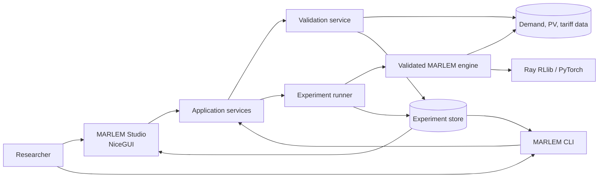
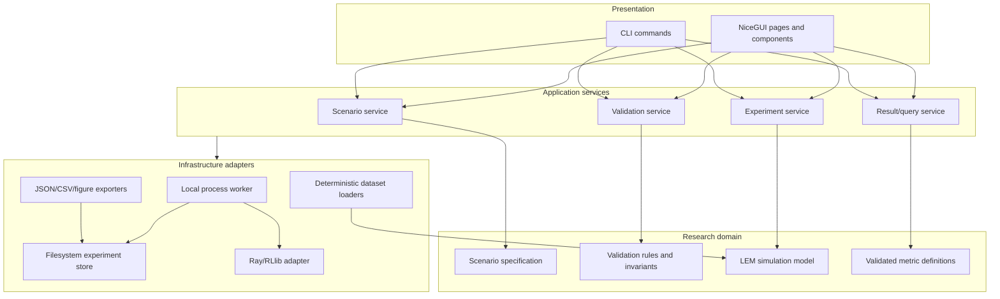
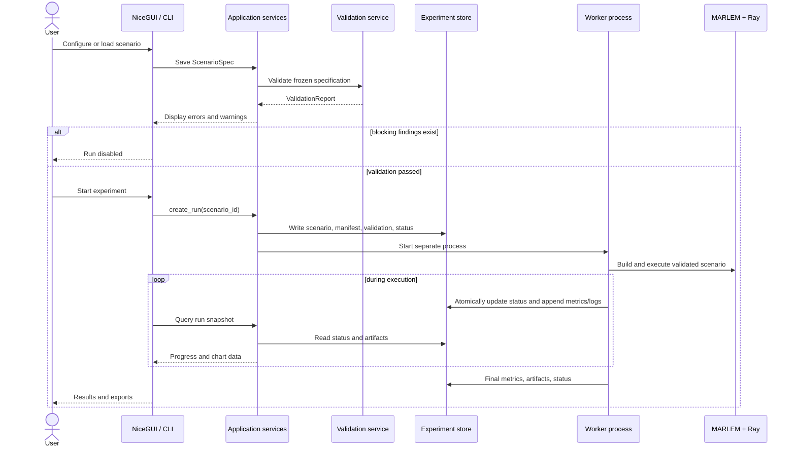

# MARLEM platform architecture

> **Status:** Initial target architecture for discussion  
> **UI decision:** NiceGUI  
> **Last updated:** 2026-08-08

## 1. Purpose

This document describes the proposed architecture and technology stack for transforming MARLEM from a research prototype into a validated, reproducible, and accessible local-energy-market research platform.

The architecture follows the thesis direction:

1. validate and correct the inherited MARLEM simulator;
2. define reproducible experiment specifications;
3. add an experiment-management layer;
4. expose the same workflow through a command line and MARLEM Studio;
5. use **NiceGUI** as the MARLEM Studio UI framework.

This is a target architecture, not a description of functionality that already exists. Confirmed defects and the order in which they must be addressed remain documented in the [validation and fix plan](validation-fix-plan.md).

## 2. Architectural goals

The platform should:

- keep physical, market, reward, and metric logic independent of the UI;
- execute the same scenario from the CLI, UI, tests, or a batch job;
- reject invalid scenarios before expensive simulation or training begins;
- record enough information to reproduce an experiment from a clean checkout;
- keep original input, validation output, raw results, and derived figures traceable;
- isolate long-running Ray/RLlib work from the web UI process;
- remain usable as a local, single-researcher application before considering server deployment;
- prefer simple file-based components until a database or distributed queue is justified.

## 3. Non-goals for the first version

The initial platform will not attempt to provide:

- a distributed cloud training service;
- Redis, Celery, Kubernetes, or a message broker;
- a multi-tenant user and permission system;
- a separate JavaScript/TypeScript frontend;
- a public REST API as a prerequisite for the UI;
- a replacement for Ray's training infrastructure;
- a full AC power-flow implementation;
- a standalone Windows executable;
- a database when an indexed experiment directory is sufficient.

These can be reconsidered only when a demonstrated requirement exceeds the local architecture.

## 4. Core architectural decisions

| Decision | Initial choice | Reason |
|---|---|---|
| Studio UI | NiceGUI | Python-first UI, reactive updates, Plotly integration, and no separate frontend build |
| Application style | Modular monolith | One repository and one domain model are easier to validate and reproduce |
| UI/backend boundary | In-process Python application services | Avoid an unnecessary REST layer while preserving service boundaries |
| Training execution | Separate worker process | Ray and long-running CPU/GPU work must not block or destabilize the UI event loop |
| Scenario format | Versioned JSON first | Standard-library support, deterministic serialization, and direct Pydantic validation |
| Persistence | Experiment directories with JSON/CSV/artifacts | Transparent, portable, version-controllable, and sufficient for the thesis scale |
| Experiment index | Scan/cache filesystem initially | Avoid introducing a database before run volume requires one |
| Validation | Explicit preflight service plus invariant tests | Validation is a first-class thesis contribution, not a UI form check |
| Charts | Plotly for interactive Studio views | Already present in the project and supported by NiceGUI |
| Static publication figures | Matplotlib/Seaborn | Suitable for deterministic thesis figures and existing project code |
| Dependency management | `uv`, `pyproject.toml`, and `uv.lock` | Reproducible Python environment and one canonical dependency workflow |
| Deployment | Local browser application first | Lowest operational complexity and appropriate for a research platform |

NiceGUI currently uses a Python/FastAPI backend with a Vue/Quasar frontend and a persistent browser connection for UI events. Its own architecture documentation describes a single Uvicorn worker, which reinforces the decision to place Ray jobs in separate processes rather than inside UI callbacks. See the [official NiceGUI architecture](https://github.com/zauberzeug/nicegui#architecture) and [NiceGUI documentation](https://nicegui.io/documentation/).

## 5. System context



Both interfaces call the same application services. NiceGUI is not allowed to construct a different environment, calculate alternate metrics, or write ad hoc result formats.

## 6. Layered architecture



### 6.1 Presentation layer

The presentation layer contains:

- NiceGUI pages, layouts, forms, tables, notifications, and charts;
- conversion between form state and `ScenarioSpec` commands;
- presentation-only validation such as required fields and input formatting;
- CLI argument parsing and human-readable output.

It must not contain:

- energy-balance equations;
- market-clearing behavior;
- battery feasibility rules;
- reward or KPI formulas;
- direct Ray configuration assembly;
- experiment-directory conventions duplicated from the application layer.

### 6.2 Application layer

Application services coordinate use cases and define the stable boundary used by both UI and CLI.

Proposed services:

| Service | Responsibility |
|---|---|
| `ScenarioService` | Create, load, normalize, clone, and save versioned scenarios |
| `ValidationService` | Run schema, data, model, split, resource, and invariant preflight checks |
| `ExperimentService` | Create a run, freeze its manifest, start/cancel a worker, and report status |
| `ResultService` | Read raw artifacts and provide consistent tables/chart-ready series |
| `DatasetService` | Inspect datasets, map columns, select intervals, and calculate source hashes |

Services should return typed result objects rather than NiceGUI elements or raw Ray objects.

### 6.3 Domain and simulation layer

This layer contains the scientific behavior being validated:

- agents and batteries in [`src/agent`](../src/agent/);
- the multi-agent environment in [`src/environment`](../src/environment/);
- matching and DSO behavior in [`src/market`](../src/market/);
- grid abstractions in [`src/grid`](../src/grid/);
- profile handling in [`src/profile`](../src/profile/);
- analytics in [`src/analytics`](../src/analytics/);
- coordination metrics in [`src/coordination`](../src/coordination/).

The first implementation should layer new platform modules around this structure instead of immediately moving all existing code into a new package. A packaging migration can be considered later, after the validation fixes have stabilized imports and public interfaces.

The inherited [UML overview](../img/01-uml-diagram.png) and [simulation sequence diagram](../img/02-sequence-diagram.png) remain useful descriptions of the prototype's internal classes. They are historical inputs, not the target platform boundary, and should be regenerated after the P0/P1 corrections stabilize the domain model.

### 6.4 Infrastructure layer

Infrastructure adapters handle replaceable technical details:

- JSON/CSV file access;
- dataset parsing and hashing;
- local process creation and status monitoring;
- Ray configuration, training, checkpointing, and evaluation;
- Plotly/Matplotlib export;
- environment and Git metadata collection.

Domain code should not know whether a run was initiated from NiceGUI or the CLI.

## 7. Proposed MARLEM Studio pages

### 7.1 Dashboard

- recent experiments and status;
- validation state;
- quick links to create, clone, resume, or inspect a run;
- warnings when the repository or environment is not in a validated state.

### 7.2 Data

- register or select a dataset;
- inspect columns, timestamps, resolution, missing values, and coverage;
- map household, demand, PV, and tariff fields;
- choose exact replay or explicitly labelled synthetic/augmentation mode;
- preview profiles with Plotly;
- show the source file hash and selected interval.

### 7.3 Scenario

- timestep and episode horizon;
- agents, capacities, and grid nodes;
- batteries and initial SOC;
- market mechanism and tariffs;
- DSO and abstract grid settings;
- observation and reward configuration;
- scenario import/export.

The form edits a typed `ScenarioSpec`; it does not create live `DERAgent`, `GridNetwork`, or `LocalEnergyMarket` objects.

### 7.4 Learning

- random or rule-based baseline;
- PPO, APPO, or SAC;
- DTDE, CTCE, and eventually validated CTDE;
- training/evaluation seed sets;
- iterations, evaluation frequency, and checkpoint policy;
- CPU/GPU resource limits;
- explicit train/validation/test data split.

Options that are not validated should be disabled or marked experimental rather than silently exposed.

### 7.5 Validation

- schema and type errors;
- missing or overlapping data;
- unit and timestep consistency;
- battery and tariff constraints;
- agent/grid placement;
- seed and holdout checks;
- availability of required validation gates;
- warnings versus blocking errors;
- links to the relevant issue in the validation plan.

### 7.6 Runs

- queued, validating, running, completed, failed, or cancelled state;
- current phase and progress;
- training/evaluation summaries;
- worker logs;
- resource information;
- graceful cancellation request;
- direct access to the frozen scenario and manifest.

### 7.7 Results

- RL reward displayed separately from research outcomes;
- household cost/profit and savings;
- unserved energy and curtailment;
- P2P and DSO volumes;
- imports/exports and transmission losses;
- battery SOC and power/energy flows;
- market prices and settlement records;
- energy and cash conservation residuals;
- comparisons across seeds and scenarios;
- export of tables, raw data, and publication figures.

## 8. Scenario and run contracts

Pydantic models should define the boundary between presentation, validation, runner, and storage. The canonical persisted form should initially be JSON. YAML import can be added later if it materially improves hand editing.

Conceptual model:

```python
class ScenarioSpec:
    schema_version: str
    name: str
    timestep_minutes: int
    horizon_steps: int
    data: DataSpec
    market: MarketSpec
    grid: GridSpec
    agents: list[AgentSpec]
    learning: LearningSpec
    evaluation: EvaluationSpec
```

Required supporting contracts:

| Contract | Purpose |
|---|---|
| `ScenarioSpec` | User-controlled, versioned experiment definition |
| `DatasetRef` | Path/identifier, mapping, interval, resolution, and cryptographic hash |
| `ValidationFinding` | Code, severity, message, affected field, and optional issue link |
| `ValidationReport` | Scenario hash, validation version, findings, and pass/fail state |
| `ExperimentManifest` | Frozen scenario plus code, dependency, data, seed, and platform metadata |
| `RunStatus` | State, timestamps, phase, progress, worker PID, and failure summary |
| `ArtifactIndex` | Typed list of result files, formats, hashes, and producing step |

The environment factory is the only component that converts a validated `ScenarioSpec` into current MARLEM runtime objects.

## 9. Experiment lifecycle



### Run-state model

```text
DRAFT -> VALIDATING -> READY -> RUNNING -> COMPLETED
                    \-> INVALID
                               RUNNING -> FAILED
                               RUNNING -> CANCELLING -> CANCELLED
```

State transitions should be controlled by `ExperimentService`, not assigned directly by UI code.

## 10. Process model

### NiceGUI process

The NiceGUI process should handle:

- page rendering and user events;
- transient form/session state;
- application-service calls;
- lightweight file queries;
- periodic refresh of run snapshots.

NiceGUI storage may hold preferences, selected experiment IDs, or incomplete form state, but it must not be the authoritative experiment database. NiceGUI documents different storage scopes with different lifetimes; persistent research state therefore belongs in the experiment store. See the [official storage documentation](https://nicegui.io/documentation/storage).

### Worker process

One local worker process owns one experiment and handles:

- deterministic scenario construction;
- Ray initialization and shutdown;
- baseline, training, evaluation, or inference execution;
- append-only logs and raw records;
- atomic progress/status updates;
- final artifact indexing.

The first implementation can use `subprocess.Popen` and a status file. It does not need a task queue. A cancellation request should be written to the run directory and handled gracefully at a checkpoint/iteration boundary before forceful termination is considered.

### Why not NiceGUI background tasks for training?

NiceGUI provides helpers for background, I/O-bound, and CPU-bound work. They are appropriate for previews, hashing, and lightweight imports. Ray owns processes, resources, logs, and potentially GPUs; isolating a training run in a dedicated worker gives clearer failure recovery, cancellation, and artifact ownership. NiceGUI's [official documentation](https://nicegui.io/documentation/) describes its background and process helpers, but MARLEM should use the application worker abstraction rather than bind research jobs to a browser session.

## 11. Experiment storage

Proposed directory structure:

```text
experiments/
└── 20260808T153012Z_winter_ppo_a1b2c3d4/
    ├── scenario.json
    ├── manifest.json
    ├── validation.json
    ├── status.json
    ├── artifacts.json
    ├── logs/
    │   ├── worker.log
    │   └── ray/
    ├── metrics/
    │   ├── training.csv
    │   ├── evaluation.json
    │   └── per_episode.csv
    ├── raw/
    │   ├── settlements.csv
    │   ├── agent_steps.csv
    │   └── market_steps.csv
    ├── checkpoints/
    └── figures/
```

Storage rules:

- write the scenario, validation report, and initial manifest before starting work;
- never modify the frozen scenario after a run begins;
- update small state files atomically with write-then-rename;
- append logs and long-running metric streams;
- record hashes for datasets and final artifacts;
- treat figures as derived outputs that can be regenerated from raw results;
- keep RL reward separate from independent evaluation metrics;
- do not store large result arrays in NiceGUI session storage.

SQLite may later provide a faster run index, but experiment directories remain the portable source of truth.

## 12. Proposed source layout

The following layout adds the platform without immediately reorganizing the inherited simulator:

```text
src/
├── agent/                  # Existing domain code
├── analytics/              # Existing analytics; definitions to be validated
├── coordination/           # Existing coordination code
├── environment/            # Existing Gymnasium/RLlib environment
├── grid/                   # Existing abstract grid model
├── market/                 # Existing market and settlement code
├── profile/                # Existing profile handling
├── application/            # Use-case services shared by UI and CLI
│   ├── scenario_service.py
│   ├── validation_service.py
│   ├── experiment_service.py
│   └── result_service.py
├── experiments/            # Specifications, manifests, runner, worker, store
│   ├── models.py
│   ├── factory.py
│   ├── manifest.py
│   ├── store.py
│   ├── runner.py
│   ├── worker.py
│   └── cli.py
├── validation/             # Runtime preflight and scientific invariants
│   ├── findings.py
│   ├── preflight.py
│   └── invariants.py
└── studio/                 # NiceGUI presentation only
    ├── app.py
    ├── layout.py
    ├── state.py
    ├── pages/
    │   ├── dashboard.py
    │   ├── data.py
    │   ├── scenario.py
    │   ├── learning.py
    │   ├── validation.py
    │   ├── runs.py
    │   └── results.py
    └── components/
        ├── findings.py
        ├── experiment_table.py
        └── charts.py
```

Tests should mirror the new modules under `tests/`. Small deterministic fixtures should be shared by CLI, service, and UI integration tests.

## 13. Technology stack

### Core runtime

| Concern | Technology | Notes |
|---|---|---|
| Language | Python 3.12 | Already selected in `pyproject.toml` |
| Environment/dependencies | uv | `pyproject.toml` plus committed `uv.lock` |
| Typed contracts | Pydantic | Scenario, manifest, validation, status, and artifact models |
| Numeric/data processing | NumPy, Pandas, SciPy | Existing scientific stack |
| Simulation API | Gymnasium | Existing environment contract |
| Graph model | NetworkX | Retained as an explicitly abstract network unless scope changes |
| RL training | Ray RLlib | Existing algorithms and distributed training facilities |
| Neural networks | PyTorch | Existing RLlib backend |
| Optimization baseline | Pyomo | Optional small-instance reference baseline |

### Presentation and reporting

| Concern | Technology | Notes |
|---|---|---|
| Web UI | NiceGUI | Server-driven Python UI for MARLEM Studio |
| Interactive plots | Plotly | Live profiles, training, market, battery, and comparison views |
| Publication plots | Matplotlib and Seaborn | Reproducible static thesis figures |
| Tabular export | CSV and JSON | Transparent initial formats; Parquet can be added if scale requires it |
| Training diagnostics | TensorBoard/Ray logs | Keep as supporting diagnostics, not the experiment manifest |

### Quality and delivery

| Concern | Technology | Notes |
|---|---|---|
| Tests | pytest | Assertion-based unit, invariant, integration, and smoke tests |
| Static typing | To decide: Pyright or mypy | Add only after the new public contracts are defined |
| Formatting/linting | To decide: Ruff | Prefer one tool if introduced |
| CI | GitHub Actions | Clean uv sync, tests, and documentation checks |
| Container | Docker, optional | Add after local uv workflow is stable |
| Native window | NiceGUI native mode, optional | Presentation option only; browser mode remains canonical |

NiceGUI should be added and pinned through uv when implementation begins; this document intentionally does not hard-code a version independently of the lockfile.

## 14. NiceGUI implementation rules

1. **Pages call services, not domain constructors.** A button may call `ExperimentService.start`, but must not initialize Ray or instantiate `LocalEnergyMarket` directly.
2. **Keep callbacks short.** Expensive hashing, preview processing, simulation, and training run outside the UI event handler.
3. **Use one page shell.** Navigation, status badges, error handling, and theme are shared through `layout.py`.
4. **Keep transient state typed.** Page state should reference a draft scenario model instead of unrelated widget globals.
5. **Re-read authoritative status.** Timers query immutable snapshots from `ResultService`; they do not assume the browser observed every event.
6. **Make errors traceable.** Display validation codes, worker failure summaries, and links to logs rather than generic notifications alone.
7. **Separate previews from evidence.** Downsampled Plotly previews are presentation artifacts; exported results come from raw run data.
8. **Do not make browser state reproducibility-critical.** Refreshing or closing the page must not alter a running experiment.
9. **Start single-user.** Authentication, per-user storage, and multi-instance synchronization are outside the MVP.
10. **Keep native mode optional.** The application must work in the normal browser mode used by development and automated tests.

## 15. Validation boundaries

Validation occurs at several levels:

| Level | Examples | Owner |
|---|---|---|
| Form | Required name, parseable number | NiceGUI/CLI presentation |
| Schema | Ranges, enums, field relationships | Pydantic scenario models |
| Data | Coverage, resolution, NaNs, hashes, split overlap | `DatasetService` / `ValidationService` |
| Model preflight | Units, SOC, tariffs, node mapping, algorithm compatibility | `ValidationService` |
| Runtime invariants | Energy, cash, battery, settlement, horizon | Validated engine and invariant recorder |
| Experimental protocol | Seed independence, holdouts, baseline availability | Experiment manifest validation |
| Result integrity | Complete artifacts, hashes, conservation residuals | Worker finalization / `ResultService` |

A green form is not equivalent to a validated experiment. The Studio must show the strongest completed validation level.

## 16. Testing architecture

The initial automated test pyramid should contain:

1. **Domain invariant tests:** deterministic battery, energy, cash, pricing, settlement, grid, and horizon cases.
2. **Contract tests:** scenario serialization, schema migration, manifest completeness, and status transitions.
3. **Service tests:** UI-independent scenario, validation, run creation, cancellation, and result-query behavior.
4. **Worker integration tests:** a tiny baseline experiment executed in a temporary experiment store.
5. **UI smoke tests:** page creation, form-to-spec conversion, validation display, and run/result rendering with fake services.
6. **End-to-end test:** one small scenario launched through the same service boundary used by NiceGUI and CLI.

Scientific correctness remains primarily in domain and invariant tests. UI tests verify wiring and presentation, not the energy model.

## 17. Deployment profiles

### Development

Once architecture milestone A has added the Studio entry point and dependency:

```text
uv sync
uv run python -m src.studio.app
```

- browser-based NiceGUI application;
- experiment data stored under a local configurable directory;
- worker subprocesses use the same uv environment;
- hot reload allowed only when no research run depends on the UI process.

### Thesis/research release

- locked dependencies;
- tagged Git commit;
- validation suite passing;
- browser-based local application;
- explicit CPU installation path and optional supported CUDA path;
- sample scenario and deterministic demonstration run.

### Optional Docker deployment

- one image containing the NiceGUI application and worker runtime;
- host-mounted experiment and dataset directories;
- GPU image only if a supported CUDA configuration is documented;
- not required for the core thesis contribution.

### Optional native mode

NiceGUI can display the same server-driven application in a native window. This is a convenience wrapper, not a different architecture or primary release target.

## 18. Incremental implementation plan

### Architecture milestone A — contracts and read-only Studio shell

- define versioned `ScenarioSpec`, `ValidationReport`, `ExperimentManifest`, and `RunStatus`;
- implement filesystem scenario/run loading;
- create NiceGUI application shell, dashboard, and read-only run browser;
- add NiceGUI through uv and commit the updated lockfile;
- no training launched from the UI yet.

### Architecture milestone B — validation and scenario editor

- implement scenario/data services;
- build Data, Scenario, Learning, and Validation pages;
- connect validation findings to the issue tracker;
- export/import canonical JSON scenarios;
- block execution on P0 validation failures.

### Architecture milestone C — local experiment worker

- create immutable run directories and manifests;
- execute a deterministic rule-based baseline in a worker process;
- implement status polling, logs, graceful cancellation, and failure recovery;
- add the CLI on the same application services.

### Architecture milestone D — validated RL integration

- adapt the corrected Ray/RLlib training and evaluation path;
- add checkpoint and evaluation artifacts;
- display live progress without coupling the run to a browser connection;
- expose only validated algorithms/training modes.

### Architecture milestone E — results and thesis workflows

- build comparison views across scenarios and seeds;
- export raw tables and reproducible figures;
- support original-versus-corrected case comparisons;
- document a complete clean-checkout reproduction workflow.

These milestones should follow the acceptance gates in the validation plan. UI breadth must not get ahead of simulation correctness.

## 19. Architecture decision and refinement tracker

| Topic | Current decision | Status | Revisit when |
|---|---|---|---|
| UI framework | NiceGUI | Accepted for initial design | A required workflow cannot be implemented cleanly |
| Application shape | Modular monolith | Proposed | Independent deployment becomes necessary |
| UI/service connection | Direct Python service calls | Proposed | A public/remote client is required |
| Training isolation | Local worker subprocess | Proposed | Jobs must span machines or survive host restarts |
| Scenario format | Versioned JSON | Proposed | Human-authored YAML provides demonstrated value |
| Experiment persistence | Filesystem artifacts | Proposed | Search/concurrency volume justifies SQLite/PostgreSQL |
| Run index | Filesystem scan plus in-memory cache | Proposed | Startup/query time becomes material |
| Multi-user support | Out of scope | Proposed | Deployment moves beyond a local researcher tool |
| Native window | Optional stretch goal | Proposed | Browser delivery proves insufficient for target users |
| Docker | Optional release artifact | Proposed | OS-level reproducibility or deployment requires it |

## 20. Open questions for the next refinement

1. Which fields belong in the first `ScenarioSpec`, and which current MARLEM options should remain hidden until validated?
2. Should the first executable workflow be a deterministic rule-based simulation before any RL training?
3. Which dataset and exact interval will serve as the canonical demonstration fixture?
4. Should experiment IDs include a scenario hash, a human-readable name, or both?
5. Which independent metrics are required for the first thesis case study?
6. Is one worker at a time sufficient for the MVP, or should local concurrency be configurable?
7. Should status refresh use simple polling first or an internal event stream?
8. Which parts of the inherited analytics should be repaired, renamed, or replaced?
9. When should the current `src.*` namespace be converted into an installable `marlem` package?
10. What is the smallest NiceGUI vertical slice that proves the architecture without distracting from validation work?

The recommended next design step is to define the first `ScenarioSpec` and one end-to-end vertical slice:

```text
load deterministic scenario
-> validate
-> run rule-based simulation in worker
-> persist manifest and raw results
-> display validation and results in NiceGUI
```

That slice validates the platform boundaries before Ray training and the full Studio interface are added.
