# Grid-method comparison

> **Status: built on the `marlem-slurm` branch, for review.** The two arms, their
> settings, the experiment and a first comparison without learning are in the code
> there (see [Implementation](#implementation)). The diagram's *to build* tags
> describe the state before that branch.

The thesis compares two ways of letting the grid into the market, on the **same
SimBench network** with the same participants, profiles, days, seeds and learning
setup:

- **Arm A, power flow** (built): the pandapower AC power flow of what the
  participants physically did, as `marlem-v1` runs it now.
- **Arm B, graph model**: Salazar's grid method ([P1] §3.5,
  [methodology §6](../marlem/methodology.md#6-grid-p1-35)) placed on the SimBench
  network: flows of the trades along shortest paths, capacity spread over the lines,
  linear losses and voltage drop.

The question is which grid dynamics each method produces once the agents learn
under it. What is compared is the method, not the published numbers.

## The two arms



[Open the diagram full size](diagrams/grid-methods.svg). Its source is
[`diagrams/grid_methods.drawio`](diagrams/grid_methods.drawio).

Read it from the top. Both arms play the same market step. The grid reaches the
agents through the **DSO fees** in their reward and through one entry of their
observation, the `grid_congestion` KPI: the mean line loading the fees were charged
on, so the power flow's in one arm and the graph model's in the other
([observation](../rl/observation.md#implicit-cooperation-kpis-10-the-same-for-every-agent)).
Most fee inputs are
the same in both arms (middle column). Two come from the arm: the line loading
$C_t$ of the trade's path, which sets the congestion and thermal fees, and the
voltage drop $V_\text{drop}$, which sets the voltage fee.

| Fee input | Arm A: power flow | Arm B: graph model |
|---|---|---|
| Line loading $C_t$ (eq. 8a, 8g) | measured loading of the path's lines | trade flows on the path ÷ edge capacity (eq. 19) |
| Voltage drop $V_\text{drop}$ (eq. 8c) | measured $\lvert V_a - V_b \rvert$ (proposed) | $f_\text{volt}\, d_{ij}$ (eq. 8f) |
| Distance $d_{ij}$, path, zones | shared: SimBench lines | shared |
| Loss $l_{ij} = \kappa\, d_{ij}\, q_{ij}$ (eq. 18) | shared | shared |
| Imbalance (eq. 8b, 8h) | shared: the market's balance | shared |

The difference in incentives: in arm A a trade's fee follows the state of the
network at that time and place, which a trade between peers does not change (only a
battery shifting energy does). In arm B the fee follows the trades themselves: more
and longer trades over a line raise its fee, while everything that is not traded
(the network's own loads, untraded imports) is invisible.

## Implementation

Where each part of the diagram lives in the code:

| Part | Code |
|---|---|
| Settings | `GridSetup.method` (`"powerflow"`, `"graph"`), `graph_capacity` (`"paper"`, `"ratings"`), `graph_total_kw`; `DsoSetup.voltage_drop` (`"distance"`, `"measured"`) in [scenario.py](../../core/config/scenario.py). Old scenario files load with the defaults: the current behaviour |
| Graph model | [`GraphGrid`](../../core/grid/graph.py): capacity per line (`capacities`), and `assess(step, flows)`, which adds each trade's kW to every line of its path and returns the loading in the power flow's own record (`GridAssessment.line_loading_percent`), so the DSO's fee code reads it unchanged |
| Lines and path ends | [`SimBenchGrid.line_table`](../../core/grid/powerflow.py): length and rating of every line. `GridPath.bus_a` and `bus_b` ([contract.py](../../core/grid/contract.py)): the buses at the path's ends, for the measured voltage drop |
| The step | [`LocalEnergyMarket.advance`](../../core/market/lem.py): power flow (always) → `_grid_signal` (the power flow itself, or `GraphGrid.assess` on the step's trades along the paths their fees use) → `_charge_fees`. `StepRecord.grid` is always the power flow; `StepRecord.signal` holds the graph model's loading in arm B |
| Fees | [`Dso.observe(signal, measured=grid)`](../../core/market/dso.py) and `Dso.voltage_drop_of`: the only change to the fees is where $C_t$ and $V_\text{drop}$ come from |
| Environment | [`MarketEnv`](../../core/env/market_env.py) takes `grid` and `dso` in `env_config`, which replace the scenario's fields; the state `fee_max_line_loading_percent` is the loading the fees saw |
| Experiments | A variant may carry `env_config` ([spec.py](../../core/runner/spec.py)), merged into its runs' and their held-out evaluation's environment ([launch.py](../../core/runner/launch.py)). [`config/experiments/grid_methods.json`](../../config/experiments/grid_methods.json): PPO-CTDE, seeds 0-2, arms `ac`, `graph`, `graph_ratings` |
| Checks | [`tests/market/test_grid_methods.py`](../../tests/market/test_grid_methods.py), runner tests in [`tests/runner/test_runner.py`](../../tests/runner/test_runner.py); [`notebooks/market/grid_methods.ipynb`](../../notebooks/market/grid_methods.ipynb): the arms with the net-position baseline (no learning) |

Order of work from here: settle the fee-related market points (M-28, M-31, M-32,
M-33, M-34, M-41), since the fees are the only route the comparison runs through;
then train.

## Open decisions

| Decision | Options | Proposed |
|---|---|---|
| Edge capacity in arm B | [P1]'s split by inverse line length of a total $C_\text{tot}$ (no value given; the release uses 1e6 kW, which never congests); or each line's real rating | both as variants: [P1]'s split with $C_\text{tot}$ = sum of the line ratings, and the real ratings |
| $V_\text{drop}$ in arm A | keep [P1]'s $f_\text{volt}\, d_{ij}$; or measured $\lvert V_a - V_b\rvert$ along the path | measured; "deviation from 1 pu" would mostly measure the transformer's set voltage |
| Loss factor $\kappa$ | release's 0.03 per km; or calibrated from the AC line losses | same in both arms; value with M-41 |
| Losses in settlement | deduct from the delivered energy ([P1] eq. 18); or record only | record only, in both arms |
| Network | `validate_market` (lightly loaded); or a loaded SimBench network | a loaded network as well, or the arms hardly differ |
| RL scope | full 3 × 3 matrix; or one or two combinations that train reliably | one or two, with 3–5 seeds |

## A first check

[`notebooks/market/grid_methods.ipynb`](../../notebooks/market/grid_methods.ipynb)
reproduces these numbers with the implemented arms (the measured voltage drop gives
a voltage fee of 1.3 instead of 24.5). A comparison on `validate_market.json` (`1-LV-rural1`, 5 participants, 13
lines), 14 held-out July days with the net-position baseline (1,467 trades, 944
with the DSO), gives a first idea of the size of the differences. Baseline
behaviour only, one small network: an indication, not a result.

| Quantity | [P1]'s stand-in | Measured (AC) |
|---|---|---|
| Line losses over 14 days | 18.7 kWh ($\kappa d q$) | 7.2 kWh (+ 175 kWh in the transformer, which the stand-in ignores) |
| Voltage drop per trade, median | 2.0 % ($f_\text{volt}\, d_{ij}$) | 0.07 % ($\lvert V_a - V_b \rvert$) |
| Path loading $C_t$, mean / max | 0.27 / 0.75 ([P1]'s capacity split); 0.036 / 0.14 (real ratings) | 0.047 / 0.25 |
| Thermal fee, total | 182.6 ([P1]'s split); 0 (real ratings) | 0.22 |

[P1]'s capacity split gives long lines little capacity, so arm B's thermal fee is
about 800 times arm A's; with real ratings the trade flows come close to the
measured loading. The congestion fee (threshold 0.8) never applies in either arm on
this network.

## Editing the diagram

The `.drawio` file is the source. Edit it with the Draw.io Integration extension in
VS Code (or diagrams.net), then export it to the SVG this page shows:

```
python docs_site/export_drawio.py
```
