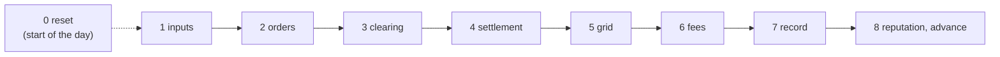

# The full cycle: training, environment step, market step

> **V2 note.** The environment step and the market step are V2's: the mixed
> `Dict` action, the observation of the paper's 42 signals. The training iteration
> still names V1's algorithms (PPO, APPO and SAC); V2 trains PPO only
> ([v2.md](v2.md)).

> Everything that happens from one training iteration down to one fee, on one page,
> in the order the code runs it. Three loops nest inside each other: a **training
> iteration** collects many **environment steps**, and each environment step plays
> one **market step**. The master diagram shows all three; the sections below open
> them one level at a time. Every phase has the same card: what it **reads**,
> **computes** and **writes**, the **code**, the **paper** equations and the
> **decisions** of the [issue register](validation/register.md) behind it.

**How to read it.** Start with [the master diagram](#the-master-diagram). Open a
section only when you need it. To find where one quantity comes from, use
[Where is it calculated](#where-is-it-calculated) at the end. The learning side in
full detail, with every tensor and every paradigm, is
[One training iteration](rl/cycle.md); this page keeps it to the outline and joins
it to the market.

**Keeping it true.** The market sections follow
[`LocalEnergyMarket.start_step`](../core/market/lem.py#L273-L291) and
[`advance`](../core/market/lem.py#L293-L327), the environment section
[`MarketEnv.step`](../core/env/market_env.py#L340-L385), the training section
[`train`](../core/rl/train.py#L378-L509). When one of them changes, its section
changes. Line links point at branch `marlem-v2` (see the V2 note above).

## The master diagram

[Open the diagram full size](diagrams/full-cycle.svg). Purple is learning, blue the
environment step and the grid, grey the market, green the fees. Read it from the
top left: an episode starts (one day), the agents observe and act (A1 to A4), and
the environment step (A5) plays one market step (phases 1 to 8) between decoding
the actions and returning rewards and observations. That repeats for the 24 steps
of a day and over as many days as the batch needs; then the learner computes
targets (B) and updates the networks (C), and the new weights go back (D). Its
source is [`diagrams/full_cycle.drawio`](diagrams/full_cycle.drawio): edit it in
VS Code's Draw.io extension, then run `python docs_site/export_drawio.py`.

### How the loops nest

| Loop | One round is | Repeats | Code | Details |
|---|---|---|---|---|
| Training | one iteration: collect, targets, update | until `budget` environment steps | [`train`](../core/rl/train.py#L450-L452) → RLlib `algo.train()` | [One training iteration](rl/cycle.md) |
| Collect (A) | one environment step for every agent | until the batch is full (`train_batch_size_per_learner`) | RLlib env runners | [A1-A5](rl/cycle.md#a-collect-from-observation-to-environment-step) |
| Episode | one day | 24 steps (96 with quarter hours) | [`MarketEnv.reset`](../core/env/market_env.py#L324-L338) | [0. Before the day](#0-before-the-day-reset) |
| Environment step (A5) | decode, market step, reward, observation | once per collect step | [`MarketEnv.step`](../core/env/market_env.py#L340-L385) | [The environment step](#the-environment-step) |
| Market step | phases 1 to 8 | once per environment step | [`LocalEnergyMarket.step`](../core/market/lem.py#L329-L336) | [The market step](#the-market-step) |

The paradigms (CTCE, CTDE, DTDE) change only A1 to A4 and the update: what each
network receives and who learns from which reward
([Training cycle](rl/training.md)). The environment step and the market step are
the same for all of them.

## The training iteration

In outline; every calculation is in [One training iteration](rl/cycle.md).

| Part | What happens | Code |
|---|---|---|
| A · Collect | the agents observe, act and step the environment with the current policy $\mu$, until the batch holds `train_batch_size_per_learner` steps; nothing is learned | RLlib env runners on [`MarketEnv`](../core/env/market_env.py), wrapped by [`CTCEEnv`](../core/rl/ctce.py#L46-L107) (CTCE) or [`CTDEEnv`](../core/rl/ctde.py#L57-L104) (CTDE) |
| B · Targets | the critic values every step; λ-returns and advantages | RLlib learner |
| C · Update | the losses (PPO clip, value, entropy; or SAC's), gradient steps over epochs and minibatches | RLlib learner, [CTDE module](../core/rl/ctde.py#L140-L145) |
| D · After | new weights to the env runners; every `eval_every` steps an evaluation against the baselines; metrics, NaN check, checkpoint | [`train`](../core/rl/train.py#L378-L509), [`evaluation`](../core/rl/policy.py#L301-L332) |

## The environment step

[`MarketEnv.step`](../core/env/market_env.py#L340-L385): the agents' actions in,
observations and rewards out, one market step in the middle.

**E1. Decode.** [`decode`](../core/env/market_env.py#L388-L414), per agent. The
action's four parts ([P1] eq. 2; [v2.md §2](v2.md#2-the-mixed-action)) become an
intent: `side` picks sell or buy, `partner` one of the agent's candidates (a peer,
the DSO or none), and the continuous `quantity` and `price` $a_q, a_p \in [-1, 1]$
become

$$
q = \frac{s - 0.05}{0.95}\, q_\text{max}, \quad s = \frac{a_q + 1}{2}, \qquad p = p_\text{FiT} + \frac{a_p + 1}{2}\,(p_\text{utility} - p_\text{FiT})
$$

where $q_\text{max}$ is eq. 15a (sell) or 15b (buy), and $s < 0.05$ places no
order.

**Then the market step**, phases 1 to 8 below, with these intents as phase 2a.

**E2. Reward.** Per agent, from its `ParticipantOutcome`:

$$
r_i = \frac{\text{profit}_i - p_\text{utility} \cdot \text{deferred demand}_i}{\text{scale}}, \qquad \text{scale} = p_\text{utility} \cdot E
$$

where profit is eq. 14 net of fees, deferred demand is what its trades and battery
left uncovered (drawn untraded from the upstream grid, charged at the utility
price), and $E$ is the `energy_scale`.

**E3. Observation.** [`_observe`](../core/env/market_env.py#L499-L523), per agent
for the step about to be played: the paper's 16 market signals, the agent's own 16
agent signals and the 10 implicit-cooperation KPIs over the day so far, all from
[`signals.py`](../core/market/signals.py), then the other agents' reputations;
each scaled, a missing value as 0 ([Observation](rl/observation.md)). No other
agent's profile or order; the grid only as the mean line loading the fees used
(`grid_congestion`). `done` when the day is over.

| | |
|---|---|
| **Reads** | the actions; the `StepRecord` of the market step |
| **Computes** | intents; rewards; next observations; the step's metrics (`infos`) |
| **Writes** | `last_record` |
| **Code** | above; metrics: [`_market_infos`](../core/env/market_env.py) |
| **Paper** | [P1] §3.9 phases 5 (reward) and 7 (observation); eq. 2 (the action) |
| **Decisions** | the reward is the net bill, not [P2]'s composite reward (E-13 to E-22); observations normalised (E-06); no forecast error (E-05); *Open: RP-1a to RP-1f* ([plans](plan/index.md)) |

## The market step

| # | Phase | Method | Produces | [P1] §3.9 phase |
|---|---|---|---|---|
| 0 | Before the day | [`reset`](../core/market/lem.py#L256-L271) | participants with their day's profiles, DSO, grid | – |
| 1 | Inputs | [`_inputs`](../core/market/lem.py#L379-L389) | `StepInputs`: $G_t$, $D_t$, $p_\text{FiT}$, $p_\text{utility}$ | – |
| 2 | Orders | [`start_step`](../core/market/lem.py#L273-L291) | `PendingStep.orders` | 1, 2 |
| 3 | Clearing | [`advance`](../core/market/lem.py#L300-L303) × 3 → [`clearing.STAGES`](../core/market/clearing.py#L183) | three `StageResult`s with their trades | 3 |
| 4 | Settlement | [`_settle`](../core/market/lem.py#L534-L541) | `ParticipantOutcome` per participant | 4 |
| 5 | Grid | [`_assess_grid`](../core/market/lem.py#L543-L553), [`_grid_signal`](../core/market/lem.py#L565-L578) | `GridAssessment` (and the fee signal) | 4 |
| 6 | Fees | [`_charge_fees`](../core/market/lem.py#L580-L593), `pay_fees` | each trade's fee parts; profits net of fees | 4 |
| 7 | Record | [`advance`](../core/market/lem.py#L313-L324) | `StepRecord` | 6 |
| 8 | Reputation and advance | [`_update_reputation`](../core/market/lem.py#L596-L606), [`_advance`](../core/market/lem.py#L608-L614) | new reputations, next $p_\text{ref}$, history | 6, 8 |

Phases 5 (reward, KPIs) and 7 (observation) of [P1] §3.9 are the environment
step's E2 and E3. Without the RL agents, the market runs on its own bidding rule
([`step`](../core/market/lem.py#L329-L336) with no intents), and the Studio's Step
page plays it one part at a time: `start_step`, then `advance` five times (three
stages, then the rest).

### 0. Before the day: reset

| | |
|---|---|
| **Reads** | the scenario: network and day (`grid`), participants and what they own, batteries, market and DSO settings |
| **Computes** | each participant's $G_t$ and $D_t$ for every step of the day from the SimBench profiles of the elements it owns; batteries at their initial state of charge; reputation at its start value (0.5); the DSO with nothing seen; the first reference price $p_\text{ref}$ = midpoint of $p_\text{FiT}$ and $p_\text{utility}$; a fresh working copy of the network; the graph model if `grid.method = "graph"` |
| **Writes** | `participants`, `dso`, `clearing_price`, `grid`, `graph`; empty `history` |
| **Code** | [`reset`](../core/market/lem.py#L256-L271) → [`_build_participants`](../core/market/lem.py#L347-L370) ([`profiles_from_elements`](../core/market/agent/der.py#L88-L115)), [`_battery`](../core/market/lem.py#L372-L377), [`Dso.market_price`](../core/market/dso.py#L124-L127), [`SimBenchGrid.reset`](../core/grid/powerflow.py#L67-L89), [`_graph_model`](../core/market/lem.py#L555-L563) |
| **Paper** | §3.4.4 (profiles, replaced by SimBench), eq. 16 (battery) |
| **Decisions** | profiles from SimBench (M-04, M-05); one start value for everyone (M-45); tariffs flat or time-of-use (MP-0b: the reference scenario's utility price by hour, `Dso.set_hour` before each step); *Open: MP-0a, MP-1c, MP-5b* ([plans](plan/index.md)) |

### 1. Inputs

| | |
|---|---|
| **Reads** | the step $t$ = `current_step` (number of steps already recorded) |
| **Computes** | nothing new: picks step $t$ out of each participant's day |
| **Writes** | [`StepInputs`](../core/market/lem.py#L77-L93): `generation_kwh`, `demand_kwh`, `feed_in_tariff`, `utility_price` |
| **Code** | [`_inputs`](../core/market/lem.py#L379-L389) |
| **Paper** | $G_t$, $D_t$, $p_\text{FiT}$, $p_\text{utility}$ (§3.3.1, §3.4) |
| **Decisions** | energies in kWh per step, $\Delta t$ explicit (`step_hours`, M-03); *Open: MP-0a* ([plans](plan/index.md)) |

### 2. Orders

Three sub-steps, all inside [`start_step`](../core/market/lem.py#L273-L291).

**2a. Intents.** What each participant wants: buy or sell, price, quantity, and
optionally a preferred partner $\beta$. They come from outside or from the market's
own rule:

- **from the RL agents**: [`MarketEnv.decode`](../core/env/market_env.py#L388-L414)
  turns each action into an intent (quantity as a share of eq. 15a-b's bound, price
  between $p_\text{FiT}$ and $p_\text{utility}$);
- **from the bidding rule** when none are given:
  [`_rule_intents`](../core/market/lem.py#L391-L415) →
  [`rule_based_bid.net_position`](../core/market/agent/rule_based_bid.py#L64-L102): the net position
  after what the battery can take or give, at $p_\text{FiT} + m \cdot \text{spread}$
  (selling) or $p_\text{utility} - m \cdot \text{spread}$ (buying), with a small
  jitter;
- **partners**, if `partner_preference` is on:
  [`_with_partners`](../core/market/lem.py#L417-L435) →
  [`Participant.choose_partner`](../core/market/agent/der.py#L187-L223): a weighted
  score of reputation and closeness $d_{ij}$ over the candidates on the other side.

**2b. Validate.** [`_validate`](../core/market/lem.py#L465-L490): every intent is
limited, never rejected for being too large.

$$
q \leftarrow \min\bigl(q,\ q_\text{max,phys},\ q_\text{max}\bigr), \qquad p \leftarrow \min\bigl(p_\text{max}, \max(p_\text{min}, p)\bigr)
$$

where $q_\text{max,phys}$ is eq. 15a for a seller,
$\max(0, G_t - D_t) + E_\text{dischargeable}$
([`max_sell_kwh`](../core/market/agent/der.py#L178-L180)), or eq. 15b for a buyer,
$\max(0, D_t - G_t) + E_\text{chargeable}$
([`max_buy_kwh`](../core/market/agent/der.py#L182-L184)), with the battery's
efficiencies and power limit
([`chargeable_kwh`, `dischargeable_kwh`](../core/market/agent/battery.py#L107-L118)).
An intent at or below `min_quantity` is dropped. Every change is written to `notes`.

**2c. Orders.** [`_orders`](../core/market/lem.py#L492-L508): each valid intent
becomes an [`Order`](../core/market/order.py#L9-L23) with an ID, the participant's bus
as location, its partner, and its arrival rank as timestamp (the participants'
order), the double auction's last tie-break.

| | |
|---|---|
| **Reads** | `StepInputs`, battery room, market bounds (`MarketSetup`), reputations and distances (partners) |
| **Computes** | intents; limited quantities and prices; orders |
| **Writes** | [`PendingStep`](../core/market/lem.py#L96-L130): `intents`, `orders`, `notes` |
| **Code** | [`start_step`](../core/market/lem.py#L273-L291), above |
| **Paper** | eq. 2 (the action $\langle p, q, \alpha, \beta \rangle$), eq. 15a-b, §3.2.3, §3.4 |
| **Decisions** | eq. 15 implemented with the battery (M-06, M-19); invalid actions limited, not raised (M-02); "no order" possible (M-08); weighted partner score (M-11); submitted orders never changed later (M-09); *Open: MP-2a, MP-2b, MP-2c, MP-3b* ([plans](plan/index.md)) |

### 3. Clearing

`advance` runs one stage per call, each on the orders the previous one left open
([`clearing.py`](../core/market/clearing.py)). The stages work on copies: the
submitted orders stay as they were. Every trade leaves its stage with its distance
and loss ([`Dso.assess`](../core/market/dso.py#L220-L224)); its fee comes only
in phase 6.

**3a. Stage 1, preferences.**
[`preferences`](../core/market/clearing.py#L110-L134): a buyer and a seller that
named each other as $\beta$ trade if the bid is at least the ask, for
$\min(q_\text{buy}, q_\text{sell})$, at the pricing mechanism's price.

**3b. Stage 2, double auction.**
[`double_auction`](../core/market/clearing.py#L140-L170): bids from the highest
price down, asks from the lowest up, reputation then arrival breaking ties; pairs
trade while bid ≥ ask. Orders that prefer the DSO stay out.

**3c. Stage 3, DSO.** [`dso`](../core/market/clearing.py#L176-L180) →
[`Dso.clear`](../core/market/dso.py#L269-L290): every order still open trades
with the DSO, sells at $p_\text{FiT}$, buys at $p_\text{utility}$, along the path to
the transformer.

The price of a peer trade comes from the mechanism of `market.mechanism`
([`clearing_price.py`](../core/market/clearing_price.py)): average (eq. 9), buyer,
seller, bid-ask spread, Nash bargaining (eq. 10) or proportional surplus around
$p_\text{ref}$ (eq. 11). Each trade's distance and loss:

$$
d_{ij} = \text{line length of the shortest path (km)}, \qquad l_{ij} = \kappa\, d_{ij}\, q_{ij} \quad \text{(eq. 18)}
$$

| | |
|---|---|
| **Reads** | the open orders; [`ClearingRules`](../core/market/clearing.py#L56-L79) from [`_rules`](../core/market/lem.py#L511-L522): mechanism, $p_\text{ref}$, reputations, paths, the DSO |
| **Computes** | the trades of each stage: buyer, seller, $q_{ij}$, $p_{ij}$, stage, $d_{ij}$, $l_{ij}$ |
| **Writes** | `PendingStep.stages`: three [`StageResult`](../core/market/clearing.py#L34-L53)s, each with its trades and the orders left |
| **Code** | above; paths: [`_path`](../core/market/lem.py#L446-L454), [`_upstream`](../core/market/lem.py#L456-L462) → [`SimBenchGrid.path`, `path_upstream`](../core/grid/powerflow.py#L159-L181) |
| **Paper** | §3.3.2 (three stages, Algorithm 1), §3.3.3 and eq. 9-11 (prices), eq. 18 (loss), §3.5.1 (distance) |
| **Decisions** | DSO-preferring orders wait for stage 3 (M-10); no trade blocked for grid reasons (M-12); pricing fixed (M-13, M-14); DSO trades get a path (M-31); loss recorded, not taken off the energy (M-40, M-41); *Open: MP-3a, MP-5d* ([plans](plan/index.md)) |

### 4. Settlement

[`_settle`](../core/market/lem.py#L534-L541) → for every participant
[`Participant.settle`](../core/market/agent/der.py#L226-L260):

$$
\begin{aligned}
B_i &= (G_t - D_t) + (E_\text{bought} - E_\text{sold}) && \text{(eq. 13)} \\
\text{charge} &= \text{battery takes } B_i \text{ if } B_i > 0, \quad \text{discharge} = \text{battery gives } {-B_i} \text{ if } B_i < 0 && \text{(eq. 16)} \\
\text{external} &= B_i - \text{charge} + \text{discharge} && \text{(untraded, with the upstream grid)} \\
\text{profit}_i &= \textstyle\sum p\, q_\text{sold} - \sum p\, q_\text{bought} && \text{(eq. 14, before fees)}
\end{aligned}
$$

| | |
|---|---|
| **Reads** | the step's trades, $G_t$, $D_t$, the battery |
| **Computes** | bought, sold, balance $B_i$, charge, discharge, external exchange, state of charge, trading profit; deferred and satisfied demand and supply (properties of the outcome) |
| **Writes** | [`ParticipantOutcome`](../core/market/agent/der.py#L31-L82) per participant (fees still 0); the battery's energy; `Participant.profit` |
| **Code** | above; battery: [`charge`, `discharge`](../core/market/agent/battery.py#L121-L137) |
| **Paper** | eq. 13, 14, 16; §3.4.1 (demand satisfied) |
| **Decisions** | battery sign and efficiencies fixed (M-16, M-17, M-18); balance as eq. 13 (M-20, M-21); profit updated (M-22); discharge counts towards demand (M-23); *Open: MP-1a, MP-1b* ([plans](plan/index.md)) |

### 5. Grid

**5a. Power flow, always.** [`_assess_grid`](../core/market/lem.py#L543-L553):
each participant's net power at its bus from what it physically did,
[`injection`](../core/market/agent/der.py#L274-L284)
$= (G + \text{discharge} - D - \text{charge}) / \Delta t$, never from its trades.
[`SimBenchGrid.assess`](../core/grid/powerflow.py#L118-L151) sets the network's own
loads and generators to their profiles for step $t$
([`_apply_background`](../core/grid/powerflow.py#L91-L115)), adds the injections
and runs one AC power flow (pandapower).

**5b. The fee signal.** [`_grid_signal`](../core/market/lem.py#L565-L578): the line
loading the fees will use. With `grid.method = "powerflow"` it is 5a's result;
with `"graph"` it is [`GraphGrid.assess`](../core/grid/graph.py#L52-L79): every
trade's $q/\Delta t$ added to each line of its path, divided by the line's capacity
([P1] §3.5.3, eq. 19). See [Grid-method comparison](experiments/grid-methods.md).

| | |
|---|---|
| **Reads** | the outcomes (5a); the trades and their paths (5b, graph only) |
| **Computes** | bus voltages, line and transformer loading, losses, exchange with the upstream grid, limit violations; the graph loading |
| **Writes** | [`GridAssessment`](../core/grid/contract.py) (`grid`), and in graph mode a second one (`signal`) |
| **Code** | above |
| **Paper** | §3.5.3 (replaced by the power flow; kept as the graph method) |
| **Decisions** | AC power flow instead of the trade-flow graph (M-35, M-36, M-38); *Open: MP-4e* ([plans](plan/index.md)) |

### 6. Fees

**6a. The DSO looks at the grid.**
[`Dso.observe(signal, measured=grid)`](../core/market/dso.py#L130-L138): it
keeps the signal's line loading and the power flow's bus voltages.

**6b. A fee for every trade.** [`Dso.charge`](../core/market/dso.py#L238-L266),
for a peer trade along $\text{path}(i, j)$, for a DSO trade along the path to the
transformer (no zone bonus, plus the imbalance fee):

$$
\begin{aligned}
C_t &= \min\bigl(1, \max_{e \in \text{path}} \text{loading}_e / 100\bigr) && \text{(eq. 8a's congestion)} \\
F_\text{cong} &= f_\text{cong}\,(C_t - C_\text{th})\, q\, p \ \text{ if } C_t > C_\text{th} && \text{(8a)} \\
F_\text{thermal} &= \min\Bigl(\tfrac{C_t - T_\text{th}}{1 - T_\text{th}},\ f_\text{threshold}\Bigr)\, q\, p \ \text{ if } C_t > T_\text{th} && \text{(8d, 8g)} \\
F_\text{volt} &= \min(V_\text{drop}, V_\text{th})\, q\, p, \quad V_\text{drop} = f_\text{volt}\, d_{ij} \text{ or measured} && \text{(8c, 8f)} \\
F_\text{trans} &= l_{ij}\, p && \text{(8, no formula in [P1])} \\
F_\text{zone} &= -f_\text{zone}\, q\, p \ \text{ if both ends on one feeder} && \text{(8e)} \\
F_\text{imb} &= f_\text{imb}\, \min\bigl(q / |B_\text{grid}|, 1\bigr)\, q\, p \ \text{ for a DSO trade that worsens } B_\text{grid} && \text{(8b, 8h)}
\end{aligned}
$$

([`congestion`](../core/market/dso.py#L149-L154),
[`voltage_drop_of`](../core/market/dso.py#L140-L147),
[`fees_of`](../core/market/dso.py#L161-L185),
[`imbalance_fee`](../core/market/dso.py#L187-L200)). $B_\text{grid}$ is the
market's balance before stage 3, offered minus asked
([`PendingStep.grid_balance_kwh`](../core/market/lem.py#L127-L130)).
[`_charged`](../core/market/dso.py#L202-L218) splits the total: a peer trade's
fee 50/50 (`fee_buyer_share`), a DSO trade's fee all to the participant; nothing
is paid when `fees_charged` is off.

**6c. Participants pay.**
[`Participant.pay_fees`](../core/market/agent/der.py#L262-L271): its share of every
trade's fee comes off the step's profit and the running profit.

| | |
|---|---|
| **Reads** | the trades, the signal's loading, the measured voltages, paths and zones, $B_\text{grid}$ |
| **Computes** | $C_t$, $V_\text{drop}$, the six fee parts per trade, the split, each participant's fees |
| **Writes** | `Trade.fees`, `fee_parts`, `buyer_fee`, `seller_fee`; `ParticipantOutcome.fees` and `profit` |
| **Code** | [`_charge_fees`](../core/market/lem.py#L580-L593), above |
| **Paper** | eq. 8, 8a-8h |
| **Decisions** | fees charged at all (M-27); after the same step's power flow; $F_\text{trans}$ as the loss at the trade price (M-28); caps (M-29); imbalance on DSO trades (M-30); DSO trades pay their path (M-31); thermal threshold (M-32); zones = feeders and the bonus size (M-33, M-34); *Open: MP-4a, MP-4b, MP-4c, MP-4d, MP-4f* ([plans](plan/index.md)) |

### 7. Record

In [`advance`](../core/market/lem.py#L308-L324), once the fees are known (the record itself at [L332-L343](../core/market/lem.py#L313-L324)):

- the step's clearing price,
  [`_clearing_price`](../core/market/lem.py#L524-L531): volume-weighted price of the
  peer trades, or the previous one when there were none;
- the DSO's step, [`Dso.settle`](../core/market/dso.py#L293-L311):
  $B_\text{DSO} = \sum (E_\text{sold} - E_\text{bought})$ (eq. 7), energy revenue,
  fees collected;
- everything into one [`StepRecord`](../core/market/lem.py#L133-L197): inputs,
  orders, stages with their charged trades, outcomes, clearing price, `grid`, `dso`,
  notes, `signal`.

| | |
|---|---|
| **Reads** | the charged trades, the outcomes, the grid results |
| **Computes** | the clearing price; the DSO's balance, revenue and fees |
| **Writes** | `StepRecord`; the DSO's running balance and profit |
| **Code** | above |
| **Paper** | eq. 7; UpdateMarketState of Algorithm 1 |
| **Decisions** | clearing price from peer trades only (M-15); the DSO's balance kept per step and over the day (M-24, M-25); *Open: MP-6a* ([plans](plan/index.md)) |

### 8. Reputation and advance

**8a. Reputation.** [`_update_reputation`](../core/market/lem.py#L596-L606) →
[`ReputationHandler.update_reputation`](../core/market/reputation.py#L119-L142),
for every participant, from the record
([`_calculate_reputation`](../core/market/reputation.py#L156-L242)):

$$
\begin{aligned}
\delta_\text{rel} &= \min\bigl(1, \text{volume matched by peers} / \text{volume ordered}\bigr) \\
\delta_\text{fair} &= 1 - \min\bigl(1, \text{mean } |p - p_\text{clear}| / p_\text{clear}\bigr) \quad \text{(its peer trades)} \\
\delta_\text{grid} &= \bigl(\text{mean impact of its trades on } B_\text{grid} + 1\bigr) / 2 \quad \text{(DSO trades neutral)} \\
s &= 0.3\, \delta_\text{rel} + 0.2\, \delta_\text{fair} + 0.5\, \delta_\text{grid} \quad \text{(eq. 12)} \\
r &\leftarrow \delta\, r + (1 - \delta)\, s, \qquad \delta = 0.8^{\Delta t}
\end{aligned}
$$

When the step has no trades at all, every reputation stays as it was. Otherwise a
component with nothing to measure counts as neutral (0.5), e.g. fairness for a
participant without peer trades. The weights and the decay are scenario settings
(`MarketSetup`); 0.3, 0.2, 0.5 and 0.8 are the defaults. The impact of one
trade is $\pm\min(q / |B_\text{grid}|, 1)$: positive when it buys during excess
supply or sells during a shortage
([`_calculate_grid_impact`](../core/market/reputation.py#L244-L293)).

**8b. Advance.** [`_advance`](../core/market/lem.py#L608-L614): the clearing price
becomes next step's $p_\text{ref}$; the record joins `history`, so `current_step`
moves on.

| | |
|---|---|
| **Reads** | `StepRecord`, each participant's reputation |
| **Computes** | the three components, the score, the new reputation |
| **Writes** | `Participant.reputation`; `StepRecord.reputation`; `clearing_price`; `history` |
| **Code** | above |
| **Paper** | eq. 12 and §3.3.4 (reputation, decay); §3.9 phases 6 and 8 |
| **Decisions** | reliability measured on peer matches (M-42); decay per hour (M-43); grid part and fairness on peers (M-44); start value (M-45); *Open: MP-5a, MP-5b, MP-5c, MP-5d* ([plans](plan/index.md)) |

## Where is it calculated

Every quantity of the environment step and the market step, with the phase that makes it and where it ends up.

| Quantity | Symbol | Phase | Code | Kept in |
|---|---|---|---|---|
| Action → intent | $a_t$ | E1 | [`MarketEnv.decode`](../core/env/market_env.py#L388-L414) | `PendingStep.intents` |
| Reward | $r_t$ | E2 | [`MarketEnv.step`](../core/env/market_env.py#L340-L385) | `rewards`, `infos` |
| Observation | $o_{t+1}$ | E3 | [`MarketEnv._observe`](../core/env/market_env.py#L499-L523) | – |
| Market and agent signals, KPIs | [P1] Table 2, eq. 19-27 | E3 | [`signals.py`](../core/market/signals.py) | – |
| Generation, demand of a step | $G_t$, $D_t$ | 0, 1 | [`profiles_from_elements`](../core/market/agent/der.py#L88-L115), [`_inputs`](../core/market/lem.py#L379-L389) | `StepInputs`, `ParticipantOutcome` |
| Tariffs | $p_\text{FiT}$, $p_\text{utility}$ | 1 | `DsoSetup` | `StepInputs` |
| Chargeable, dischargeable energy | $E_\text{ch}$, $E_\text{dis}$ | 2 | [`Battery`](../core/market/agent/battery.py#L107-L118) | – |
| Order bounds | $q_\text{sell,max}$, $q_\text{buy,max}$ | 2 | [`max_sell_kwh`, `max_buy_kwh`](../core/market/agent/der.py#L178-L184) | – |
| Intent from an action | | 2 | [`MarketEnv.decode`](../core/env/market_env.py#L388-L414) | `PendingStep.intents` |
| Intent from the bidding rule | | 2 | [`rule_based_bid.net_position`](../core/market/agent/rule_based_bid.py#L64-L102) | `PendingStep.intents` |
| Preferred partner | $\beta$ | 2 | [`choose_partner`](../core/market/agent/der.py#L187-L223) | `Order.partner_id` |
| Validated order | $p$, $q$ | 2 | [`_validate`](../core/market/lem.py#L465-L490), [`_orders`](../core/market/lem.py#L492-L508) | `StepRecord.orders`, `notes` |
| Market balance | $B_\text{grid}$ | 3 (before stage 3) | [`grid_balance_kwh`](../core/market/lem.py#L127-L130) | `StepRecord.grid_balance_kwh` |
| Trade price | $p_{ij}$ | 3 | [`clearing_price.py`](../core/market/clearing_price.py) | `Trade.price` |
| Trade quantity | $q_{ij}$ | 3 | [`clearing.py`](../core/market/clearing.py) | `Trade.quantity` |
| Distance, path, zones | $d_{ij}$ | 3 | [`SimBenchGrid.path`](../core/grid/powerflow.py#L159-L168) | `Trade.distance` |
| Loss of a trade | $l_{ij}$ | 3 | [`Dso.transmission_loss`](../core/market/dso.py#L156-L158) | `Trade.transmission_loss` |
| Participant balance | $B_i$ | 4 | [`settle`](../core/market/agent/der.py#L226-L260) | `ParticipantOutcome.balance_kwh` |
| Battery charge, discharge, energy | | 4 | [`Battery.charge`, `discharge`](../core/market/agent/battery.py#L121-L137) | `ParticipantOutcome` |
| Untraded exchange, deferred demand | | 4 | [`settle`](../core/market/agent/der.py#L226-L260), [properties](../core/market/agent/der.py#L65-L82) | `ParticipantOutcome` |
| Trading profit | eq. 14 | 4, 6 | [`settle`](../core/market/agent/der.py#L226-L260), [`pay_fees`](../core/market/agent/der.py#L262-L271) | `ParticipantOutcome.profit`, `Participant.profit` |
| Injection at the bus | | 5 | [`injection`](../core/market/agent/der.py#L274-L284) | – |
| Bus voltages, line loading, network losses | | 5 | [`SimBenchGrid.assess`](../core/grid/powerflow.py#L118-L151) | `StepRecord.grid` |
| Graph line loading | $\zeta_e$ | 5 (graph) | [`GraphGrid.assess`](../core/grid/graph.py#L52-L79) | `StepRecord.signal` |
| Congestion of a trade | $C_t$ | 6 | [`Dso.congestion`](../core/market/dso.py#L149-L154) | – |
| Voltage drop | $V_\text{drop}$ | 6 | [`Dso.voltage_drop_of`](../core/market/dso.py#L140-L147) | – |
| Fee parts, total, split | eq. 8 | 6 | [`fees_of`](../core/market/dso.py#L161-L185), [`imbalance_fee`](../core/market/dso.py#L187-L200), [`_charged`](../core/market/dso.py#L202-L218) | `Trade.fee_parts`, `fees`, `buyer_fee`, `seller_fee` |
| Clearing price (next $p_\text{ref}$) | $p_\text{clear}$ | 7 | [`_clearing_price`](../core/market/lem.py#L524-L531) | `StepRecord.clearing_price` |
| DSO balance, revenue, fees | $B_\text{DSO}$ | 7 | [`Dso.settle`](../core/market/dso.py#L293-L311) | `StepRecord.dso` |
| Reputation components, score, reputation | $\delta$, $s$, $r$ | 8 | [`ReputationHandler`](../core/market/reputation.py#L119-L293) | `StepRecord.reputation`, `Participant.reputation` |
