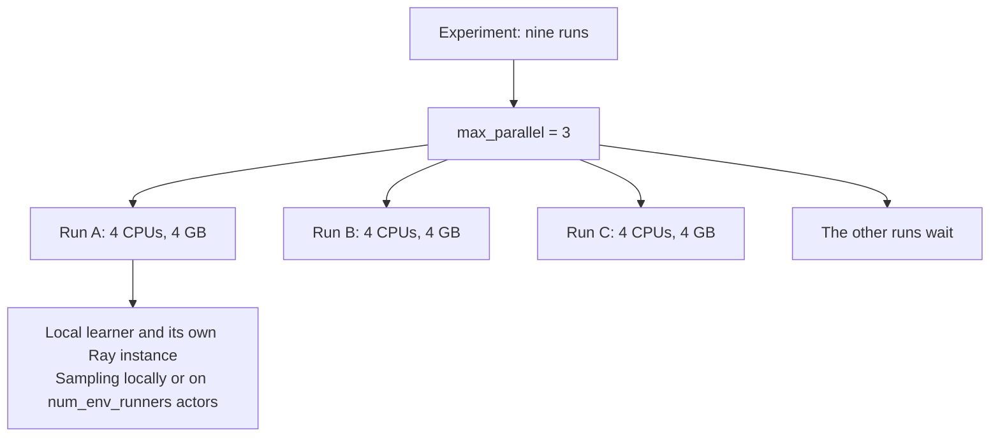

# Resources and parallelism

There are two levels: **independent runs** side by side, and the **work inside one
run**. The experiment spec controls both: `max_parallel` limits independent runs,
and `num_env_runners` sets remote sampling processes inside each run. SLURM
resources are requested separately.

## Runs side by side

An experiment expands to algorithms × paradigms × seeds × variants, each one an
independent run with its own model, seed, replay buffer, metrics and checkpoint.
[market_3x3.json](../../experiments/market_3x3.json) is 3 × 3 × 1 = 9 runs;
[sac_alpha.json](../../experiments/sac_alpha.json) 1 × 1 × 1 × 3 variants = 3.
Five seeds would make `market_3x3` 45 runs.



| Target | Who schedules | One run is |
|---|---|---|
| `local` | The worker (`launch.work`): at most `max_parallel` runs, started 10 s apart | A job process on this PC |
| `taltech` | SLURM: one array, at most `max_parallel` tasks at once | One array task, on a node SLURM picks |

Both call the same [`launch.job`](../../core/runner/launch.py). A slot refills as
soon as its run ends. `max_parallel` is per experiment, not across experiments.

## How many runs fit at once

On TalTech the limit on runs at once is **threads per node**, not CPUs, memory or
an account quota. Checked on 19 October 2026 (`sinfo`, `sacctmgr`, `ulimit`):

| Limit | Value | Limits the runner? |
|---|---|---|
| Jobs, CPUs or submits per user | None: the `normal` QOS sets no per-user cap | No |
| CPUs per green node | 78 (hyper-threads) | Rarely: 13 runs at 6 CPUs |
| Memory per green node | 95 GB | Rarely: 15 runs at 6 GB |
| Wall time | `short` 4 h, `common` 8 days, per run | Per run, not per experiment |
| **Threads and processes per user per node** | **4096** (`ulimit -u`) | **Yes** |

### Threads per run

Each run starts its own Ray instance, and Ray sizes its gRPC and worker thread
pools by the node's 80 hardware threads, not by the CPUs SLURM gave the run.
Measured on green31 (SLURM job 1043952, test profile of
[market_3x3.json](../../experiments/market_3x3.json), DTDE, 6 CPUs), the most
threads one run held at any moment:

| `num_env_runners` | One run alone | One run in a runner job | Runs per green node |
|---:|---:|---:|---:|
| 0 | 485 | about 550 | **7** |
| 1 | 560 | about 625 | **6** |
| 3 | 705 | about 760 | **5** |

- About **550 + 75 × `num_env_runners`** per run; PPO, APPO and SAC differ by
  fewer than 5 threads.
- "In a runner job" comes from the five runs of `market_3x3_3envRuns` that kept
  going on 19 October: 3815 threads together, 763 each. The extra (about 60 per
  run) was not broken down; the other rows add it as an estimate.
- Runs per node is 4096 divided by the per-run count, rounded down, with a little
  room left. Your own other jobs on the node (a Jupyter session, a second
  experiment) count against the same 4096.

### Where SLURM puts the runs

`max_parallel` limits runs at once over the whole cluster; **SLURM chooses the
nodes, and it packs tasks onto as few as fit by CPU and memory**. SLURM does not
know the thread limit: tasks over it are not held in the queue, they start and
crash in `ray.init` with `pthread_create failed: Resource temporarily unavailable`
and `Failed to register worker to Raylet`, and the Studio shows them as `lost`.

That happened on 19 October: `market_3x3_3envRuns` with `max_parallel: 9`,
`num_env_runners: 3` and 6 CPUs per run put all nine tasks on green31 (54 of 78
CPUs). Four failed in their first minute; five ran.

On `short`, a task can also land on blackwell1, amp or ada (128–512 hardware
threads). More tasks fit there by CPU, and Ray starts more threads per run (about
1000 at zero samplers on blackwell1, [measurements](performance.md#parallel-training)),
so the table above does not hold there. `common` is green nodes only.

### Sizing an experiment

Pick one of two settings, with $k$ = `num_env_runners` and $n$ = the runs per
green node from the table:

1. **Everything on one node:** `max_parallel` ≤ $n$. Always safe, whatever the
   CPUs per run. More runs than $n$ wait for a free slot.
2. **More at once, spread over nodes:** ask for so many CPUs per run that at most
   $n$ fit on a green node by CPU, and keep the runs on green nodes:
   `resources.cpus` more than 78 / ($n$ + 1), and `resources.minutes` above
   240, which selects `common`. Then `max_parallel` has no thread limit.

| `num_env_runners` | 1. `max_parallel` at most | 2. `resources.cpus` at least |
|---:|---:|---:|
| 0 | 7 | 10 |
| 1 | 6 | 12 |
| 3 | 5 | 14 |

Setting 2 reserves CPUs a run does not use: they count towards billing, and a
large request can wait longer in the queue. At the prices in
[measurements](performance.md#the-cluster), nine runs × 14 CPUs × 4 h is about
4 EUR. Memory still has to fit: $n$ × `mem_gb` ≤ 95.

For `market_3x3_3envRuns` (nine runs, $k = 3$):

```json
"max_parallel": 5,
"resources": {"cpus": 6, "mem_gb": 6, "minutes": 240}
```

runs five, then four, in about twice the time of the longest run;

```json
"max_parallel": 9,
"resources": {"cpus": 14, "mem_gb": 6, "minutes": 300}
```

runs all nine at once on at least two green nodes in `common`.

Not done yet: limiting Ray's thread pools to the run's CPUs, or sharing one Ray
instance between runs as the probe notebook does
([measurements](performance.md#parallel-training)). Either would fit more runs on
a node; until then, size with the table.

## What a run gets

Defaults in [spec.py](../../core/runner/spec.py), the same for every run of an
experiment:

| Field | Default | Effect |
|---|---|---|
| `max_parallel` | 3 | Runs at once |
| `resources.cpus` | 4 | SLURM CPUs per run; creates no extra samplers |
| `resources.mem_gb` | 4 | Memory per run (not per CPU) |
| `resources.minutes` | 120 | Wall time per run, evaluation and saving included |
| `torch_threads` | 1 | `torch.set_num_threads` in each run |
| `num_env_runners` | 0 | Remote sampling processes per run; zero samples locally |

At the defaults three runs take 12 CPUs and 12 GB. On this PC `resources` is
ignored (no reservation, no time limit); `max_parallel`, `torch_threads` and
`num_env_runners` apply.
On the cluster the runner takes the first partition in `targets.toml` whose limit
allows `minutes`: `short` up to 240, then `common` up to 11,520; longer is refused.

## Inside one run

The runner passes `num_env_runners` to [`Run`](../../core/rl/train.py).
The default remains zero; GPU training is not exposed in the spec.
With [`build_config`](../../core/rl/config.py):

| Setting | Value | Meaning |
|---|---|---|
| `num_env_runners` | Spec value (default 0) | Zero: local sampling; positive: that many remote sampler actors |
| `num_envs_per_env_runner` | 1 | One market environment per sampler |
| `num_learners` | 0 | One learner, in the same process |
| `num_gpus` | 0 | CPU only |
| Ray `num_cpus` | `num_env_runners + 1` | Samplers plus the driver/learner; Ray bookkeeping, not a CPU pin |

At zero runners, one run is essentially one busy core (APPO adds learner threads). Raising
`resources.cpus` alone does not make it faster; 4 is an allowance for Ray's own
threads and processes. A larger request does spread runs over more nodes
([how many runs fit](#how-many-runs-fit-at-once)). The five market participants are agents inside the one
environment, not processes; training days are what an episode draws from, not
parallel environments. `budget` counts environment steps (one market step for all
agents) and is checked after each training iteration, so a run can overshoot it
(APPO: 480 asked, 500 done). Evaluation stays in the job's driver process.

For example, these top-level experiment fields request three remote samplers per
run and four SLURM CPUs for the samplers and driver/learner:

```json
{
  "num_env_runners": 3,
  "max_parallel": 3,
  "resources": {"cpus": 4, "mem_gb": 4, "minutes": 120}
}
```

With three runs active, this gives nine training samplers and reserves twelve
SLURM CPUs. Each sampler has its own environment and inference model; allow for
their additional memory. Size `resources.cpus` for at least `num_env_runners + 1`
as a starting point; the runner does not automatically change the allocation.
`torch_threads` is set in the driver, not explicitly in remote sampler actors.
More samplers can improve sampling throughput but do not guarantee higher CPU
utilization or faster learning. The training-step budget is aggregated across
samplers, not repeated for each sampler. Use a new experiment name when changing
this setting for an existing experiment.

## Full and test profiles

For `market_3x3`:

| | Full | Test |
|---|---:|---:|
| Runs, at once | 9, 3 | 9, 3 |
| CPUs / memory per run | 4 / 4 GB | 4 / 4 GB |
| Minutes per run | 120 | 15 |
| Train / test days | 30 / 14 | 1 / 1 |
| Budget SAC / PPO / APPO | 24,000 / 240,000 / 240,000 | 1,100 / 2,400 / 480 |

The test profile keeps algorithms, paradigms, variants and settings (including
`num_env_runners`), and takes the
first seed, one evaluation episode and one test day (played once, as every test
day is). Its budget per algorithm
is one training batch (`train_batch_size_per_learner`, else 100), or the warm-up
plus 100 steps where learning starts after a warm-up (SAC: the spec's 1,000, else
RLlib's 1,500), the largest over the variants, so every test run really updates
its networks. A `test` block in the spec overrides seeds, days, budget, evaluation
and resources.

## What the spec can set

| Choice | In the spec | Otherwise |
|---|---|---|
| Runs and how many at once | grid fields, `max_parallel` | |
| Cluster allocation per run | `resources` | |
| PyTorch threads | `torch_threads` | |
| Training and network settings | `training`, `model`, `variants` | |
| Sampler processes | `num_env_runners` | Also `Run(num_env_runners=...)` in Python |
| GPU | no | `Run(num_gpus=...)` in Python, on a GPU node |

Unknown fields are refused. `num_env_runners` inside `training` does not work: that
block goes to RLlib's training settings.

## Shared Ray

[train.py](../../core/rl/train.py) joins an existing Ray instance when
`RAY_ADDRESS` is set, instead of starting its own. The probe notebook uses this to
run 38 runs in one Jupyter job; the runner does not, so its sizing is not the
notebook's ([sizing](performance.md#sizing)).

Before longer runs, measure a short one with `seff <jobid>` (CPU efficiency, peak
memory) and size from that: five agents say little about fifty.

## Comparing sampling and learning time

`metrics.csv` records reports that advance sampled environment steps or lifetime
learner environment steps. Idle APPO polls are omitted; non-finite learner metrics
still stop the run and are recorded. `iteration` remains the number of calls to
`algo.train()`, so gaps in that column are expected and are not missing updates.

| Column | Meaning |
|---|---|
| `sampler_sample_s_mean` | RLlib's mean sample-call duration on the environment runners, aggregated across runners |
| `sampling_s_mean` | RLlib's driver sampling timer (PPO/SAC), including waiting for samples |
| `learner_call_s_mean` | RLlib's driver learner-call timer; for APPO this queues work, not the background update duration |
| `async_learner_update_s_mean` | APPO's background learner update timer |
| `learner_env_steps` | Lifetime environment steps processed by the learner; replay and reuse can count data repeatedly |
| `train_call_s` | Wall time of the reported `algo.train()` call |
| `train_calls_s_total` | Cumulative wall time of all training calls, including omitted idle polls |
| `sampled_steps_per_train_s` | Collected environment steps divided by cumulative training-call time; includes learning/communication, so this is not pure rollout throughput |
| `elapsed_s` | Wall time since the training loop began, including intermediate evaluation and reporting |

RLlib timers are smoothed means in seconds, not cumulative times. Missing timers
are blank in the CSV. Do not sum these columns to derive total runtime, or divide
the whole run's step count by a mean sample-call duration. Asynchronous sampling
and learning can overlap, and timer values may reflect earlier completed work.

`run.json` also records `timings`: `ray_init_s`, `build_s`, `train_calls_s`,
`evaluation_s` (including evaluation CSV writes) and `checkpoint_s`. These help
separate initialization from sustained training. They exclude the runner's later
held-out evaluation and do not constitute a complete breakdown of job wall time.
Compare longer runs on the same code and settings; a one-iteration test is mainly
a startup and pipeline check.
