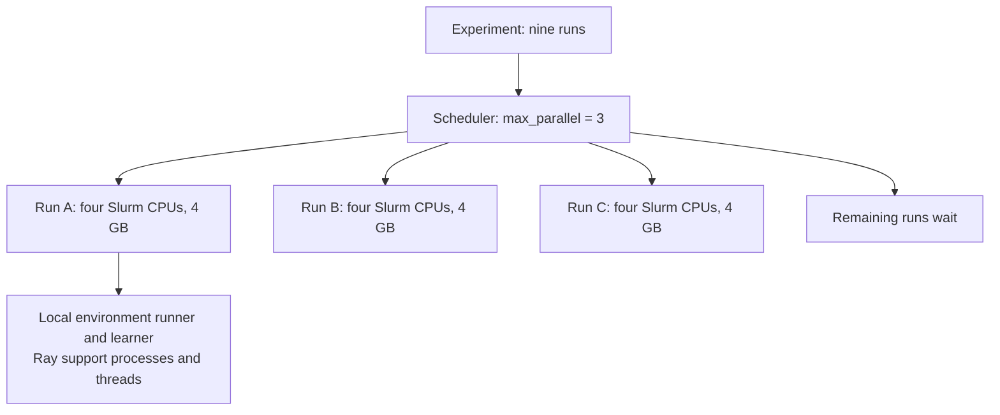

# Resources and parallelism

[HPC overview](../hpc.md) · [Training experiments](experiments.md)

There are two levels: independent training runs, and sampling/learning within
each run. The experiment JSON controls the first level and the Slurm reservation.
It does **not** currently expose parallel environment runners inside a run.

## From an experiment to jobs

An experiment expands to algorithms × paradigms × seeds × variants. With no
variants the last factor is one. [market_3x3.json](../../experiments/market_3x3.json)
has three algorithms, three paradigms and one seed: nine independent runs.
[sac_alpha.json](../../experiments/sac_alpha.json) has one algorithm, one paradigm,
one seed and three variants: three runs.

Each run owns its model, random seed, replay buffer (SAC), metrics and checkpoint.
Different runs exchange neither experience nor gradients. Five seeds would make
`market_3x3` 45 runs; it would not change the structure inside each run.



| Target | Scheduler | One run | Limit |
|---|---|---|---|
| `local` | Detached supervisor in `launch.work` | A Python job process | At most `max_parallel` runs; starts staggered by 10 seconds |
| `taltech` | Slurm | An element of one submitit job array | Array concurrency at most `max_parallel`; available resources may reduce it |

`worker.json` on this PC identifies the **supervisor**, not an RLlib sampler.
The cluster uses `slurm.json` instead. Each array element calls the same
[`launch.job`](../../core/runner/launch.py) as the local job process. Slurm chooses
node placement; the runner does not provision one distributed Ray cluster across
nodes. Slots refill as runs finish; they are not fixed groups that must finish
together. The concurrency limit is per experiment, not global across submissions.

## Allocation per run

Defaults in [spec.py](../../core/runner/spec.py):

```json
{
  "max_parallel": 3,
  "torch_threads": 1,
  "resources": {"cpus": 4, "mem_gb": 4, "minutes": 120}
}
```

These are fields to include in a complete experiment spec, not a complete spec
on their own. All runs in an experiment receive the same resource request.

| Field | Effect |
|---|---|
| `max_parallel` | Maximum simultaneous independent runs |
| `resources.cpus` | Slurm CPUs reserved for **each** run; does not create samplers |
| `resources.mem_gb` | Memory requested for each run, shared by its processes; not per CPU |
| `resources.minutes` | Wall-time limit of each run, including setup, evaluation and saving |
| `torch_threads` | `torch.set_num_threads` in each job, controlling PyTorch intra-operation CPU threads |

At three active runs the default reservation totals 12 Slurm CPUs and 12 GB.
The two-hour limit is per run, not per experiment. On the **local target**, the
`resources` fields do not reserve or limit CPUs/RAM and do not impose a timeout;
`max_parallel` and `torch_threads` still apply.

The [target file](../../hpc/targets.toml) sets the SSH alias, remote checkout,
Python, account, mirror and ordered partitions. The runner chooses the first
configured partition whose `max_minutes` allows the request: currently `short`
through 240 minutes, then `common` through 11,520. Longer requests are refused.
These are the runner's configured limits, not a live query of cluster policy.

## Inside one run

[`RunSpec.run`](../../core/runner/spec.py) does not pass sampler or GPU options,
so [`Run`](../../core/rl/train.py) uses its defaults. The configuration in
[`build_config`](../../core/rl/config.py) yields:

| Setting | Current experiment-runner value | Meaning |
|---|---|---|
| `num_env_runners` | 0 | No remote sampling actors; sampling uses the local environment runner |
| `num_envs_per_env_runner` | RLlib default 1 | One training environment per runner |
| `num_learners` | 0 | One local learner, no remote learner actors |
| `num_gpus` | 0 | CPU learning |
| Ray `num_cpus` | `num_env_runners + 1`, therefore 1 | Logical scheduling capacity when this run starts Ray |
| `torch_threads` | 1 by default | Threads for PyTorch operations, not a limit on all job threads |

“Local” means inside the training driver's process, which on TalTech is on a
compute node. Zero remote runners does not mean zero environments or no learning.
APPO also uses internal learner threads; this layout is not a claim that every
algorithm is strictly single-threaded.

Slurm allocation, Ray logical CPUs and PyTorch threads are distinct. Ray's logical
resources do not pin a task to one physical CPU or cap every background thread
([Ray resources](https://docs.ray.io/en/latest/ray-core/scheduling/resources.html)).
Raising `resources.cpus` alone does not change the RLlib topology or guarantee a
speed-up. The default four-CPU reservation is also an operational allowance to
reduce packing of separate Ray instances; it is not measured full utilization.

## Agents, days and batches are not workers

The validation scenario has five market participants. CTCE has one joint module;
CTDE and DTDE have one module per participant, managed by the same learner.
They interact within one market environment. Five participants do not create
five processes, five samplers or five Slurm jobs.

Training days are the days the environment can select for episodes, not parallel
environment instances. One environment step advances the market for all agents.
`budget` counts these steps, not CPU time, gradient updates or participant steps.
The trainer checks its budget after each `algo.train()` call, so the final count
can overshoot (the recorded APPO test runs requested 480 and reached 500).

Training parameters change computational work without directly reserving more
hardware: PPO batch size, minibatch size and epochs affect update cost; SAC replay
capacity affects memory; more agents generally increase module and market work.
The [training cycle](../rl/training.md) explains those updates.

Evaluation runs through this project's [`evaluate`](../../core/rl/policy.py)
functions, in the same job, without a separate Slurm task or parallel evaluation
actor pool. Time limits must allow for evaluation and checkpoint writing too.

## Full and test profiles

For the current `market_3x3` spec:

| Property | Full | Test default |
|---|---:|---:|
| Runs | 9 | 9 |
| Maximum simultaneous runs | 3 | 3 |
| CPUs / memory per cluster run | 4 / 4 GB | 4 / 4 GB |
| Minutes per cluster run | 120 | 15 |
| Train / test days | 30 / 14 | 1 / 1 |
| SAC budget | 24,000 | 1,100 |
| PPO budget | 240,000 | 2,400 |
| APPO budget | 240,000 | 480 |
| Remote environment runners | 0 | 0 |

The test profile retains algorithms, paradigms, variants, concurrency and thread
settings; by default it uses the first seed, first train/test day, one evaluation
episode and one held-out seed. For each algorithm its default budget is the
largest over variants of the configured training batch (fallback 100) and,
where applicable, warm-up plus 100. SAC's fallback warm-up is the named constant
1,500 for RLlib 2.51.1; these specs explicitly set it to 1,000.

The optional `test` block overrides seeds, numbers of train/test days, budget,
evaluation episodes, held-out seeds and resources. Its resource values overlay
the full resource request after the default test time is set to 15 minutes.
An explicit test budget takes precedence, even if too small to reach learning.

## What can be configured now

| Choice | Experiment JSON | Lower-level Python API |
|---|---|---|
| Independent runs and concurrency | Grid fields and `max_parallel` | `Experiment` |
| Per-run cluster allocation | `resources` | Slurm target |
| PyTorch thread count | `torch_threads` | Set in the calling process |
| Training and model settings | `training`, `model`, training `variants` | `Run(training=..., model=...)` |
| Remote environment runners | Not exposed | `Run(num_env_runners=...)` |
| GPU learning | Not exposed or allocated | `Run(num_gpus=...)`, provided GPU resources exist |
| Remote learners | Not exposed | Fixed to zero by this project's `build_config` |
| Vectorized environments per runner | Not exposed | Not a parameter of this project's `build_config` |

Unknown experiment fields are rejected. Putting `num_env_runners` in the JSON's
`training` block is not the supported route: that block goes to RLlib's training
configuration, not its environment-runner configuration. Future support must
connect the experiment schema, `Run` and resource allocation consistently.

## Shared Ray belongs to the notebook workflow

By default each experiment run starts its own Ray instance. If `RAY_ADDRESS` is
already set, `train` joins that instance; the experiment launcher does not start
or manage a shared instance. The probe notebook explicitly does this inside its
single allocation. Its high-concurrency sizing is therefore **not** the job
array's sizing. See [the dated observations](performance.md).

Use `seff` and task logs to measure CPU efficiency, peak memory and time before
changing allocations for longer research runs. An allocation sufficient for a
five-agent test is not evidence for a 50-agent training run.
