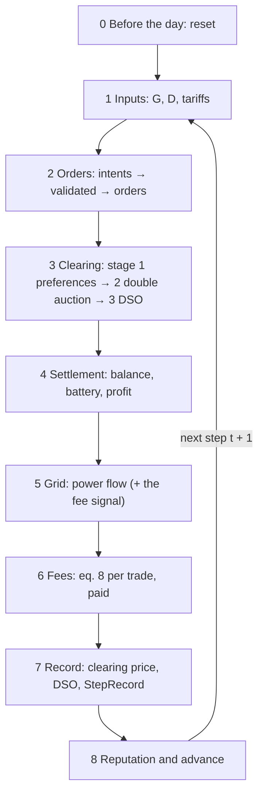

# One market step, phase by phase

> Everything that happens in one market step, in the order the code does it, and
> where each quantity is calculated. The page follows the spine of the code:
> [`LocalEnergyMarket.start_step`](../core/market/lem.py#L292-L310) and
> [`advance`](../core/market/lem.py#L312-L346), about 50 lines that call every
> phase in turn. One section per phase, each with the same card: what it
> **reads**, what it **computes**, what it **writes**, the **code**, the
> **paper** equations and the **decisions** of the
> [issue register](validation/register.md) behind it.

**How to read it.** Start with [the outline](#the-outline): eight phases on one
screen. Open a phase only when you need it. To find where one quantity comes from,
use [Where is it calculated](#where-is-it-calculated) at the end. What the rebuild
decided differently from the paper is in the cards' *Decisions* line, with the
reasons on the register's detail pages.

**Keeping it true.** Each phase is one method, or a few, of
`core/market/lem.py`. When a phase's method changes, its card changes; when
`advance` changes, the outline changes. Line links point at branch `marlem-v1`.

## The outline

| # | Phase | Method | Produces | [P1] §3.9 phase |
|---|---|---|---|---|
| 0 | Before the day | [`reset`](../core/market/lem.py#L273-L290) | participants with their day's profiles, DSO, grid, ledger | – |
| 1 | Inputs | [`_inputs`](../core/market/lem.py#L407-L417) | `StepInputs`: $G_t$, $D_t$, $p_\text{FiT}$, $p_\text{utility}$ | – |
| 2 | Orders | [`start_step`](../core/market/lem.py#L292-L310) | `PendingStep.orders` | 1, 2 |
| 3 | Clearing | [`advance`](../core/market/lem.py#L319-L322) × 3 → [`clearing.STAGES`](../core/market/clearing.py#L183) | three `StageResult`s with their trades | 3 |
| 4 | Settlement | [`_settle`](../core/market/lem.py#L553-L560) | `ParticipantOutcome` per participant | 4 |
| 5 | Grid | [`_assess_grid`](../core/market/lem.py#L562-L572), [`_grid_signal`](../core/market/lem.py#L584-L602) | `GridAssessment` (and the fee signal) | 4 |
| 6 | Fees | [`_charge_fees`](../core/market/lem.py#L604-L617), `pay_fees` | each trade's fee parts; profits net of fees | 4 |
| 7 | Record | [`advance`](../core/market/lem.py#L332-L343) | `StepRecord` | 6 |
| 8 | Reputation and advance | [`_update_reputation`](../core/market/lem.py#L620-L630), [`_advance`](../core/market/lem.py#L632-L643) | new reputations, next $p_\text{ref}$, ledger block, history | 6, 8 |

Phases 5 (reward, KPIs) and 7 (observation) of [P1] §3.9 belong to learning and
live in [`MarketEnv`](../core/env/market_env.py), outside the market (see
[The RL step around it](#the-rl-step-around-it)).

A step can run at once ([`step`](../core/market/lem.py#L348-L355)) or one part at
a time: `start_step`, then `advance` five times (three stages, then the rest), which
is what the Studio's Step page does.

---

## 0. Before the day: reset

| | |
|---|---|
| **Reads** | the scenario: network and day (`grid`), participants and what they own, batteries, market and DSO settings |
| **Computes** | each participant's $G_t$ and $D_t$ for every step of the day from the SimBench profiles of the elements it owns; batteries at their initial state of charge; reputation at its start value (0.5); the DSO with nothing seen; the first reference price $p_\text{ref}$ = midpoint of $p_\text{FiT}$ and $p_\text{utility}$; a fresh working copy of the network; the graph model if `grid.method = "graph"` |
| **Writes** | `participants`, `dso`, `ledger`, `clearing_price`, `grid`, `graph`; empty `history` |
| **Code** | [`reset`](../core/market/lem.py#L273-L290) → [`_build_participants`](../core/market/lem.py#L366-L389) ([`profiles_from_elements`](../core/market/agent/der.py#L88-L115)), [`_battery`](../core/market/lem.py#L391-L405), [`Dso.market_price`](../core/market/dso/dso.py#L124-L127), [`SimBenchGrid.reset`](../core/grid/powerflow.py#L67-L89), [`_graph_model`](../core/market/lem.py#L574-L582) |
| **Paper** | §3.4.4 (profiles, replaced by SimBench), eq. 16 (battery) |
| **Decisions** | profiles from SimBench (M-04, M-05); one start value for everyone (M-45); tariffs constant over the day |

## 1. Inputs

| | |
|---|---|
| **Reads** | the step $t$ = `current_step` (number of steps already recorded) |
| **Computes** | nothing new: picks step $t$ out of each participant's day |
| **Writes** | [`StepInputs`](../core/market/lem.py#L79-L94): `generation_kwh`, `demand_kwh`, `feed_in_tariff`, `utility_price` |
| **Code** | [`_inputs`](../core/market/lem.py#L407-L417) |
| **Paper** | $G_t$, $D_t$, $p_\text{FiT}$, $p_\text{utility}$ (§3.3.1, §3.4) |
| **Decisions** | energies in kWh per step, $\Delta t$ explicit (`step_hours`, M-03) |

## 2. Orders

Three sub-steps, all inside [`start_step`](../core/market/lem.py#L292-L310).

**2a. Intents.** What each participant wants: buy or sell, price, quantity, and
optionally a preferred partner $\beta$. They come from outside or from the market's
own rule:

- **from the RL agents**: [`MarketEnv.decode`](../core/env/market_env.py#L279-L297)
  turns each action into an intent (quantity as a share of eq. 15a-b's bound, price
  between $p_\text{FiT}$ and $p_\text{utility}$);
- **from the bidding rule** when none are given:
  [`_rule_intents`](../core/market/lem.py#L419-L443) →
  [`bidding.net_position`](../core/market/bidding.py#L64-L102): the net position
  after what the battery can take or give, at $p_\text{FiT} + m \cdot \text{spread}$
  (selling) or $p_\text{utility} - m \cdot \text{spread}$ (buying), with a small
  jitter;
- **partners**, if `partner_preference` is on:
  [`_with_partners`](../core/market/lem.py#L445-L463) →
  [`Participant.choose_partner`](../core/market/agent/der.py#L187-L223): a weighted
  score of reputation and closeness $d_{ij}$ over the candidates on the other side.

**2b. Validate.** [`_validate`](../core/market/lem.py#L484-L509): every intent is
limited, never rejected for being too large.

$$
q \leftarrow \min\bigl(q,\ q_\text{max,phys},\ q_\text{max}\bigr), \qquad p \leftarrow \min\bigl(p_\text{max}, \max(p_\text{min}, p)\bigr)
$$

where $q_\text{max,phys}$ is eq. 15a for a seller,
$\max(0, G_t - D_t) + E_\text{dischargeable}$
([`max_sell_kwh`](../core/market/agent/der.py#L178-L180)), or eq. 15b for a buyer,
$\max(0, D_t - G_t) + E_\text{chargeable}$
([`max_buy_kwh`](../core/market/agent/der.py#L182-L184)), with the battery's
efficiencies and power limit
([`chargeable_kwh`, `dischargeable_kwh`](../core/market/agent/battery.py#L107-L118)).
An intent at or below `min_quantity` is dropped. Every change is written to `notes`.

**2c. Orders.** [`_orders`](../core/market/lem.py#L511-L527): each valid intent
becomes an [`Order`](../core/market/order.py#L10) with an ID, the participant's bus
as location, its partner, and its arrival rank as timestamp (the participants'
order), the double auction's last tie-break.

| | |
|---|---|
| **Reads** | `StepInputs`, battery room, market bounds (`MarketSetup`), reputations and distances (partners) |
| **Computes** | intents; limited quantities and prices; orders |
| **Writes** | [`PendingStep`](../core/market/lem.py#L98-L131): `intents`, `orders`, `notes` |
| **Code** | [`start_step`](../core/market/lem.py#L292-L310), above |
| **Paper** | eq. 2 (the action $\langle p, q, \alpha, \beta \rangle$), eq. 15a-b, §3.2.3, §3.4 |
| **Decisions** | eq. 15 implemented with the battery (M-06, M-19); invalid actions limited, not raised (M-02); "no order" possible (M-08); weighted partner score (M-11); submitted orders never changed later (M-09) |

## 3. Clearing

`advance` runs one stage per call, each on the orders the previous one left open
([`clearing.py`](../core/market/clearing.py)). The stages work on copies: the
submitted orders stay as they were. Every trade leaves its stage with its distance
and loss ([`Dso.assess`](../core/market/dso/dso.py#L220-L224)); its fee comes only
in phase 6.

**3a. Stage 1, preferences.**
[`preferences`](../core/market/clearing.py#L110-L134): a buyer and a seller that
named each other as $\beta$ trade if the bid is at least the ask, for
$\min(q_\text{buy}, q_\text{sell})$, at the pricing mechanism's price.

**3b. Stage 2, double auction.**
[`double_auction`](../core/market/clearing.py#L140-L170): bids from the highest
price down, asks from the lowest up, reputation then arrival breaking ties; pairs
trade while bid ≥ ask. Orders that prefer the DSO stay out.

**3c. Stage 3, DSO.** [`dso`](../core/market/clearing.py#L176-L180) →
[`Dso.clear`](../core/market/dso/dso.py#L262-L283): every order still open trades
with the DSO, sells at $p_\text{FiT}$, buys at $p_\text{utility}$, along the path to
the transformer.

The price of a peer trade comes from the mechanism of `market.mechanism`
([`clearing_price.py`](../core/market/clearing_price.py)): average (eq. 9), buyer,
seller, bid-ask spread, Nash bargaining (eq. 10) or proportional surplus around
$p_\text{ref}$ (eq. 11). Each trade's distance and loss:

$$
d_{ij} = \text{line length of the shortest path (km)}, \qquad l_{ij} = \kappa\, d_{ij}\, q_{ij} \quad \text{(eq. 18)}
$$

| | |
|---|---|
| **Reads** | the open orders; [`ClearingRules`](../core/market/clearing.py#L57-L79) from [`_rules`](../core/market/lem.py#L530-L541): mechanism, $p_\text{ref}$, reputations, paths, the DSO |
| **Computes** | the trades of each stage: buyer, seller, $q_{ij}$, $p_{ij}$, stage, $d_{ij}$, $l_{ij}$ |
| **Writes** | `PendingStep.stages`: three [`StageResult`](../core/market/clearing.py#L35-L53)s, each with its trades and the orders left |
| **Code** | above; paths: [`_path`](../core/market/lem.py#L465-L473), [`_upstream`](../core/market/lem.py#L475-L481) → [`SimBenchGrid.path`, `path_upstream`](../core/grid/powerflow.py#L159-L181) |
| **Paper** | §3.3.2 (three stages, Algorithm 1), §3.3.3 and eq. 9-11 (prices), eq. 18 (loss), §3.5.1 (distance) |
| **Decisions** | DSO-preferring orders wait for stage 3 (M-10); no trade blocked for grid reasons (M-12); pricing fixed (M-13, M-14); DSO trades get a path (M-31); loss recorded, not taken off the energy (M-40, M-41) |

## 4. Settlement

[`_settle`](../core/market/lem.py#L553-L560) → for every participant
[`Participant.settle`](../core/market/agent/der.py#L226-L260):

$$
\begin{aligned}
B_i &= (G_t - D_t) + (E_\text{bought} - E_\text{sold}) && \text{(eq. 13)} \\
\text{charge} &= \text{battery takes } B_i \text{ if } B_i > 0, \quad \text{discharge} = \text{battery gives } {-B_i} \text{ if } B_i < 0 && \text{(eq. 16)} \\
\text{external} &= B_i - \text{charge} + \text{discharge} && \text{(untraded, with the upstream grid)} \\
\text{profit}_i &= \textstyle\sum p\, q_\text{sold} - \sum p\, q_\text{bought} && \text{(eq. 14, before fees)}
\end{aligned}
$$

| | |
|---|---|
| **Reads** | the step's trades, $G_t$, $D_t$, the battery |
| **Computes** | bought, sold, balance $B_i$, charge, discharge, external exchange, state of charge, trading profit; deferred and satisfied demand and supply (properties of the outcome) |
| **Writes** | [`ParticipantOutcome`](../core/market/agent/der.py#L32-L82) per participant (fees still 0); the battery's energy; `Participant.profit` |
| **Code** | above; battery: [`charge`, `discharge`](../core/market/agent/battery.py#L121-L137) |
| **Paper** | eq. 13, 14, 16; §3.4.1 (demand satisfied) |
| **Decisions** | battery sign and efficiencies fixed (M-16, M-17, M-18); balance as eq. 13 (M-20, M-21); profit updated (M-22); discharge counts towards demand (M-23) |

## 5. Grid

**5a. Power flow, always.** [`_assess_grid`](../core/market/lem.py#L562-L572):
each participant's net power at its bus from what it physically did,
[`injection`](../core/market/agent/der.py#L274-L284)
$= (G + \text{discharge} - D - \text{charge}) / \Delta t$, never from its trades.
[`SimBenchGrid.assess`](../core/grid/powerflow.py#L118-L151) sets the network's own
loads and generators to their profiles for step $t$
([`_apply_background`](../core/grid/powerflow.py#L91-L115)), adds the injections
and runs one AC power flow (pandapower).

**5b. The fee signal.** [`_grid_signal`](../core/market/lem.py#L584-L602): the line
loading the fees will use. With `grid.method = "powerflow"` it is 5a's result;
with `"graph"` it is [`GraphGrid.assess`](../core/grid/graph.py#L52-L79): every
trade's $q/\Delta t$ added to each line of its path, divided by the line's capacity
([P1] §3.5.3, eq. 19). See [Grid-method comparison](experiments/grid-methods.md).

| | |
|---|---|
| **Reads** | the outcomes (5a); the trades and their paths (5b, graph only) |
| **Computes** | bus voltages, line and transformer loading, losses, exchange with the upstream grid, limit violations; the graph loading |
| **Writes** | [`GridAssessment`](../core/grid/contract.py) (`grid`), and in graph mode a second one (`signal`) |
| **Code** | above |
| **Paper** | §3.5.3 (replaced by the power flow; kept as the graph method) |
| **Decisions** | AC power flow instead of the trade-flow graph (M-35, M-36, M-38) |

## 6. Fees

**6a. The DSO looks at the grid.**
[`Dso.observe(signal, measured=grid)`](../core/market/dso/dso.py#L130-L138): it
keeps the signal's line loading and the power flow's bus voltages.

**6b. A fee for every trade.** [`Dso.charge`](../core/market/dso/dso.py#L226-L259),
for a peer trade along $\text{path}(i, j)$, for a DSO trade along the path to the
transformer (no zone bonus, plus the imbalance fee):

$$
\begin{aligned}
C_t &= \min\bigl(1, \max_{e \in \text{path}} \text{loading}_e / 100\bigr) && \text{(eq. 8a's congestion)} \\
F_\text{cong} &= f_\text{cong}\,(C_t - C_\text{th})\, q\, p \ \text{ if } C_t > C_\text{th} && \text{(8a)} \\
F_\text{thermal} &= \min\Bigl(\tfrac{C_t - T_\text{th}}{1 - T_\text{th}},\ f_\text{threshold}\Bigr)\, q\, p \ \text{ if } C_t > T_\text{th} && \text{(8d, 8g)} \\
F_\text{volt} &= \min(V_\text{drop}, V_\text{th})\, q\, p, \quad V_\text{drop} = f_\text{volt}\, d_{ij} \text{ or measured} && \text{(8c, 8f)} \\
F_\text{trans} &= l_{ij}\, p && \text{(8, no formula in [P1])} \\
F_\text{zone} &= -f_\text{zone}\, q\, p \ \text{ if both ends on one feeder} && \text{(8e)} \\
F_\text{imb} &= f_\text{imb}\, \min\bigl(q / |B_\text{grid}|, 1\bigr)\, q\, p \ \text{ for a DSO trade that worsens } B_\text{grid} && \text{(8b, 8h)}
\end{aligned}
$$

([`congestion`](../core/market/dso/dso.py#L149-L154),
[`voltage_drop_of`](../core/market/dso/dso.py#L140-L147),
[`fees_of`](../core/market/dso/dso.py#L161-L185),
[`imbalance_fee`](../core/market/dso/dso.py#L187-L200)). $B_\text{grid}$ is the
market's balance before stage 3, offered minus asked
([`PendingStep.grid_balance_kwh`](../core/market/lem.py#L128-L131)).
[`_charged`](../core/market/dso/dso.py#L202-L218) splits the total: a peer trade's
fee 50/50 (`fee_buyer_share`), a DSO trade's fee all to the participant; nothing
is paid when `fees_charged` is off.

**6c. Participants pay.**
[`Participant.pay_fees`](../core/market/agent/der.py#L262-L271): its share of every
trade's fee comes off the step's profit and the running profit.

| | |
|---|---|
| **Reads** | the trades, the signal's loading, the measured voltages, paths and zones, $B_\text{grid}$ |
| **Computes** | $C_t$, $V_\text{drop}$, the six fee parts per trade, the split, each participant's fees |
| **Writes** | `Trade.fees`, `fee_parts`, `buyer_fee`, `seller_fee`; `ParticipantOutcome.fees` and `profit` |
| **Code** | [`_charge_fees`](../core/market/lem.py#L604-L617), above |
| **Paper** | eq. 8, 8a-8h |
| **Decisions** | fees charged at all (M-27); after the same step's power flow; $F_\text{trans}$ as the loss at the trade price (M-28); caps (M-29); imbalance on DSO trades (M-30); DSO trades pay their path (M-31); thermal threshold (M-32); zones = feeders and the bonus size (M-33, M-34) |

## 7. Record

In [`advance`](../core/market/lem.py#L327-L343), once the fees are known (the record itself at [L332-L343](../core/market/lem.py#L332-L343)):

- the step's clearing price,
  [`_clearing_price`](../core/market/lem.py#L543-L550): volume-weighted price of the
  peer trades, or the previous one when there were none;
- the DSO's step, [`Dso.settle`](../core/market/dso/dso.py#L286-L304):
  $B_\text{DSO} = \sum (E_\text{sold} - E_\text{bought})$ (eq. 7), energy revenue,
  fees collected;
- everything into one [`StepRecord`](../core/market/lem.py#L135-L198): inputs,
  orders, stages with their charged trades, outcomes, clearing price, `grid`, `dso`,
  notes, `signal`.

| | |
|---|---|
| **Reads** | the charged trades, the outcomes, the grid results |
| **Computes** | the clearing price; the DSO's balance, revenue and fees |
| **Writes** | `StepRecord`; the DSO's running balance and profit |
| **Code** | above |
| **Paper** | eq. 7; UpdateMarketState of Algorithm 1 |
| **Decisions** | clearing price from peer trades only (M-15); the DSO's balance kept per step and over the day (M-24, M-25) |

## 8. Reputation and advance

**8a. Reputation.** [`_update_reputation`](../core/market/lem.py#L620-L630) →
[`ReputationHandler.update_reputation`](../core/market/reputation.py#L119-L142),
for every participant, from the record
([`_calculate_reputation`](../core/market/reputation.py#L156-L242)):

$$
\begin{aligned}
\delta_\text{rel} &= \min\bigl(1, \text{volume matched by peers} / \text{volume ordered}\bigr) \\
\delta_\text{fair} &= 1 - \min\bigl(1, \text{mean } |p - p_\text{clear}| / p_\text{clear}\bigr) \quad \text{(its peer trades)} \\
\delta_\text{grid} &= \bigl(\text{mean impact of its trades on } B_\text{grid} + 1\bigr) / 2 \quad \text{(DSO trades neutral)} \\
s &= 0.3\, \delta_\text{rel} + 0.2\, \delta_\text{fair} + 0.5\, \delta_\text{grid} \quad \text{(eq. 12)} \\
r &\leftarrow \delta\, r + (1 - \delta)\, s, \qquad \delta = 0.8^{\Delta t}
\end{aligned}
$$

When the step has no trades at all, every reputation stays as it was. Otherwise a
component with nothing to measure counts as neutral (0.5), e.g. fairness for a
participant without peer trades. The weights and the decay are scenario settings
(`MarketSetup`); 0.3, 0.2, 0.5 and 0.8 are the defaults. The impact of one
trade is $\pm\min(q / |B_\text{grid}|, 1)$: positive when it buys during excess
supply or sells during a shortage
([`_calculate_grid_impact`](../core/market/reputation.py#L244-L293)).

**8b. Advance.** [`_advance`](../core/market/lem.py#L632-L643): the clearing price
becomes next step's $p_\text{ref}$; the trades go into a ledger block, if the
ledger is on; the record joins `history`, so `current_step` moves on.

| | |
|---|---|
| **Reads** | `StepRecord`, each participant's reputation |
| **Computes** | the three components, the score, the new reputation; the block hash |
| **Writes** | `Participant.reputation`; `StepRecord.reputation`; `clearing_price`; `history`; the ledger |
| **Code** | above |
| **Paper** | eq. 12 and §3.3.4 (reputation, decay, ValidateBlock); §3.9 phases 6 and 8 |
| **Decisions** | reliability measured on peer matches (M-42); decay per hour (M-43); grid part and fairness on peers (M-44); start value (M-45); the block (M-46) |

---

## Where is it calculated

Every quantity of the step, with the phase that makes it and where it ends up.

| Quantity | Symbol | Phase | Code | Kept in |
|---|---|---|---|---|
| Generation, demand of a step | $G_t$, $D_t$ | 0, 1 | [`profiles_from_elements`](../core/market/agent/der.py#L88-L115), [`_inputs`](../core/market/lem.py#L407-L417) | `StepInputs`, `ParticipantOutcome` |
| Tariffs | $p_\text{FiT}$, $p_\text{utility}$ | 1 | `DsoSetup` | `StepInputs` |
| Chargeable, dischargeable energy | $E_\text{ch}$, $E_\text{dis}$ | 2 | [`Battery`](../core/market/agent/battery.py#L107-L118) | – |
| Order bounds | $q_\text{sell,max}$, $q_\text{buy,max}$ | 2 | [`max_sell_kwh`, `max_buy_kwh`](../core/market/agent/der.py#L178-L184) | – |
| Intent from an action | | 2 | [`MarketEnv.decode`](../core/env/market_env.py#L279-L297) | `PendingStep.intents` |
| Intent from the bidding rule | | 2 | [`bidding.net_position`](../core/market/bidding.py#L64-L102) | `PendingStep.intents` |
| Preferred partner | $\beta$ | 2 | [`choose_partner`](../core/market/agent/der.py#L187-L223) | `Order.partner_id` |
| Validated order | $p$, $q$ | 2 | [`_validate`](../core/market/lem.py#L484-L509), [`_orders`](../core/market/lem.py#L511-L527) | `StepRecord.orders`, `notes` |
| Market balance | $B_\text{grid}$ | 3 (before stage 3) | [`grid_balance_kwh`](../core/market/lem.py#L128-L131) | `StepRecord.grid_balance_kwh` |
| Trade price | $p_{ij}$ | 3 | [`clearing_price.py`](../core/market/clearing_price.py) | `Trade.price` |
| Trade quantity | $q_{ij}$ | 3 | [`clearing.py`](../core/market/clearing.py) | `Trade.quantity` |
| Distance, path, zones | $d_{ij}$ | 3 | [`SimBenchGrid.path`](../core/grid/powerflow.py#L159-L181) | `Trade.distance` |
| Loss of a trade | $l_{ij}$ | 3 | [`Dso.transmission_loss`](../core/market/dso/dso.py#L156-L158) | `Trade.transmission_loss` |
| Participant balance | $B_i$ | 4 | [`settle`](../core/market/agent/der.py#L226-L260) | `ParticipantOutcome.balance_kwh` |
| Battery charge, discharge, energy | | 4 | [`Battery.charge`, `discharge`](../core/market/agent/battery.py#L121-L137) | `ParticipantOutcome` |
| Untraded exchange, deferred demand | | 4 | [`settle`](../core/market/agent/der.py#L226-L260), [properties](../core/market/agent/der.py#L65-L82) | `ParticipantOutcome` |
| Trading profit | eq. 14 | 4, 6 | [`settle`](../core/market/agent/der.py#L226-L260), [`pay_fees`](../core/market/agent/der.py#L262-L271) | `ParticipantOutcome.profit`, `Participant.profit` |
| Injection at the bus | | 5 | [`injection`](../core/market/agent/der.py#L274-L284) | – |
| Bus voltages, line loading, network losses | | 5 | [`SimBenchGrid.assess`](../core/grid/powerflow.py#L118-L151) | `StepRecord.grid` |
| Graph line loading | $\zeta_e$ | 5 (graph) | [`GraphGrid.assess`](../core/grid/graph.py#L52-L79) | `StepRecord.signal` |
| Congestion of a trade | $C_t$ | 6 | [`Dso.congestion`](../core/market/dso/dso.py#L149-L154) | – |
| Voltage drop | $V_\text{drop}$ | 6 | [`Dso.voltage_drop_of`](../core/market/dso/dso.py#L140-L147) | – |
| Fee parts, total, split | eq. 8 | 6 | [`fees_of`](../core/market/dso/dso.py#L161-L185), [`imbalance_fee`](../core/market/dso/dso.py#L187-L200), [`_charged`](../core/market/dso/dso.py#L202-L218) | `Trade.fee_parts`, `fees`, `buyer_fee`, `seller_fee` |
| Clearing price (next $p_\text{ref}$) | $p_\text{clear}$ | 7 | [`_clearing_price`](../core/market/lem.py#L543-L550) | `StepRecord.clearing_price` |
| DSO balance, revenue, fees | $B_\text{DSO}$ | 7 | [`Dso.settle`](../core/market/dso/dso.py#L286-L304) | `StepRecord.dso` |
| Reputation components, score, reputation | $\delta$, $s$, $r$ | 8 | [`ReputationHandler`](../core/market/reputation.py#L119-L293) | `StepRecord.reputation`, `Participant.reputation` |
| Ledger block | | 8 | [`Validator`](../core/market/validation.py) | the ledger |

## The RL step around it

[`MarketEnv.step`](../core/env/market_env.py#L226-L276) wraps the whole market step
as one call:

1. **decode**: each agent's action → an intent ([`decode`](../core/env/market_env.py#L279-L297)), phase 2a above;
2. **market step**: `self.market.step(intents)`, phases 1 to 8;
3. **reward**: per agent, the step's net bill, $(\text{profit} - p_\text{utility} \cdot \text{deferred demand}) / \text{scale}$, from `ParticipantOutcome`;
4. **observation**: for the next step, from the participant's next $G$, $D$, battery, reputation, $p_\text{ref}$ and the market totals of this record.

The training loop around that, from observation to network update, is
[One training iteration](rl/cycle.md); this step is its A5.
