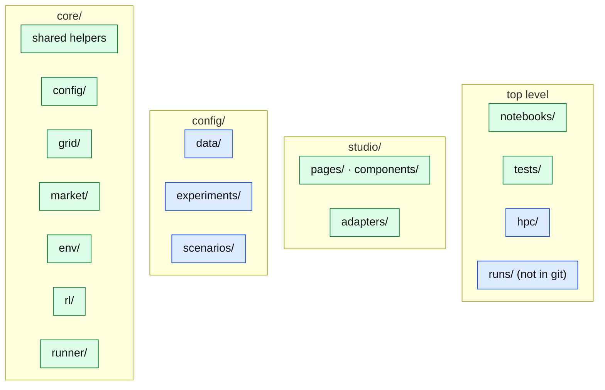
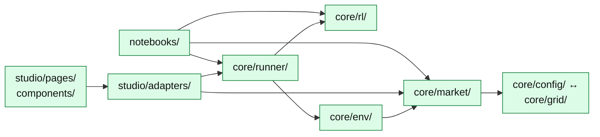

# Architecture

> How the code is organised, in three levels: this page (the folders and the rules
> between them), one page per package (its modules and how they connect), and the
> [API Reference](../../api/index.md) (one page per module: its classes and
> functions, from the docstrings).

## The folders

```text
marlem-v2/
├─ core/                           the functionality: everything a notebook can call
│  ├─ config/                      the scenario: network, participants, market rules
│  │  ├─ scenario.py
│  │  └─ …
│  ├─ grid/                        the SimBench network and its power flow
│  │  ├─ powerflow.py
│  │  └─ …
│  ├─ market/                      orders, matching, pricing, DSO, reputation
│  │  ├─ lem.py                    LocalEnergyMarket: one market step
│  │  ├─ agent/                    the participants: DER, battery
│  │  └─ …
│  ├─ env/                         the market as an RL environment
│  │  ├─ market_env.py
│  │  └─ …
│  ├─ rl/                          PPO in three paradigms on RLlib
│  │  ├─ train.py
│  │  ├─ envs/                     the probe environments
│  │  ├─ scripts/                  the probe scripts
│  │  └─ …
│  ├─ runner/                      experiments: start, watch, stop, sync
│  │  ├─ spec.py
│  │  └─ …
│  ├─ settings.py                  this machine's settings (.env)
│  └─ …                            files.py, env_defaults.py, rl_defaults.py
├─ studio/                         the NiceGUI interface
│  ├─ adapters/                    thin layer over core/
│  │  ├─ run_service.py
│  │  └─ …
│  ├─ components/                  shared building blocks: charts, tables
│  ├─ pages/                       one file per page; market/ and results/ have tabs
│  └─ …
├─ config/                         data, not code
│  ├─ data/                        market price data
│  ├─ experiments/                 experiment specs: which runs to train (JSON)
│  └─ scenarios/                   saved scenarios (JSON)
├─ notebooks/                      market/, rl/, runner/; they call core/ only
├─ tests/                          market/, rl/, runner/, studio/
├─ hpc/                            where experiments run (targets.toml), the cluster jobs
├─ docs/                           this documentation (Markdown)
├─ docs_site/                      builds the website from docs/
├─ runs/                           training runs and results (not in git)
└─ run_studio.py, mkdocs.yml, …    entry points, the docs site's settings
```

A package shows one landmark module; `…` stands for the others, listed one line each
on the package's page. The same as a diagram:



Green holds code, blue holds data and settings. Click a folder to open its page.

| Package | What it is | Page |
|---|---|---|
| `core/config/` | The scenario: everything set before the market runs, as plain data | [Config](packages/config.md) |
| `core/grid/` | The SimBench network: loading, topology, profiles, the power flow, the graph model | [Grid](packages/grid.md) |
| `core/market/` | The MARLEM market: participants, DSO, clearing, fees, reputation, signals | [Market](packages/market.md) |
| `core/env/` | The market as a multi-agent RL environment: actions, observations, rewards | [Environment](packages/env.md) |
| `core/rl/` | The learning layer: PPO in three paradigms on RLlib | [RL](packages/rl.md) |
| `core/runner/` | Experiments: starting, watching and reading runs, here or on a cluster | [Runner](packages/runner.md) |
| `studio/` | The NiceGUI interface | [Studio](packages/studio.md) |
| `config/`, `notebooks/`, `tests/`, the rest | Data and settings, notebooks, tests, cluster helpers, docs | [Around the code](around.md) |

## The layers

An arrow means "imports"; only the main imports are drawn.



Four rules keep the layers apart:

- **`core/` never imports `studio/` or `notebooks/`.** Anything that looks wrong in
  the Studio can be reproduced in a notebook, which tells a core problem from a UI
  one.
- **`core/rl/` imports no market module.** The environment arrives as a class, so
  the RL probes test the learner alone.
- **`core/runner/` is the one place that knows both** the environment and the
  learner, and it loads them only inside a training job.
- **`core/grid/` is the only place that imports pandapower and SimBench.** It hands
  out plain records, never pandapower objects.

`core/config/` and `core/grid/` import each other: placing participants needs the
network, and the power flow reads the grid settings.

## Shared helpers

Four modules directly in `core/`, which any layer may use. Each is light on purpose:
importing them loads neither Ray nor the market
([API](../../api/helpers/index.md)).

| Module | What it is |
|---|---|
| [`settings`](../../api/helpers/settings.md) | This machine's settings (cluster account, SSH host, folders), from the environment or `.env` |
| [`files`](../../api/helpers/files.md) | Atomic file and JSON writes, shared by training and the runner |
| [`env_defaults`](../../api/helpers/env_defaults.md) | The environment's settings and their defaults, for the runner without loading RLlib |
| [`rl_defaults`](../../api/helpers/rl_defaults.md) | PPO's and the network's default settings, so an experiment can be written out in full without loading Ray |
