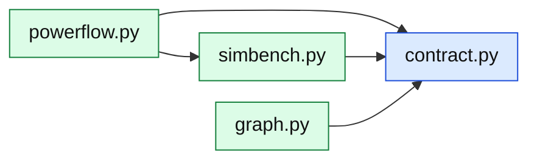

# core/grid/: the SimBench network

The only package that imports pandapower and SimBench. It hands out plain records
(`contract.py`), never pandapower objects, so nothing above it depends on them. How
the two grid methods differ: [Grid methods](../../market/grid-methods.md).

| Module | What it is |
|---|---|
| [`contract`](../../../api/grid/contract.md) | The records that cross the seam: networks, topology, elements, profiles, power-flow results, the path between two buses (`GridPath`) |
| [`simbench`](../../../api/grid/simbench.md) | Listing, loading and caching networks; their topology, elements and profiles; SimBench's study cases |
| [`powerflow`](../../../api/grid/powerflow.md) | `SimBenchGrid`: one AC power flow per market step from what the participants did; the path, distance and zone between two buses |
| [`graph`](../../../api/grid/graph.md) | `GraphGrid`: [P1]'s grid model on the SimBench lines, the line loading from the step's trades, for `grid.method = "graph"` |
