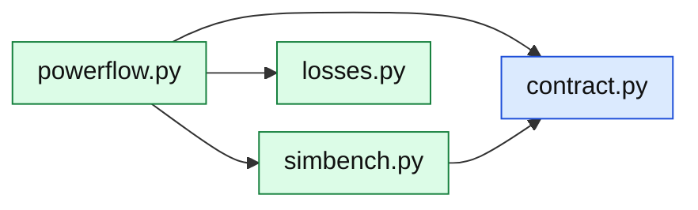

# core/grid/: the SimBench network

The only package that imports pandapower and SimBench. It hands out plain records
(`contract.py`), never pandapower objects, so nothing above it depends on them.

| Module | What it is |
|---|---|
| [`contract`](../../../api/grid/contract.md) | The records that cross the seam: networks, topology, elements, profiles, power-flow results, the path between two buses (`GridPath`) |
| [`simbench`](../../../api/grid/simbench.md) | Listing, loading and caching networks; their topology, elements and profiles; SimBench's study cases |
| [`powerflow`](../../../api/grid/powerflow.md) | `SimBenchGrid`: one AC power flow per market step from what the participants did; the path, distance and zone between two buses |
| [`losses`](../../../api/grid/losses.md) | Loss allocation: the step's measured losses shared among the network's elements by a rule chosen with `dso.losses` (`bcdla`, `pro_rata`); the radial check. A selectable option: [Adding an option](../development/options.md) |
