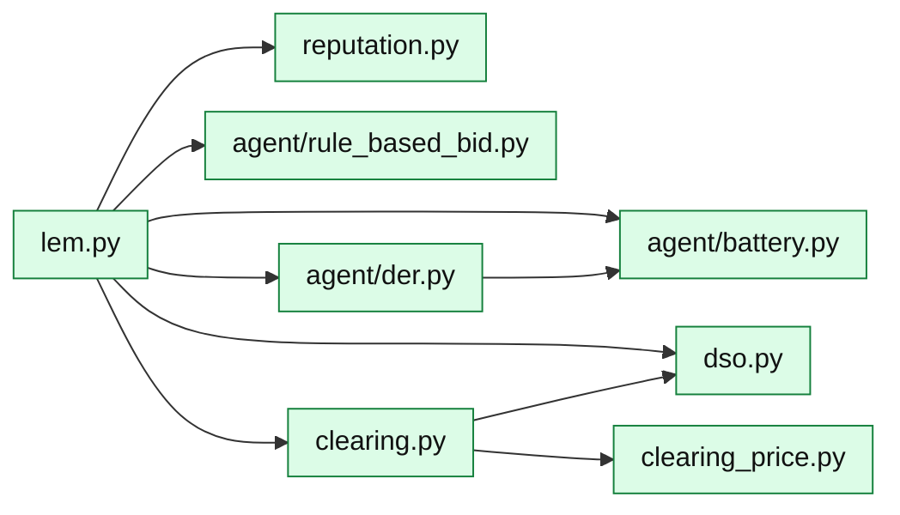

# core/market/: the MARLEM market

The market of [P1], rebuilt. `LocalEnergyMarket` (`lem.py`) is the one class that
runs it, one step at a time; the other modules are its parts. What a step does:
[Market step](../../market/step.md).

An arrow means "imports". Left out: `order.py`, which nearly every module imports;
`signals.py`, which imports nothing from the market; `probes.py`, which plays the
market through `lem.py`.

| Module | What it is |
|---|---|
| [`lem`](../../../api/market/lem.md) | `LocalEnergyMarket`: one step in its phases (orders, the three stages, settlement, power flow, fees, reputation), a part at a time or all at once; the day's history (`StepRecord`) |
| [`order`](../../../api/market/order.md) | `Order`, `Trade` and `GridFees`: what the stages pass on |
| [`clearing`](../../../api/market/clearing.md) | `Clearing`: the three stages (preferences, double auction, DSO) |
| [`clearing_price`](../../../api/market/clearing_price.md) | `ClearingMechanism`: the price of a matched pair |
| [`dso`](../../../api/market/dso.md) | `Dso`: tariffs, the third stage, losses, grid fees and who pays them, its balance |
| [`reputation`](../../../api/market/reputation.md) | Reputation (eq. 12): reliability, price fairness and grid contribution, with the decay |
| [`signals`](../../../api/market/signals.md) | The paper's 42 observation signals, each a plain function; open definitions marked `# OPEN` |
| [`probes`](../../../api/market/probes.md) | The market probes: scripted cases with hand-worked outcomes |
| [`agent/der`](../../../api/market/agent/der.md) | `Participant`: profiles, what it can trade (eq. 15), partner choice, settlement (eq. 13, 14, 16), its bus injection |
| [`agent/battery`](../../../api/market/agent/battery.md) | `Battery`: its energy, what it can take or give (eq. 15c-d), charging and discharging (eq. 16) |
| [`agent/rule_based_bid`](../../../api/market/agent/rule_based_bid.md) | The rule that writes orders when no agent does |

The market probes M1-M4 are built; M5-M9 are planned.
