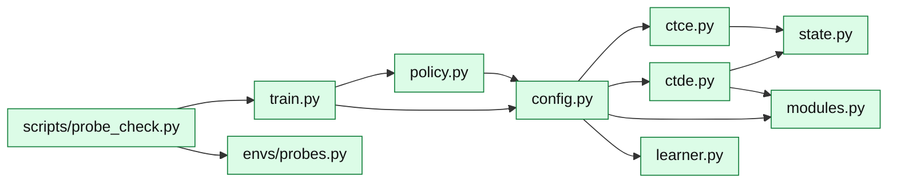

# core/rl/: the learning layer

PPO in three paradigms (CTCE, CTDE, DTDE) on RLlib's own algorithm. It imports no
market module: the environment is passed in as a class. What was added to RLlib and
why: [Why the RL layer is built this way](../../learning/examples/rl-layer.md); how training works:
[Learning layer](../../learning/index.md).

An arrow means "imports"; only the main imports are drawn.

| Module | What it is |
|---|---|
| [`train`](../../../api/rl/train.md) | `train`: one run, from configuration to saved policy, with its budget, metrics and records; `load_policy` |
| [`config`](../../../api/rl/config.md) | The PPO configuration of one paradigm |
| [`policy`](../../../api/rl/policy.md) | Acting with a trained policy, the baselines, and evaluation |
| [`modules`](../../../api/rl/modules.md) | RLlib's PPO module with `BoundedHead`: bounded means, one learned spread per continuous part |
| [`learner`](../../../api/rl/learner.md) | RLlib's PPO learner, also logging the clip fraction |
| [`ctce`](../../../api/rl/ctce.md) | CTCE: every agent as one, `"group"` |
| [`ctde`](../../../api/rl/ctde.md) | CTDE (MAPPO): own-observation actors, critics on the global state |
| [`state`](../../../api/rl/state.md) | The global state: every agent's observation joined |
| [`envs/probes`](../../../api/rl/envs/probes.md) | The probe environments: ten small tasks with known answers |
| [`scripts/probe_check`](../../../api/rl/scripts/probe_check.md) | The probe check: train on every probe in every paradigm and score the networks |
| [`scripts/probe_ppo`](../../../api/rl/scripts/probe_ppo.md) | The probe check as one command; run it first after a change here |

PPO's default settings are in [`rl_defaults`](../index.md#shared-helpers), outside the
package: importing anything under `core/rl/` loads Ray.
