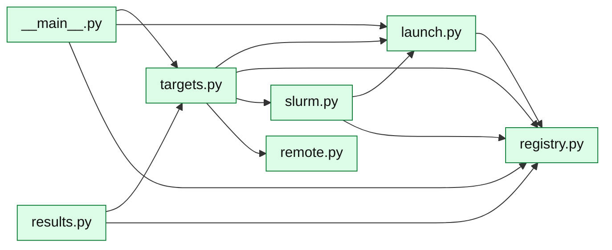

# core/runner/: experiments

Starts training runs that outlive the terminal and the Studio, and reads them back
from their files only. An experiment (a file in `config/experiments/`) expands into
runs; a **target** says where they run: this PC (a detached worker process) or a
SLURM cluster (one array task per run), used on the cluster itself or from this PC
over SSH. The CLI (`python -m core.runner`) and the Studio both go through targets.
How to use it: [Starting and following runs](../../../using/running/runs.md).

An arrow means "imports". Left out: `spec.py`, which nearly every module imports.
`launch.py` is where `core/env/` and `core/rl/` come in.

**Running**

| Module | What it is |
|---|---|
| [`spec`](../../../api/runner/spec.md) | `Experiment`: an experiment file checked and expanded into runs (`RunSpec`) |
| [`targets`](../../../api/runner/targets.md) | `Target`: check, start, stop, sync, list; `LocalTarget`, `SlurmTarget`, `RemoteTarget` |
| [`launch`](../../../api/runner/launch.md) | Preparing an experiment's folder, the local worker, one training job, stopping |
| [`slurm`](../../../api/runner/slurm.md) | Submitting to SLURM, reading its states, cancelling |
| [`remote`](../../../api/runner/remote.md) | `Remote`: one SSH connection to the cluster; runs the runner's CLI there and copies results back |
| [`registry`](../../../api/runner/registry.md) | A read-only view of `runs/`: experiments and each run's state |
| `__main__` | The command line: `start`, `status`, `stop`, `sync`, `check` |

**Reading results** ([Evaluation](../../evaluation/index.md))

| Module | What it is |
|---|---|
| [`results`](../../../api/runner/results.md) | Runs read from their folders, for the Results page and the notebooks |
| `indicators`, `ceiling` | Moved to [`core/market`](market.md): the indicators and the references are market scoring; `results` reads them |
| [`probe_runs`](../../../api/runner/probe_runs.md) | The RL probe runs: what each probe is and what it scored |
