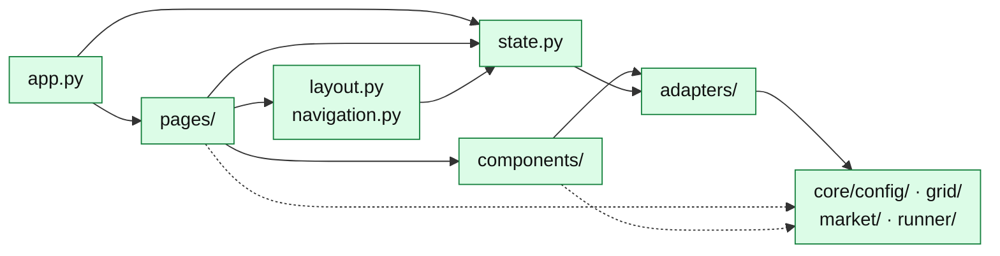

# studio/: the user interface

NiceGUI, on port 8091. Pages draw; adapters fetch: building a market, reading a
network or starting a run always goes through `studio/adapters/`. Pages and components
take only data types from `core/` (`NetworkRef`, `Trade`, `StepRecord`) and a few
small helpers (reading price files, the indicator tables). What each page offers a
user: [Studio UI](../../../using/studio/index.md).

An arrow means "imports"; the dotted arrows are the data types and small helpers
only.



`state.services()` builds the adapters once; every page reaches them through it.

```text
studio/
├── app.py, layout.py,      the server, the page frame (header, navigation),
│   navigation.py, theme.py the colours; static/ holds the styles
├── state.py                the adapters, built once (services())
├── pages/                  one file per page, or a folder when its tabs are large
├── components/             what more than one page uses
└── adapters/               what the pages call: a thin layer over core/
```

**Pages** ([API](../../../api/studio/pages/index.md)): one module per page of the
navigation; `pages/market/` and `pages/results/` hold a file per tab. Each module's
docstring says what the page shows.

**Components** ([API](../../../api/studio/components/index.md))

| Module | What it is |
|---|---|
| [`charts`](../../../api/studio/components/charts.md) | The chart classes: `Chart`, `SeriesChart`, `NetworkChart` and their controls |
| [`network`](../../../api/studio/components/network.md) | Network picker, summary, topology, elements, profile inspector |
| [`run_table`](../../../api/studio/components/run_table.md) | The table of runs to tick (Results, RL probes) |
| [`run_check`](../../../api/studio/components/run_check.md) | An experiment and a target as Runs, Experiments and Summary show them |
| [`cards`](../../../api/studio/components/cards.md), [`tables`](../../../api/studio/components/tables.md), [`choices`](../../../api/studio/components/choices.md), [`labels`](../../../api/studio/components/labels.md) | Cards and loading states, tables, dropdowns, the names shown for settings |
| [`day_profiles`](../../../api/studio/components/day_profiles.md), [`profiles`](../../../api/studio/components/profiles.md) | The Summary's Day profiles; SimBench's profile classes |
| [`memory`](../../../api/studio/components/memory.md) | What a browser remembers of a page between visits |

**Adapters** ([API](../../../api/studio/adapters/index.md))

| Module | What it is |
|---|---|
| [`scenario_service`](../../../api/studio/adapters/scenario_service.md) | The active scenario: edited, saved on every change, opened from files |
| [`run_service`](../../../api/studio/adapters/run_service.md) | The runner for the Studio: experiments to edit and start, targets, runs |
| [`results_service`](../../../api/studio/adapters/results_service.md) | What the Results page reads about runs |
| [`market_service`](../../../api/studio/adapters/market_service.md) | The market the Step tab plays, built from the scenario |
| [`validation_service`](../../../api/studio/adapters/validation_service.md) | The market probes and RL probe runs for the Validate pages |
| [`grid_catalog_service`](../../../api/studio/adapters/grid_catalog_service.md), [`profile_service`](../../../api/studio/adapters/profile_service.md) | Networks, their facts and cache; profiles and price files |
| [`workspace`](../../../api/studio/adapters/workspace.md) | Where the Studio keeps its data |
| [`container`](../../../api/studio/adapters/container.md), [`models`](../../../api/studio/adapters/models.md), [`profile_classes`](../../../api/studio/adapters/profile_classes.md) | Building the adapters once; the Studio's own data types; profile classes |

The rules for the Studio's code (the core first, the page only draws what the core
computes) are in [AGENTS.md](https://github.com/KevinRapo/P2P-thesis/blob/marlem-studio/AGENTS.md).
