# The full cycle: training, environment step, market step

> Everything that happens from one training iteration down to one fee, on one page,
> in the order the code runs it. Three loops nest inside each other: a **training
> iteration** collects many **environment steps**, and each environment step plays
> one **market step**. The master diagram shows all three; the sections below open
> them one level at a time. Every phase has the same card: what it **reads**,
> **computes** and **writes**, the **code**, the **paper** equations and the
> **decisions** of the [issue register](../original/issues/register.md) behind it.

**How to read it.** Start with [the master diagram](#the-master-diagram). Open a
section only when you need it. To find where one quantity comes from, use
[Where is it calculated](#where-is-it-calculated) at the end. The learning side in
full detail, with every tensor and every paradigm, is
[One training iteration](learning/examples/iteration.md), which also marks everything this
implementation changes in RLlib's PPO; this page keeps learning to the outline and
joins it to the market.

**Keeping it true.** [The market step](market/step.md) follows
[`LocalEnergyMarket.start_step`](../../core/market/lem.py#L304-L327) and
[`advance`](../../core/market/lem.py#L329-L369), [the environment](environment/index.md)
follows [`MarketEnv.step`](../../core/env/market_env.py#L459-L544), the training section
[`train`](../../core/rl/train.py#L408-L555). When one of them changes, its page
changes. Line links point at branch `marlem-studio`.

## The master diagram

[Open the diagram full size](diagrams/full-cycle.svg). Purple is learning, blue the
environment step and the grid, grey the market, green the fees. Read it from the
top left: an episode starts (one day), the agents observe and act (A1 to A4), and
the environment step (A5) plays one market step (phases 1 to 8) between decoding
the actions and returning rewards and observations. That repeats for the 24 steps
of a day, which ends **terminated** at midnight (RP-1f), and over as many days as
the batch needs (500 environment steps, about 21 days); then the learner computes
targets (B) and updates the networks (C), and the new weights go back (D). Its
source is [`diagrams/full_cycle.drawio`](diagrams/full_cycle.drawio): edit it in
VS Code's Draw.io extension, then run `python docs_site/export_drawio.py`.

### How the loops nest

| Loop | One round is | Repeats | Code | Details |
|---|---|---|---|---|
| Training | one iteration: collect, targets, update | until `budget` environment steps | [`train`](../../core/rl/train.py#L408-L555) → RLlib `algo.train()` | [One training iteration](learning/examples/iteration.md) |
| Collect (A) | one environment step for every agent | until the batch is full (`train_batch_size_per_learner`) | RLlib env runners | [A1-A5](learning/examples/iteration.md#a-collect-from-observation-to-environment-step) |
| Episode | one day | 24 steps (96 with quarter hours) | [`MarketEnv.reset`](../../core/env/market_env.py#L422-L457) | [0. Before the day](market/step.md#0-before-the-day-reset) |
| Environment step (A5) | decode, market step, reward, observation | once per collect step | [`MarketEnv.step`](../../core/env/market_env.py#L459-L544) | [The environment step](environment/index.md#the-environment-step) |
| Market step | phases 1 to 8 | once per environment step | [`LocalEnergyMarket.step`](../../core/market/lem.py#L371-L378) | [The market step](market/step.md) |

The paradigms (CTCE, CTDE, DTDE) change only A1 to A4 and the update: what each
network receives and who learns from which reward
([Training cycle](learning/index.md)). The environment step and the market step are
the same for all of them.

## The training iteration

In outline; every calculation is in [One training iteration](learning/examples/iteration.md).

| Part | What happens | Code |
|---|---|---|
| A · Collect | the agents observe, act with the four-part mixed action (side and partner categorical, quantity and price Gaussian) and step the environment with the current policy $\mu$, until the batch holds `train_batch_size_per_learner` (500) environment steps; nothing is learned | RLlib env runners on [`MarketEnv`](../../core/env/market_env.py), wrapped by [`CTCEEnv`](../../core/rl/ctce.py#L45-L106) (CTCE) or [`CTDEEnv`](../../core/rl/ctde.py#L55-L104) (CTDE) |
| B · Targets | the critic values every step; λ-returns ($\gamma = 0.99$, $\lambda = 0.95$) and advantages, standardised per module | RLlib learner |
| C · Update | PPO's clipped surrogate, value loss and entropy bonus; 10 epochs of minibatches of 64, about 78 Adam steps (learning rate $3 \cdot 10^{-4}$, gradient norm clipped to 0.5) | RLlib's learner ([`PPOLearner`](../../core/rl/learner.py#L27-L52), which also logs the clip fraction), on our module: [`PPOModule`](../../core/rl/modules.py#L192-L200) with its bounded head, and for CTDE [`CTDEPPOModule`](../../core/rl/ctde.py#L143-L149) |
| D · After | new weights to the env runners; at each evaluation point an evaluation against the baselines; metrics (each action part's mean, log σ, entropy), NaN check, checkpoint | [`train`](../../core/rl/train.py#L408-L555), [`evaluation`](../../core/rl/policy.py#L328-L366) |

## The environment step

[`MarketEnv.step`](../../core/env/market_env.py#L459-L544): the agents' actions in,
observations and rewards out, one market step in the middle. It decodes each action
into an order (E1), plays the market step, computes the reward (E2) and the next
observation (E3) and ends the episode after the day's last step (E4). The step is the
same for all three paradigms. Its pages:
[The environment](environment/index.md), [Action](environment/action.md),
[Reward](environment/reward.md) and [Observation](environment/observation.md).

## The market step

The market plays one step in nine phases (0 reset, 1 inputs, 2 orders, 3 clearing,
4 settlement, 5 grid, 6 fees, 7 record, 8 reputation and advance). Each phase has a
card of what it reads, computes and writes, its code, the paper's equations and the
decisions behind it: [The market step](market/step.md).

## Where is it calculated

Every quantity of the environment step and the market step, with the phase that makes it and where it ends up.

| Quantity | Symbol | Phase | Code | Kept in |
|---|---|---|---|---|
| Action → intent | $a_t$ | E1 | [`MarketEnv.decode`](../../core/env/market_env.py#L594-L627) | `PendingStep.intents` |
| Reward | $r_t$ | E2 | [`NetBillReward`](../../core/env/reward.py), by default | `rewards`, `infos` |
| Observation | $o_{t+1}$ | E3 | [`MarketEnv._observe`](../../core/env/market_env.py#L715-L745) | – |
| Market and agent signals, KPIs | [P1] Table 2, eq. 19-27 | E3 | [`signals.py`](../../core/market/signals.py) | – |
| Generation, demand of a step | $G_t$, $D_t$ | 0, 1 | [`profiles_from_elements`](../../core/market/agent/der.py#L88-L120), [`_inputs`](../../core/market/lem.py#L435-L446) | `StepInputs`, `ParticipantOutcome` |
| Tariffs | $p_\text{FiT}$, $p_\text{utility}$ | 0, 8b, 1 | `DsoSetup`, [`Dso.set_hour`](../../core/market/dso.py#L120-L123), [`price_at`](../../core/config/scenario.py#L265-L268) | `StepInputs` |
| Chargeable, dischargeable energy | $E_\text{ch}$, $E_\text{dis}$ | 2 | [`Battery`](../../core/market/agent/battery.py#L22-L107) | – |
| Order bounds | $q_\text{sell,max}$, $q_\text{buy,max}$ | 2 | [`max_sell_kwh`, `max_buy_kwh`](../../core/market/agent/der.py#L186-L192) | – |
| Intent from an action | | 2 | [`MarketEnv.decode`](../../core/env/market_env.py#L594-L627) | `PendingStep.intents` |
| Intent from the bidding rule | | 2 | [`rule_based_bid.net_position`](../../core/market/agent/rule_based_bid.py#L64-L108) | `PendingStep.intents` |
| Preferred partner | $\beta$ | 2 | [`choose_partner`](../../core/market/agent/der.py#L195-L234) | `Order.partner_id` |
| Validated order | $p$, $q$ | 2 | [`_validate`](../../core/market/lem.py#L528-L568), [`_orders`](../../core/market/lem.py#L570-L586) | `StepRecord.orders`, `notes` |
| Market balance | $B_\text{grid}$ | 3 (before stage 3) | [`grid_balance_kwh`](../../core/market/lem.py#L126-L130) | `StepRecord.grid_balance_kwh` |
| Trade price | $p_{ij}$ | 3 | [`clearing_price.py`](../../core/market/clearing_price.py) | `Trade.price` |
| Trade quantity | $q_{ij}$ | 3 | [`clearing.py`](../../core/market/clearing.py) | `Trade.quantity` |
| Distance, path, zones | $d_{ij}$ | 3 | [`SimBenchGrid.path`](../../core/grid/powerflow.py#L242-L252) | `Trade.distance` |
| Loss of a trade | $l_{ij}$ | 3 | [`Dso.transmission_loss`](../../core/market/dso.py#L181-L183) | `Trade.transmission_loss` |
| Participant balance | $B_i$ | 4 | [`settle`](../../core/market/agent/der.py#L237-L274) | `ParticipantOutcome.balance_kwh` |
| Battery charge, discharge, energy | | 4 | [`Battery.charge`, `discharge`](../../core/market/agent/battery.py#L89-L107) | `ParticipantOutcome` |
| Untraded exchange, deferred demand | | 4 | [`settle`](../../core/market/agent/der.py#L237-L274), [properties](../../core/market/agent/der.py#L64-L82) | `ParticipantOutcome` |
| Trading profit | eq. 14 | 4, 6 | [`settle`](../../core/market/agent/der.py#L237-L274), [`pay_fees`](../../core/market/agent/der.py#L276-L286) | `ParticipantOutcome.profit`, `Participant.profit` |
| Injection at the bus | | 5 | [`injection`](../../core/market/agent/der.py#L289-L300) | – |
| Bus voltages, line loading, network losses | | 5 | [`SimBenchGrid.assess`](../../core/grid/powerflow.py#L187-L234) | `StepRecord.grid` |
| Congestion of a trade | $C_t$ | 6 | [`Dso.congestion`](../../core/market/dso.py#L181-L196) | – |
| Voltage drop | $V_\text{drop}$ | 6 | [`Dso.voltage_drop_of`](../../core/market/dso.py#L166-L179) | – |
| Untraded energy settled with the DSO | | 6 | [`_untraded_trades`](../../core/market/lem.py#L702-L726) | `StepRecord.untraded` |
| Fee parts, total, split | eq. 8 | 6 | [`fees_of`](../../core/market/dso.py#L199-L245), [`imbalance_fee`](../../core/market/dso.py#L247-L273), [`_charged`](../../core/market/dso.py#L275-L294) | `Trade.fee_parts`, `fees`, `buyer_fee`, `seller_fee` |
| Clearing price (next $p_\text{ref}$) | $p_\text{clear}$ | 7 | [`_clearing_price`](../../core/market/lem.py#L606-L615) | `StepRecord.clearing_price` |
| DSO balance, revenue, fees | $B_\text{DSO}$ | 7 | [`Dso.settle`](../../core/market/dso.py#L338-L357) | `StepRecord.dso` |
| Reputation components, score, reputation | $\delta$, $s$, $r$ | 8 | [`ReputationHandler`](../../core/market/reputation.py#L55-L297) | `StepRecord.reputation`, `Participant.reputation` |
