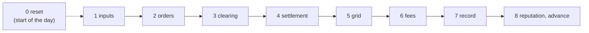

# The market step

> One market step, phase 0 to 8, in the order the code runs it: what each phase
> **reads**, **computes** and **writes**, the **code**, the **paper** equations and
> the **decisions** of the [issue register](../../original/issues/register.md) behind it.
> It is the innermost loop of [the full cycle](../full-cycle.md): the environment step
> ([The environment](../environment/index.md)) plays one market step between decoding
> the actions and returning rewards and observations.

| # | Phase | Method | Produces | [P1] §3.9 phase |
|---|---|---|---|---|
| 0 | Before the day | [`reset`](../../../core/market/lem.py#L272-L302) | participants with their day's profiles, DSO, grid | – |
| 1 | Inputs | [`_inputs`](../../../core/market/lem.py#L435-L446) | `StepInputs`: $G_t$, $D_t$, $p_\text{FiT}$, $p_\text{utility}$ | – |
| 2 | Orders | [`start_step`](../../../core/market/lem.py#L304-L327) | `PendingStep.orders` | 1, 2 |
| 3 | Clearing | [`advance`](../../../core/market/lem.py#L329-L369) × 3 → [`Clearing.stages`](../../../core/market/clearing.py#L97-L100) | three `StageResult`s with their trades | 3 |
| 4 | Settlement | [`_settle`](../../../core/market/lem.py#L618-L625) | `ParticipantOutcome` per participant | 4 |
| 5 | Grid | [`_assess_grid`](../../../core/market/lem.py#L627-L638) | `GridAssessment` | 4 |
| 6 | Fees | [`_charge_fees`](../../../core/market/lem.py#L679-L700), `pay_fees` | the fee parts of each trade and of each participant's untraded energy; profits net of fees | 4 |
| 7 | Record | [`advance`](../../../core/market/lem.py#L329-L369) | `StepRecord` | 6 |
| 8 | Reputation and advance | [`_update_reputation`](../../../core/market/lem.py#L688-L700), [`_advance`](../../../core/market/lem.py#L702-L711) | new reputations, next $p_\text{ref}$, history | 6, 8 |

Phases 5 (reward, KPIs) and 7 (observation) of [P1] §3.9 are the environment
step's E2 and E3. Without the RL agents, the market runs on its own bidding rule
([`step`](../../../core/market/lem.py#L371-L378) with no intents), and the Studio's Step
page plays it one part at a time: `start_step`, then `advance` five times (three
stages, then the rest).

## 0. Before the day: reset

| | |
|---|---|
| **Reads** | the scenario: network and day (`grid`), participants and what they own, batteries, market and DSO settings |
| **Computes** | each participant's $G_t$ and $D_t$ for every step of the day from the SimBench profiles of the elements it owns; batteries at their initial state of charge; reputation at its start value (0.5); the DSO with nothing seen and the tariffs of hour 0 ([`Dso.set_hour`](../../../core/market/dso.py#L120-L123)); the first reference price $p_\text{ref}$ = midpoint of those $p_\text{FiT}$ and $p_\text{utility}$; a fresh working copy of the network |
| **Writes** | `participants`, `dso`, `clearing_price`, `grid`; empty `history` |
| **Code** | [`reset`](../../../core/market/lem.py#L272-L302) → [`_build_participants`](../../../core/market/lem.py#L409-L426) ([`profiles_from_elements`](../../../core/market/agent/der.py#L88-L120)), [`_battery`](../../../core/market/lem.py#L428-L433), [`Dso.market_price`](../../../core/market/dso.py#L146-L150), [`SimBenchGrid.reset`](../../../core/grid/powerflow.py#L81-L104) |
| **Paper** | §3.4.4 (profiles, replaced by SimBench), eq. 16 (battery) |
| **Decisions** | profiles from SimBench (M-04, M-05); one start value for everyone (M-45); tariffs flat or time-of-use (MP-0b: the reference scenario's utility price by hour, `Dso.set_hour` before each step); *Open: MP-0a, MP-1c, MP-5b* ([open items](../../temp/open.md)) |

## 1. Inputs

| | |
|---|---|
| **Reads** | the step $t$ = `current_step` (number of steps already recorded) |
| **Computes** | nothing new: picks step $t$ out of each participant's day, and takes the DSO's current tariffs, which the previous step's 8b (or the reset, for step 0) set to this step's hour: flat, or the step's price from the series of a file in `config/data/` ([`price_at`](../../../core/config/scenario.py#L265-L268)) |
| **Writes** | [`StepInputs`](../../../core/market/lem.py#L77-L93): `generation_kwh`, `demand_kwh`, `feed_in_tariff`, `utility_price` |
| **Code** | [`_inputs`](../../../core/market/lem.py#L435-L446) |
| **Paper** | $G_t$, $D_t$, $p_\text{FiT}$, $p_\text{utility}$ (§3.3.1, §3.4) |
| **Decisions** | energies in kWh per step, $\Delta t$ explicit (`step_hours`, M-03); time-of-use utility price in the reference scenario (MP-0b), the tariffs and what they leave a peer trade in [Tariffs and the peer charge](tariffs.md); *Open: MP-0a* ([open items](../../temp/open.md)) |

## 2. Orders

Order prices are rounded to whole cents when the intents are limited to the bounds
(MP-5d). Three sub-steps, all inside [`start_step`](../../../core/market/lem.py#L304-L327).

**2a. Intents.** What each participant wants: buy or sell, price, quantity, and
optionally a preferred partner $\beta$. They come from outside or from the market's
own rule:

- **from the RL agents**: [`MarketEnv.decode`](../../../core/env/market_env.py#L594-L627)
  turns each action into an intent (quantity as a share of eq. 15a-b's bound, price
  between $p_\text{FiT}$ and $p_\text{utility}$);
- **from the bidding rule** when none are given:
  [`_rule_intents`](../../../core/market/lem.py#L448-L474) →
  [`rule_based_bid.net_position`](../../../core/market/agent/rule_based_bid.py#L64-L108): the net position
  after what the battery can take or give, at $p_\text{FiT} + m \cdot \text{spread}$
  (selling) or $p_\text{utility} - m \cdot \text{spread}$ (buying), with a small
  jitter;
- **partners**, if `partner_preference` is on:
  [`_with_partners`](../../../core/market/lem.py#L476-L496) →
  [`Participant.choose_partner`](../../../core/market/agent/der.py#L195-L234): a weighted
  score of reputation and closeness $d_{ij}$ over the candidates on the other side.

**2b. Validate.** [`_validate`](../../../core/market/lem.py#L528-L568): every intent is
limited, never rejected for being too large.

$$
q \leftarrow \min\bigl(q,\ q_\text{max,phys},\ q_\text{max}\bigr), \qquad p \leftarrow \min\bigl(p_\text{max}, \max(p_\text{min}, p)\bigr)
$$

where $q_\text{max,phys}$ for a seller is
$\max(0,\ G_t - D_t + E_\text{dischargeable})$
([`max_sell_kwh`](../../../core/market/agent/der.py#L185-L192)): the battery covers the
household's own deficit first, and only the rest is for sale. [P1] eq. 15a adds the
whole $E_\text{dischargeable}$ to $\max(0, G_t - D_t)$, which would let a household
short of energy sell its battery to peers while importing its own load (MP-2c). For a
buyer it is eq. 15b less the household's own surplus,
$\max(0, D_t - G_t) + \max\bigl(0,\ E_\text{chargeable} - \max(0, G_t - D_t)\bigr)$
([`max_buy_kwh`](../../../core/market/agent/der.py#L199-L209)), with the battery's
efficiencies and power limit
([`chargeable_kwh`, `dischargeable_kwh`](../../../core/market/agent/battery.py#L72-L86)):
a surplus charges the battery first (eq. 16), so only the room it leaves is left to
buy, where [P1]'s eq. 15b adds the whole room to a household that already has a
surplus (MP-2f).
An intent at or below `min_quantity` is dropped (0.001 kWh in the thesis scenario, so
that no numerical dust becomes an order, MP-2g). A price is limited to the market's
own bounds, `min_price` and `max_price`, not to the tariffs: an order priced beyond
$p_\text{FiT}$ or the peer ceiling is kept as given, and what no peer takes still
clears with the DSO at the tariff (MP-2b, MP-2e). Every change is written to `notes`.

**2c. Orders.** [`_orders`](../../../core/market/lem.py#L570-L586): each valid intent
becomes an [`Order`](../../../core/market/order.py#L9-L23) with an ID, the participant's bus
as location, its partner, and its arrival rank as timestamp (the participants'
order), the double auction's last tie-break.

| | |
|---|---|
| **Reads** | `StepInputs`, battery room, market bounds (`MarketSetup`), reputations and distances (partners) |
| **Computes** | intents; limited quantities and prices; orders |
| **Writes** | [`PendingStep`](../../../core/market/lem.py#L96-L130): `intents`, `orders`, `notes` |
| **Code** | [`start_step`](../../../core/market/lem.py#L304-L327), above |
| **Paper** | eq. 2 (the action $\langle p, q, \alpha, \beta \rangle$), eq. 15a-b, §3.2.3, §3.4 |
| **Decisions** | eq. 15 implemented with the battery (M-06, M-19); invalid actions limited, not raised (M-02); "no order" possible (M-08); weighted partner score (M-11); submitted orders never changed later (M-09); no selling from the battery while short (MP-2c); the household's own surplus counts against the room it may buy (MP-2f); a minimum order of 0.001 kWh in the thesis scenario (MP-2g); *Open: MP-2b* ([open items](../../temp/open.md)) |

## 3. Clearing

`advance` runs one stage per call, each on the orders the previous one left open
([`clearing.py`](../../../core/market/clearing.py)). The stages work on copies: the
submitted orders stay as they were. Every trade leaves its stage with its distance
and loss ([`Dso.assess`](../../../core/market/dso.py#L259-L263)); its fee comes only
in phase 6.

**3a. Stage 1, preferences.**
[`preferences`](../../../core/market/clearing.py#L103-L136): a buyer and a seller that
named each other as $\beta$ trade if the bid is at least the ask, for
$\min(q_\text{buy}, q_\text{sell})$, at the pricing mechanism's price.

**3b. Stage 2, double auction.**
[`double_auction`](../../../core/market/clearing.py#L139-L174): bids from the highest
price down, asks from the lowest up, reputation then arrival breaking ties; pairs
trade while bid ≥ ask. Orders that prefer the DSO stay out.

**3c. Stage 3, DSO.** [`dso`](../../../core/market/clearing.py#L177-L181) →
[`Dso.clear`](../../../core/market/dso.py#L312-L335): every order still open trades
with the DSO, sells at $p_\text{FiT}$, buys at $p_\text{utility}$, along the path to
the transformer.

The price of a peer trade comes from the mechanism of `market.mechanism`
([`clearing_price.py`](../../../core/market/clearing_price.py)): average (eq. 9), buyer,
seller, bid-ask spread, Nash bargaining (eq. 10) or proportional surplus around
$p_\text{ref}$ (eq. 11). Each trade's distance and loss:

$$
d_{ij} = \text{line length of the shortest path (km)}, \qquad l_{ij} = \kappa\, d_{ij}\, q_{ij} \quad \text{(eq. 18)}
$$

| | |
|---|---|
| **Reads** | the open orders; [`ClearingRules`](../../../core/market/clearing.py#L57-L80) from [`_rules`](../../../core/market/lem.py#L589-L604): mechanism, $p_\text{ref}$, reputations, paths, the DSO |
| **Computes** | the trades of each stage: buyer, seller, $q_{ij}$, $p_{ij}$, stage, $d_{ij}$, $l_{ij}$ |
| **Writes** | `PendingStep.stages`: three [`StageResult`](../../../core/market/clearing.py#L35-L54)s, each with its trades and the orders left |
| **Code** | above; paths: [`_path`](../../../core/market/lem.py#L507-L517), [`_upstream`](../../../core/market/lem.py#L519-L525) → [`SimBenchGrid.path`, `path_upstream`](../../../core/grid/powerflow.py#L242-L268) |
| **Paper** | §3.3.2 (three stages, Algorithm 1), §3.3.3 and eq. 9-11 (prices), eq. 18 (loss), §3.5.1 (distance) |
| **Decisions** | DSO-preferring orders wait for stage 3 (M-10); no trade blocked for grid reasons (M-12); pricing fixed (M-13, M-14); DSO trades get a path (M-31); loss recorded, not taken off the energy (M-40, M-41) ([open items](../../temp/open.md)) |

## 4. Settlement

[`_settle`](../../../core/market/lem.py#L618-L625) → for every participant
[`Participant.settle`](../../../core/market/agent/der.py#L237-L274):

$$
\begin{aligned}
B_i &= (G_t - D_t) + (E_\text{bought} - E_\text{sold}) && \text{(eq. 13)} \\
\text{charge} &= \text{battery takes } B_i \text{ if } B_i > 0, \quad \text{discharge} = \text{battery gives } {-B_i} \text{ if } B_i < 0 && \text{(eq. 16)} \\
\text{external} &= B_i - \text{charge} + \text{discharge} && \text{(untraded, with the upstream grid)} \\
\text{profit}_i &= \textstyle\sum p\, q_\text{sold} - \sum p\, q_\text{bought} && \text{(eq. 14, before fees)}
\end{aligned}
$$

| | |
|---|---|
| **Reads** | the step's trades, $G_t$, $D_t$, the battery |
| **Computes** | bought, sold, balance $B_i$, charge, discharge, external exchange, state of charge, trading profit; deferred and satisfied demand and supply (properties of the outcome) |
| **Writes** | [`ParticipantOutcome`](../../../core/market/agent/der.py#L31-L82) per participant (fees still 0; its untraded energy, `external`, is settled with the DSO in phase 6); the battery's energy; `Participant.profit` |
| **Code** | above; battery: [`charge`, `discharge`](../../../core/market/agent/battery.py#L89-L107) |
| **Paper** | eq. 13, 14, 16; §3.4.1 (demand satisfied) |
| **Decisions** | battery sign and efficiencies fixed (M-16, M-17, M-18); balance as eq. 13 (M-20, M-21); profit updated (M-22); discharge counts towards demand (M-23) ([open items](../../temp/open.md)) |

## 5. Grid

The power flow. [`_assess_grid`](../../../core/market/lem.py#L627-L638):
each participant's net power at its bus from what it physically did,
[`injection`](../../../core/market/agent/der.py#L289-L300)
$= (G + \text{discharge} - D - \text{charge}) / \Delta t$, never from its trades.
[`SimBenchGrid.assess`](../../../core/grid/powerflow.py#L187-L234) sets the network's own
loads and generators to their profiles for step $t$
([`_apply_background`](../../../core/grid/powerflow.py#L146-L152)), adds the injections
and runs one AC power flow (pandapower). The flow gives every line's and
transformer's loss; with `dso.losses` set to a rule of
[losses.py](../../../core/grid/losses.py) they are also shared out, each participant's
share in `GridAssessment.loss_shares_kwh` (BCDLA: each branch's current-dependent loss
split over the elements below it by
$\operatorname{Re}(I_e \overline{I_b}) / \lvert I_b \rvert^2$, a negative share for an
element that relieves the branch). A line's loss is its measured loss; a transformer's
is its copper loss, $v_{kr}/100 \cdot S_n \cdot (I_\text{LV} / I_\text{rated})^2$
([`trafo_copper_losses_kw`](../../../core/grid/losses.py#L246-L273)), not its measured
loss, which also holds the no-load (iron) loss, 0.48 kW on rural1's transformer whatever
flows. That part depends on no current, and sharing it by current made the shares blow
up where the net transformer current is near zero (two households that balance each
other got opposite shares many times the loss). It stays with the DSO, as
`LossShares.residual_kw` (MP-4k).

| | |
|---|---|
| **Reads** | the outcomes |
| **Computes** | bus voltages, line and transformer loading, losses (and each participant's share of them, with a loss rule), exchange with the upstream grid, limit violations |
| **Writes** | [`GridAssessment`](../../../core/grid/contract.py) (`grid`), the line loading and bus voltages the fees read |
| **Code** | above |
| **Paper** | §3.5.3 (replaced by the power flow) |
| **Decisions** | AC power flow instead of the trade-flow graph (M-35, M-36, M-38) ([open items](../../temp/open.md)) |

## 6. Fees

**6a. The DSO looks at the grid.**
[`Dso.observe(grid)`](../../../core/market/dso.py#L158-L164): it keeps the power
flow's line loading, the transformer's loading and the bus voltages.

**6b. A fee for every trade.** [`Dso.charge`](../../../core/market/dso.py#L302-L343),
for a peer trade along $\text{path}(i, j)$, for a DSO trade along the path to the
transformer (the transformer's loading counts in $C_t$, no zone bonus, plus the
imbalance fee):

$$
\begin{aligned}
C_t &= \min\bigl(1, \max_{e \in \text{path}} \text{loading}_e / 100\bigr), \ e \text{ also the transformer for a DSO trade} && \text{(eq. 8a's congestion)} \\
F_\text{cong} &= f_\text{cong}\,(C_t - C_\text{th})\, q\, p \ \text{ if } C_t > C_\text{th} && \text{(8a)} \\
F_\text{thermal} &= \min\Bigl(\tfrac{C_t - T_\text{th}}{1 - T_\text{th}},\ f_\text{threshold}\Bigr)\, q\, p \ \text{ if } C_t > T_\text{th} && \text{(8d, 8g)} \\
F_\text{volt} &= \min(V_\text{drop}, V_\text{th})\, q\, p, \quad V_\text{drop} = f_\text{volt}\, d_{ij} \text{ or measured: } \max_{b \in \text{path}} \lvert V_b - 1 \rvert && \text{(8c, 8f)} \\
F_\text{trans} &= l_{ij}\, p \ \text{ with } \texttt{losses = "trades"}\text{, else } 0 && \text{(8, no formula in [P1])} \\
F_\text{zone} &= -\min\bigl(f_\text{zone}\, q\, p,\ F_\text{other}\bigr) \ \text{ if both ends on one feeder} && \text{(8e)} \\
F_\text{imb} &= f_\text{imb}\, \min\bigl(q / |B_\text{grid}|, 1\bigr)\, q\, p \ \text{ for a DSO trade that worsens } B_\text{grid} && \text{(8b, 8h)}
\end{aligned}
$$

([`congestion`](../../../core/market/dso.py#L181-L196),
[`voltage_drop_of`](../../../core/market/dso.py#L166-L179),
[`fees_of`](../../../core/market/dso.py#L199-L245),
[`imbalance_fee`](../../../core/market/dso.py#L247-L273)). $B_\text{grid}$ is the
market's balance before stage 3, offered minus asked
([`PendingStep.grid_balance_kwh`](../../../core/market/lem.py#L126-L130)).
[`_charged`](../../../core/market/dso.py#L275-L294) splits the total: a peer trade's
fee 50/50 (`fee_buyer_share`), a DSO trade's fee all to the participant; nothing
is paid when `fees_charged` is off.

Three choices of the fee parts. The measured voltage is the largest deviation from
nominal on the path's buses, $\max_b \lvert V_b - 1 \rvert$, not the difference between
its two ends: on a feeder at 1.05 pu all along (rural1 exporting) two neighbours
differ by nothing, yet the voltage limit binds (MP-4l). A trade with the DSO runs up
to the transformer, so its loading counts in $C_t$ next to the lines', for both the
congestion and the thermal fee (MP-4l). The zone bonus (8e) cancels fees but never
pays out: it is at most the sum of the other parts, $F_\text{other}$, so no trade's
fee is below 0 (MP-4n). The imbalance fee (8b) is switched off in the thesis scenario
(`imbalance_factor` 0): it reads the order book's balance, not the grid, and lands on
the minority side by the sign of a net that no agent sees (MP-4m, open).

**6c. Untraded energy pays like a DSO trade.** What no trade covers (a deficit the
participant did not order, a surplus nobody took) is settled with the DSO at the
tariff, the deficit at $p_\text{utility}$ and the surplus at $p_\text{FiT}$
([Settlement](#4-settlement), MP-1e). That energy runs the same way as a stage-3
trade, through the same lines to the same transformer, so it pays the same fees: for
each participant with such energy, [`_untraded_trades`](../../../core/market/lem.py#L702-L726)
makes one implicit trade with the DSO (stage 4, `UNTRADED`) at that tariff along the
participant's path to the transformer, with its loss (eq. 18), and
[`_charge_fees`](../../../core/market/lem.py#L679-L700) hands it to `Dso.charge` with
the real trades, after the power flow. The participant pays the whole fee
(`_charged`); `fees_charged` off gives 0. Not ordering is then no cheaper than
ordering the same energy to the DSO (MP-1f). The implicit trades are in
`StepRecord.untraded`, not in `trades`, so volumes, clearing price, reputation and
the DSO's energy balance count only what was traded; the fee columns of the baseline
rows and of the trade tables (stage 4) and `StepRecord.fees` include them, and the
reward (the bill) carries them through `ParticipantOutcome.profit`.

**6d. Participants pay.**
[`Participant.pay_fees`](../../../core/market/agent/der.py#L292-L308): its share of every
trade's fee, and the whole fee of its untraded energy, comes off the step's profit and
the running profit. With a loss rule
(`dso.losses` other than `"trades"`) it also pays its share of the step's measured
losses at the step's utility price,
[`Dso.loss_charge`](../../../core/market/dso.py): $L_i \cdot p_\text{utility}$, paid back
when $L_i < 0$, nothing when `fees_charged` is off. It is part of its fees
(`ParticipantOutcome.loss_charge`), and the DSO collects it. The transformer's
no-load loss is nobody's share: the DSO bears it ([Grid](#5-grid)).

| | |
|---|---|
| **Reads** | the trades and the untraded energy, the power flow's line and transformer loading, the measured voltages, paths and zones, $B_\text{grid}$ |
| **Computes** | $C_t$, $V_\text{drop}$, the six fee parts per trade and per untraded settlement, the split, each participant's fees |
| **Writes** | `Trade.fees`, `fee_parts`, `buyer_fee`, `seller_fee`; `StepRecord.untraded`; `ParticipantOutcome.fees` and `profit` |
| **Code** | [`_charge_fees`](../../../core/market/lem.py#L679-L700), above |
| **Paper** | eq. 8, 8a-8h |
| **Decisions** | fees charged at all (M-27); after the same step's power flow; $F_\text{trans}$ as the loss at the trade price (M-28), or the measured losses shared by a rule and charged per participant (`dso.losses`, MP-4j); caps (M-29); imbalance on DSO trades (M-30); DSO trades pay their path (M-31); thermal threshold (M-32); zones = feeders and the bonus size (M-33, M-34); untraded energy pays the fees of a DSO trade (MP-1f, 11 Nov 2026: it was settled without fees before, MP-1e); the measured voltage and the transformer's loading in a DSO trade's congestion (MP-4l); the zone bonus never takes a fee below 0 (MP-4n); the transformer's no-load loss stays with the DSO (MP-4k); the imbalance fee off in the thesis scenario (MP-4m); *Open: MP-4f, MP-4h (the peer charge, [Tariffs](tariffs.md)), MP-4m* ([open items](../../temp/open.md)) |

## 7. Record

In [`advance`](../../../core/market/lem.py#L329-L369), once the fees are known (the record itself at [L354-L365](../../../core/market/lem.py#L354-L365)):

- the step's clearing price,
  [`_clearing_price`](../../../core/market/lem.py#L606-L615): volume-weighted price of the
  peer trades, or the previous one when there were none;
- the DSO's step, [`Dso.settle`](../../../core/market/dso.py#L338-L357):
  $B_\text{DSO} = \sum (E_\text{sold} - E_\text{bought})$ (eq. 7), energy revenue,
  fees collected, those of the untraded energy included;
- everything into one [`StepRecord`](../../../core/market/lem.py#L133-L201): inputs,
  orders, stages with their charged trades, outcomes, clearing price, `grid`, `dso`,
  notes, and the charged untraded settlements.

| | |
|---|---|
| **Reads** | the charged trades, the outcomes, the grid results |
| **Computes** | the clearing price; the DSO's balance, revenue and fees |
| **Writes** | `StepRecord`; the DSO's running balance and profit |
| **Code** | above |
| **Paper** | eq. 7; UpdateMarketState of Algorithm 1 |
| **Decisions** | clearing price from peer trades only (M-15); the DSO's balance kept per step and over the day (M-24, M-25); *Open: MP-6a* ([open items](../../temp/open.md)) |

## 8. Reputation and advance

**8a. Reputation.** [`_update_reputation`](../../../core/market/lem.py#L688-L700) →
[`ReputationHandler.update_reputation`](../../../core/market/reputation.py#L120-L144),
for every participant, from the record
([`_calculate_reputation`](../../../core/market/reputation.py#L158-L245)):

$$
\begin{aligned}
\delta_\text{rel} &= \min\bigl(1, \text{volume matched by peers} / \text{volume ordered}\bigr) \\
\delta_\text{fair} &= 1 - \min\bigl(1, \text{mean } |p - p_\text{clear}| / p_\text{clear}\bigr) \quad \text{(its peer trades)} \\
\delta_\text{grid} &= \bigl(\text{mean impact of its trades on } B_\text{grid} + 1\bigr) / 2 \quad \text{(DSO trades neutral)} \\
s &= 0.3\, \delta_\text{rel} + 0.2\, \delta_\text{fair} + 0.5\, \delta_\text{grid} \quad \text{(eq. 12)} \\
r &\leftarrow \delta\, r + (1 - \delta)\, s, \qquad \delta = 0.8^{\Delta t}
\end{aligned}
$$

When the step has no trades at all, every reputation stays as it was. Otherwise a
component with nothing to measure counts as neutral (0.5), e.g. fairness for a
participant without peer trades. The weights and the decay are scenario settings
(`MarketSetup`); 0.3, 0.2, 0.5 and 0.8 are the defaults. The impact of one
trade is $\pm\min(q / |B_\text{grid}|, 1)$: positive when it buys during excess
supply or sells during a shortage; 0 for a trade with the DSO, and 0 for every
trade when the market is balanced ($|B_\text{grid}| < 0.1$ kWh)
([`_calculate_grid_impact`](../../../core/market/reputation.py#L247-L297)).

**8b. Advance.** [`_advance`](../../../core/market/lem.py#L702-L711): the clearing price
becomes next step's $p_\text{ref}$; the record joins `history`, so `current_step`
moves on; and the DSO's tariffs move to the next step's hour
([`Dso.set_hour`](../../../core/market/dso.py#L120-L123)), which phase 1 of the next
step reads. After the day's last step that is midnight of the next day, as the
final observation shows.

| | |
|---|---|
| **Reads** | `StepRecord`, each participant's reputation |
| **Computes** | the three components, the score, the new reputation |
| **Writes** | `Participant.reputation`; `StepRecord.reputation`; `clearing_price`; `history` |
| **Code** | above |
| **Paper** | eq. 12 and §3.3.4 (reputation, decay); §3.9 phases 6 and 8 |
| **Decisions** | reliability measured on peer matches (M-42); decay per hour (M-43); grid part and fairness on peers (M-44); start value (M-45); *Open: MP-5b, MP-5c* ([open items](../../temp/open.md)) |
