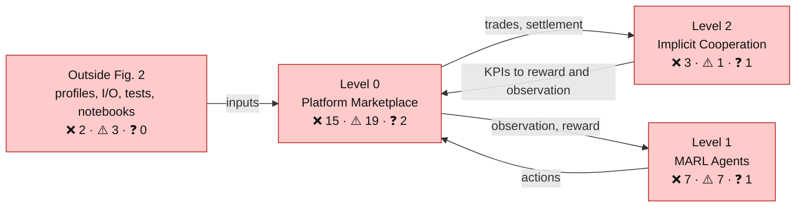
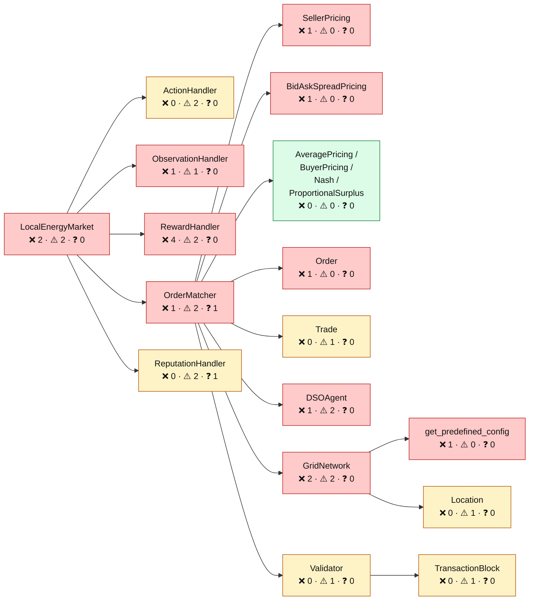
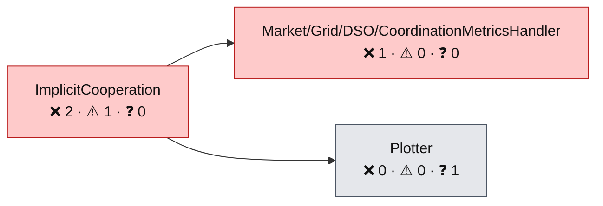
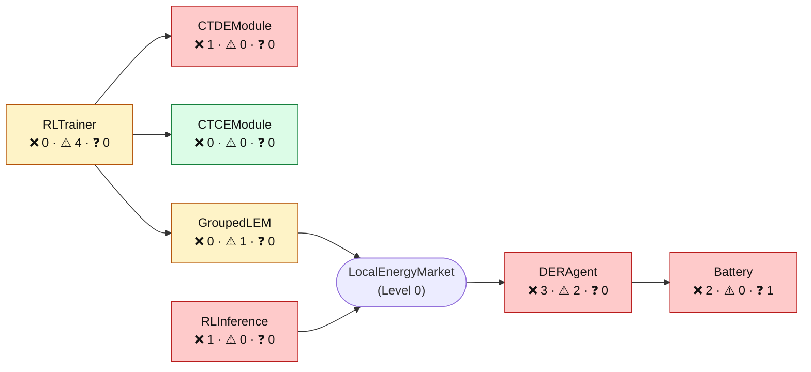
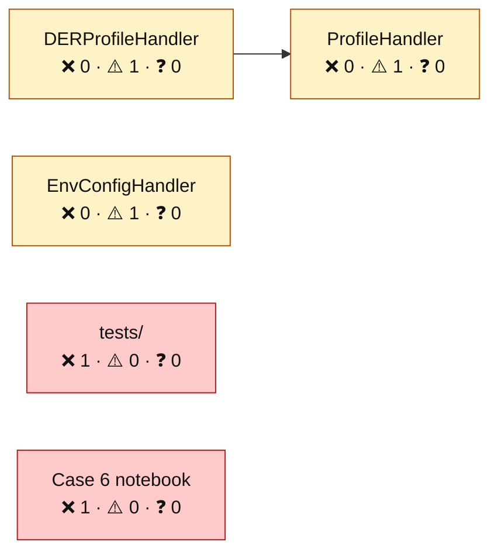
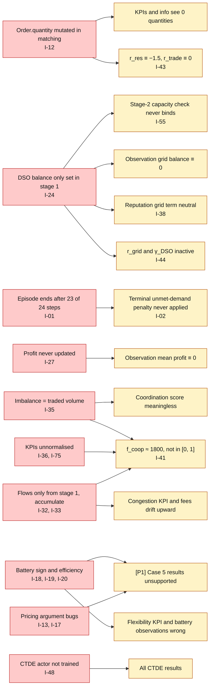

# MARLEM: faults by level in the original code

> Every class and function of the original MARLEM that deviates from the papers or is broken, organised by the three levels of [P1] Fig. 2. It aggregates everything analysed so far: the issue register, the evidence trace and the implementation tables.
>
> - The pure paper summary is in [marlem-methodology copy.md](<marlem-methodology copy.md>).
> - The paper vs code comparison per equation is in [marlem-methodology.md](marlem-methodology.md).
> - The full issue register (with evidence) is in [paper-vs-code.md](../thesis/validation/paper-vs-code.md).
>
> Code links point to `src_thesis/`, which is the upstream code relocated, unchanged (checked 2026-09-24). Issue IDs link to their register row.

**Status legend**

| Mark | Meaning |
|---|---|
| ❌ | Broken or contradicts the paper; changes results |
| ⚠️ | Deviates from the paper or only partly implemented |
| ❓ | The paper is silent or ambiguous; the code made a choice that needs a recorded decision |
| ✅ | Implemented as described (listed only where it helps orientation) |

## 1. Fault map by level

Colour = the **worst** finding in a box: red ❌ broken, amber ⚠️ deviates, grey ❓ paper silent, green ✅ as described. Counts are ❌ / ⚠️ / ❓ findings.

### 1.1 Level 0: Platform Marketplace

### 1.2 Level 2: Implicit Cooperation

### 1.3 Level 1: MARL Agents

### 1.4 Outside Fig. 2 (inputs, persistence, tests, notebooks)

## 2. How the root faults propagate

A few faults in Level 0 and Level 1 explain most of the broken signals downstream. Fixing a root (left) is expected to clear its symptoms (right). Re-check the symptoms after each fix.

## 3. Summary per class

| Level | Class | File | ❌ | ⚠️ | ❓ | Worst |
|---|---|---|---|---|---|---|
| 0 | LocalEnergyMarket | [lem.py](../../src_thesis/marketplace/lem.py) | 2 | 2 | 0 | ❌ |
| 0 | ActionHandler | [action.py](../../src_thesis/marketplace/action.py) | 0 | 2 | 0 | ⚠️ |
| 0 | ObservationHandler | [observation.py](../../src_thesis/marketplace/observation.py) | 1 | 1 | 0 | ❌ |
| 0 | RewardHandler | [reward.py](../../src_thesis/marketplace/reward.py) | 4 | 2 | 0 | ❌ |
| 0 | OrderMatcher | [matching.py](../../src_thesis/marketplace/market/matching.py) | 1 | 2 | 1 | ❌ |
| 0 | SellerPricing | [mechanism.py](../../src_thesis/marketplace/market/mechanism.py) | 1 | 0 | 0 | ❌ |
| 0 | BidAskSpreadPricing | [mechanism.py](../../src_thesis/marketplace/market/mechanism.py) | 1 | 0 | 0 | ❌ |
| 0 | AveragePricing / BuyerPricing / Nash / ProportionalSurplus | [mechanism.py](../../src_thesis/marketplace/market/mechanism.py) | 0 | 0 | 0 | ✅ |
| 0 | Order | [order.py](../../src_thesis/marketplace/market/order.py) | 1 | 0 | 0 | ❌ |
| 0 | Trade | [order.py](../../src_thesis/marketplace/market/order.py) | 0 | 1 | 0 | ⚠️ |
| 0 | DSOAgent | [dso.py](../../src_thesis/marketplace/dso/dso.py) | 1 | 2 | 0 | ❌ |
| 0 | ReputationHandler | [reputation.py](../../src_thesis/marketplace/market/reputation.py) | 0 | 2 | 1 | ⚠️ |
| 0 | TransactionBlock | [validation.py](../../src_thesis/marketplace/market/validation.py) | 0 | 1 | 0 | ⚠️ |
| 0 | Validator | [validation.py](../../src_thesis/marketplace/market/validation.py) | 0 | 1 | 0 | ⚠️ |
| 0 | GridNetwork | [network.py](../../src_thesis/adapters/grid/network.py) | 2 | 2 | 0 | ❌ |
| 0 | get_predefined_config | [config.py](../../src_thesis/marketplace/grid/config.py) | 1 | 0 | 0 | ❌ |
| 0 | Location | [base.py](../../src_thesis/marketplace/grid/base.py) | 0 | 1 | 0 | ⚠️ |
| 1 | DERAgent | [der.py](../../src_thesis/marl/agents/der.py) | 3 | 2 | 0 | ❌ |
| 1 | Battery | [battery.py](../../src_thesis/marl/agents/battery.py) | 2 | 0 | 1 | ❌ |
| 1 | CTDEModule | [ctde.py](../../src_thesis/marl/ctde.py) | 1 | 0 | 0 | ❌ |
| 1 | CTCEModule | [ctce.py](../../src_thesis/marl/ctce.py) | 0 | 0 | 0 | ✅ |
| 1 | RLTrainer | [train.py](../../src_thesis/marl/train.py) | 0 | 4 | 0 | ⚠️ |
| 1 | GroupedLEM | [train.py](../../src_thesis/marl/train.py) | 0 | 1 | 0 | ⚠️ |
| 1 | RLInference | [inference.py](../../src_thesis/marl/inference.py) | 1 | 0 | 0 | ❌ |
| 2 | ImplicitCooperation | [implicit_cooperation.py](../../src_thesis/cooperation/implicit_cooperation.py) | 2 | 1 | 0 | ❌ |
| 2 | Market/Grid/DSO/CoordinationMetricsHandler | [market_analytics.py](../../src_thesis/cooperation/metrics/market_analytics.py) | 1 | 0 | 0 | ❌ |
| 2 | Plotter | [plotter.py](../../src_thesis/cooperation/visualization/plotter.py) | 0 | 0 | 1 | ❓ |
| — | DERProfileHandler | [der.py](../../src_thesis/adapters/profiles/der.py) | 0 | 1 | 0 | ⚠️ |
| — | ProfileHandler | [base.py](../../src_thesis/adapters/profiles/base.py) | 0 | 1 | 0 | ⚠️ |
| — | EnvConfigHandler | [io.py](../../src_thesis/marketplace/io.py) | 0 | 1 | 0 | ⚠️ |
| — | tests/ | [test_battery.py](../../tests/test_battery.py) | 1 | 0 | 0 | ❌ |
| — | Case 6 notebook | [case6_implicit_cooperation.ipynb](../../notebooks/case6_implicit_cooperation.ipynb) | 1 | 0 | 0 | ❌ |
| | **Total findings** | | **27** | **30** | **4** | ✅ 7 |

## 4. Level 0: Platform Marketplace

### [src_thesis/marketplace/lem.py](../../src_thesis/marketplace/lem.py)

| Class | Function | Status | What is wrong | Issues |
|---|---|---|---|---|
| LocalEnergyMarket | `__init__` [lem.py:45-122](../../src_thesis/marketplace/lem.py#L45-L122) | ❌ | Reads `max_error` and `num_anchor` but never uses them, so observations get the true future instead of forecasts. | [I-39](../thesis/validation/paper-vs-code.md#I-39) |
| LocalEnergyMarket | `reset` [lem.py:260-318](../../src_thesis/marketplace/lem.py#L260-L318) | ⚠️ | Falls back to the configured seed (every episode identical), regenerates the profiles passed to agents, and gives every agent the same random reputation. | [I-03](../thesis/validation/paper-vs-code.md#I-03), [I-05](../thesis/validation/paper-vs-code.md#I-05), [I-07](../thesis/validation/paper-vs-code.md#I-07) |
| LocalEnergyMarket | `step` [lem.py:320-506](../../src_thesis/marketplace/lem.py#L320-L506) | ❌ | Only 23 of 24 periods run and the terminal flag never reaches the reward (L459-469). Invalid actions raise instead of being dropped (L349-350). Uses `α > 0.5` while feasibility uses `α > 0` (L366). `info['grid_balance']` is `dso.balance`, and $B_{grid}$ (eq. 20) is never computed (L489). | [I-01](../thesis/validation/paper-vs-code.md#I-01), [I-02](../thesis/validation/paper-vs-code.md#I-02), [I-78](../thesis/validation/paper-vs-code.md#I-78), [I-09](../thesis/validation/paper-vs-code.md#I-09), [I-23](../thesis/validation/paper-vs-code.md#I-23) |
| LocalEnergyMarket | `seed` [lem.py:525-532](../../src_thesis/marketplace/lem.py#L525-L532) | ⚠️ | Shadowed by the `self.seed` attribute set in `__init__`, so it can never be called. | [I-04](../thesis/validation/paper-vs-code.md#I-04) |

### [src_thesis/marketplace/action.py](../../src_thesis/marketplace/action.py)

| Class | Function | Status | What is wrong | Issues |
|---|---|---|---|---|
| ActionHandler | `__init__` [action.py:18-45](../../src_thesis/marketplace/action.py#L18-L45) | ⚠️ | Continuous Box for discrete α and β; β = "no preference" is only reachable at the exact upper bound. | [I-10](../thesis/validation/paper-vs-code.md#I-10) |
| ActionHandler | `get_partner_id` [action.py:70-91](../../src_thesis/marketplace/action.py#L70-L91) | ⚠️ | Truncates the continuous β with `int()`; self-selection is allowed. | [I-10](../thesis/validation/paper-vs-code.md#I-10) |

### [src_thesis/marketplace/observation.py](../../src_thesis/marketplace/observation.py)

| Class | Function | Status | What is wrong | Issues |
|---|---|---|---|---|
| ObservationHandler | `reset_observation_space` [observation.py:196-258](../../src_thesis/marketplace/observation.py#L196-L258) | ⚠️ | Hard-codes generation, demand, remaining energy and KPIs to 0 at reset. | [I-58](../thesis/validation/paper-vs-code.md#I-58) |
| ObservationHandler | `update_observation_space` [observation.py:260-364](../../src_thesis/marketplace/observation.py#L260-L364) | ❌ | Exact future demand and supply (no forecast); mean profit always 0; grid balance always 0; raw, unnormalised values. | [I-39](../thesis/validation/paper-vs-code.md#I-39), [I-27](../thesis/validation/paper-vs-code.md#I-27), [I-24](../thesis/validation/paper-vs-code.md#I-24), [I-40](../thesis/validation/paper-vs-code.md#I-40) |

### [src_thesis/marketplace/reward.py](../../src_thesis/marketplace/reward.py)

| Class | Function | Status | What is wrong | Issues |
|---|---|---|---|---|
| RewardHandler | `__init__` [reward.py:36-93](../../src_thesis/marketplace/reward.py#L36-L93) | ⚠️ | `_w_local` is set to 0.7 and overwritten with 0.3, so trading weights become 0.3 / 0.3. | [I-45](../thesis/validation/paper-vs-code.md#I-45) |
| RewardHandler | `calculate_reward` [reward.py:103-232](../../src_thesis/marketplace/reward.py#L103-L232) | ❌ | The no-trade guard returns −4.46 before any term (❓ not in the paper). $f_{coop}$ is built from unnormalised KPIs (≈ 1800). The boost has no −1 and matches neither paper form. $\gamma_{UD}$ is terminal-only and never fires. $\gamma_{DSO}$ is 0 while the DSO balance is 0. | [I-47](../thesis/validation/paper-vs-code.md#I-47), [I-41](../thesis/validation/paper-vs-code.md#I-41), [I-42](../thesis/validation/paper-vs-code.md#I-42), [I-02](../thesis/validation/paper-vs-code.md#I-02), [I-46](../thesis/validation/paper-vs-code.md#I-46), [I-44](../thesis/validation/paper-vs-code.md#I-44) |
| RewardHandler | `_calculate_trading_reward` [reward.py:234-251](../../src_thesis/marketplace/reward.py#L234-L251) | ❌ | Divides by the mutated `order.quantity` (0), so it is always 0. | [I-43](../thesis/validation/paper-vs-code.md#I-43) |
| RewardHandler | `_calculate_grid_balance_reward` [reward.py:253-309](../../src_thesis/marketplace/reward.py#L253-L309) | ❌ | Driven by `dso.balance` (always 0) and `order.quantity` (0). | [I-44](../thesis/validation/paper-vs-code.md#I-44), [I-43](../thesis/validation/paper-vs-code.md#I-43) |
| RewardHandler | `_calculate_resource_allocation_reward` [reward.py:388-412](../../src_thesis/marketplace/reward.py#L388-L412) | ❌ | Execution ratio uses the mutated `order.quantity` (0), so it is always −1.5. | [I-43](../thesis/validation/paper-vs-code.md#I-43) |
| RewardHandler | `_calculate_contribution_factor` [reward.py:448-499](../../src_thesis/marketplace/reward.py#L448-L499) | ⚠️ | Grid part is a heuristic on `matching.grid_balance` (0), not the marginal effect; local share counts trades, not energy. | [I-79](../thesis/validation/paper-vs-code.md#I-79) |
| RewardHandler | `_calculate_economic_reward` [reward.py:311-386](../../src_thesis/marketplace/reward.py#L311-L386) | ✅ | 0.4 price efficiency + 0.6 profit vs DSO, as described. | — |
| RewardHandler | `_calculate_stability_reward` [reward.py:414-446](../../src_thesis/marketplace/reward.py#L414-L446) | ✅ | 0.3 price stability + 0.7 grid improvement, as described. | — |

### [src_thesis/marketplace/market/matching.py](../../src_thesis/marketplace/market/matching.py)

| Class | Function | Status | What is wrong | Issues |
|---|---|---|---|---|
| OrderMatcher | `match_orders` [matching.py:240-436](../../src_thesis/marketplace/market/matching.py#L240-L436) | ❌ | Mutates the submitted orders (L370-371). The capacity check uses `max_quantity · N` and the current balance (L317-318). The loss is re-bought from the DSO (L370). The clearing price is a volume-weighted mean including DSO tariffs (L410, ❓). The DSO balance is only set from stage 1 (L398). Stage-2 trades never update grid flows. | [I-12](../thesis/validation/paper-vs-code.md#I-12), [I-55](../thesis/validation/paper-vs-code.md#I-55), [I-14](../thesis/validation/paper-vs-code.md#I-14), [I-16](../thesis/validation/paper-vs-code.md#I-16), [I-24](../thesis/validation/paper-vs-code.md#I-24), [I-32](../thesis/validation/paper-vs-code.md#I-32) |
| OrderMatcher | `_match_preferred_partners` [matching.py:607-752](../../src_thesis/marketplace/market/matching.py#L607-L752) | ❓ | Clears DSO-preferred orders with the DSO before any P2P matching. Its balance update has the opposite sign and is discarded. | [I-15](../thesis/validation/paper-vs-code.md#I-15), [I-25](../thesis/validation/paper-vs-code.md#I-25) |
| OrderMatcher | `_create_trade` [matching.py:531-605](../../src_thesis/marketplace/market/matching.py#L531-L605) | ⚠️ | The only place that calls `update_flow_from_trade` (stage 1 only). | [I-32](../thesis/validation/paper-vs-code.md#I-32) |
| OrderMatcher | `get_agent_position` [matching.py:453-472](../../src_thesis/marketplace/market/matching.py#L453-L472) | ⚠️ | Returns sold − bought, used as the agent balance instead of eq. 13. | [I-26](../thesis/validation/paper-vs-code.md#I-26) |

### [src_thesis/marketplace/market/mechanism.py](../../src_thesis/marketplace/market/mechanism.py)

| Class | Function | Status | What is wrong | Issues |
|---|---|---|---|---|
| SellerPricing | `calculate_price` [mechanism.py:73-85](../../src_thesis/marketplace/market/mechanism.py#L73-L85) | ❌ | The first positional argument is the *buy* order, so it returns the buyer's price. | [I-13](../thesis/validation/paper-vs-code.md#I-13) |
| BidAskSpreadPricing | `calculate_price` [mechanism.py:92-113](../../src_thesis/marketplace/market/mechanism.py#L92-L113) | ❌ | Receives the market price as `factor` (clipped to 1), so it returns the buyer's price. Used in [P1] Case 5. | [I-17](../thesis/validation/paper-vs-code.md#I-17) |
| AveragePricing / BuyerPricing / Nash / ProportionalSurplus | `calculate_price` [mechanism.py:31-192](../../src_thesis/marketplace/market/mechanism.py#L31-L192) | ✅ | Match eq. 9–11. | — |

### [src_thesis/marketplace/market/order.py](../../src_thesis/marketplace/market/order.py)

| Class | Function | Status | What is wrong | Issues |
|---|---|---|---|---|
| Order | `(dataclass)` [order.py:12-23](../../src_thesis/marketplace/market/order.py#L12-L23) | ❌ | Mutable `quantity` is used as the matching residual, which is the root of I-12. There is no separate submitted quantity. | [I-12](../thesis/validation/paper-vs-code.md#I-12) |
| Trade | `(dataclass)` [order.py:25-34](../../src_thesis/marketplace/market/order.py#L25-L34) | ⚠️ | Stores `fees` but no payer or receiver; no buyer payment or seller receipt. | [I-28](../thesis/validation/paper-vs-code.md#I-28) |

### [src_thesis/marketplace/dso/dso.py](../../src_thesis/marketplace/dso/dso.py)

| Class | Function | Status | What is wrong | Issues |
|---|---|---|---|---|
| DSOAgent | `clear_unmatched_orders` [dso.py:192-275](../../src_thesis/marketplace/dso/dso.py#L192-L275) | ⚠️ | Fills everything at zero distance, loss and fee, without grid checks, and sets the order quantities to 0. | [I-54](../thesis/validation/paper-vs-code.md#I-54), [I-12](../thesis/validation/paper-vs-code.md#I-12) |
| DSOAgent | `calculate_fees` [dso.py:277-353](../../src_thesis/marketplace/dso/dso.py#L277-L353) | ❌ | Fees are computed but **never charged**. $F_{trans}$ = 0 (❓). Voltage/thermal caps differ from eq. 8. $F_{imb}$ is effectively 0. | [I-28](../thesis/validation/paper-vs-code.md#I-28), [I-29](../thesis/validation/paper-vs-code.md#I-29), [I-30](../thesis/validation/paper-vs-code.md#I-30), [I-31](../thesis/validation/paper-vs-code.md#I-31) |
| DSOAgent | `validate_grid_constraints` [dso.py:356-401](../../src_thesis/marketplace/dso/dso.py#L356-L401) | ⚠️ | Ignores trade direction and uses current rather than projected congestion. | [I-54](../thesis/validation/paper-vs-code.md#I-54) |
| DSOAgent | `_calculate_balance_impact` [dso.py:403-451](../../src_thesis/marketplace/dso/dso.py#L403-L451) | ✅ | Matches eq. 8h (P2P trades → 0). | — |

### [src_thesis/marketplace/market/reputation.py](../../src_thesis/marketplace/market/reputation.py)

| Class | Function | Status | What is wrong | Issues |
|---|---|---|---|---|
| ReputationHandler | `reset` [reputation.py:57-69](../../src_thesis/marketplace/market/reputation.py#L57-L69) | ⚠️ | Re-seeds and draws U(0, 1), so every agent gets the same initial reputation. | [I-07](../thesis/validation/paper-vs-code.md#I-07) |
| ReputationHandler | `update_reputation` [reputation.py:71-89](../../src_thesis/marketplace/market/reputation.py#L71-L89) | ❓ | Decay weight = time of day, so new evidence is almost ignored near the end of the episode. | [I-38](../thesis/validation/paper-vs-code.md#I-38) |
| ReputationHandler | `_calculate_reputation` [reputation.py:103-163](../../src_thesis/marketplace/market/reputation.py#L103-L163) | ⚠️ | Reliability ≡ 1 (the unmatched list is always empty); grid term neutral (balance 0); weights 0.3 / 0.2 / 0.5 not in paper. | [I-38](../thesis/validation/paper-vs-code.md#I-38) |

### [src_thesis/marketplace/market/validation.py](../../src_thesis/marketplace/market/validation.py)

| Class | Function | Status | What is wrong | Issues |
|---|---|---|---|---|
| TransactionBlock | `calculate_hash` [validation.py:26-40](../../src_thesis/marketplace/market/validation.py#L26-L40) | ⚠️ | The hash omits loss and fees, so those fields can change without breaking the chain. | [I-66](../thesis/validation/paper-vs-code.md#I-66) |
| Validator | `_create_new_block` [validation.py:92-114](../../src_thesis/marketplace/market/validation.py#L92-L114) | ⚠️ | Called as a private method after every step, overriding the block size. In-memory proof-of-work, not consensus. | [I-66](../thesis/validation/paper-vs-code.md#I-66) |

### [src_thesis/adapters/grid/network.py](../../src_thesis/adapters/grid/network.py)

| Class | Function | Status | What is wrong | Issues |
|---|---|---|---|---|
| GridNetwork | `reset` [network.py:55-87](../../src_thesis/adapters/grid/network.py#L55-L87) | ❌ | Initialises edge flows at a random 0–30 % of capacity instead of per-period injections. | [I-33](../thesis/validation/paper-vs-code.md#I-33) |
| GridNetwork | `update_flow_from_trade` [network.py:283-334](../../src_thesis/adapters/grid/network.py#L283-L334) | ❌ | Flows accumulate over the episode, unsigned, silently capped; only called for stage-1 trades. | [I-33](../thesis/validation/paper-vs-code.md#I-33), [I-32](../thesis/validation/paper-vs-code.md#I-32) |
| GridNetwork | `transmission_loss` [network.py:338-355](../../src_thesis/adapters/grid/network.py#L338-L355) | ⚠️ | Eq. 18 with κ = 0.03 hard-coded and no cap on $d \cdot \kappa$. | [I-34](../thesis/validation/paper-vs-code.md#I-34), [I-70](../thesis/validation/paper-vs-code.md#I-70) |
| GridNetwork | `__init__` [network.py:23-53](../../src_thesis/adapters/grid/network.py#L23-L53) | ⚠️ | Capacity is clamped to ≥ 0 before a dead negative-capacity check. | [I-53](../thesis/validation/paper-vs-code.md#I-53) |

### [src_thesis/marketplace/grid/config.py](../../src_thesis/marketplace/grid/config.py)

| Class | Function | Status | What is wrong | Issues |
|---|---|---|---|---|
| get_predefined_config | `IEEE34 entry` [config.py:30-77](../../src_thesis/marketplace/grid/config.py#L30-L77) | ❌ | Edge 832–888 is missing, so the IEEE-34 graph is disconnected; the impedance table is never used. | [I-57](../thesis/validation/paper-vs-code.md#I-57) |

### [src_thesis/marketplace/grid/base.py](../../src_thesis/marketplace/grid/base.py)

| Class | Function | Status | What is wrong | Issues |
|---|---|---|---|---|
| Location | `distance_to` [base.py:34-58](../../src_thesis/marketplace/grid/base.py#L34-L58) | ⚠️ | A bare `except` silently falls back to Euclidean distance. | [I-53](../thesis/validation/paper-vs-code.md#I-53) |

## 5. Level 2: Implicit Cooperation

### [src_thesis/cooperation/implicit_cooperation.py](../../src_thesis/cooperation/implicit_cooperation.py)

| Class | Function | Status | What is wrong | Issues |
|---|---|---|---|---|
| ImplicitCooperation | `_get_economic_efficiency_metrics` [implicit_cooperation.py:82-113](../../src_thesis/cooperation/implicit_cooperation.py#L82-L113) | ⚠️ | Social welfare is turnover $\sum p \lvert q \rvert$ (❓ as printed, unnormalised); price volatility is over the whole episode. | [I-36](../thesis/validation/paper-vs-code.md#I-36), [I-37](../thesis/validation/paper-vs-code.md#I-37) |
| ImplicitCooperation | `_get_grid_stability_metrics` [implicit_cooperation.py:115-134](../../src_thesis/cooperation/implicit_cooperation.py#L115-L134) | ❌ | "Imbalance" = $\lvert \sum_{trades} q \rvert / C$, i.e. total traded volume, not supply − demand. | [I-35](../thesis/validation/paper-vs-code.md#I-35), [I-68](../thesis/validation/paper-vs-code.md#I-68) |
| ImplicitCooperation | `_get_coordination_effectiveness_metrics` [implicit_cooperation.py:136-160](../../src_thesis/cooperation/implicit_cooperation.py#L136-L160) | ❌ | Coordination score = 1 − the volume-based imbalance (inherits I-35). Convergence as described. | [I-35](../thesis/validation/paper-vs-code.md#I-35) |
| ImplicitCooperation | `_get_resource_coordination_metrics` [implicit_cooperation.py:162-233](../../src_thesis/cooperation/implicit_cooperation.py#L162-L233) | ✅ | Self-consumption and flexibility utilization as eq. 25–26 (the self-consumption label is a misnomer). | [I-69](../thesis/validation/paper-vs-code.md#I-69) |

### [src_thesis/cooperation/metrics/market_analytics.py](../../src_thesis/cooperation/metrics/market_analytics.py)

| Class | Function | Status | What is wrong | Issues |
|---|---|---|---|---|
| Market/Grid/DSO/CoordinationMetricsHandler | `(modules)` | ❌ | Report welfare, grid and coordination concepts without the required inputs (from the earlier audit; not re-verified line by line). | [I-65](../thesis/validation/paper-vs-code.md#I-65) |

### [src_thesis/cooperation/visualization/plotter.py](../../src_thesis/cooperation/visualization/plotter.py)

| Class | Function | Status | What is wrong | Issues |
|---|---|---|---|---|
| Plotter | `(module)` | ❓ | Not audited. | — |

## 6. Level 1: MARL Agents

### [src_thesis/marl/agents/der.py](../../src_thesis/marl/agents/der.py)

| Class | Function | Status | What is wrong | Issues |
|---|---|---|---|---|
| DERAgent | `__init__ / reset` [der.py:24-115](../../src_thesis/marl/agents/der.py#L24-L115) | ❌ | `profit` is initialised and reset but **never updated** anywhere. `balance` starts as a random U(−cap, cap). Capacity is documented in W. | [I-27](../thesis/validation/paper-vs-code.md#I-27), [I-26](../thesis/validation/paper-vs-code.md#I-26), [I-56](../thesis/validation/paper-vs-code.md#I-56) |
| DERAgent | `adjust_action_for_battery` [der.py:165-241](../../src_thesis/marl/agents/der.py#L165-L241) | ❌ | Uses the requested quantity minus G or D instead of eq. 15, treats any α > 0 as buy, and forces at least `q_min`. | [I-08](../thesis/validation/paper-vs-code.md#I-08), [I-09](../thesis/validation/paper-vs-code.md#I-09), [I-11](../thesis/validation/paper-vs-code.md#I-11) |
| DERAgent | `update_battery_from_trades` [der.py:283-317](../../src_thesis/marl/agents/der.py#L283-L317) | ❌ | Energy balance uses `sold − bought`: selling **charges** the battery. | [I-18](../thesis/validation/paper-vs-code.md#I-18) |
| DERAgent | `update_energy_tracking` [der.py:243-281](../../src_thesis/marl/agents/der.py#L243-L281) | ⚠️ | Demand satisfied ignores battery discharge. | [I-21](../thesis/validation/paper-vs-code.md#I-21) |
| DERAgent | `select_preferred_partner` [der.py:140-163](../../src_thesis/marl/agents/der.py#L140-L163) | ⚠️ | Lexicographic sort plus a random top-half pick, not a weighted score. | [I-77](../thesis/validation/paper-vs-code.md#I-77) |

### [src_thesis/marl/agents/battery.py](../../src_thesis/marl/agents/battery.py)

| Class | Function | Status | What is wrong | Issues |
|---|---|---|---|---|
| Battery | `_can_charge / charge` [battery.py:96-159](../../src_thesis/marl/agents/battery.py#L96-L159) | ❌ | A charge that would reach SoC_max is refused entirely (no partial fill). | [I-19](../thesis/validation/paper-vs-code.md#I-19) |
| Battery | `discharge` [battery.py:162-187](../../src_thesis/marl/agents/battery.py#L162-L187) | ❌ | Stored energy decreases by $E_{out} \cdot \eta$ instead of $E_{out} / \eta$. | [I-20](../thesis/validation/paper-vs-code.md#I-20) |
| Battery | `(model)` [battery.py:22-51](../../src_thesis/marl/agents/battery.py#L22-L51) | ❓ | No charge/discharge power limit (the paper text mentions one; its equation does not). | [I-71](../thesis/validation/paper-vs-code.md#I-71) |

### [src_thesis/marl/ctde.py](../../src_thesis/marl/ctde.py)

| Class | Function | Status | What is wrong | Issues |
|---|---|---|---|---|
| CTDEModule | `setup / _forward_train / _forward_inference` [ctde.py:28-186](../../src_thesis/marl/ctde.py#L28-L186) | ❌ | Trains a centralized `pi` on all observations (L127-128) but acts with per-agent `pi_heads` (L76-89) that are never trained. | [I-48](../thesis/validation/paper-vs-code.md#I-48) |

### [src_thesis/marl/ctce.py](../../src_thesis/marl/ctce.py)

| Class | Function | Status | What is wrong | Issues |
|---|---|---|---|---|
| CTCEModule | `(module)` [ctce.py:22-377](../../src_thesis/marl/ctce.py#L22-L377) | ✅ | One policy on concatenated observations, as described. | — |

### [src_thesis/marl/train.py](../../src_thesis/marl/train.py)

| Class | Function | Status | What is wrong | Issues |
|---|---|---|---|---|
| RLTrainer | `_setup_config` [train.py:167-207](../../src_thesis/marl/train.py#L167-L207) | ⚠️ | PBT mutation domain lr ∈ [1e-4, 1e-2] excludes the initial 1e-5; entropy up to 10. | [I-49](../thesis/validation/paper-vs-code.md#I-49) |
| RLTrainer | `_check_init` [train.py:87-146](../../src_thesis/marl/train.py#L87-L146) | ⚠️ | Rejects every positive integer `evaluation_duration` (only `"auto"` passes). | [I-62](../thesis/validation/paper-vs-code.md#I-62) |
| RLTrainer | `_setup_extra_config` [train.py:267-299](../../src_thesis/marl/train.py#L267-L299) | ⚠️ | The CPU count is used for both training and evaluation runners; evaluation runs on the training scenario. | [I-62](../thesis/validation/paper-vs-code.md#I-62), [I-72](../thesis/validation/paper-vs-code.md#I-72) |
| RLTrainer | `train` [train.py:407-470](../../src_thesis/marl/train.py#L407-L470) | ⚠️ | PBT always on; the budget is RLlib iterations, not episodes; no `finally` around `ray.shutdown`. | [I-62](../thesis/validation/paper-vs-code.md#I-62), [I-50](../thesis/validation/paper-vs-code.md#I-50) |
| GroupedLEM | `__init__ / step / _dict_to_tuple_space` [train.py:638-723](../../src_thesis/marl/train.py#L638-L723) | ⚠️ | Groups by insertion order but builds spaces from sorted keys (possible agent mix-up); the group reward is the **sum** over agents. | [I-59](../thesis/validation/paper-vs-code.md#I-59), [I-60](../thesis/validation/paper-vs-code.md#I-60), [I-73](../thesis/validation/paper-vs-code.md#I-73) |
| RLTrainer | `_setup_algorithm_config` [train.py:209-265](../../src_thesis/marl/train.py#L209-L265) | ✅ | Table 8 hyperparameters and the SAC target-entropy rule, as described. | — |

### [src_thesis/marl/inference.py](../../src_thesis/marl/inference.py)

| Class | Function | Status | What is wrong | Issues |
|---|---|---|---|---|
| RLInference | `inference` [inference.py:106-267](../../src_thesis/marl/inference.py#L106-L267) | ❌ | Samples and clips actions itself instead of using RLlib's action path, and reads `info` as top-level fields. | [I-61](../thesis/validation/paper-vs-code.md#I-61) |

## 7. Outside Fig. 2 (inputs, persistence, tests, notebooks)

### [src_thesis/adapters/profiles/der.py](../../src_thesis/adapters/profiles/der.py)

| Class | Function | Status | What is wrong | Issues |
|---|---|---|---|---|
| DERProfileHandler | `_get_generation_profile / _random_generation_profile` [der.py:105-205](../../src_thesis/adapters/profiles/der.py#L105-L205) | ⚠️ | Additive noise instead of eq. 17's multiplicative form; CSV mode applies a random scale per reset. | [I-06](../thesis/validation/paper-vs-code.md#I-06) |

### [src_thesis/adapters/profiles/base.py](../../src_thesis/adapters/profiles/base.py)

| Class | Function | Status | What is wrong | Issues |
|---|---|---|---|---|
| ProfileHandler | `_load_profile` [base.py:32-44](../../src_thesis/adapters/profiles/base.py#L32-L44) | ⚠️ | Picks a **random CSV column** per reset (no household identity), which makes Case 6 unreproducible. | [I-06](../thesis/validation/paper-vs-code.md#I-06), [I-51](../thesis/validation/paper-vs-code.md#I-51) |

### [src_thesis/marketplace/io.py](../../src_thesis/marketplace/io.py)

| Class | Function | Status | What is wrong | Issues |
|---|---|---|---|---|
| EnvConfigHandler | `_make_config_serializable` [io.py:81-170](../../src_thesis/marketplace/io.py#L81-L170) | ⚠️ | Rounds profiles, stores `seed=None`, drops profile sources, so a saved config cannot reconstruct the scenario. | [I-63](../thesis/validation/paper-vs-code.md#I-63) |

### [tests/test_battery.py](../../tests/test_battery.py)

| Class | Function | Status | What is wrong | Issues |
|---|---|---|---|---|
| tests/ | `(suite)` | ❌ | No functioning test gate: tests without assertions, broken fixtures. | [I-52](../thesis/validation/paper-vs-code.md#I-52) |

### [notebooks/case6_implicit_cooperation.ipynb](../../notebooks/case6_implicit_cooperation.ipynb)

| Class | Function | Status | What is wrong | Issues |
|---|---|---|---|---|
| Case 6 notebook | `(configuration)` | ❌ | Agents differ from [P2] Table 6; random nodes; `TUNE_SAMPLES = 100`; one ALGO/MODE per run; iterations instead of episodes. | [I-51](../thesis/validation/paper-vs-code.md#I-51), [I-50](../thesis/validation/paper-vs-code.md#I-50) |

## 8. Reading guide for validation

The order follows the validation plan ([plan-by-level.md](../thesis/validation/plan-by-level.md)): Level 0 first, then Level 2, then Level 1 learning.

1. Fix the **roots in §2** first. Each one clears several downstream symptoms: I-12, I-24, I-01, I-27.
2. Then the **Level 0 contradictions** that change physics or money: battery (I-18 to I-20), pricing (I-13, I-17), fees charged (I-28), grid flows (I-32, I-33).
3. Then **Level 2 definitions** (I-35, I-36, I-41), which need recorded decisions because the paper is ambiguous.
4. **Level 1 learning** last: CTDE (I-48), grouped ordering (I-59), training config (I-49, I-50, I-62).
