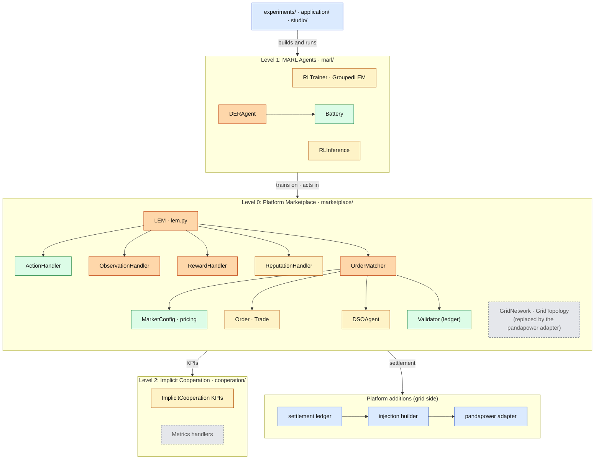

# MARLEM paper-to-code map

> Where each component of [P1] Fig. 2 lives in the original implementation (`src_thesis_reference/`, frozen), which validation step covers it, and what changes when SimBench and the platform are added.
> Method: [marlem-methodology.md](marlem-methodology.md) · Validation steps: [../thesis/validation/plan.md](../thesis/validation/plan.md) · Architecture: [../thesis/architecture/README.md](../thesis/architecture/README.md). Numbers such as 01 §5 refer to the [architecture documents](../thesis/architecture/README.md#3-documents).

`src_thesis_reference/` holds the original MARLEM code, relocated into paper levels with the **same file names** and annotated with the issue markers (see [`src_thesis_reference/README.md`](../../src_thesis_reference/README.md) for the full original → new path table). It is a frozen snapshot (2026-09-27, D-14) and never edited, so every code link in this document stays valid. `src/` is the unchanged upstream. The SimBench edition is built in `src_thesis/`, keeping file names and class responsibilities while files may be rewritten (D-04); the NetworkX grid leaves the tool.

**Change legend:** **—** unchanged · **Adapt** small additive edit in the same file · **Rewrite** same file and responsibility, new implementation (D-04) · **New** new module · **Replace** implementation swapped behind a contract. The verdict per function is in the [keep / replace audit](../thesis/validation/marlem-keep-replace-audit.md).

<!-- BEGIN toc (python docs/toc.py) -->
## Contents

- [0. At a glance](#0-at-a-glance)
- [1. Level 0: Platform Marketplace](#1-level-0-platform-marketplace)
- [2. Level 1: MARL Agents](#2-level-1-marl-agents)
- [3. Level 2: Implicit Cooperation](#3-level-2-implicit-cooperation)

<!-- END toc -->

## 0. At a glance

The [P1] Fig. 2 classes by level, where they live in the original code (`src_thesis_reference/`), and what happens to each in the SimBench edition (colour = change verdict of §1–§3).

Legend: green unchanged · amber adapt (small edit) · orange rewrite (same file and responsibility, D-04) · blue new · grey removed or replaced.

[↑ Contents](#contents)

## 1. Level 0: Platform Marketplace

| Fig. 2 class | File | Role | Validation | SimBench / platform change |
|---|---|---|---|---|
| `LEM` | [marketplace/lem.py](../../src_thesis_reference/marketplace/lem.py) | Episode orchestration: reset, step | A1 | **Rewrite**: same phase order; receives the grid model from the factory and is its **only holder** (D-13); builds injections after settlement, calls `assess`, passes the assessment to KPIs, reward, observation and info, and `GridTopologyInfo` / `GridSignals[t−1]` to the market (01 §5.1, §7) |
| `ActionHandler` | [marketplace/action.py](../../src_thesis_reference/marketplace/action.py) | Action space, partner index | A3 | — |
| `ObservationHandler` | [marketplace/observation.py](../../src_thesis_reference/marketplace/observation.py) | 42-dim observation | C1 | **Rewrite**: versioned schema, same Table 2 layout; grid block sourced from `GridAssessment` (R5) |
| `RewardHandler` | [marketplace/reward.py](../../src_thesis_reference/marketplace/reward.py) | Reward eq. 3–6 | C2 | **Rewrite**: versioned reward, same eq. 3–6 structure and weights; physical-violation term in feedback mode (R5) |
| `ReputationHandler` | [marketplace/market/reputation.py](../../src_thesis_reference/marketplace/market/reputation.py) | Reputation eq. 12 | A9 | Adapt: grid term from assessment or dropped (**Decision** in 01 §8) |
| `OrderMatcher`, `MatchingResult` | [marketplace/market/matching.py](../../src_thesis_reference/marketplace/market/matching.py) | Stages 1–3, clearing | A5 | **Rewrite**: same three stages; NetworkX calls removed; lossless matching; holds no grid, receives `GridTopologyInfo` and `GridSignals` as arguments (D-13) |
| `MarketConfig`, `ClearingMechanism` | [marketplace/market/matching.py](../../src_thesis_reference/marketplace/market/matching.py), [mechanism.py](../../src_thesis_reference/marketplace/market/mechanism.py) | Bounds, pricing | A4 | — |
| `Order`, `Trade` | [marketplace/market/order.py](../../src_thesis_reference/marketplace/market/order.py) | Economic records | A5 | Adapt: `transmission_loss` removed (lossless market); `distance` = electrical distance |
| `DSOAgent` | [marketplace/dso/dso.py](../../src_thesis_reference/marketplace/dso/dso.py) | Tariffs, residual clearing, fees | A6 | **Adapt**: holds no grid; fee inputs come from `GridSignals[t−1]` and `GridTopologyInfo` passed in by the loop (D-13), not graph queries |
| `Validator`, `TransactionBlock` | [marketplace/market/validation.py](../../src_thesis_reference/marketplace/market/validation.py) | Hash-chained trade log | A10 | — |
| `GridNetwork` | [adapters/grid/network.py](../../src_thesis_reference/adapters/grid/network.py) | NetworkX grid (abstract) | A7 | **Removed from the tool** (frozen in `src_thesis_reference/`); replaced by the pandapower adapter behind `GridModel` |
| `GridTopology`, `Location` | [marketplace/grid/base.py](../../src_thesis_reference/marketplace/grid/base.py), [config.py](../../src_thesis_reference/marketplace/grid/config.py) | Synthetic topologies, coordinates | A7 | **Removed from the tool**; locations are bus IDs from the network |
| *(not in Fig. 2)* profile handlers | [adapters/profiles/](../../src_thesis_reference/adapters/profiles/) | Generation, demand, tariffs | A2 | **New** `simbench` profile source beside the existing ones (01 §3) |
| *(not in Fig. 2)* config I/O | [marketplace/io.py](../../src_thesis_reference/marketplace/io.py) | env_config save/load | D3 | **Superseded** by the experiment file (02) |

[↑ Contents](#contents)

## 2. Level 1: MARL Agents

| Fig. 2 class | File | Role | Validation | SimBench / platform change |
|---|---|---|---|---|
| `DERAgent` | [marl/agents/der.py](../../src_thesis_reference/marl/agents/der.py) | Action feasibility, settlement, partner choice | A3, A8 | **Rewrite** feasibility (eq. 15), settlement (into the settlement ledger) and partner choice; `node_id` becomes a bus ID from the mapping; partner distance from `GridTopologyInfo` passed in (D-13) |
| `Battery` | [marl/agents/battery.py](../../src_thesis_reference/marl/agents/battery.py) | Storage dynamics | A8 | — (a battery can be sized from a SimBench storage element; 01 §3) |
| `RLTrainer`, `GroupedLEM` | [marl/train.py](../../src_thesis_reference/marl/train.py) | RLlib config, PBT, grouping | D1 | Adapt: `learning` section of the experiment file replaces its arguments; the environment is built by the factory inside each runner |
| `RLInference` | [marl/inference.py](../../src_thesis_reference/marl/inference.py) | Checkpoint rollout | D2 | Adapt: called by the worker |
| `RLAlgorithm`, `TrainingMode` | [marl/base.py](../../src_thesis_reference/marl/base.py), [ctce.py](../../src_thesis_reference/marl/ctce.py), [ctde.py](../../src_thesis_reference/marl/ctde.py) | Algorithms, paradigms | D1 | — |

[↑ Contents](#contents)

## 3. Level 2: Implicit Cooperation

| Fig. 2 class | File | Role | Validation | SimBench / platform change |
|---|---|---|---|---|
| `ImplicitCooperation` | [cooperation/implicit_cooperation.py](../../src_thesis_reference/cooperation/implicit_cooperation.py) | 10 KPIs | B1 | **Adapt**: `grid_congestion` from line and transformer loading; supply-demand imbalance from external-grid exchange (the physical `B_grid`) |
| Metrics handlers | [cooperation/metrics/](../../src_thesis_reference/cooperation/metrics/) | Reporting | B2 | **Replace** `grid_metrics.py` inputs with the assessment history |
| `Plotter` | [cooperation/visualization/plotter.py](../../src_thesis_reference/cooperation/visualization/plotter.py) | Figures | B2 | Adapt: network plots from the grid backend's topology view |

The paper's Fig. 2 shows `DSOMetricsHandler` twice. The second box is `GridMetricsHandler` in the code.

Components that are not in the paper (contracts, settlement, adapters, the experiment layer, services, Studio) are listed in the [architecture README §2.4](../thesis/architecture/README.md#24-new-components-not-in-the-paper).

[↑ Contents](#contents)
