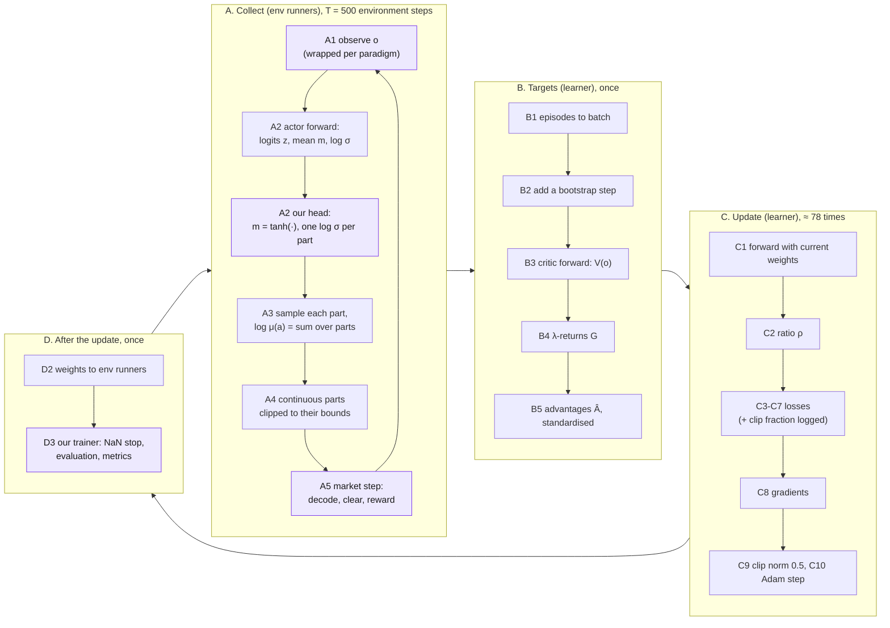

# One training iteration, from observation to update

> Every calculation in one PPO training iteration of V2, in the order it happens:
> the agents observe, act with the mixed action and step the market until the
> batch is full (A); the batch is turned into targets (B); the losses are computed
> and the networks updated, minibatch by minibatch (C); the new weights go back to
> the agents (D). Steps that repeat (every environment step, every minibatch) are
> written out once, with how often they happen, and with what the three paradigms
> change on the way. [The training cycle](training.md) is the overview and the
> list of what we change in RLlib; [Worked examples](examples.md) puts numbers on
> each step.

!!! ours "How to read the colours"
    Purple is **ours**: code this implementation adds to
    RLlib, a setting it chooses differently from RLlib's default, or the market
    environment. The normal colour is PPO as RLlib 2.51.1 implements it,
    unchanged. In formulas our terms are $\textcolor{mediumpurple}{\text{purple}}$; in the
    diagram our steps are purple boxes. The full list with the reason for each
    is in [The training cycle, section 2](training.md#2-everything-we-change-in-rllibs-ppo).

**Sources.** RLlib is Ray 2.51.1, read in its installed source and linked at tag
[`ray-2.51.1`](https://github.com/ray-project/ray/tree/ray-2.51.1/rllib); the
implementation is `core/rl/` with the settings of
[rl_defaults.py](../../core/rl_defaults.py#L28-L64) and the environment
[market_env.py](../../core/env/market_env.py). The step labels A1 to D3 are those
used in [the full cycle](../full-cycle.md) and the other RL pages.

## Notation

| Symbol | Meaning |
|---|---|
| $N$ | number of agents, $i = 1 \dots N$ |
| $d_o$ | size of one agent's observation: $42 + (N - 1)$ ([Observation](observation.md)) |
| $t$ | environment step (one market hour): all $N$ agents act at once |
| $o_{i,t} \in \mathbb{R}^{d_o}$ | agent $i$'s observation |
| $s_t = (o_{1,t}, \dots, o_{N,t}) \in \mathbb{R}^{N d_o}$ | the global state: CTCE's input, CTDE's critic input |
| $x_{i,t} = (o_{i,t}, s_t) \in \mathbb{R}^{(N+1) d_o}$ | agent $i$'s module input in CTDE |
| $a_{i,t} = (\alpha, q, p, \beta)$ | agent $i$'s action: side, quantity, price, partner, as the policy sampled it |
| $z$ | the logits of a categorical part |
| $m$, $\ell = \log\sigma$ | a continuous part's mean and log standard deviation |
| $r_{i,t}$, $R_t = \sum_i r_{i,t}$ | agent $i$'s reward; the group reward of CTCE |
| $\pi_\theta$, $\mu$ | the policy being trained; the copy that collected the data |
| $V_\phi$ | the critic (state value) |
| $T$ | environment steps per iteration: 500 (`train_batch_size_per_learner`) |
| $K$ | number of env runners: 0 by default (the driver samples), 3 in the market runs |

Settings used below: $\gamma = 0.99$, $\lambda = \textcolor{mediumpurple}{0.95}$, clip
$\epsilon = \textcolor{mediumpurple}{0.2}$, value coefficient $c_v = 1$, value-loss cap
$\textcolor{mediumpurple}{10^6}$, entropy coefficient $c_H = \textcolor{mediumpurple}{0.01}$, KL
weight $\textcolor{mediumpurple}{0}$, gradient-norm clip $\textcolor{mediumpurple}{0.5}$, learning
rate $\textcolor{mediumpurple}{3 \cdot 10^{-4}}$, $\textcolor{mediumpurple}{10}$ epochs, minibatches
of $\textcolor{mediumpurple}{64}$. An experiment can override any of them.

## Overview

What happens how often in one iteration:

| Step | How often | Done by |
|---|---|---|
| A1-A5: observe, act, step the market | $T = 500$ environment steps, $\lceil 500/K \rceil$ per env runner when $K > 0$ | env runners (or the driver), with $\mu$ |
| A2: actor forward pass | 500 per module: $N \times 500$ in CTDE and DTDE, 500 in CTCE | env runners |
| B1-B5: values, returns, advantages | once, over the whole batch, per module | learner, critic before the update |
| C1-C10: one gradient step | 10 epochs × 500 / 64 ≈ 78; every row used 10 times | learner |
| D2: weights to the env runners | once | learner → env runners |
| D3: evaluation | at the experiment's evaluation points | our trainer |

## A. Collect: from observation to environment step

Each env runner holds a copy $\mu$ of the policy, identical to $\pi_\theta$ at the
start of the iteration (D2 of the previous one). Per environment step it does A1 to
A5. Nothing is learned here: no gradients, no critic.

### A1. Observe

The market returns one observation per agent, $o_{i,t} \in \mathbb{R}^{d_o}$, its
entries already scaled to about $[-1, 1]$ and clipped to $[-10, 10]$ by
`MarketEnv`. RLlib passes it to the network as it comes
(no `MeanStdFilter`). The paradigm's wrapper decides what
each module receives ([`env_spec`](../../core/rl/config.py#L82-L95)):

| | CTCE | CTDE | DTDE |
|---|---|---|---|
| What the module receives | $s_t$, all observations joined in the environment's agent order, one input for the group ([`CTCEEnv`](../../core/rl/ctce.py#L46-L110)) | $x_{i,t} = (o_{i,t}, s_t)$, agent $i$'s module ([`CTDEEnv`](../../core/rl/ctde.py#L55-L103)) | $o_{i,t}$, each agent's module its own |

### A2. Actor forward pass

RLlib's PPO module (`fcnet_hiddens = [256, 256]`, `tanh`), with
the actor's and the critic's encoders separate
(`vf_share_layers=False`). The actor's encoder and its linear policy head:

$$
h = \tanh\big(W_2 \tanh(W_1 y + b_1) + b_2\big) \in \mathbb{R}^{256},
\qquad \text{out} = W_\pi h + b_\pi ,
$$

where $y$ is the actor's input. `out` holds the distribution inputs of every
action part one after the other, in the order RLlib flattens the `Dict` (its keys
sorted, [`action_parts`](../../core/rl/modules.py#L56-L85)):

| Part | Inputs | Size |
|---|---|---|
| `partner` | logits $z_\beta$ | $N + 1$ |
| `price` | $m_p$, $\ell_p$ | 2 |
| `quantity` | $m_q$, $\ell_q$ | 2 |
| `side` | logits $z_\alpha$ | 2 |

so $N + 7$ outputs per agent. Our head
([`BoundedHead`](../../core/rl/modules.py#L121-L173)) then changes the continuous
parts; the logits pass unchanged:

$$
m_k = \textcolor{mediumpurple}{\tanh}(\text{out}_{m_k}),
\qquad
\ell_k = \textcolor{mediumpurple}{\bar\ell_k} \quad \text{for } k \in \{p, q\},
$$

where $\textcolor{mediumpurple}{\bar\ell_k}$ is one learned parameter per continuous part,
the same in every state, starting at 0 ($\sigma = 1$). RLlib's own head would use
the linear outputs for both: an unbounded mean and a $\log\sigma$ that depends on
the state (and for a `Dict` action, unlike a single `Box`, it does not clip
$\log\sigma$ to ±20). The two outputs of `out` at the $\ell$ positions are computed
but replaced, so their weights never get a gradient.

!!! ours "Why the head is changed (RP-3h)"
    With RLlib's head, $\log\sigma$ of the probe's level shrank to about −5.5
    before the side it depends on was decided; after that the level's mean could
    no longer move to its target (probe 9: 0 of 6 runs in CTDE and DTDE). One
    state-independent $\log\sigma$ moves at most about the learning rate per
    Adam step, slow enough for the mean to follow (6 of 6). The tanh keeps the mean
    inside $(-1, 1)$: beyond the bounds the clipped action makes the reward flat
    and the mean can drift there without any gradient bringing it back.
    Evidence: [probes, The continuous parts](probes.md#the-continuous-parts-26-october-2026).

What $y$ and the output size are per paradigm:

| | CTCE | CTDE | DTDE |
|---|---|---|---|
| $y$ | $s_t \in \mathbb{R}^{N d_o}$ | the first $d_o$ entries of $x_{i,t}$, i.e. $o_{i,t}$ ([`own_encoder`](../../core/rl/ctde.py#L126-L140)) | $o_{i,t}$ |
| `out` | $N (N + 7)$: every agent's parts from one network, agent by agent in environment order | $N + 7$, agent $i$'s network | $N + 7$, agent $i$'s network |
| learned $\log\sigma$ | $2N$ | 2 | 2 |

So CTDE's actor is the same network as DTDE's: it never sees the global state.
The value $V_\phi$ is not computed while collecting; PPO needs it only in B3.

### A3. Sample the action and its log-probability

Each part is sampled on its own
([`get_actions.py`](https://github.com/ray-project/ray/blob/ray-2.51.1/rllib/connectors/module_to_env/get_actions.py),
[`TorchMultiDistribution`](https://github.com/ray-project/ray/blob/ray-2.51.1/rllib/models/torch/torch_distributions.py#L549-L660)):

- **Categorical** (side, partner): probabilities $P_c = e^{z_c} / \sum_{c'} e^{z_{c'}}$,
  a category $c$ drawn with them, $\log\mu(c) = z_c - \log\sum_{c'} e^{z_{c'}}$.
- **Gaussian** (quantity, price): with fresh noise $\varepsilon \sim \mathcal{N}(0, 1)$,
  $u = m + \sigma\varepsilon$ and
  $\log\mu(u) = -\frac{(u - m)^2}{2\sigma^2} - \ell - \tfrac12 \log 2\pi$.

The action's log-probability is the sum over its parts:

$$
\log\mu(a) = \log\mu(\alpha) + \log\mu(q) + \log\mu(p) + \log\mu(\beta).
$$

Nothing ties the parts together: the partner is drawn without knowing the side
drawn with it (the **factorised** policy; v2.md §8). In CTCE the sum runs over all
$N$ agents' parts, so the group's log-probability is the sum of the agents':
$\log\mu(\mathbf{a}) = \sum_i \log\mu(a_i)$.

**Stored for the learner**, per step: the module's input, the sampled action
(categories as indices, continuous parts as the raw $u$), $\log\mu(a)$, and the
distribution's inputs (the logits, $m$ and $\ell$ after our head).

### A4. Rescale to the action bounds

RLlib's `normalize_actions=True` maps each continuous part from $[-1, 1]$ to its
space's bounds and clips
([`unsquash_action`](https://github.com/ray-project/ray/blob/ray-2.51.1/rllib/utils/spaces/space_utils.py#L448-L488)):

$$
a_k = \text{clip}\left(\text{low}_k + (u_k + 1)\,\frac{\text{high}_k - \text{low}_k}{2},\ \text{low}_k,\ \text{high}_k\right).
$$

The market's quantity and price spaces are $[-1, 1]$ themselves, so this is only
the clip: a $u$ beyond $\pm 1$ acts as the bound. The categorical parts pass
unchanged. The batch keeps the unclipped $u$, and the learner trains on it. In
CTCE every agent's parts are rescaled with that agent's own space, at its place in
the `Tuple` (L-05).

### A5. Environment step

Entirely ours: the market environment. In CTCE
`CTCEEnv` first splits the group's `Tuple` into the agents' actions
([`ungroup`](../../core/rl/ctce.py#L36-L43)). Then
[`MarketEnv.step`](../../core/env/market_env.py#L359-L410), per agent:

1. **Decode** the action into an order
   ([`decode`](../../core/env/market_env.py#L412-L445)):
    - side $\alpha$: 0 sell, 1 buy;
    - quantity share $\textcolor{mediumpurple}{s = (q + 1)/2}$; **no order** when
      $\textcolor{mediumpurple}{s < 0.05}$, otherwise $s$ rescaled to $(0, 1]$ and
      multiplied by what the agent may sell or buy this step ([P1] eq. 15a-b);
    - price $\textcolor{mediumpurple}{p_\text{FiT} + \tfrac{p + 1}{2}\,(p_\text{utility} - p_\text{FiT})}$
      with the step's tariffs;
    - partner $\beta$: an index into the agent's candidates, the $N - 1$ other
      participants, then the DSO, then "no preference".
2. **Play the market step** with all orders: matching by preference, double
   auction, DSO, power flow, fees ([the full cycle](../full-cycle.md#the-environment-step)).
3. **Reward** $\textcolor{mediumpurple}{r_{i,t} = (\text{profit}_i - p_\text{utility} \cdot \text{deferred demand}_i) / \text{reward scale}}$:
   the agent's bill, with unmet demand charged at the utility price, scaled.
4. **Observe** the next step's $o_{i,t+1}$.

| | CTCE | CTDE | DTDE |
|---|---|---|---|
| Reward stored | $R_t = \sum_i r_{i,t}$ ([`CTCEEnv.step`](../../core/rl/ctce.py#L85-L107)) | $r_{i,t}$ in agent $i$'s episode | $r_{i,t}$ in agent $i$'s episode |
| Done flag | one, `__all__` | per agent, and `__all__` | per agent, and `__all__` |

The day ends **terminated** after its last step (RP-1f): the return stops at
midnight, nothing is bootstrapped into the next day.

### A6. Until the batch is full

A1-A5 repeat until 500 environment steps are collected, $\lceil 500/K \rceil$ per
env runner. An episode still running when the batch is full is cut there
(`batch_mode="truncate_episodes"`) and continues in the next iteration, with the
next iteration's weights; the cut piece is bootstrapped with the critic in B2.

## B. Targets: what the loss will be compared with

Once per iteration, on the learner, before any weight changes
([`ppo_learner.py` L60-L80](https://github.com/ray-project/ray/blob/ray-2.51.1/rllib/algorithms/ppo/ppo_learner.py#L60-L80)).

### B1. Episodes to a batch

The collected episode pieces are laid out as one table per module.

| | CTCE | CTDE | DTDE |
|---|---|---|---|
| Modules | 1 | $N$ | $N$ |
| Rows per module | 500 | 500 (every agent acts every step) | 500 |
| One row holds | $s_t$, the joint action, $R_t$, $\log\mu(\mathbf{a}_t)$, the distribution inputs | $x_{i,t}$, $a_{i,t}$, $r_{i,t}$, $\log\mu(a_{i,t})$, the distribution inputs | $o_{i,t}$, $a_{i,t}$, $r_{i,t}$, $\log\mu(a_{i,t})$, the distribution inputs |

### B2. Add a bootstrap step

Each episode piece gets one artificial step at its end: the last observation
repeated, reward 0, and *truncated* set if the episode did not terminate
([`add_one_ts_to_episodes_and_truncate.py`](https://github.com/ray-project/ray/blob/ray-2.51.1/rllib/connectors/learner/add_one_ts_to_episodes_and_truncate.py)).
It exists only so that B3 computes $V_\phi$ of the last observation; a loss mask
removes it from every loss in C.

### B3. Critic forward pass

The critic, with its weights from *before* this iteration's update, evaluates every
row. It has its own encoder (2 × 256 tanh) and a linear value head:

| | CTCE | CTDE | DTDE |
|---|---|---|---|
| Value | $V_\phi(s_t)$: the group's return | $V_{\phi_i}(o_{i,t}, s_t)$: agent $i$'s own return, from every agent's observation | $V_{\phi_i}(o_{i,t})$: agent $i$'s own return |

### B4. λ-returns

Backwards in time over each episode piece, with $\bar V_t = V_\phi(o_t)$, or 0 if
$o_t$ ends a terminated episode
([`value_predictions.py` L7-L38](https://github.com/ray-project/ray/blob/ray-2.51.1/rllib/utils/postprocessing/value_predictions.py#L7-L38)):

$$
G_t = r_t + \gamma \left[(1 - \lambda)\, \bar V_{t+1} + \lambda\, G_{t+1}\right],
\qquad \text{starting from } G = \bar V \text{ at the bootstrap step.}
$$

A cut episode ends on the critic's estimate, a terminated day on 0. With the
one-step error $\delta_t = r_t + \gamma \bar V_{t+1} - V_\phi(o_t)$ this is the
GAE sum, $G_t = V_\phi(o_t) + \sum_{l \ge 0} (\gamma\lambda)^l \delta_{t+l}$.
$\lambda = \textcolor{mediumpurple}{0.95}$ (RLlib's default is 1.0) sets how far real rewards
are used before the critic's estimate takes over: about
$1/(1 - \gamma\lambda) \approx 17$ steps, most of a 24-step day.

$G_t$ is the **value target**, on the scale of the module's reward: in CTCE the
summed reward, about $N$ times one agent's.

### B5. Advantages

$$
\hat A_t = G_t - V_\phi(o_t),
\qquad
\hat A_t \leftarrow \frac{\hat A_t - \operatorname{mean}(\hat A)}{\max\big(10^{-4}, \operatorname{std}(\hat A)\big)},
$$

the mean and standard deviation over the module's whole batch
([`general_advantage_estimation.py` L144-L150](https://github.com/ray-project/ray/blob/ray-2.51.1/rllib/connectors/learner/general_advantage_estimation.py#L144-L150)).
$\hat A_t > 0$ means "the action taken at $t$ did better than the critic expected".

In CTCE there is **one advantage per step for the whole group**: all $4N$ parts of
the joint action are pushed in the same direction by the summed outcome, however
much each agent contributed. In CTDE and DTDE each agent has its own advantage from
its own reward; in CTDE its critic sees the whole state, so the advantage can
discount what the other agents' situation explains.

## C. Update: one gradient step, repeated ≈ 78 times

The 500 rows of a module are shuffled and cut into minibatches of
$\textcolor{mediumpurple}{64}$; one pass over all of them is an epoch; there are
$\textcolor{mediumpurple}{10}$ epochs, so $10 \times 500 / 64 \approx 78$ gradient steps
(RLlib cycles through the batch, so the last minibatch of an epoch continues into
the next), and every row is used 10 times
([`ppo.py` L389-L458](https://github.com/ray-project/ray/blob/ray-2.51.1/rllib/algorithms/ppo/ppo.py#L389-L458)).
In CTDE and DTDE each step updates all $N$ modules, each on 64 rows of its own
agent. One gradient step, on a minibatch $b$:

### C1. Forward pass with the current weights

The same networks as in A2 (our head included) and B3, with the weights as they
are at this step: the distribution inputs and $V_\phi$ for the 64 rows. In CTDE
the actor is agent $i$'s own network on $o_{i,t}$, the same one that sampled the
action in A2.

### C2. Probability ratio

$$
\rho_t = \exp\big(\log\pi_\theta(a_t \mid o_t) - \log\mu(a_t \mid o_t)\big)
= \rho_t^{\alpha}\, \rho_t^{q}\, \rho_t^{p}\, \rho_t^{\beta},
$$

with $\log\pi_\theta$ computed as in A3 from the current inputs and $\log\mu$ the
value stored in A3. Because the log-probability is a sum over the parts, the ratio
is the **product of the parts' ratios**: one number for the agent's whole action.
$\rho_t > 1$: the current policy makes the stored action more likely than the
collecting policy did. On the very first minibatch $\pi_\theta = \mu$, so
$\rho_t = 1$ exactly.

In CTCE $\rho_t = \prod_i \rho_{i,t}$ over all agents: one ratio for the joint
action. In CTDE and DTDE each agent has its own $\rho_{i,t}$.

### C3. Clipped surrogate

$$
S_t = \min\big(\rho_t \hat A_t,\ \text{clip}(\rho_t, 1 - \epsilon, 1 + \epsilon)\, \hat A_t\big),
\qquad \epsilon = \textcolor{mediumpurple}{0.2}.
$$

Its gradient is $\hat A_t \rho_t \nabla_\theta \log\pi_\theta(a_t \mid o_t)$ while
the policy has not yet moved more than 20 % on this action in the direction
$\hat A_t$ asks for, and **zero** once it has: a good action ($\hat A > 0$) stops
being pushed when $\rho > 1.2$, a bad one when $\rho < 0.8$. Because $\rho$ is a
product, the four parts share this budget: a part that moved a lot uses it up for
the others. In CTCE the clip acts on the product over all agents too, so several
agents that each moved a little can together leave the band
([worked example](examples.md#5-the-update-per-agent-ratios-and-clips-c2-c3-c8)).

Logged: the **clip fraction**, the share of the
minibatch's rows with $|\rho_t - 1| > \epsilon$
([`PPOLearner`](../../core/rl/learner.py#L27-L52)); the value of the last minibatch
of the update.

### C4. Value loss

$$
L_{V,t} = \min\big((V_\phi(o_t) - G_t)^2,\ \textcolor{mediumpurple}{10^6}\big).
$$

Its gradient is $2 (V_\phi(o_t) - G_t)\, \nabla_\phi V_\phi(o_t)$. RLlib's cap
`vf_clip_param` is 10 on the **squared** error, which gives **zero** gradient for
an error above $\sqrt{10} \approx 3.2$; ours is $10^6$, in
effect no cap.

### C5. Entropy

The policy's entropy is the sum of its parts' entropies:

$$
\mathcal{H}_t
= \underbrace{-\sum_c P_c \log P_c}_{\text{side, partner}}
+ \underbrace{\sum_{k \in \{p, q\}} \left(\ell_k + \tfrac12 \log 2\pi e\right)}_{\text{price, quantity}} .
$$

With $c_H = \textcolor{mediumpurple}{0.01}$ (RLlib's default is 0) its gradient pushes every
categorical towards uniform and every $\ell_k$ up. For a Gaussian part
$\partial \mathcal{H} / \partial \ell_k = 1$ exactly; with
our head $\ell_k$ is one parameter for all states, so on
each minibatch it receives the constant push $c_H$ from the entropy plus the
average of the surrogate's pull over the 64 rows. Adam scales each step to about
the learning rate, so $\ell_k$ changes by at most about $3 \cdot 10^{-4}$ per step.
How this plays out over a run, and when it drifts:
[Close-up: how the learned log σ moves](#close-up-how-the-learned-log-σ-moves).

!!! ours "Open: the entropy bonus in CTCE"
    In CTCE the sum runs over $4N$ parts with one coefficient, while the surrogate
    has one standardised advantage per step, so the entropy weighs about $N$ times
    more against it than for one DTDE agent. The experiment `ctce_entropy` tests
    whether this drives CTCE's rising $\log\sigma$ on the market: `entropy_coeff`
    0.01, 0.01/13 and 0 with 13 agents.

### C6. KL between the collecting and the current policy

Computed and logged as `mean_kl_loss`, with weight
$\beta = 0$ in the loss (`use_kl_loss=True`,
`kl_coeff=0.0`; RLlib's default is 0.2, adapted): a
measure of how far each update moved the policy, nothing more (RP-4a). Like the
log-probability it is a sum over the parts: for a categorical
$\sum_c P^\mu_c \log (P^\mu_c / P^\pi_c)$, for a Gaussian
$\ell' - \ell + \frac{e^{2\ell} + (m - m')^2}{2 e^{2\ell'}} - \frac12$
(unprimed: $\mu$, primed: $\pi_\theta$).

### C7. Total loss

Averaged over the minibatch's real rows (the bootstrap rows of B2 masked out):

$$
L = \frac{1}{|b|} \sum_{t \in b} \Big[-S_t + 1 \cdot L_{V,t} - \textcolor{mediumpurple}{0.01}\, \mathcal{H}_t\Big] + \textcolor{mediumpurple}{0} \cdot \overline{\mathrm{KL}} .
$$

### C8. Gradients: where each term goes

Backpropagation gives $\partial L / \partial w$ for every weight $w$ the loss
depends on.

| | CTCE | CTDE | DTDE |
|---|---|---|---|
| Surrogate and entropy | the actor (encoder, head, the $2N$ learned $\log\sigma$), from the group's rows | agent $i$'s actor (encoder, head, its 2 learned $\log\sigma$), from agent $i$'s rows only | the same as CTDE |
| Value loss | the critic (encoder and head) | agent $i$'s central critic | agent $i$'s critic |

Through our head the gradient on a continuous part's mean
reaches the network multiplied by the tanh's slope, $1 - m^2$: small near the
bounds, so a mean that has gone to $\pm 1$ moves back slowly. The head's two
unused outputs per agent (the replaced $\ell$ positions) get no gradient.

The actor and the critic share no layers, so a large value loss does not overwrite
what the actor's layers learn.

### C9. Clip the gradient norm

All gradients of a module are scaled together so that their global norm is at most
0.5 (`grad_clip`, `grad_clip_by="global_norm"`; RLlib's
default is no clip):

$$
g \leftarrow g \cdot \min\left(1, \frac{\textcolor{mediumpurple}{0.5}}{\lVert g \rVert_2}\right).
$$

The direction is kept, the length capped. The norm before clipping is logged
(`gradients_default_optimizer_global_norm`): far above 0.5 means every update is
being cut down.

### C10. Adam step

One optimiser per module (torch's Adam, $\beta_1 = 0.9$, $\beta_2 = 0.999$),
learning rate $\eta = \textcolor{mediumpurple}{3 \cdot 10^{-4}}$, for every weight $w$:

$$
m_w \leftarrow 0.9\, m_w + 0.1\, g_w,
\qquad v_w \leftarrow 0.999\, v_w + 0.001\, g_w^2,
\qquad w \leftarrow w - \eta\, \frac{\hat m_w}{\sqrt{\hat v_w} + 10^{-8}},
$$

with $\hat m_w, \hat v_w$ the bias-corrected averages. Adam divides by the
gradient's running size, so each weight moves by about $\eta$ per step whatever the
loss scale: over the ≈ 78 steps of an iteration, at most about $0.02$.

Then the next minibatch: C1 again, with the weights just updated.

### Close-up: how the learned log σ moves

Ours (RP-3h). C2 to C10 together decide how a continuous
part's spread evolves over a run. This is the same chain for one part, price or
quantity, written out once.

**What it is.** One `torch.nn.Parameter` $\bar\ell$ per continuous part, created at
0 ($\sigma = 1$) in
[`BoundedHead`](../../core/rl/modules.py#L149-L150) and written into every row's
distribution inputs ([L164-L166](../../core/rl/modules.py#L164-L166)), whatever the
observation. It has **no bounds**: `log_std_bounds` is `None`, and RLlib does not
clip $\log\sigma$ for a `Dict` action.

**Its gradient.** For a stored sample $u$, let $z = (u - m)/\sigma$ be its distance
from the current mean in units of the current spread. From A3 and C5,

$$
\frac{\partial \log\pi}{\partial \bar\ell} = z^2 - 1,
\qquad
\frac{\partial \mathcal H}{\partial \bar\ell} = 1 .
$$

$\bar\ell$ is shared by every row, so its gradient on a minibatch is an average
over the rows. Descending $L$ moves it in the direction

$$
\Delta\bar\ell \;\propto\;
\underbrace{\operatorname{mean}_{t \in b,\ \text{unclipped}}\big[\hat A_t\, \rho_t\, (z_t^2 - 1)\big]}_{\text{surrogate}}
\;+\;
\underbrace{c_H}_{=\,0.01} ,
$$

where "unclipped" are the rows whose ratio has not yet left the band in the
direction their advantage pushes (C3).

| Situation | Surrogate term | $\sigma$ |
|---|---|---|
| samples far from the mean ($z^2 > 1$) did better than expected | positive | widens: explore further out |
| samples close to the mean ($z^2 < 1$) did better | negative | narrows: the usual case once the mean is near the optimum |
| the reward does not depend on this part | noise around 0 | only the entropy's $+0.01$ remains: **drifts up** |

At equilibrium the surrogate's narrowing pull balances the entropy's constant push.
The advantages are standardised (std 1, B5), so the surrogate term is usually far
larger than 0.01 whenever the part matters; the entropy decides only when the part
barely affects the reward.

**How fast it moves.** Adam divides each parameter's step by that parameter's own
running gradient size (C10), so $\bar\ell$ moves by at most about
$\eta = 3 \cdot 10^{-4}$ per step, however large its gradient: at most about
$78 \times 3 \cdot 10^{-4} \approx 0.023$ per iteration. The speed depends on how
*consistently* the gradient points one way, not on its size. For the same reason
the gradient-norm clip (C9) hardly slows it: a rescaled gradient is the same to
Adam.

- **Why this was chosen.** RLlib's state-dependent $\log\sigma$ is the output of a
  network: hundreds of weights each move by about $\eta$ and their effects add up,
  so it collapsed to about −5.5 within a few iterations on probe 9, before the side
  was decided. One parameter cannot do that.
- **The other side of the same property.** A part the reward ignores gets a
  consistent upward push, at up to 0.023 per iteration: over `market_s2`'s 480
  iterations, up to about +11 in $\bar\ell$ in the extreme. The surrogate's noise
  makes the push less consistent and the drift slower, but nothing bounds it. That
  can happen to price, side and partner on the steps where an agent places no
  order (probe 7), and in CTCE the entropy also carries all $4N$ parts (C5, the
  `ctce_entropy` experiment). Once $\sigma$ is large, most samples land beyond
  $\pm 1$, and the market sees only the bounds (A4). If it shows on the market, the
  options are a smaller `entropy_coeff` or bounds on $\log\sigma$
  (`log_std_bounds`, implemented and switched off).

**Effect on the clip.** Changing $\bar\ell$ by $\delta$ changes a sample's ratio by
about $\rho \approx \exp\big(\delta (z^2 - 1)\big)$. With $\delta \le 0.023$ per
iteration that is 2-3 % even for $z^2 \approx 2$: $\bar\ell$ almost never reaches
the clip on its own; the means and the logits use up the 20 % band first.

**Where it does not matter.** Evaluation takes the mean and ignores $\sigma$
([worked examples, section 7](examples.md#7-evaluating-a-trained-policy)): $\sigma$
shapes only what training explores.

**What to watch.** `<module>/<part>/log_std` in each run's `metrics.csv`, per
iteration ([`part_stats`](../../core/rl/policy.py#L492-L542)), with `outside`, the
share of samples beyond the bounds. A steady climb in a part that is mostly unused,
against a decline in the parts that matter, is the drift above. The numbers for one
sample are in [worked examples, section 5](examples.md#5-the-update-per-agent-ratios-and-clips-c2-c3-c8).

## D. After the update

### D1. KL coefficient

RLlib adapts the KL coefficient after each update (× 1.5 or × 0.5 from the measured
KL, [`ppo_torch_learner.py` L141-L166](https://github.com/ray-project/ray/blob/ray-2.51.1/rllib/algorithms/ppo/torch/ppo_torch_learner.py#L141-L166));
from 0 it stays 0.

### D2. Weights to the env runners

The updated weights are copied to every env runner: $\mu \leftarrow \pi_\theta$. The
next iteration starts at A1 with them. The batch is discarded: PPO never uses a step
again after its iteration.

### D3. Between iterations

Our trainer
([`train`](../../core/rl/train.py#L408-L558)) records the iteration's metrics
(learner metrics per module, and each action part's mean, $\log\sigma$, share
outside the bounds or entropy in fixed states,
[`part_stats`](../../core/rl/policy.py#L492-L542)), stops the run on a NaN or
infinite loss or entropy ([`_nonfinite`](../../core/rl/train.py#L346-L363)), and
evaluates the policy and the baselines (random, zero, net position) whenever the
budget of environment steps reaches the next evaluation point. Hyperparameters stay
fixed during a run; the run ends when the budget is used.

## Where the original code departs from this

| Step | What the original does | Recorded as |
|---|---|---|
| A2, C1, C8 | CTDE acts with heads that receive no gradient; the loss trains a central actor | [L-01](../validation/rl.md#l-01-ctde-never-trains-the-policies-that-act) |
| A5, B4, B5 | CTDE learns from the summed reward $R_t$ with one advantage for the group, as CTCE | [L-01](../validation/rl.md#l-01-ctde-never-trains-the-policies-that-act) |
| A2, B3 | CTCE and CTDE: custom 2 × 128 ReLU networks with a shared encoder; DTDE: RLlib's default | [L-04](../validation/rl.md#l-04-the-paradigms-train-different-networks) |
| A2, C5 | CTCE and CTDE: $\ell$ unclipped, so the entropy bonus can grow it until it overflows | [L-06](../validation/rl.md#l-06-the-ctce-and-ctde-action-spread-has-no-limit) |
| A3, A5 | all four action parts decoded from one continuous `Box` (`α > 0.5`, `int(β)`) | [v2.md §2](../v2.md#2-the-mixed-action) |
| A4 | CTCE and CTDE: an agent's slice can be rescaled with another agent's bounds | [L-05](../validation/rl.md#l-05-grouped-spaces-are-in-name-order-grouped-data-in-environment-order) |
| C6, C7, C9 | $\beta = 0$ still computes the KL; an infinite KL makes the loss NaN, and the NaN gradient is zeroed silently | [L-07](../validation/rl.md#l-07-kl_coeff--0-does-not-switch-off-the-kl-term-and-a-nan-loss-goes-unnoticed) |
| D3 | Population-based training raises the learning rate 10-1000× and the entropy coefficient up to 10 | [L-10](../validation/rl.md#l-10-population-based-training-jumps-the-learning-rate-and-reaches-entropy-10) |
