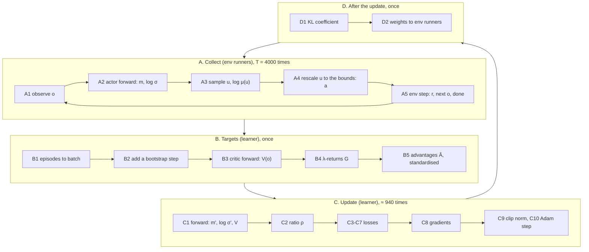

# One training iteration, from observation to update

> Every calculation in one training iteration, in the order it happens: the
> agents observe, act and collect a batch of steps; the batch is turned into
> targets; the losses are computed and the networks updated; the new weights go
> back to the agents. PPO is followed in full, with the shapes of what flows
> through each step and what the three paradigms (CTCE, CTDE, DTDE) change on the
> way. APPO and SAC follow as differences from it. Steps that repeat (every
> environment step, every minibatch) are written out once, with how often they
> happen. [The training cycle](training.md) is the shorter overview of the same
> material. [Worked examples](examples.md) puts numbers on the parts our own
> code defines.

**Sources.** As in [The training cycle](training.md): RLlib is Ray 2.51.1, read in
its installed source and linked at tag
[`ray-2.51.1`](https://github.com/ray-project/ray/tree/ray-2.51.1/rllib); MARLEM's
code at the original commit
[`15d6715`](https://github.com/salazarna/marlem/tree/15d6715a7b7ad31700d3758f2a2dd9df053773a7/src/environment);
settings are the original's
([`train.py` L215-L259](https://github.com/salazarna/marlem/blob/15d6715a7b7ad31700d3758f2a2dd9df053773a7/src/environment/train.py#L215-L259)),
completed with RLlib's defaults. Where the original code computes something other
than what is described, the step says so and links to
[RL layer: what is wrong](../validation/rl.md).

## Notation

| Symbol | Meaning |
|---|---|
| $N$ | number of agents, $i = 1 \dots N$ |
| $d_o$, $d_a$ | size of one agent's observation and action (taken equal for all agents here) |
| $t$ | environment step: all $N$ agents act at once |
| $o_{i,t} \in \mathbb{R}^{d_o}$ | agent $i$'s observation |
| $s_t = (o_{1,t}, \dots, o_{N,t}) \in \mathbb{R}^{N d_o}$ | all observations, concatenated (CTCE and CTDE) |
| $u_{i,t} \in \mathbb{R}^{d_a}$ | the action as the policy sampled it, before any rescaling |
| $a_{i,t}$ | the action the environment receives |
| $r_{i,t}$, $R_t = \sum_i r_{i,t}$ | agent $i$'s reward; the group reward of CTCE and CTDE |
| $m$, $\ell = \log\sigma$ | the Gaussian's mean and log standard deviation, one per action dimension |
| $\pi_\theta$, $\mu$ | the policy being trained; the copy that collected the data |
| $V_\phi$ | the critic (state value) |
| $T$ | environment steps per iteration: 4000 for PPO |
| $K$ | number of env runners (the original sets $K$ = `cpu_count() - 4`) |

Settings used below (PPO): $\gamma = 0.99$, $\lambda = 0.95$, clip $\epsilon = 0.2$,
value coefficient $c_v = 1$, value-loss cap 10, entropy coefficient $c_H = 0.01$,
KL coefficient $\beta = 0$, gradient-norm clip 0.5, learning rate $10^{-5}$,
30 epochs, minibatches of 128.

## Overview

What happens how often in one PPO iteration:

| Step | How often | Done by |
|---|---|---|
| A1-A5: observe, act, step the environment | $T = 4000$ environment steps, $4000/K$ per env runner | env runners, with $\mu$ |
| A2: actor forward pass | 4000 per network: $N \times 4000$ in DTDE and CTDE (one per agent's network), 4000 in CTCE | env runners |
| B1-B5: value predictions, returns, advantages | once, over the whole batch | learner, critic before the update |
| C1-C10: one gradient step | 30 epochs × ≈ 31 minibatches ≈ 940; every step used 30 times | learner |
| D1: KL coefficient | once | learner |
| D2: weights to the env runners | once | learner → env runners |

## A. Collect: from observation to environment step

Each env runner holds a copy $\mu$ of the policy, identical to $\pi_\theta$ at the
start of the iteration (D2 of the previous one). Per environment step it does A1 to
A5. Nothing is learned here: no gradients, no critic.

### A1. Observe

The environment returns one observation per agent, $o_{i,t} \in \mathbb{R}^{d_o}$.

| | CTCE | CTDE | DTDE |
|---|---|---|---|
| What the module receives | the tuple $(o_{1,t}, \dots, o_{N,t})$, one input for the group (`GroupedLEM`) | the same tuple | $o_{i,t}$, each agent's module its own |

RLlib passes the observation to the network **as it comes**: the default pipeline
adds a batch dimension and converts to a tensor, but does not normalise (no
`MeanStdFilter`). The scale of the market's observation features goes straight into
the first layer.

### A2. Actor forward pass

The network turns the observation into the parameters of a Gaussian: a mean $m$ and
a log standard deviation $\ell = \log\sigma$ per action dimension
([`forward_exploration`](https://github.com/ray-project/ray/blob/ray-2.51.1/rllib/core/rl_module/rl_module.py),
which all three modules route to their inference pass).

**DTDE**, RLlib's default PPO module per agent (`fcnet_hiddens = [256, 256]`,
`tanh`):

$$h = \tanh\big(W_2 \tanh(W_1 o_{i,t} + b_1) + b_2\big) \in \mathbb{R}^{256}, \qquad [m, \ell] = W_\pi h + b_\pi \in \mathbb{R}^{2 d_a}, \qquad \ell \leftarrow \text{clip}(\ell, -20, 20).$$

**CTCE**, the custom module
([`ctce.py` L290-L322](https://github.com/salazarna/marlem/blob/15d6715a7b7ad31700d3758f2a2dd9df053773a7/src/environment/ctce.py#L290-L322)):

$$e = \text{ReLU}\big(W_2\, \text{ReLU}(W_1 s_t + b_1) + b_2\big) \in \mathbb{R}^{128}, \qquad [m_1, \ell_1, \dots, m_N, \ell_N] = W_\pi e + b_\pi \in \mathbb{R}^{2 N d_a}.$$

One network outputs every agent's mean and log-std, from all observations. There is
no clip on $\ell$ ([R-01](../validation/rl.md#r-01-the-ctce-and-ctde-action-spread-has-no-limit)).

**CTDE**, the custom module's acting heads
([`ctde.py` L51-L57, L86-L89](https://github.com/salazarna/marlem/blob/15d6715a7b7ad31700d3758f2a2dd9df053773a7/src/environment/ctde.py#L51-L89)):
one small network $g_i$ per agent, on its own observation only,

$$[m_i, \ell_i] = g_i(o_{i,t}), \qquad g_i:\ \mathbb{R}^{d_o} \xrightarrow{\text{Linear, ReLU}} \mathbb{R}^{128} \xrightarrow{\text{Linear, ReLU}} \mathbb{R}^{128} \xrightarrow{\text{Linear}} \mathbb{R}^{2 d_a},$$

concatenated over the agents. No clip on $\ell$. These heads are what acts in CTDE,
and they are never trained ([I-48](../validation/rl.md#i-48-ctde-never-trains-the-policies-that-act)).

The value $V_\phi$ is not computed while collecting; PPO needs it only in B3.

### A3. Sample the action and its log-probability

Per action dimension $k$, with $\sigma_k = e^{\ell_k}$ and fresh noise
$\varepsilon_k \sim \mathcal{N}(0, 1)$
([`get_actions.py`](https://github.com/ray-project/ray/blob/ray-2.51.1/rllib/connectors/module_to_env/get_actions.py)):

$$u_k = m_k + \sigma_k \varepsilon_k, \qquad \log\mu(u) = \sum_k \left[-\frac{(u_k - m_k)^2}{2\sigma_k^2} - \ell_k - \tfrac12 \log 2\pi\right].$$

In CTCE and CTDE the sum runs over all $N d_a$ dimensions, so the group's
log-probability is the sum of the agents':
$\log\mu(\mathbf{u}) = \sum_i \log\mu(u_i)$.

**Stored for the learner**, per step: the observation ($o_{i,t}$ or $s_t$), the
sampled $u$, $\log\mu(u)$, and the distribution's inputs $[m, \ell]$ (needed for the
KL in C6).

### A4. Rescale to the action bounds

The policy's actions are meant to live in $[-1, 1]$; RLlib rescales them to the
environment's bounds and clips (`normalize_actions=True`,
[`space_utils.py` L469-L481](https://github.com/ray-project/ray/blob/ray-2.51.1/rllib/utils/spaces/space_utils.py#L469-L481)):

$$a_k = \text{clip}\left(\text{low}_k + (u_k + 1)\,\frac{\text{high}_k - \text{low}_k}{2},\ \text{low}_k,\ \text{high}_k\right).$$

The environment gets $a$; the batch keeps the unclipped $u$. So every $u_k$ beyond
$\pm 1$ acts as the bound, while the learner still sees and trains on the exact
$u_k$. In CTCE and CTDE each agent's slice is rescaled with the grouped space's
bounds, which may be another agent's
([I-59](../validation/rl.md#i-59-grouped-spaces-are-in-name-order-grouped-data-in-environment-order)).

### A5. Environment step

The environment applies all $N$ actions at once and returns, per agent, the reward
$r_{i,t}$, the next observation $o_{i,t+1}$ and whether the episode ended
(terminated, or truncated by a time limit).

| | CTCE | CTDE | DTDE |
|---|---|---|---|
| Reward stored | $R_t = \sum_i r_{i,t}$ ([`train.py` L684](https://github.com/salazarna/marlem/blob/15d6715a7b7ad31700d3758f2a2dd9df053773a7/src/environment/train.py#L684)) | $R_t$ | $r_{i,t}$ in agent $i$'s episode |
| Done flag | one, `__all__` | one | per agent, and `__all__` |

### A6. Until the batch is full

A1-A5 repeat until the env runners together have 4000 environment steps
(`train_batch_size`), each about $4000/K$. An episode that is still running when a
runner's share is full is cut there (`batch_mode="truncate_episodes"`) and continues
in the next iteration, with the next iteration's weights. A cut episode is
bootstrapped with the critic in B2.

## B. Targets: what the loss will be compared with

Once per iteration, on the learner, before any weight changes
([`ppo_learner.py` L60-L80](https://github.com/ray-project/ray/blob/ray-2.51.1/rllib/algorithms/ppo/ppo_learner.py#L60-L80)).

### B1. Episodes to a batch

The collected episode pieces are laid out as one table per RLlib module.

| | CTCE | CTDE | DTDE |
|---|---|---|---|
| Modules | 1 | 1 | $N$ |
| Rows per module | 4000 | 4000 | ≈ 4000 (one per step the agent acted) |
| One row holds | $s_t$, $\mathbf{u}_t \in \mathbb{R}^{N d_a}$, $R_t$, $\log\mu(\mathbf{u}_t)$, $[m, \ell]$ | the same | $o_{i,t}$, $u_{i,t}$, $r_{i,t}$, $\log\mu(u_{i,t})$, $[m, \ell]$ |

### B2. Add a bootstrap step

Each episode piece gets one artificial step at its end: the last observation
repeated, reward 0, and *truncated* set if the episode did not terminate
([`add_one_ts_to_episodes_and_truncate.py`](https://github.com/ray-project/ray/blob/ray-2.51.1/rllib/connectors/learner/add_one_ts_to_episodes_and_truncate.py)).
It exists only so that B3 computes $V_\phi$ of the last observation; a loss mask
removes it from every loss in C.

### B3. Critic forward pass

The critic, with its weights from *before* this iteration's update, evaluates every
row:

| | CTCE | CTDE | DTDE |
|---|---|---|---|
| Value | $V_\phi(s_t) = w_V^\top e + b_V$, on the actor's encoder output $e$ | the same: central encoder and value head ([`ctde.py` L46-L49](https://github.com/salazarna/marlem/blob/15d6715a7b7ad31700d3758f2a2dd9df053773a7/src/environment/ctde.py#L46-L49)) | $V_{\phi_i}(o_{i,t}) = w_V^\top h + b_V$, on the actor's encoder output $h$ |

In all three the critic is a linear head on the **same encoder** as the actor
(RLlib's default is `vf_share_layers=True`), so in C both losses train the encoder.

### B4. λ-returns

Backwards in time over each episode piece, with $\bar V_{t} = V_\phi(o_t)$, or 0 if
$o_t$ ends a terminated episode
([`value_predictions.py` L7-L38](https://github.com/ray-project/ray/blob/ray-2.51.1/rllib/utils/postprocessing/value_predictions.py#L7-L38)):

$$G_t = r_t + \gamma \left[(1 - \lambda)\, \bar V_{t+1} + \lambda\, G_{t+1}\right], \qquad \text{starting from } G = \bar V \text{ at the bootstrap step.}$$

A cut episode therefore ends on the critic's estimate, a terminated one on 0.
Written with the one-step error $\delta_t = r_t + \gamma \bar V_{t+1} - V_\phi(o_t)$,
this is the GAE sum: $G_t = V_\phi(o_t) + \sum_{l \ge 0} (\gamma\lambda)^l \delta_{t+l}$.
$\lambda = 0.95$ sets how far real rewards are used before the critic's estimate
takes over (about $1/(1 - \gamma\lambda) \approx 17$ steps).

$G_t$ is the **value target**. It is not rescaled, so it is on the scale of the
summed rewards: in CTCE and CTDE about $N$ times one agent's.

### B5. Advantages

$$\hat A_t = G_t - V_\phi(o_t), \qquad \hat A_t \leftarrow \frac{\hat A_t - \operatorname{mean}(\hat A)}{\max\big(10^{-4}, \operatorname{std}(\hat A)\big)},$$

the mean and standard deviation taken over the module's whole batch
([`general_advantage_estimation.py` L144-L150](https://github.com/ray-project/ray/blob/ray-2.51.1/rllib/connectors/learner/general_advantage_estimation.py#L144-L150)).
$\hat A_t > 0$ means "the action taken at $t$ did better than the critic expected".
After standardising, about half of the actions in the batch are reinforced and half
discouraged, whatever the reward scale.

In CTCE and CTDE there is **one advantage per step for the whole group**: every
agent's action at $t$ is pushed in the same direction by the summed outcome, however
much that agent contributed to it.

## C. Update: one gradient step, repeated ≈ 940 times

The 4000 rows are shuffled and cut into minibatches of 128; one pass over all of them
is an epoch; there are 30 epochs, so ≈ 31 × 30 ≈ 940 gradient steps, and every row is
used 30 times
([`ppo.py` L389-L458](https://github.com/ray-project/ray/blob/ray-2.51.1/rllib/algorithms/ppo/ppo.py#L389-L458)).
In DTDE each step updates all $N$ modules, each on 128 rows of its own agent. One
gradient step, on a minibatch $b$:

### C1. Forward pass with the current weights

The same network as in A2 and B3, now with the weights as they are at this step:
$[m', \ell'] = \pi_\theta(\cdot)$ and $V_\phi(\cdot)$ for the 128 rows, the encoder
computed once and shared by both heads.

In CTDE this pass goes through the **central** actor
$[m', \ell'] = W_\pi\, \text{enc}(s_t) + b_\pi$, not through the heads $g_i$ that
sampled the actions in A2
([`ctde.py` L121-L128](https://github.com/salazarna/marlem/blob/15d6715a7b7ad31700d3758f2a2dd9df053773a7/src/environment/ctde.py#L121-L128), [I-48](../validation/rl.md#i-48-ctde-never-trains-the-policies-that-act)).

### C2. Probability ratio

$$\rho_t = \exp\big(\log\pi_\theta(u_t \mid o_t) - \log\mu(u_t \mid o_t)\big),$$

with $\log\pi_\theta$ computed as in A3 but with $m', \ell'$, and $\log\mu$ the value
stored in A3. $\rho_t > 1$: the current policy makes the stored action more likely
than the collecting policy did. On the very first minibatch $\pi_\theta = \mu$, so
$\rho_t = 1$ exactly; that is a check that the stored and recomputed log-probabilities
agree.

In CTCE and CTDE, $\log\pi_\theta$ is a sum over agents, so
$\rho_t = \prod_i \rho_{i,t}$: one ratio for the joint action. In CTDE, $\mu$ was
the heads and $\pi_\theta$ is the central actor, two different networks, so $\rho$
starts far from 1 (I-48).

### C3. Clipped surrogate

$$S_t = \min\big(\rho_t \hat A_t,\ \text{clip}(\rho_t, 0.8, 1.2)\, \hat A_t\big).$$

Its gradient is $\hat A_t \rho_t \nabla_\theta \log\pi_\theta(u_t \mid o_t)$ while the
policy has not yet moved more than 20 % on this action in the direction $\hat A_t$
asks for, and **zero** once it has: a good action ($\hat A > 0$) stops being pushed
when $\rho > 1.2$, a bad one when $\rho < 0.8$. This is what keeps 30 epochs on the
same data from running away.

### C4. Value loss

$$L_{V,t} = \min\big((V_\phi(o_t) - G_t)^2,\ 10\big).$$

Its gradient is $2 (V_\phi(o_t) - G_t)\, \nabla_\phi V_\phi(o_t)$ while the error is
below $\sqrt{10} \approx 3.2$, and **zero** above (`vf_clip_param = 10`). Since $G_t$
is on the reward scale (B4), rows whose return the critic misses by more than 3.2
units teach the critic nothing.

### C5. Entropy

$$\mathcal{H}_t = \sum_k \left(\ell'_k + \tfrac12 \log 2\pi e\right).$$

Its gradient with respect to each $\ell'_k$ is exactly 1: with coefficient 0.01 it is
a constant push to widen every action dimension. Where the reward does not depend on
the action, nothing pushes back; with $\ell$ unclipped (CTCE, CTDE) $\ell$ then grows
without limit
([R-01](../validation/rl.md#r-01-the-ctce-and-ctde-action-spread-has-no-limit)).

### C6. KL between the collecting and the current policy

From the stored $[m, \ell]$ and the current $[m', \ell']$, per row
([`ppo_torch_learner.py` L74-L80](https://github.com/ray-project/ray/blob/ray-2.51.1/rllib/algorithms/ppo/torch/ppo_torch_learner.py#L74-L80)):

$$\mathrm{KL}_t(\mu \,\|\, \pi_\theta) = \sum_k \left[\ell'_k - \ell_k + \frac{e^{2\ell_k} + (m_k - m'_k)^2}{2\, e^{2\ell'_k}} - \frac12\right].$$

It is computed because `use_kl_loss` stays on, although $\beta = 0$
([R-02](../validation/rl.md#r-02-kl_coeff--0-does-not-switch-off-the-kl-term-and-a-nan-loss-goes-unnoticed)).

### C7. Total loss

Averaged over the minibatch's real rows (the bootstrap rows of B2 masked out):

$$L = \frac{1}{|b|} \sum_{t \in b} \Big[-S_t + 1 \cdot L_{V,t} - 0.01\, \mathcal{H}_t\Big] + \beta\, \frac{1}{|b|} \sum_{t \in b} \mathrm{KL}_t, \qquad \beta = 0.$$

If $\mathrm{KL}_t = \infty$, then $\beta \cdot \infty$ is NaN and so is $L$ (R-02).

### C8. Gradients: where each term goes

Backpropagation gives $\partial L / \partial w$ for every weight $w$ the loss
depends on.

| | CTCE | CTDE | DTDE |
|---|---|---|---|
| Surrogate and entropy | actor head $W_\pi$ and the encoder | central actor $W_\pi$ and the encoder; **not** the heads $g_i$ | agent $i$'s actor head and encoder, from agent $i$'s rows only |
| Value loss | value head and the encoder | value head and the encoder | agent $i$'s value head and encoder |
| Networks with no gradient | – | the acting heads $g_i$ (I-48) | – |

The encoder receives both the policy gradient and the value gradient, weighted 1 : 1
($c_v = 1$); while value errors are large, the value loss dominates what the shared
layers learn.

### C9. Clip the gradient norm

All gradients of a module are scaled together so that their global norm is at most
0.5 (`grad_clip`, `grad_clip_by="global_norm"`):

$$g \leftarrow g \cdot \min\left(1, \frac{0.5}{\lVert g \rVert_2}\right).$$

The direction is kept, the length capped. If $g$ contains NaN (C7), RLlib replaces it
with zeros, logs a warning and carries on (R-02).

### C10. Adam step

One optimiser per module (torch's Adam, $\beta_1 = 0.9$, $\beta_2 = 0.999$),
learning rate $\eta = 10^{-5}$, for every weight $w$:

$$m_w \leftarrow 0.9\, m_w + 0.1\, g_w, \qquad v_w \leftarrow 0.999\, v_w + 0.001\, g_w^2, \qquad w \leftarrow w - \eta\, \frac{\hat m_w}{\sqrt{\hat v_w} + 10^{-8}},$$

with $\hat m_w, \hat v_w$ the bias-corrected averages. Adam divides by the gradient's
running size, so each weight moves by about $\eta$ per step whatever the loss scale:
after 940 steps, at most about $0.01$.

Then the next minibatch: C1 again, with the weights just updated.

## D. After the update

### D1. KL coefficient

Once, from the KL of the last minibatch: $\beta \leftarrow 1.5\,\beta$ if
$\mathrm{KL} > 2 \times 0.01$, $\beta \leftarrow 0.5\,\beta$ if
$\mathrm{KL} < 0.5 \times 0.01$
([`ppo_torch_learner.py` L141-L166](https://github.com/ray-project/ray/blob/ray-2.51.1/rllib/algorithms/ppo/torch/ppo_torch_learner.py#L141-L166)).
From $\beta = 0$ it stays 0.

### D2. Weights to the env runners

The updated weights are copied to every env runner: $\mu \leftarrow \pi_\theta$. The
next iteration starts at A1 with them. The batch is discarded: PPO never uses a step
again after its iteration.

### D3. Between iterations

The trainer reports the iteration's metrics. Every `checkpoint_freq` iterations,
population-based training may replace a trial's weights with a better trial's and
resample its learning rate, entropy coefficient and $\lambda$
([I-49](../validation/rl.md#i-49-population-based-training-jumps-the-learning-rate-and-reaches-entropy-10)).

## APPO: the same cycle, what changes

Asynchronous PPO: the env runners do not wait for the learner, so the data is a
little older than the policy, and V-trace corrects for it
([`appo_torch_learner.py` L44-L214](https://github.com/ray-project/ray/blob/ray-2.51.1/rllib/algorithms/appo/torch/appo_torch_learner.py#L44-L214)).

| Stage | What changes from PPO |
|---|---|
| A. Collect | A1-A5 are the same. The env runners never stop: they send pieces of 50 steps to the learner as they fill and keep acting, so $\mu$ can be a few updates behind $\pi_\theta$. |
| B. Targets | No GAE, no standardisation. The pieces are gathered into batches of 500 steps, kept in a circular buffer of 4 batches; each batch is trained on at most twice. Targets are computed inside the loss (C), with the current critic. |
| C. Update | One gradient step per 500-step batch. In it: (1) $V_\phi$ for every step; (2) truncated weights $\rho_t = c_t = \min(1, \bar\pi(u_t \mid o_t) / \mu(u_t \mid o_t))$ against a **target policy** $\bar\pi$; (3) V-trace targets backwards in time, $v_t = V_\phi(o_t) + \rho_t \delta_t + \gamma (1 - d_t) c_t (v_{t+1} - V_\phi(o_{t+1}))$; (4) advantage $A_t = \rho_t (r_t + \gamma (1 - d_t) v_{t+1} - V_\phi(o_t))$; (5) the clipped surrogate on $\pi_\theta / \bar\pi$ with clip 0.4, value loss $0.5 \cdot \frac12 (V_\phi - v_t)^2$ (no cap), entropy 0.01, no KL term; (6) gradient-norm clip 0.5, Adam step, learning rate $10^{-5}$. There is no λ: the original's `lambda_` has no effect ([R-06](../validation/rl.md#r-06-appos-lambda_-has-no-effect)). |
| D. After | The target policy is overwritten with $\pi_\theta$ every 8000 trained steps. New weights go to the env runners while they keep sampling. An iteration ends after at least 10 s, so the number of steps per iteration depends on the machine. |

The paradigm differences of A2, B3 and C8 hold unchanged, I-48 included.

## SAC: the same cycle, what changes

Off-policy: steps go into a replay buffer and are trained on later, in random
batches
([`sac_torch_learner.py` L270-L350](https://github.com/ray-project/ray/blob/ray-2.51.1/rllib/algorithms/sac/torch/sac_torch_learner.py#L270-L350)).
SAC learns two critics $Q_{\psi_1}, Q_{\psi_2}$ of state *and action*, their slowly
following copies $\bar Q_1, \bar Q_2$, the actor, and a temperature $\alpha$.

| Stage | What changes from PPO |
|---|---|
| A. Collect | A1-A3 as in PPO, but in DTDE (RLlib's SAC module) the sample is squashed, $\tanh(u) \in (-1, 1)$, before A4's rescaling. CTCE and CTDE use the plain Gaussian of A3, and A4 clips it ([R-04](../validation/rl.md#r-04-sac-in-ctce-and-ctde-uses-an-unsquashed-gaussian)). Whole episodes are collected (`complete_episodes`), about 256 environment steps per gradient step, and each step $(o, a, r, o', d)$ goes into a buffer of 1000 steps, the oldest dropped first. Training starts after 1500 steps. |
| B. Targets | A random batch of 256 steps from the buffer, old and new. For each: a next action $a' \sim \pi_\theta(\cdot \mid o')$ and the target $y = r + \gamma (1 - d)[\min_j \bar Q_j(o', a') - \alpha \log\pi_\theta(a' \mid o')]$. In the original's CTCE and CTDE, $a'$ comes from a target copy of the actor instead. |
| C. Update | Three losses on the same batch, each with its own Adam optimiser: critics $L_Q = \sum_j \text{Huber}(Q_{\psi_j}(o, a) - y)$, learning rate $10^{-5}$; actor $L_\pi = \alpha \log\pi_\theta(\tilde a \mid o) - \min_j Q_{\psi_j}(o, \tilde a)$ with a reparameterised $\tilde a = m + \sigma\varepsilon$, so the actor's gradient runs through $\partial Q / \partial \tilde a$, learning rate $10^{-5}$; temperature $L_\alpha = -\log\alpha\, (\log\pi_\theta(\tilde a \mid o) + \bar{\mathcal{H}})$ with target $\bar{\mathcal{H}} = -\dim A$, learning rate $3 \cdot 10^{-4}$. In the original's CTCE and CTDE, $\tilde a$ is drawn with `sample()`, so the actor gets no gradient from the critic ([R-05](../validation/rl.md#r-05-sacs-actor-in-ctce-and-ctde-gets-no-gradient-from-the-critic)). |
| D. After | After every gradient step the critic copies follow: $\bar\psi_j \leftarrow 0.005\, \psi_j + 0.995\, \bar\psi_j$. Weights go to the env runners; the buffer is kept, so a step is trained on about once while it stays in the 1000-step buffer. |

| | CTCE | CTDE | DTDE |
|---|---|---|---|
| Critic | $Q_\psi(s, \mathbf{a})$ on all observations and actions | the same | $Q_{\psi_i}(o_i, a_i)$ per agent |
| Entropy target $\bar{\mathcal{H}}$ | $-N d_a$ | $-N d_a$ | $-d_a$ |

## Where the original code departs from this

| Step | What the original does | Recorded as |
|---|---|---|
| A2, C1, C8 | CTDE acts with heads $g_i$ that receive no gradient; the loss trains a central actor | [I-48](../validation/rl.md#i-48-ctde-never-trains-the-policies-that-act) |
| A2, C5 | CTCE and CTDE: $\ell$ unclipped, so the entropy bonus can grow it until it overflows | [R-01](../validation/rl.md#r-01-the-ctce-and-ctde-action-spread-has-no-limit) |
| A4 | CTCE and CTDE: an agent's slice can be rescaled with another agent's bounds | [I-59](../validation/rl.md#i-59-grouped-spaces-are-in-name-order-grouped-data-in-environment-order) |
| C6, C7, C9 | $\beta = 0$ still computes the KL; an infinite KL makes the loss NaN, and the NaN gradient is zeroed silently | [R-02](../validation/rl.md#r-02-kl_coeff--0-does-not-switch-off-the-kl-term-and-a-nan-loss-goes-unnoticed) |
| D3 | Population-based training raises the learning rate 10-1000× and the entropy coefficient up to 10 | [I-49](../validation/rl.md#i-49-population-based-training-jumps-the-learning-rate-and-reaches-entropy-10) |
| APPO, C | `lambda_` is set and tuned, but V-trace has no λ | [R-06](../validation/rl.md#r-06-appos-lambda_-has-no-effect) |
| SAC, A | CTCE and CTDE: unsquashed Gaussian, clipped | [R-04](../validation/rl.md#r-04-sac-in-ctce-and-ctde-uses-an-unsquashed-gaussian) |
| SAC, C | CTCE and CTDE: the actor's sample is not reparameterised, so no gradient through the critic | [R-05](../validation/rl.md#r-05-sacs-actor-in-ctce-and-ctde-gets-no-gradient-from-the-critic) |
