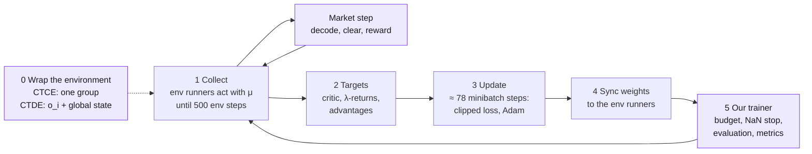

# The training cycle: PPO in three paradigms

> What one training iteration computes in V2: RLlib's PPO on the market's mixed
> action (side, quantity, price, partner), trained as CTCE, CTDE and DTDE. This
> page is the overview: the iteration in outline, **everything this
> implementation changes in RLlib's PPO and why**, the loss, and what each
> paradigm changes. [One iteration, step by step](cycle.md) follows every
> calculation in order; [Worked examples](examples.md) puts numbers on them.

!!! ours "How to read the colours"
    Purple is **ours**: code this implementation adds to
    RLlib, a setting it chooses differently from RLlib's default, or the market
    environment (which is ours entirely). Everything in the normal colour is PPO
    as RLlib 2.51.1 implements it, unchanged. In formulas our terms are
    $\textcolor{mediumpurple}{\text{purple}}$, in diagrams our steps are purple boxes.
    Each purple item says why it differs, so it can be explained, kept or changed.

**Sources.** RLlib is Ray 2.51.1, the version in the `marlem` conda env, read in
its installed source and linked at tag
[`ray-2.51.1`](https://github.com/ray-project/ray/tree/ray-2.51.1/rllib). The
implementation is `core/rl/` and [rl_defaults.py](../../core/rl_defaults.py); the
market environment is [market_env.py](../../core/env/market_env.py). What the
original MARLEM code computes instead is in
[section 6](#6-where-the-original-code-differs) and
[RL layer: what is wrong](../validation/rl.md).

## Notation

| Symbol | Meaning |
|---|---|
| $N$ | number of agents (market participants), $i = 1 \dots N$ |
| $t$ | environment step (one market hour): all $N$ agents act at once |
| $o_{i,t}$ | agent $i$'s observation: the paper's 42 signals and the $N - 1$ peers' reputations ([Observation](observation.md)) |
| $s_t = (o_{1,t}, \dots, o_{N,t})$ | the global state: all observations joined in the environment's agent order ([state.py](../../core/rl/state.py)) |
| $x_{i,t} = (o_{i,t}, s_t)$ | what agent $i$'s module receives in CTDE |
| $a_{i,t} = (\alpha, q, p, \beta)$ | agent $i$'s action: side, quantity, price, partner ([P1] eq. 2) |
| $r_{i,t}$, $R_t = \sum_i r_{i,t}$ | agent $i$'s reward (its scaled bill); the group reward of CTCE |
| $\pi_\theta$, $\mu$ | the policy being trained; the copy that collected the data |
| $V_\phi$ | the critic (state value) |
| $\gamma$, $\lambda$ | discount 0.99; GAE parameter 0.95 |

**The policy is a product of four distributions**, one per action part, sampled
independently given the observation (RLlib's `TorchMultiDistribution`):

$$
\pi(a \mid o) = \pi(\alpha \mid o)\; \pi(q \mid o)\; \pi(p \mid o)\; \pi(\beta \mid o),
\qquad
\log \pi(a \mid o) = \sum_{\text{parts}} \log \pi(\text{part} \mid o),
$$

where side $\alpha$ and partner $\beta$ are categorical (a softmax over logits) and
quantity $q$ and price $p$ are Gaussian, each with a mean $m$ and a $\log\sigma$.
The entropy and the KL are sums over the parts in the same way. In CTCE one
policy outputs all $N$ agents' actions, so the sum runs over $4N$ parts: that is
the key to the paradigms ([section 4](#4-what-each-paradigm-changes)).

## 1. One iteration at a glance

1. **Collect.** Each env runner holds a copy $\mu$ of the policy. Per step every
   module computes its distribution from its input (with our
   policy head, section 2), samples an action, and the
   market environment turns it into an order, plays the
   market step and returns rewards and observations. Recorded per step: input,
   action, reward, done flags, $\log\mu(a \mid o)$ and the distribution's inputs.
2. **Targets.** With the critic as it is before the update: λ-returns (the value
   targets) and advantages, standardised per module.
3. **Update.** 10 epochs over the batch in shuffled minibatches of 64: one loss,
   one gradient-norm clip and one Adam step per minibatch.
4. **Sync.** The new weights go to the env runners; the batch is discarded.
5. **Our trainer** ([`train`](../../core/rl/train.py#L408-L558))
   repeats RLlib's iteration until the budget of environment steps is used, stops
   on a non-finite loss, evaluates against baselines and records each action
   part's distribution.

The wrapping (step 0) is set once per run and decides
what each module sees, which reward it learns from and which actions share one
PPO ratio.

## 2. Everything we change in RLlib's PPO

Each row is a difference from what `PPOConfig()` with RLlib's default module would
do. The settings are in [rl_defaults.py](../../core/rl_defaults.py#L28-L64), the
code in `core/rl/`.

### Code

| What | RLlib does | Ours | Why | ID |
|---|---|---|---|---|
| CTCE environment | trains the environment's agents as they are | [`CTCEEnv`](../../core/rl/ctce.py#L46-L110): one agent, `"group"`, observing $s_t$, acting with a `Tuple` of every agent's `Dict`, rewarded with $R_t$ | CTCE is one controller for everyone (the social planner); the `Tuple` keeps each agent's parts and bounds in agent order | L-02, L-05 |
| CTDE environment and module | – | [`CTDEEnv`](../../core/rl/ctde.py#L55-L103) gives agent $i$ the input $x_{i,t} = (o_{i,t}, s_t)$; [`CTDEPPOModule`](../../core/rl/ctde.py#L143-L149)'s actor reads only $o_{i,t}$, its critic all of $x_{i,t}$ | MAPPO with one central critic per agent: the actor can act on its own observation after training, the critic uses everything; each agent keeps its own reward and ratio | L-01, RP-3e |
| Policy head of a continuous part | mean = linear output, unbounded; $\log\sigma$ = linear output, a function of the state (clipped to ±20 only for a single `Box` action, not for a `Dict`) | [`BoundedHead`](../../core/rl/modules.py#L121-L173): mean $= \tanh(\text{output}) \in (-1, 1)$; $\log\sigma$ = **one learned number per part**, the same in every state, starting at 0 | RLlib's state-dependent $\log\sigma$ collapsed before the side was decided, after which the price/quantity mean could no longer move (probe 9: 0 of 6 → 6 of 6); the tanh keeps the mean inside the bounds, where the clipped reward is not flat | RP-3h |
| Learner | RLlib's PPO loss and update | [`PPOLearner`](../../core/rl/learner.py#L27-L52): the same loss, also logs the **clip fraction** (share of samples whose ratio left $[0.8, 1.2]$) | shows how often the clip stops the gradient, above all for CTCE's joint ratio | L-02 |
| Training loop | `algo.train()`, one iteration per call | [`train`](../../core/rl/train.py#L408-L558): budget in environment steps, stop on NaN/inf losses, evaluation against baselines on unseen seeds, per-part distribution statistics, `run.json` | comparable budgets across paradigms; a NaN cannot pass silently; a run is judged against baselines and can be repeated | L-14, L-07, L-16 |
| Evaluation policy | – | [`Policy`](../../core/rl/policy.py#L92-L173): acts without noise, each part's most likely value (the Gaussian's mean, the categorical's mode) | a trained policy acts the same way in evaluation as when sampling, minus the noise | L-15 |

### Settings

| Setting | RLlib's default | Ours | Why | ID |
|---|---|---|---|---|
| `lr` | $5 \cdot 10^{-5}$ | $3 \cdot 10^{-4}$ | the probe screen: learns most per sample without collapsing $\sigma$; the original's $10^{-5}$ ([P2] Table 8) moved the policy almost nothing | RP-6b |
| `train_batch_size_per_learner` | 4000 | 500 | market steps are expensive (a power flow each); more, smaller updates per sample | RP-6b |
| `minibatch_size` | 128 | 64 | Stable-Baselines3's PPO default | RP-6b |
| `num_epochs` | 30 | 10 | Stable-Baselines3's PPO default | RP-6b |
| `lambda_` | 1.0 | 0.95 | the original's; the usual GAE value | [P2] Table 8 |
| `clip_param` | 0.3 | 0.2 | the original's; PPO paper's value | [P2] Table 8 |
| `entropy_coeff` | 0 | 0.01 | the original's: keeps exploring | [P2] Table 8 |
| `grad_clip` | none | 0.5 (global norm) | the original's | [P2] Table 8 |
| `kl_coeff` (with `use_kl_loss=True`) | 0.2, adaptive | 0 | the KL is computed and logged as a gauge of each update's size, not used in the loss | RP-4a, L-07 |
| `vf_clip_param` | 10 | $10^6$ | RLlib caps the **squared** value error at 10: errors above $\sqrt{10} \approx 3.2$ give the critic no gradient | – |
| `vf_share_layers` | True | False | actor and critic have separate encoders in every paradigm, so the value loss does not train the actor's layers | L-04 |
| `num_env_runners` | 2 | 0 (sample in the driver); 3 in the market runs | set per experiment from the CPUs a run has | L-11 |

**Unchanged** (RLlib's): $\gamma = 0.99$, value-loss coefficient 1, the network
(2 × 256 tanh encoders, linear heads), GAE and advantage standardisation,
`truncate_episodes`, `normalize_actions`, the clipped surrogate loss, Adam.

## 3. The loss

RLlib's PPO loss
([`ppo_torch_learner.py` L74-L120](https://github.com/ray-project/ray/blob/ray-2.51.1/rllib/algorithms/ppo/torch/ppo_torch_learner.py#L74-L120)),
averaged over the minibatch, per module:

$$
\begin{aligned}
\rho_t &= \exp\big(\log\pi_\theta(a_t \mid o_t) - \log\mu(a_t \mid o_t)\big) \\
L &= -\min\big(\rho_t \hat A_t,\; \text{clip}(\rho_t, 1 - \epsilon, 1 + \epsilon)\, \hat A_t\big) \\
  &\quad + c_v \min\big((V_\phi(o_t) - G^\lambda_t)^2,\; \textcolor{mediumpurple}{10^6}\big) \\
  &\quad - \textcolor{mediumpurple}{c_H}\, \mathcal{H}\big(\pi_\theta(\cdot \mid o_t)\big)
   + \textcolor{mediumpurple}{0} \cdot \mathrm{KL}(\mu \,\|\, \pi_\theta)
\end{aligned}
$$

where $\log\pi$, $\mathcal{H}$ and $\mathrm{KL}$ are sums over the action parts
(over $4N$ parts in CTCE), $\hat A_t$ the standardised advantage and $G^\lambda_t$
the λ-return.

| Term | Setting | What it does |
|---|---|---|
| clipped surrogate | $\epsilon = \textcolor{mediumpurple}{0.2}$ | raise the probability of actions with $\hat A > 0$, lower it for $\hat A < 0$, but stop once $\rho$ leaves $[0.8, 1.2]$ in that direction. With the composite action, $\rho$ is the **product** of the parts' ratios: one ratio for the agent's whole action |
| value loss | $c_v = 1$, cap $10^6$ | fit $V_\phi$ to $G^\lambda$ |
| entropy bonus | $c_H =$ 0.01 | keep exploring: pushes every categorical towards uniform and every $\log\sigma$ up |
| KL | weight 0 | logged as `mean_kl_loss`, no effect on the loss |

**Gradient steps.** 10 epochs over the 500 rows of each module, in shuffled
minibatches of 64: $10 \times 500 / 64 \approx 78$ Adam steps per iteration,
learning rate $3 \cdot 10^{-4}$, each preceded by clipping the gradient's global
norm to 0.5. On the first minibatch $\pi_\theta = \mu$, so $\rho = 1$ exactly;
every Adam step then moves $\pi_\theta$ away from $\mu$, and once a sample's ratio
has left $[0.8, 1.2]$ in the direction its advantage pushes, that sample stops
contributing a gradient. That is what lets PPO use each sample 10 times without
the policy running away from the data it was collected with.

**What to check** (each run's `metrics.csv`, the Studio's Learning tab): $\rho = 1$
on the first minibatch; explained variance of $V_\phi$ rising toward 1; entropy
falling slowly; KL per update around $10^{-3}$ to
$10^{-2}$ (the probes' median is 0.005); clip fraction
small; the gradient norm before clipping; each part's mean,
$\log\sigma$, share outside the bounds, entropy in fixed states
([`part_stats`](../../core/rl/policy.py#L492-L542)).

## 4. What each paradigm changes

The algorithm, the loss and the settings are the same in all three. What differs
is what each module receives, whose reward it learns from and
which actions share one ratio:

| | CTCE | CTDE | DTDE |
|---|---|---|---|
| Modules | one, `"group"` | $N$, one per agent | $N$, one per agent |
| Actor input | $s_t$ | $o_{i,t}$ | $o_{i,t}$ |
| Critic input | $s_t$ | $(o_{i,t}, s_t)$ | $o_{i,t}$ |
| Reward | $R_t = \sum_i r_{i,t}$ | $r_{i,t}$ | $r_{i,t}$ |
| Action distribution | one composite over $4N$ parts | per agent, over its 4 parts | per agent, over its 4 parts |
| PPO ratio | $\rho_t = \prod_i \rho_{i,t}$, one clip for the group | $\rho_{i,t}$, one clip per agent | $\rho_{i,t}$, one clip per agent |
| Advantage | one per step for the group | one per agent | one per agent |
| Entropy in the loss | sum over $4N$ parts, one coefficient | sum over the agent's 4 parts | sum over the agent's 4 parts |
| Wrapper | `CTCEEnv` | `CTDEEnv`, `CTDEPPOModule` | none |

### CTCE

One controller sees everything, acts for everyone and is paid the total. Every
agent's parts are pushed by **one** advantage, computed from the summed reward,
however much that agent contributed (the credit-assignment cost); the clip acts on
the product of $N$ agents' ratios, which leaves $[0.8, 1.2]$ sooner than any single
agent's. That is why CTCE is slower on the probes (5 and 6 do not converge at 8
times the budget) and why it is a centralised-information baseline, not an upper
bound ([L-02](../validation/rl.md#l-02-ctce-is-a-centralised-information-baseline-not-an-upper-bound)).

!!! ours "Open: the entropy bonus in CTCE"
    The entropy is a sum over $4N$ parts, while the surrogate still uses one
    standardised advantage per step; with 13 agents the entropy term weighs about
    13 times what it does for one DTDE agent. Whether this drives CTCE's rising
    $\log\sigma$ on the market is what the experiment `ctce_entropy` tests:
    `entropy_coeff` 0.01, 0.01/13 and 0 (`runs/@taltech/ctce_entropy/`).

### CTDE

MAPPO with one actor and one central critic per agent and no parameter sharing
(RP-3e). The actor is the same network as DTDE's, so the trained policy acts on
$o_{i,t}$ alone; only the critic is wider and sees $s_t$, so it can explain part of
the agent's return by the others' situation instead of crediting the agent's own
action. A difference between CTDE and DTDE is therefore the central critic's.

### DTDE

Each agent is an independent PPO learner on its own observation and reward. The
other agents are part of its environment, which changes as they learn.

## 5. Steps per iteration and the budget

| Per iteration | Value |
|---|---|
| Environment steps sampled | 500 (about 21 market days of 24 steps), split over the env runners |
| Rows per module | 500: in CTCE one group's, in CTDE and DTDE each agent's (so $N \times 500$ rows in total) |
| Adam steps per module | $10 \times 500 / 64 \approx 78$ |
| Adam steps per 1000 environment steps | ≈ 156 |
| Times each row is used | 10 |
| Data | fresh, then discarded |

Batches are counted in environment steps (`count_steps_by="env_steps"`): one step
is one transition for the group in CTCE and one for each agent in CTDE and DTDE,
so every paradigm gets the same experience per iteration. The
budget is counted in environment steps too (L-14): `market_s2`'s 240,000
steps are 480 iterations, about 10,000 market days, in every paradigm. An episode
is one day; it ends **terminated** at midnight (RP-1f), so the return does not
bootstrap into the next day. An episode still running when the batch is full is
cut there and bootstrapped with the critic.

## 6. Where the original code differs

The original MARLEM trained the same three paradigms (and APPO and SAC) on one
continuous `Box` action, decoding side and partner from it. For PPO:

| Original | Here | Recorded as |
|---|---|---|
| CTDE acts with per-agent heads that never receive a gradient; the loss trains a central actor; it learns from $R_t$ like CTCE | each agent's actor is the network the loss trains, on its own reward | [L-01](../validation/rl.md#l-01-ctde-never-trains-the-policies-that-act) |
| CTCE and CTDE: custom 2 × 128 ReLU networks with a shared encoder; DTDE: RLlib's default | the same network settings everywhere, actor and critic separate | [L-04](../validation/rl.md#l-04-the-paradigms-train-different-networks) |
| grouped spaces in name order, grouped data in environment order | both in environment order | [L-05](../validation/rl.md#l-05-grouped-spaces-are-in-name-order-grouped-data-in-environment-order) |
| CTCE and CTDE: $\log\sigma$ unclipped, grown by the entropy bonus until it overflows | one learned $\log\sigma$ per part (RP-3h) | [L-06](../validation/rl.md#l-06-the-ctce-and-ctde-action-spread-has-no-limit) |
| `kl_coeff=0` still computes the KL; an infinite KL makes the loss NaN, silently zeroed | the KL is a logged gauge; training stops on a non-finite loss | [L-07](../validation/rl.md#l-07-kl_coeff--0-does-not-switch-off-the-kl-term-and-a-nan-loss-goes-unnoticed) |
| population-based training jumps the learning rate and the entropy coefficient | fixed settings per run | [L-10](../validation/rl.md#l-10-population-based-training-jumps-the-learning-rate-and-reaches-entropy-10) |
| budget in iterations | budget in environment steps | [L-14](../validation/rl.md#l-14-the-budget-is-counted-in-iterations-the-paper-in-episodes) |
| standalone inference uses the mean without rescaling | the same rescaling as in training | [L-15](../validation/rl.md#l-15-standalone-inference-does-not-act-like-training) |
