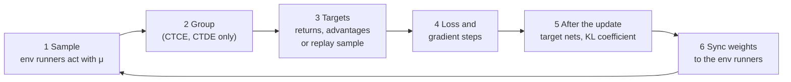

# The training cycle: 3 algorithms × 3 paradigms

> The math that has to happen in one training iteration of each of MARLEM's nine
> combinations: PPO, APPO and SAC, each trained as CTCE, CTDE and DTDE. First the
> common skeleton, then each algorithm worked through (PPO in full), then what
> each paradigm changes, then how many steps each algorithm takes, so runs can be
> compared. Where the original code computes something else, the section says so
> and points to [RL layer: what is wrong](../validation/rl.md). The same iteration,
> step by step from the observation, is in [One training iteration](cycle.md).

**Sources.** RLlib is Ray 2.51.1, the version in the `marlem` conda env; every
statement about it was read in its installed source, linked at tag
[`ray-2.51.1`](https://github.com/ray-project/ray/tree/ray-2.51.1/rllib). MARLEM's
code is linked at the original commit
[`15d6715`](https://github.com/salazarna/marlem/tree/15d6715a7b7ad31700d3758f2a2dd9df053773a7/src/environment),
as in the validation document. Settings are the original's
([`train.py` L215-L259](https://github.com/salazarna/marlem/blob/15d6715a7b7ad31700d3758f2a2dd9df053773a7/src/environment/train.py#L215-L259)),
completed with RLlib's defaults. [P2] is the implicit-cooperation preprint.

## Notation

| Symbol | Meaning |
|---|---|
| $N$ | number of agents, $i = 1 \dots N$ |
| $t$ | environment step: all $N$ agents act at once |
| $o_{i,t}$, $a_{i,t}$, $r_{i,t}$ | agent $i$'s observation, action and reward at step $t$ |
| $s_t = (o_{1,t}, \dots, o_{N,t})$ | all observations, concatenated (the grouped paradigms' input) |
| $\mathbf{a}_t = (a_{1,t}, \dots, a_{N,t})$ | the joint action |
| $R_t = \sum_i r_{i,t}$ | the group reward of CTCE and CTDE ([`train.py` L684](https://github.com/salazarna/marlem/blob/15d6715a7b7ad31700d3758f2a2dd9df053773a7/src/environment/train.py#L684)) |
| $d_t$ | 1 if the episode terminates at $t$, else 0 |
| $\pi_\theta$, $\mu$ | the policy being trained (parameters $\theta$); the policy that collected the data |
| $V_\phi$, $Q_\psi$ | state-value critic (PPO, APPO); action-value critic (SAC) |
| $\gamma$, $\lambda$ | discount 0.99; GAE parameter 0.95 |

Every policy is a diagonal Gaussian over the action dimensions (SAC-DTDE then
squashes it with tanh, [section 4](#4-sac)): the network
outputs a mean $m$ and $\log\sigma$ per dimension, and

$$\log \pi(a) = \sum_k \left[-\frac{(a_k - m_k)^2}{2\sigma_k^2} - \log\sigma_k - \tfrac12\log 2\pi\right], \qquad \mathcal{H}(\pi) = \sum_k \left(\log\sigma_k + \tfrac12 \log 2\pi e\right).$$

A sum over dimensions is also a sum over agents when one policy outputs all agents'
actions. That is the key to the paradigms ([section 5](#5-what-each-paradigm-changes)).

## 1. One iteration: the common skeleton

1. **Sample.** Each env runner holds a copy $\mu$ of the policy. Per step it
   computes the distribution from $o$, samples $a \sim \mu(\cdot \mid o)$, rescales
   it from $[-1, 1]$ to the action's bounds (`normalize_actions=True`), and
   records $o, a, r, d$, $\log\mu(a \mid o)$ and the distribution's inputs.
2. **Group** (CTCE, CTDE). `GroupedLEM` turns the $N$ agents into one: observation
   $s_t$, action $\mathbf{a}_t$, reward $R_t$, one done flag
   ([`train.py` L676-L687](https://github.com/salazarna/marlem/blob/15d6715a7b7ad31700d3758f2a2dd9df053773a7/src/environment/train.py#L676-L687)).
3. **Targets.** What the loss regresses on: λ-returns and advantages (PPO), V-trace
   targets (APPO, computed inside the loss), or a batch drawn from the replay buffer
   (SAC).
4. **Loss and gradient steps.** One Adam step per (mini)batch, after clipping the
   gradient's global norm to 0.5 (`grad_clip`).
5. **After the update.** Target networks are copied (APPO, SAC); PPO's KL
   coefficient is adapted.
6. **Sync.** The new weights go to the env runners: the next iteration samples
   with the updated $\mu$.

What changes between the nine combinations is only steps 2 to 5.

## 2. PPO, worked through

On-policy: every iteration collects fresh data with the current policy, trains on
it, and throws it away
([`ppo.py` L389-L458](https://github.com/ray-project/ray/blob/ray-2.51.1/rllib/algorithms/ppo/ppo.py#L389-L458)).

**Sample.** 4000 environment steps (`train_batch_size`), split over the env
runners. Episodes are cut where the batch is full (`truncate_episodes`).

**Targets** ([`value_predictions.py` L7-L38](https://github.com/ray-project/ray/blob/ray-2.51.1/rllib/utils/postprocessing/value_predictions.py#L7-L38)).
With the critic as it is *before* the update, compute backwards in time the
λ-return

$$G^\lambda_t = r_t + \gamma (1 - d_t)\left[(1 - \lambda)\, V_\phi(o_{t+1}) + \lambda\, G^\lambda_{t+1}\right],$$

which equals the usual GAE sum: with $\delta_t = r_t + \gamma(1-d_t) V_\phi(o_{t+1}) - V_\phi(o_t)$,
$\hat A_t = \sum_{l \ge 0} (\gamma\lambda)^l \delta_{t+l}$ and $G^\lambda_t = \hat A_t + V_\phi(o_t)$.
A truncated episode is bootstrapped with $V_\phi$ of its last observation; a
terminated one with 0. The advantages are then **standardised** over the batch,
$\hat A_t \leftarrow (\hat A_t - \text{mean}) / \text{std}$
([`general_advantage_estimation.py` L148](https://github.com/ray-project/ray/blob/ray-2.51.1/rllib/connectors/learner/general_advantage_estimation.py#L148)).
$G^\lambda_t$ is the value target.

**Loss** ([`ppo_torch_learner.py` L74-L120](https://github.com/ray-project/ray/blob/ray-2.51.1/rllib/algorithms/ppo/torch/ppo_torch_learner.py#L74-L120)), averaged over the minibatch:

$$\rho_t(\theta) = \exp\big(\log\pi_\theta(a_t \mid o_t) - \log\mu(a_t \mid o_t)\big)$$

$$L = -\min\big(\rho_t \hat A_t,\; \text{clip}(\rho_t, 1 - \epsilon, 1 + \epsilon)\, \hat A_t\big) + c_v \min\big((V_\phi(o_t) - G^\lambda_t)^2,\; 10\big) - c_H\, \mathcal{H}\big(\pi_\theta(\cdot \mid o_t)\big) + \beta\, \mathrm{KL}(\mu \,\|\, \pi_\theta)$$

| Term | Setting | What it does |
|---|---|---|
| clipped surrogate | $\epsilon = 0.2$ | raise the probability of actions with $\hat A > 0$, but stop once $\rho$ leaves $[0.8, 1.2]$ |
| value loss | $c_v = 1$, cap 10 (`vf_clip_param`) | fit $V_\phi$ to $G^\lambda$; the squared error is capped, so an error above $\sqrt{10} \approx 3.2$ gives **no** gradient |
| entropy bonus | $c_H = 0.01$ | keep exploring |
| KL penalty | $\beta = 0$ (`kl_coeff`) | switched off, but still computed: $0 \cdot \infty$ = NaN ([R-02](../validation/rl.md#r-02-kl_coeff--0-does-not-switch-off-the-kl-term-and-a-nan-loss-goes-unnoticed)) |

**Gradient steps.** 30 epochs over the 4000 steps in shuffled minibatches of 128:
$30 \times 4000 / 128 \approx 940$ Adam steps, learning rate $10^{-5}$. In the first
minibatch $\pi_\theta = \mu$, so $\rho = 1$ exactly; later minibatches move away and
the clip takes over.

**After the update.** The KL coefficient would be multiplied by 1.5 or 0.5
depending on the measured KL; from 0 it stays 0.

**What to check.** $\rho = 1$ on the first minibatch; advantages with mean 0 and
standard deviation 1; the value loss mostly below the cap; explained variance of
$V_\phi$ rising toward 1; entropy falling slowly, never NaN.

## 3. APPO

Asynchronous PPO: env runners keep sampling while the learner trains, so the data
is always a little older than the policy. V-trace corrects for that
([`appo_torch_learner.py` L44-L214](https://github.com/ray-project/ray/blob/ray-2.51.1/rllib/algorithms/appo/torch/appo_torch_learner.py#L44-L214)).
APPO keeps a **target policy** $\bar\pi$, a copy of $\pi_\theta$ refreshed now and
then, as the "old" policy that the update is anchored to.

**Sample.** Env runners send fragments of 50 steps; the learner trains on batches of
500. A circular buffer holds 4 batches, and each batch is trained on at most twice.

**Targets: V-trace** ([`vtrace_torch_v2.py` L72-L168](https://github.com/ray-project/ray/blob/ray-2.51.1/rllib/algorithms/impala/torch/vtrace_torch_v2.py#L72-L168)).
With truncated importance weights between the target policy and the collecting one,

$$\rho_t = \min\!\left(1, \frac{\bar\pi(a_t \mid o_t)}{\mu(a_t \mid o_t)}\right), \qquad c_t = \min\!\left(1, \frac{\bar\pi(a_t \mid o_t)}{\mu(a_t \mid o_t)}\right),$$

the value target is computed backwards in time,

$$v_t = V_\phi(o_t) + \rho_t \delta_t + \gamma (1 - d_t)\, c_t\, \big(v_{t+1} - V_\phi(o_{t+1})\big), \qquad \delta_t = r_t + \gamma (1 - d_t) V_\phi(o_{t+1}) - V_\phi(o_t),$$

and the policy-gradient advantage is $A_t = \rho_t \big(r_t + \gamma (1 - d_t) v_{t+1} - V_\phi(o_t)\big)$.
With $\bar\pi = \mu$ this is the $n$-step return; the weights only cut off what the
older data can no longer vouch for. There is **no λ** in it: RLlib's V-trace takes
none, so the original's `lambda_=0.95`, and its population-based training of
`lambda_` for APPO, change nothing. Advantages are not standardised.

**Loss.**

$$\rho^{\text{PPO}}_t = \text{clip}\!\left(\frac{\mu(a_t \mid o_t)}{\bar\pi(a_t \mid o_t)}, 0, 2\right) \cdot \frac{\pi_\theta(a_t \mid o_t)}{\mu(a_t \mid o_t)} \approx \frac{\pi_\theta}{\bar\pi}$$

$$L = -\min\big(\rho^{\text{PPO}}_t A_t,\; \text{clip}(\rho^{\text{PPO}}_t, 0.6, 1.4)\, A_t\big) + 0.5 \cdot \tfrac12 \big(V_\phi(o_t) - v_t\big)^2 - 0.01\, \mathcal{H}\big(\pi_\theta(\cdot \mid o_t)\big)$$

The clip is 0.4 (RLlib's APPO default), the value coefficient 0.5, and the KL term
is off (`use_kl_loss=False`). One Adam step per 500-step batch, learning rate
$10^{-5}$.

**After the update.** The target policy is overwritten with $\pi_\theta$
($\tau = 1$) every $2 \times 4 \times 2 \times 500 = 8000$ trained environment
steps, reuse counted
([`appo_learner.py` L85-L117](https://github.com/ray-project/ray/blob/ray-2.51.1/rllib/algorithms/appo/appo_learner.py#L85-L117)).

**What to check.** $\bar\pi/\mu$ near 1 (data not too stale); the same health
signals as PPO.

## 4. SAC

Off-policy: transitions go into a replay buffer, and the learner trains on random
batches from it, old and new
([`dqn.py` L647-L755](https://github.com/ray-project/ray/blob/ray-2.51.1/rllib/algorithms/dqn/dqn.py#L647-L755),
which SAC inherits). It learns two critics $Q_{\psi_1}, Q_{\psi_2}$, their slowly
following copies $\bar Q_1, \bar Q_2$, the actor, and the temperature $\alpha$.

**Sample.** About 256 environment steps per training step, in whole episodes
(`complete_episodes`), added to a buffer of 1000 transitions (uniform, the
original's setting; RLlib's default is prioritised with $10^6$). Training starts
after 1500 sampled steps.

**Targets.** A batch of 256 transitions $(o, a, r, o', d)$ from the buffer. For each,
a next action $a' \sim \pi_\theta(\cdot \mid o')$ and

$$y = r + \gamma (1 - d)\left[\min_{j=1,2} \bar Q_j(o', a') - \alpha \log \pi_\theta(a' \mid o')\right].$$

**Loss** ([`sac_torch_learner.py` L270-L350](https://github.com/ray-project/ray/blob/ray-2.51.1/rllib/algorithms/sac/torch/sac_torch_learner.py#L270-L350)),
three losses, each with its own Adam optimiser:

$$L_Q = \sum_{j=1,2} \text{Huber}\big(Q_{\psi_j}(o, a) - y\big), \qquad \text{learning rate } 10^{-5}$$

$$L_\pi = \alpha \log \pi_\theta(\tilde a \mid o) - \min_j Q_{\psi_j}(o, \tilde a), \qquad \tilde a = m_\theta(o) + \sigma_\theta(o)\,\varepsilon,\; \varepsilon \sim \mathcal N(0, I), \qquad \text{lr } 10^{-5}$$

$$L_\alpha = -\log\alpha \,\big(\log \pi_\theta(\tilde a \mid o) + \bar{\mathcal H}\big), \qquad \text{lr } 3 \cdot 10^{-4}$$

- **The actor learns through the critic.** $\tilde a$ is a *reparameterised* sample
  (`rsample`, [`default_sac_torch_rl_module.py` L155](https://github.com/ray-project/ray/blob/ray-2.51.1/rllib/algorithms/sac/torch/default_sac_torch_rl_module.py#L155)),
  so $\partial L_\pi / \partial\theta$ runs through $\partial Q / \partial \tilde a$:
  the actor moves its actions uphill on the critic. Without it the actor only
  maximises entropy.
- **The temperature** $\alpha$ (starting at 1) rises when the entropy is below the
  target $\bar{\mathcal H} = -\dim A$ and falls when above.
- **The actions are squashed**: in RLlib's own module $\tilde a = \tanh(\cdot)$, and
  $\log\pi$ includes the $-\sum_k \log(1 - \tanh^2)$ correction.

**After the update.** Polyak averaging after every gradient step:
$\bar\psi_j \leftarrow 0.005\, \psi_j + 0.995\, \bar\psi_j$.

**What to check.** $Q$ near the true discounted return (on a probe it is known);
$\alpha$ settling; the entropy near its target.

## 5. What each paradigm changes

The algorithm's math stays the same; the paradigm decides **what counts as one
agent** for RLlib: what the actor and the critic see, which reward they learn from,
and how many networks there are.

| | CTCE | CTDE (as [P2] eq. 18 intends) | DTDE |
|---|---|---|---|
| RLlib agents | 1 (the group) | 1 (the group) | $N$, one module each |
| Actor | $\pi_\theta(\mathbf{a} \mid s)$ | $\pi_{\theta_i}(a_i \mid o_i)$ per agent | $\pi_{\theta_i}(a_i \mid o_i)$ |
| Critic (PPO, APPO) | $V_\phi(s)$ | $V_\phi(s)$ | $V_{\phi_i}(o_i)$ |
| Critic (SAC) | $Q_\psi(s, \mathbf{a})$ | $Q_\psi(s, \mathbf{a})$ | $Q_{\psi_i}(o_i, a_i)$ |
| Reward | $R = \sum_i r_i$ | $R = \sum_i r_i$ | own $r_i$ |
| SAC entropy target | $-\sum_i \dim A_i$ | $-\sum_i \dim A_i$ | $-\dim A_i$ |
| Networks in the code | custom, 2 × 128 ReLU | custom; acting heads 3 layers per agent | RLlib default, 2 × 256 tanh |
| Actor and critic | share the encoder | central actor and critic share the encoder | share the encoder (`vf_share_layers=True`, RLlib's default) |

### CTCE

One policy outputs every agent's action from all observations. Because it is a
diagonal Gaussian over all action dimensions,

$$\log \pi_\theta(\mathbf{a} \mid s) = \sum_{i=1}^{N} \log \pi_{\theta}(a_i \mid s), \qquad \rho_t = \prod_{i=1}^{N} \rho_{i,t}, \qquad \mathcal{H} = \sum_i \mathcal{H}_i.$$

So PPO clips the **product** of the agents' ratios, one advantage from the summed
reward weights every agent's action, and the entropy bonus is $N$ times larger
than one agent's. The learning signal for $a_i$ carries every other agent's reward
noise: the credit-assignment cost that makes CTCE learn more slowly
([I-60](../validation/rl.md#i-60-ctce-is-a-centralised-information-baseline-not-an-upper-bound)).

### CTDE

CTDE is CTCE's loss with the actor **restricted**: each agent's part of the policy
may only look at its own observation,

$$\pi_\theta(\mathbf{a} \mid s) = \prod_{i=1}^{N} \pi_{\theta_i}(a_i \mid o_i), \qquad \log \pi_\theta(\mathbf{a} \mid s) = \sum_i \log \pi_{\theta_i}(a_i \mid o_i).$$

The critic stays central ($V_\phi(s)$ or $Q_\psi(s, \mathbf{a})$), because it is
only needed during training. With this actor:

- **PPO, APPO.** Two choices, to be decided and recorded: the joint ratio
  $\prod_i \rho_i$ clipped once (exactly CTCE's loss), or a clipped term per agent,
  $\sum_i \min(\rho_i \hat A, \text{clip}(\rho_i)\hat A)$, as in MAPPO (Yu et al.,
  2022). Both use one advantage from $V_\phi(s)$ and $R$.
- **SAC.** $L_\pi = \alpha \sum_i \log \pi_{\theta_i}(\tilde a_i \mid o_i) - \min_j Q_{\psi_j}(s, \tilde{\mathbf{a}})$
  with every $\tilde a_i$ reparameterised: each $\theta_i$ gets the gradient of the
  joint critic through its own action.

The gradient for $\theta_i$ goes into **the network that acts**. In the original
code it does not: the loss trains a central actor $\pi(\mathbf{a} \mid s)$ and the
agents act with per-agent heads that never change
([I-48](../validation/rl.md#i-48-ctde-never-trains-the-policies-that-act)).

### DTDE

$N$ independent copies of sections 2-4, each with index $i$: agent $i$'s
advantage comes from its own reward and its own critic, its ratio from its own
policy. The other agents are part of agent $i$'s environment, and that environment
changes as they learn.

## 6. The 3 × 3 matrix

What the policy gradient of each combination is built from. "→" marks where the
original code computes something else.

| | CTCE | CTDE | DTDE |
|---|---|---|---|
| **PPO** | $\prod_i \rho_i$, GAE on $R$ with $V_\phi(s)$ | $\rho_i$ of $\pi_{\theta_i}(a_i \mid o_i)$, GAE on $R$ with $V_\phi(s)$ → central actor trained, heads act (I-48) | per agent: $\rho_i$, GAE on $r_i$ with $V_{\phi_i}(o_i)$ |
| **APPO** | V-trace on $R$, joint ratio | as PPO-CTDE with V-trace → I-48 | per agent: V-trace on $r_i$ |
| **SAC** | $Q_\psi(s, \mathbf{a})$, gradient through $\tilde{\mathbf{a}}$ → no gradient through $\tilde{\mathbf{a}}$ (R-05), unsquashed Gaussian (R-04) | $Q_\psi(s, \mathbf{a})$, gradient through each $\tilde a_i$ → I-48, R-05, R-04 | per agent: $Q_{\psi_i}(o_i, a_i)$, squashed Gaussian |

## 7. Steps per iteration, and comparing runs

An **iteration** is one call of RLlib's training step, repeated until the
iteration's minimum time and step counts are met. It means something different for
each algorithm:

| Per iteration | PPO | APPO | SAC |
|---|---|---|---|
| Ends when | after one training step (4000 sampled steps) | at least 10 s have passed (`min_time_s_per_iteration`) | at least 1 s and 100 sampled steps |
| Environment steps sampled | 4000, fixed | whatever the env runners deliver in 10 s | about 256 per training step, 1 training step or more |
| Batch per gradient step | 128 | 500 | 256 |
| Gradient steps | ≈ 940 | 1 per batch, each batch at most twice | 1 per training step |
| **Gradient steps per 1000 env steps** | **≈ 234** | **≤ 4** | **≈ 4** |
| Times each sample is used | 30 | ≤ 2 | ≈ 1 while in the buffer (1000 transitions) |
| Data | fresh, then discarded | slightly stale, V-trace corrects | replayed, off-policy |

**Across paradigms.** Batches are counted in environment steps
(`count_steps_by="env_steps"`). One environment step is one transition for the
group in CTCE and CTDE, and $N$ transitions in DTDE, one per agent's module. So in
a PPO iteration each of DTDE's $N$ networks trains on 4000 transitions of its own
agent, and CTCE's single network on 4000 joint transitions: the same number of
samples per network, for a problem $N$ times larger.

**What makes runs comparable.**

- **A budget in environment steps**, the same for all nine combinations, not
  iterations ([I-50](../validation/rl.md#i-50-the-budget-is-counted-in-iterations-the-paper-in-episodes)):
  APPO's and SAC's iterations depend on wall-clock time and differ between
  machines.
- **Report the gradient steps** alongside: at the same budget PPO takes about 60
  times more gradient steps than APPO or SAC, by design.
- **Evaluate at the same environment-step counts**, with the same seeds, on the
  same team score ([I-73](../validation/rl.md#i-73-returns-of-the-paradigms-are-compared-across-different-scales)).

## 8. Where the original code differs

| What | Section | Where it is recorded |
|---|---|---|
| CTDE's loss trains a central actor; the acting heads never change | 5, 6 | [I-48](../validation/rl.md#i-48-ctde-never-trains-the-policies-that-act) |
| CTCE and CTDE: $\log\sigma$ unbounded, entropy can overflow | 2 | [R-01](../validation/rl.md#r-01-the-ctce-and-ctde-action-spread-has-no-limit) |
| `kl_coeff = 0` still computes the KL; NaN loss is skipped silently | 2 | [R-02](../validation/rl.md#r-02-kl_coeff--0-does-not-switch-off-the-kl-term-and-a-nan-loss-goes-unnoticed) |
| SAC in CTCE and CTDE uses an unsquashed Gaussian | 4 | [R-04](../validation/rl.md#r-04-sac-in-ctce-and-ctde-uses-an-unsquashed-gaussian) |
| SAC in CTCE and CTDE: the actor's sample $\tilde{\mathbf{a}}$ is drawn with `sample()`, not `rsample()`, so $L_\pi$ has no gradient through the critic and the actor only maximises entropy ([`ctce.py` L136](https://github.com/salazarna/marlem/blob/15d6715a7b7ad31700d3758f2a2dd9df053773a7/src/environment/ctce.py#L136), [`ctde.py` L147](https://github.com/salazarna/marlem/blob/15d6715a7b7ad31700d3758f2a2dd9df053773a7/src/environment/ctde.py#L147)) | 4 | [R-05](../validation/rl.md#r-05-sacs-actor-in-ctce-and-ctde-gets-no-gradient-from-the-critic) |
| SAC in CTCE and CTDE: $a'$ comes from a target copy of the actor, not the current one; the critic is not frozen while $L_\pi$ is computed, as RLlib's module does | 4 | not recorded: deviations from RLlib's SAC whose effect is not established |
| APPO: `lambda_` is set and tuned but V-trace has no λ | 3 | [R-06](../validation/rl.md#r-06-appos-lambda_-has-no-effect) |
