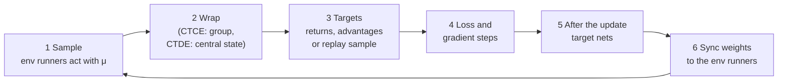

# The training cycle: 3 algorithms × 3 paradigms

> **V2 note.** This page describes V1 (PPO, APPO and SAC; the market's action as
> two numbers in one `Box`). V2 trains PPO only, with the mixed `Dict` action
> (side, quantity, price, partner) and CTCE's `Tuple` group action; what differs
> is in [v2.md](../v2.md). Code links follow branch `marlem-v2`, so a line anchor may
> point near, not at, the V1 code described.

> The math that has to happen in one training iteration of each of the nine
> combinations: PPO, APPO and SAC, each trained as CTCE, CTDE and DTDE, as
> `core/rl/` implements them. First the common skeleton, then each algorithm
> worked through (PPO in full), then what each paradigm changes, then how many
> steps each algorithm takes, so runs can be compared. Where the original MARLEM
> code computes something else, the section says so and points to
> [RL layer: what is wrong](../validation/rl.md); [section 8](#8-where-the-original-code-differs)
> collects them. The same iteration, step by step from the observation, is in
> [One training iteration](cycle.md).

**Sources.** RLlib is Ray 2.51.1, the version in the `marlem` conda env; every
statement about it was read in its installed source, linked at tag
[`ray-2.51.1`](https://github.com/ray-project/ray/tree/ray-2.51.1/rllib). The
implementation is `core/rl/` in this repository: the paradigms in
[ctce.py](../../core/rl/ctce.py) and
[ctde.py](../../core/rl/ctde.py), the settings in
[rl_defaults.py](../../core/rl_defaults.py). The settings below are its `SETTINGS`: the
original's starting values ([P2] Table 8,
[`train.py` L215-L259](https://github.com/salazarna/marlem/blob/15d6715a7b7ad31700d3758f2a2dd9df053773a7/src/environment/train.py#L215-L259))
without the defective ones, completed with RLlib's defaults. An experiment can
override them; the market runs of [marlem-v1](../v1.md#4-how-to-use-it) use a
learning rate of $3 \cdot 10^{-4}$ and PPO batches of 2400 steps, minibatches of
240 and 10 epochs. The original code is linked at commit
[`15d6715`](https://github.com/salazarna/marlem/tree/15d6715a7b7ad31700d3758f2a2dd9df053773a7/src/environment).
[P2] is the implicit-cooperation preprint.

## Notation

| Symbol | Meaning |
|---|---|
| $N$ | number of agents, $i = 1 \dots N$ |
| $t$ | environment step: all $N$ agents act at once |
| $o_{i,t}$, $a_{i,t}$, $r_{i,t}$ | agent $i$'s observation, action and reward at step $t$ |
| $s_t = (o_{1,t}, \dots, o_{N,t})$ | all observations, concatenated: CTCE's input, and the global state CTDE's critics see |
| $x_{i,t} = (o_{i,t}, s_t)$ | what agent $i$'s module receives in CTDE ([`CTDEEnv`](../../core/rl/ctde.py#L57-L104)) |
| $\mathbf{a}_t = (a_{1,t}, \dots, a_{N,t})$ | the joint action |
| $R_t = \sum_i r_{i,t}$ | the group reward of CTCE ([`CTCEEnv`](../../core/rl/ctce.py#L100)) |
| $d_t$ | 1 if the episode terminates at $t$, else 0 |
| $\pi_\theta$, $\mu$ | the policy being trained (parameters $\theta$); the policy that collected the data |
| $V_\phi$, $Q_\psi$ | state-value critic (PPO, APPO); action-value critic (SAC) |
| $\gamma$, $\lambda$ | discount 0.99; GAE parameter 0.95 |

Every policy is a diagonal Gaussian over the action dimensions (SAC then squashes
it with tanh, [section 4](#4-sac)): the network outputs a mean $m$ and $\log\sigma$
per dimension, and

$$\log \pi(a) = \sum_k \left[-\frac{(a_k - m_k)^2}{2\sigma_k^2} - \log\sigma_k - \tfrac12\log 2\pi\right], \qquad \mathcal{H}(\pi) = \sum_k \left(\log\sigma_k + \tfrac12 \log 2\pi e\right).$$

A sum over dimensions is also a sum over agents when one policy outputs all agents'
actions, as in CTCE. That is the key to the paradigms
([section 5](#5-what-each-paradigm-changes)).

## 1. One iteration: the common skeleton

1. **Sample.** Each env runner holds a copy $\mu$ of the policy. Per step it
   computes the distribution from its input, samples $a \sim \mu(\cdot \mid o)$,
   rescales it from $[-1, 1]$ to the action's bounds (`normalize_actions=True`),
   and records $o, a, r, d$, $\log\mu(a \mid o)$ and the distribution's inputs.
2. **Wrap** (CTCE, CTDE). The environment the algorithm sees
   ([`env_spec`](../../core/rl/config.py#L84-L94)):
   - CTCE: [`CTCEEnv`](../../core/rl/ctce.py#L46-L107) turns the $N$ agents
     into one: observation $s_t$, action $\mathbf{a}_t$, reward $R_t$, one done
     flag;
   - CTDE: [`CTDEEnv`](../../core/rl/ctde.py#L57-L104) keeps the $N$
     agents and their rewards, and extends each agent's observation to
     $x_{i,t} = (o_{i,t}, s_t)$;
   - DTDE: the environment as it is.
3. **Targets.** What the loss regresses on: λ-returns and advantages (PPO), V-trace
   targets (APPO, computed inside the loss), or a batch drawn from the replay buffer
   (SAC).
4. **Loss and gradient steps.** One Adam step per (mini)batch, after clipping the
   gradient's global norm to 0.5 (`grad_clip`).
5. **After the update.** Target networks are copied (APPO, SAC).
6. **Sync.** The new weights go to the env runners: the next iteration samples
   with the updated $\mu$.

What changes between the nine combinations is only steps 2 to 5.

## 2. PPO, worked through

On-policy: every iteration collects fresh data with the current policy, trains on
it, and throws it away
([`ppo.py` L389-L458](https://github.com/ray-project/ray/blob/ray-2.51.1/rllib/algorithms/ppo/ppo.py#L389-L458)).

**Sample.** 4000 environment steps (`train_batch_size`, RLlib's default), split
over the env runners. Episodes are cut where the batch is full
(`truncate_episodes`).

**Targets** ([`value_predictions.py` L7-L38](https://github.com/ray-project/ray/blob/ray-2.51.1/rllib/utils/postprocessing/value_predictions.py#L7-L38)).
With the critic as it is *before* the update, compute backwards in time the
λ-return

$$G^\lambda_t = r_t + \gamma (1 - d_t)\left[(1 - \lambda)\, V_\phi(o_{t+1}) + \lambda\, G^\lambda_{t+1}\right],$$

which equals the usual GAE sum: with $\delta_t = r_t + \gamma(1-d_t) V_\phi(o_{t+1}) - V_\phi(o_t)$,
$\hat A_t = \sum_{l \ge 0} (\gamma\lambda)^l \delta_{t+l}$ and $G^\lambda_t = \hat A_t + V_\phi(o_t)$.
A truncated episode is bootstrapped with $V_\phi$ of its last observation; a
terminated one with 0. The advantages are then **standardised** over the batch,
$\hat A_t \leftarrow (\hat A_t - \text{mean}) / \text{std}$
([`general_advantage_estimation.py` L148](https://github.com/ray-project/ray/blob/ray-2.51.1/rllib/connectors/learner/general_advantage_estimation.py#L148)).
$G^\lambda_t$ is the value target. ($o_t$ stands for the module's input: $s_t$ in
CTCE, $x_{i,t}$ in CTDE, $o_{i,t}$ in DTDE.)

**Loss** ([`ppo_torch_learner.py` L74-L120](https://github.com/ray-project/ray/blob/ray-2.51.1/rllib/algorithms/ppo/torch/ppo_torch_learner.py#L74-L120)), averaged over the minibatch:

$$\rho_t(\theta) = \exp\big(\log\pi_\theta(a_t \mid o_t) - \log\mu(a_t \mid o_t)\big)$$

$$L = -\min\big(\rho_t \hat A_t,\; \text{clip}(\rho_t, 1 - \epsilon, 1 + \epsilon)\, \hat A_t\big) + c_v \min\big((V_\phi(o_t) - G^\lambda_t)^2,\; c_{\max}\big) - c_H\, \mathcal{H}\big(\pi_\theta(\cdot \mid o_t)\big)$$

| Term | Setting | What it does |
|---|---|---|
| clipped surrogate | $\epsilon = 0.2$ | raise the probability of actions with $\hat A > 0$, but stop once $\rho$ leaves $[0.8, 1.2]$ |
| value loss | $c_v = 1$, cap $c_{\max} = 10^6$ (`vf_clip_param`) | fit $V_\phi$ to $G^\lambda$; the cap is lifted from RLlib's 10, which gives **no** gradient for an error above $\sqrt{10} \approx 3.2$ |
| entropy bonus | $c_H = 0.01$ | keep exploring |
| KL penalty | off (`use_kl_loss=False`) | not computed at all; the original set $\beta = 0$ and kept computing it, so $0 \cdot \infty$ = NaN ([L-07](../validation/rl.md#l-07-kl_coeff--0-does-not-switch-off-the-kl-term-and-a-nan-loss-goes-unnoticed)) |

**Gradient steps.** 30 epochs over the 4000 steps in shuffled minibatches of 128:
$30 \times 4000 / 128 \approx 940$ Adam steps, learning rate $10^{-5}$. In the first
minibatch $\pi_\theta = \mu$, so $\rho = 1$ exactly; later minibatches move away and
the clip takes over.

**After the update.** Nothing: without the KL term there is no KL coefficient to
adapt.

**What to check.** $\rho = 1$ on the first minibatch; advantages with mean 0 and
standard deviation 1; explained variance of $V_\phi$ rising toward 1; entropy
falling slowly, never NaN. The trainer stops a run as soon as a loss or metric is
NaN or infinite ([`train.py`](../../core/rl/train.py#L204-L219)).

## 3. APPO

Asynchronous PPO: env runners keep sampling while the learner trains, so the data
is always a little older than the policy. V-trace corrects for that
([`appo_torch_learner.py` L44-L214](https://github.com/ray-project/ray/blob/ray-2.51.1/rllib/algorithms/appo/torch/appo_torch_learner.py#L44-L214)).
APPO keeps a **target policy** $\bar\pi$, a copy of $\pi_\theta$ refreshed now and
then, as the "old" policy that the update is anchored to.

**Sample.** Env runners send fragments of 50 steps; the learner trains on batches of
500. A circular buffer holds 4 batches, and each batch is trained on at most twice.

**Targets: V-trace** ([`vtrace_torch_v2.py` L72-L168](https://github.com/ray-project/ray/blob/ray-2.51.1/rllib/algorithms/impala/torch/vtrace_torch_v2.py#L72-L168)).
With truncated importance weights between the target policy and the collecting one,

$$\rho_t = \min\!\left(1, \frac{\bar\pi(a_t \mid o_t)}{\mu(a_t \mid o_t)}\right), \qquad c_t = \min\!\left(1, \frac{\bar\pi(a_t \mid o_t)}{\mu(a_t \mid o_t)}\right),$$

the value target is computed backwards in time,

$$v_t = V_\phi(o_t) + \rho_t \delta_t + \gamma (1 - d_t)\, c_t\, \big(v_{t+1} - V_\phi(o_{t+1})\big), \qquad \delta_t = r_t + \gamma (1 - d_t) V_\phi(o_{t+1}) - V_\phi(o_t),$$

and the policy-gradient advantage is $A_t = \rho_t \big(r_t + \gamma (1 - d_t) v_{t+1} - V_\phi(o_t)\big)$.
With $\bar\pi = \mu$ this is the $n$-step return; the weights only cut off what the
older data can no longer vouch for. There is **no λ** in it: RLlib's V-trace takes
none, so `core/rl/` sets no `lambda_` for APPO (the original's `lambda_=0.95`, and
its population-based training of it, changed nothing,
[L-13](../validation/rl.md#l-13-appos-lambda_-has-no-effect)). Advantages are not
standardised.

**Loss.**

$$\rho^{\text{PPO}}_t = \text{clip}\!\left(\frac{\mu(a_t \mid o_t)}{\bar\pi(a_t \mid o_t)}, 0, 2\right) \cdot \frac{\pi_\theta(a_t \mid o_t)}{\mu(a_t \mid o_t)} \approx \frac{\pi_\theta}{\bar\pi}$$

$$L = -\min\big(\rho^{\text{PPO}}_t A_t,\; \text{clip}(\rho^{\text{PPO}}_t, 0.6, 1.4)\, A_t\big) + 0.5 \cdot \tfrac12 \big(V_\phi(o_t) - v_t\big)^2 - 0.01\, \mathcal{H}\big(\pi_\theta(\cdot \mid o_t)\big)$$

The clip is 0.4 (RLlib's APPO default), the value coefficient 0.5, and the KL term
is off (`use_kl_loss=False`). One Adam step per 500-step batch, learning rate
$10^{-5}$.

**After the update.** The target policy is overwritten with $\pi_\theta$
($\tau = 1$) every $2 \times 4 \times 2 \times 500 = 8000$ trained environment
steps, reuse counted
([`appo_learner.py` L85-L117](https://github.com/ray-project/ray/blob/ray-2.51.1/rllib/algorithms/appo/appo_learner.py#L85-L117)).

**What to check.** $\bar\pi/\mu$ near 1 (data not too stale); the same health
signals as PPO.

## 4. SAC

Off-policy: transitions go into a replay buffer, and the learner trains on random
batches from it, old and new
([`dqn.py` L647-L755](https://github.com/ray-project/ray/blob/ray-2.51.1/rllib/algorithms/dqn/dqn.py#L647-L755),
which SAC inherits). It learns two critics $Q_{\psi_1}, Q_{\psi_2}$, their slowly
following copies $\bar Q_1, \bar Q_2$, the actor, and the temperature $\alpha$; in
DTDE and CTDE each agent's module has its own.

**Sample.** About 256 environment steps per training step, in episode fragments
(RLlib's default; the original sampled `complete_episodes`, which in Ray 2.51
resets the environment with the run's seed at every sample call), added to a
uniform buffer of 1000 transitions (the original's size; RLlib's default is
prioritised with $10^6$). Training starts after 1500 sampled steps.

**Targets.** A batch of 256 transitions $(o, a, r, o', d)$ from the buffer. For each,
a next action $a' \sim \pi_\theta(\cdot \mid o')$ and

$$y = r + \gamma (1 - d)\left[\min_{j=1,2} \bar Q_j(o', a') - \alpha \log \pi_\theta(a' \mid o')\right].$$

**Loss** ([`sac_torch_learner.py` L270-L350](https://github.com/ray-project/ray/blob/ray-2.51.1/rllib/algorithms/sac/torch/sac_torch_learner.py#L270-L350)),
three losses, each with its own Adam optimiser:

$$L_Q = \sum_{j=1,2} \text{Huber}\big(Q_{\psi_j}(o, a) - y\big), \qquad \text{learning rate } 10^{-5}$$

$$L_\pi = \alpha \log \pi_\theta(\tilde a \mid o) - \min_j Q_{\psi_j}(o, \tilde a), \qquad \tilde a = \tanh\big(m_\theta(o) + \sigma_\theta(o)\,\varepsilon\big),\; \varepsilon \sim \mathcal N(0, I), \qquad \text{lr } 10^{-5}$$

$$L_\alpha = -\log\alpha \,\big(\log \pi_\theta(\tilde a \mid o) + \bar{\mathcal H}\big), \qquad \text{lr } 3 \cdot 10^{-4}$$

- **The actor learns through the critic.** $\tilde a$ is a *reparameterised* sample
  (`rsample`, [`default_sac_torch_rl_module.py` L155](https://github.com/ray-project/ray/blob/ray-2.51.1/rllib/algorithms/sac/torch/default_sac_torch_rl_module.py#L155)),
  so $\partial L_\pi / \partial\theta$ runs through $\partial Q / \partial \tilde a$:
  the actor moves its actions uphill on the critic. Without it the actor only
  maximises entropy, as in the original's CTCE and CTDE
  ([L-09](../validation/rl.md#l-09-sacs-actor-in-ctce-and-ctde-gets-no-gradient-from-the-critic)).
- **The temperature** $\alpha$ (starting at 1) rises when the entropy is below the
  target $\bar{\mathcal H} = -\dim A$ (`target_entropy="auto"`) and falls when
  above.
- **The actions are squashed** by tanh in every paradigm, and $\log\pi$ includes
  the $-\sum_k \log(1 - \tanh^2)$ correction.

**After the update.** Polyak averaging after every gradient step:
$\bar\psi_j \leftarrow 0.005\, \psi_j + 0.995\, \bar\psi_j$.

**What to check.** $Q$ near the true discounted return (on a probe it is known);
$\alpha$ settling; the entropy near its target.

## 5. What each paradigm changes

The algorithm's math stays the same; the paradigm decides **what counts as one
agent** for RLlib, what its module sees and which reward it learns from. Every
module is RLlib's default network (2 × 256 tanh) with separate actor and critic
encoders (`vf_share_layers=False`, [`NETWORK`](../../core/rl_defaults.py#L57-L66)), so
the paradigms differ in inputs and rewards, not in network design.

| | CTCE | CTDE | DTDE |
|---|---|---|---|
| RLlib modules | 1, for the group | $N$, one per agent | $N$, one per agent |
| Module input | $s$ | $x_i = (o_i, s)$ | $o_i$ |
| Actor | $\pi_\theta(\mathbf{a} \mid s)$ | $\pi_{\theta_i}(a_i \mid o_i)$: reads only the $o_i$ part of $x_i$ | $\pi_{\theta_i}(a_i \mid o_i)$ |
| Critic (PPO, APPO) | $V_\phi(s)$ | $V_{\phi_i}(o_i, s)$ | $V_{\phi_i}(o_i)$ |
| Critic (SAC) | $Q_\psi(s, \mathbf{a})$ | $Q_{\psi_i}(o_i, s, a_i)$ | $Q_{\psi_i}(o_i, a_i)$ |
| Reward | $R = \sum_i r_i$ | own $r_i$ | own $r_i$ |
| PPO ratio and clip | joint, $\rho = \prod_i \rho_i$ | per agent, $\rho_i$ | per agent, $\rho_i$ |
| SAC entropy target, temperature | $-\sum_i \dim A_i$, one $\alpha$ | $-\dim A_i$, one $\alpha_i$ per agent | $-\dim A_i$, one $\alpha_i$ per agent |

### CTCE

One policy outputs every agent's action from all observations. Because it is a
diagonal Gaussian over all action dimensions,

$$\log \pi_\theta(\mathbf{a} \mid s) = \sum_{i=1}^{N} \log \pi_{\theta}(a_i \mid s), \qquad \rho_t = \prod_{i=1}^{N} \rho_{i,t}, \qquad \mathcal{H} = \sum_i \mathcal{H}_i.$$

So PPO clips the **product** of the agents' ratios, one advantage from the summed
reward weights every agent's action, and the entropy bonus is $N$ times larger
than one agent's. The learning signal for $a_i$ carries every other agent's reward
noise: the credit-assignment cost that makes CTCE learn more slowly
([L-02](../validation/rl.md#l-02-ctce-is-a-centralised-information-baseline-not-an-upper-bound)).
CTCE answers what one controller of all agents would achieve: the social planner,
maximising the summed return.

### CTDE

Multi-agent PPO (MAPPO, Yu et al., 2022), and its APPO and SAC counterparts: one
module per agent, no parameter sharing, each trained on **its own reward**. What
makes it CTDE is only what the networks see:

$$a_i \sim \pi_{\theta_i}(\cdot \mid o_i), \qquad V_{\phi_i}(o_i, s), \qquad x_i = (o_i, s).$$

The actor's encoder reads the first $\dim o_i$ entries of $x_i$ and nothing else
([`own_encoder`](../../core/rl/ctde.py#L110-L137)), so the trained actor can
act on its own observation alone (decentralised execution). The critic reads all of
$x_i$, every agent's observation (centralised training); it is not needed to act.

**PPO, APPO.** Agent $i$'s advantage comes from its own reward and its own central
critic, and its ratio and clip are its own:

$$\hat A_{i,t} = \sum_{l \ge 0} (\gamma\lambda)^l \delta_{i,t+l}, \quad \delta_{i,t} = r_{i,t} + \gamma (1 - d_t) V_{\phi_i}(x_{i,t+1}) - V_{\phi_i}(x_{i,t}), \qquad L_i = -\min\big(\rho_{i,t} \hat A_{i,t},\ \text{clip}(\rho_{i,t}, 0.8, 1.2)\, \hat A_{i,t}\big) + \dots$$

with $\rho_{i,t} = \pi_{\theta_i}(a_{i,t} \mid o_{i,t}) / \mu_i(a_{i,t} \mid o_{i,t})$.
Formally this is DTDE's loss; the only difference is the critic's input. A central
critic can tell how much of agent $i$'s return the other agents' situation
explains, so its advantage is less noisy than a critic on $o_i$ alone.

**SAC.** $L_{\pi,i} = \alpha_i \log \pi_{\theta_i}(\tilde a_i \mid o_i) - \min_j Q_{\psi_{ij}}(o_i, s, \tilde a_i)$,
with $\tilde a_i$ reparameterised: each actor gets the gradient of its own central
critic through its own action. **Known deviation** from MADDPG and MASAC: the
critic sees the global state and the agent's own action, not the other agents'
actions, because RLlib does not provide the joint action in each agent's training
batch.

**Why per agent, not grouped.** A grouped CTDE (one RLlib agent with a product
policy $\prod_i \pi_{\theta_i}(a_i \mid o_i)$, as CTCE) would clip the joint ratio
$\prod_i \rho_i$, which leaves the band sooner the more agents there are
([worked example](examples.md#5-ctde-in-the-update-per-agent-ratios-and-clips-c2-c3-c8)),
and would train every agent on the summed reward. The market's prosumers are
self-interested, so CTDE optimises the same individual objective as DTDE, and a
difference between the two is the central critic's effect.

**The original** trained a central actor while the agents acted with per-agent
heads that never changed
([L-01](../validation/rl.md#l-01-ctde-never-trains-the-policies-that-act)), and
trained CTDE on the summed reward $R$.

### DTDE

$N$ independent copies of sections 2-4, each with index $i$: agent $i$'s
advantage comes from its own reward and its own critic $V_{\phi_i}(o_i)$, its ratio
from its own policy. The other agents are part of agent $i$'s environment, and that
environment changes as they learn.

## 6. The 3 × 3 matrix

What the policy gradient of each combination is built from in `core/rl/`. "→" marks
what the original code computes instead.

| | CTCE | CTDE | DTDE |
|---|---|---|---|
| **PPO** | $\prod_i \rho_i$, GAE on $R$ with $V_\phi(s)$ | per agent: $\rho_i$, GAE on $r_i$ with $V_{\phi_i}(o_i, s)$ → central actor trained on $R$, heads act (L-01) | per agent: $\rho_i$, GAE on $r_i$ with $V_{\phi_i}(o_i)$ |
| **APPO** | V-trace on $R$, joint ratio | per agent: V-trace on $r_i$ with $V_{\phi_i}(o_i, s)$ → L-01 | per agent: V-trace on $r_i$ |
| **SAC** | $Q_\psi(s, \mathbf{a})$, gradient through $\tilde{\mathbf{a}}$, squashed → no gradient through $\tilde{\mathbf{a}}$ (L-09), unsquashed (L-08) | per agent: $Q_{\psi_i}(o_i, s, a_i)$, gradient through $\tilde a_i$ → L-01, L-08, L-09 | per agent: $Q_{\psi_i}(o_i, a_i)$, squashed |

## 7. Steps per iteration, and comparing runs

An **iteration** is one call of RLlib's training step. `core/rl/` sets
`min_time_s_per_iteration=0` ([config.py](../../core/rl/config.py#L97-L163)), so
an iteration does not wait for the clock; what it holds still differs by algorithm:

| Per iteration | PPO | APPO | SAC |
|---|---|---|---|
| Ends when | after one training step (4000 sampled steps) | after one training step | at least 100 sampled steps (RLlib's SAC default) |
| Environment steps sampled | 4000, fixed | whatever the env runners have delivered | about 256 per training step |
| Batch per gradient step | 128 | 500 | 256 |
| Gradient steps | ≈ 940 | 1 per batch, each batch at most twice | 1 per training step |
| **Gradient steps per 1000 env steps** | **≈ 234** | **≤ 4** | **≈ 4** |
| Times each sample is used | 30 | ≤ 2 | ≈ 1 while in the buffer (1000 transitions) |
| Data | fresh, then discarded | slightly stale, V-trace corrects | replayed, off-policy |

The original kept RLlib's minimum times: APPO's iteration lasted at least 10 s and
SAC's at least 1 s, so their steps per iteration depended on the machine.

**Across paradigms.** Batches are counted in environment steps
(`count_steps_by="env_steps"`). One environment step is one transition for the
group in CTCE, and $N$ transitions in CTDE and DTDE, one per agent's module. So in
a PPO iteration each of the $N$ networks of CTDE and DTDE trains on 4000
transitions of its own agent, and CTCE's single network on 4000 joint transitions:
the same number of samples per network, for a problem $N$ times larger.

**What makes runs comparable.**

- **A budget in environment steps**, the same for all nine combinations, not
  iterations ([L-14](../validation/rl.md#l-14-the-budget-is-counted-in-iterations-the-paper-in-episodes)).
- **Report the gradient steps** alongside: at the same budget PPO takes about 60
  times more gradient steps than APPO or SAC, by design.
- **Evaluate at the same environment-step counts**, with the same seeds, on the
  same team score ([L-03](../validation/rl.md#l-03-returns-of-the-paradigms-are-compared-across-different-scales)).

## 8. Where the original code differs

| What | Section | Where it is recorded |
|---|---|---|
| CTDE's loss trains a central actor; the acting heads never change; CTDE learns from the summed reward | 5, 6 | [L-01](../validation/rl.md#l-01-ctde-never-trains-the-policies-that-act) |
| The paradigms train different networks: custom 2 × 128 ReLU with a shared encoder in CTCE and CTDE, RLlib's default in DTDE | 5 | [L-04](../validation/rl.md#l-04-the-paradigms-train-different-networks) |
| CTCE and CTDE: $\log\sigma$ unbounded, entropy can overflow | 2 | [L-06](../validation/rl.md#l-06-the-ctce-and-ctde-action-spread-has-no-limit) |
| `kl_coeff = 0` still computes the KL; NaN loss is skipped silently | 2 | [L-07](../validation/rl.md#l-07-kl_coeff--0-does-not-switch-off-the-kl-term-and-a-nan-loss-goes-unnoticed) |
| SAC in CTCE and CTDE uses an unsquashed Gaussian | 4 | [L-08](../validation/rl.md#l-08-sac-in-ctce-and-ctde-uses-an-unsquashed-gaussian) |
| SAC in CTCE and CTDE: the actor's sample $\tilde{\mathbf{a}}$ is drawn with `sample()`, not `rsample()`, so $L_\pi$ has no gradient through the critic and the actor only maximises entropy ([`ctce.py` L136](https://github.com/salazarna/marlem/blob/15d6715a7b7ad31700d3758f2a2dd9df053773a7/src/environment/ctce.py#L136), [`ctde.py` L147](https://github.com/salazarna/marlem/blob/15d6715a7b7ad31700d3758f2a2dd9df053773a7/src/environment/ctde.py#L147)) | 4 | [L-09](../validation/rl.md#l-09-sacs-actor-in-ctce-and-ctde-gets-no-gradient-from-the-critic) |
| SAC in CTCE and CTDE: $a'$ comes from a target copy of the actor, not the current one; the critic is not frozen while $L_\pi$ is computed, as RLlib's module does | 4 | not recorded: deviations from RLlib's SAC whose effect is not established |
| APPO: `lambda_` is set and tuned but V-trace has no λ | 3 | [L-13](../validation/rl.md#l-13-appos-lambda_-has-no-effect) |
| Value-loss cap at RLlib's 10 | 2 | a setting, not an issue |
