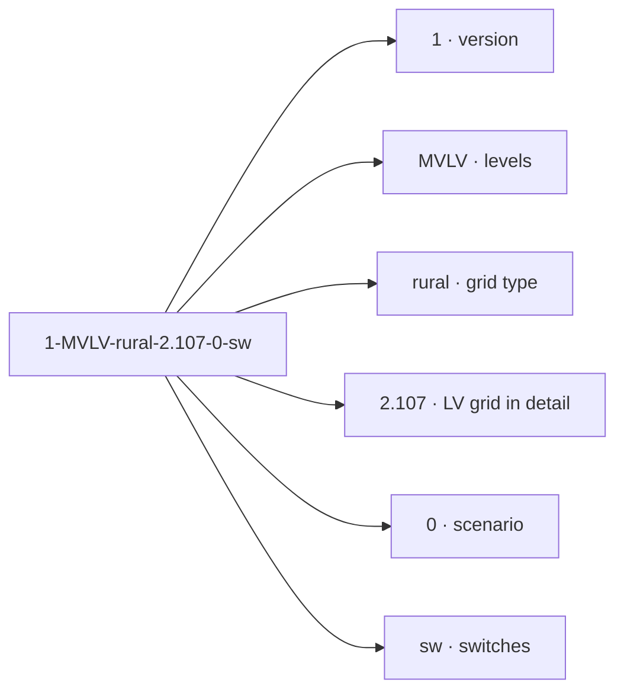

# SimBench: the networks behind the Studio

> What SimBench is, how its codes and element names read, which grids and scenarios
> it has, and the study cases it defines. Every network on the Studio's Inspect page
> comes from here.
> The networks one by one: [network catalogue](networks.md) · The time series of
> their loads and generators: [profiles](profiles.md).

Source of everything not measured in the Studio: the SimBench documentation,
version 1.1.0 (Meinecke et al., University of Kassel, Fraunhofer IEE, RWTH Aachen,
TU Dortmund), and the paper Meinecke et al. (2020), "SimBench—A Benchmark Dataset
of Electric Power Systems to Compare Innovative Solutions Based on Power Flow
Analysis", *Energies* 13(12), 3290. Section numbers like §4.2.3 refer to the
documentation. Downloads: [simbench.de](https://simbench.de/en/download/publications/).

## 1. What SimBench is

A benchmark dataset of German electricity grids from low to extra-high voltage,
made so that methods can be compared on the same grids. It has:

- **Grids** for four voltage levels (LV 0.4 kV, MV 20 kV, HV 110 kV, EHV 220/380
  kV), each in several types, and combinations of two levels (§4.1).
- **Time series** for one whole year, 2016, every 15 minutes, for every load,
  generator and storage unit (§3.5, §4.1.5). See [profiles](profiles.md).
- **Three scenarios** per grid: today and two future years with more PV, heat
  pumps, electric vehicles and storage (§3.6, §4.1.6).
- **Two switch variants** per grid (§4.2.3).
- **Study cases**: fixed scaling factors for the classic planning cases (§5.1).

The grids are not real networks. They are built so that the use cases of grid
planning and operation are covered, and checked against real grid data. The LV
grids, for example, were generated from OpenStreetMap data for six representative
German municipalities and compared with 180 real LV grids (§3.4, §4.1.4).

The Studio reads SimBench through the Python package `simbench`, which gives each
grid as a pandapower network.

## 2. The SimBench code

Every grid or grid combination has a code of six parts separated by `-`
(§4.2.3, Table 4.9). Example: `1-MVLV-rural-2.107-0-sw`.

| Part | Meaning | Values | Example |
|---|---|---|---|
| 1 | SimBench version | `1` | `1` |
| 2 | Voltage level(s) | `LV`, `MV`, `HV`, `EHV`, or two levels: `MVLV`, `HVMV`, `EHVHV` | `MVLV` |
| 3 | Grid type (of the higher level) | LV: `rural1`, `rural2`, `rural3`, `semiurb4`, `semiurb5`, `urban6`; MV: `rural`, `semiurb`, `urban`, `comm`; HV: `mixed`, `urban`; EHV: `mixed` | `rural` |
| 4 | Which lower-level grid is modelled in detail (combinations only): one subnet number, or `all` | empty for one level | `2.107` |
| 5 | Scenario | `0` today, `1` 2024, `2` 2034 ("heute", "morgen", "übermorgen") | `0` |
| 6 | Switches | `sw` all switches modelled, `no_sw` only open line and transformer switches | `sw` |

So `1-LV-semiurb4--0-sw` is the semi-urban LV grid 4 alone (part 4 empty), today,
with switches.

**Switches.** In `sw` every switch is a bus-to-bus switch, with extra auxiliary
buses between the bus bar and each line or transformer. In `no_sw` buses joined
by closed switches are merged: the same grid with fewer buses, often a faster
power flow. The loads and generators are the same in both.

**Combinations.** A grid of two levels models the higher grid in detail and
either one chosen lower grid or all of them. For the MV-LV combinations SimBench
preselected three LV grids at different places in the MV grid (e.g. `1.108`,
`2.107`, `4.101`), which keeps the number of codes manageable (§4.2.3).

The Inspect page's filters follow the code: **Voltage level** is part 2, **Type**
part 3, **Scenario** part 5, **Switches** part 6. The Studio's catalogue has 240
SimBench codes: the full "complete data" set and the four-level combination are
left out because they are far larger than a local market needs.

## 3. Element names: the subnet

Every element has a `subnet` that says which grid it belongs to (§4.2.2,
Table 4.8). That is why the Inspect page shows names like `LV4.101 Load 1`.

| Subnet | Reads as |
|---|---|
| `HV2` | HV grid of type 2 (HV and EHV subnets have two parts) |
| `MV3.201` | MV grid of type 3, the first one (`01`) connected to an HV grid of type 2 (`2xx`) |
| `LV4.101` | LV grid of type 4 (semi-urban 4), the first one connected to an MV grid of type 1 |

The third part counts from `1 + 100 · (type of the higher grid)`. Buses on the
border between two grids carry both subnets, joined by `_`. Equivalent elements,
which stand in for a grid that is not modelled in detail, end in `_eq`.

## 4. Voltage levels and grid types

How many codes the Studio offers per level (all types × 3 scenarios × 2 switch
variants, combinations × their lower grids):

| Level | Codes | Grid types | Typical use |
|---|---|---|---|
| LV | 36 | rural 1–3, semi-urban 4–5, urban 6 | households, farms, small PV: local energy markets |
| MV | 24 | rural, semi-urban, urban, commercial | whole LV grids as one load, wind, biomass |
| HV | 12 | mixed, urban | regional networks |
| EHV | 6 | mixed | Germany's transmission grid |
| MVLV | 96 | MV type × one or all LV grids | an MV grid with LV grids in detail |
| HVMV | 48 | HV type × one or all MV grids | |
| EHVHV | 18 | EHV × HV grids | |

### The six LV grids

The grids a local energy market lives on (§4.1.4, Table 4.5). Each is radial and
fed from the 20 kV grid through one MV/LV transformer.

| Grid | Class it represents | Transformer | Feeders | Nodes | Consumers | Load (total) | DER (number, power) | Cable | Line length (total, longest) |
|---|---|---|---|---|---|---|---|---|---|
| LV rural 1 | rural 3 | 160 kVA | 4 | 13 | 13 | 80 kW | 4, 160.4 kW | NAYY 4x150 | 0.56 km, 137 m |
| LV rural 2 | rural 2 | 250 kVA | 4 | 96 | 99 | 202 kW | 8, 145 kW | NAYY 4x150 | 1.47 km, 75 m |
| LV rural 3 | rural 1 | 400 kVA | 9 | 128 | 118 | 331 kW | 17, 190 kW | NAYY 4x150 | 2.35 km, 140 m |
| LV semiurb 4 | semi-urban 2 | 400 kVA | 3 | 43 | 41 | 243 kW | 1, 6.5 kW | NAYY 4x150 | 0.75 km, 60 m |
| LV semiurb 5 | semi-urban 1 | 630 kVA | 6 | 110 | 104 | 409 kW | 9, 137 kW | NAYY 4x240 | 1.79 km, 98 m |
| LV urban 6 | urban | 630 kVA | 7 | 58 | 111 | 441 kW | 5, 57 kW | NAYY 4x240 | 1.08 km, 78 m |

Values are scenario 0. At LV all generation is PV (no wind at this level). The
consumers' rated power comes from the building floor area in OpenStreetMap (2 kW
per average dwelling, varied by grid), and some values were raised by hand to
load the grids more. Load types (household, commercial, farm) were assigned to
the consumers by hand and at random. "LV rural 1" holds many farms, which is why
its loads are larger than in real grids of its class.

Cable data (Table 4.6): NAYY 4x150SE r = 0.2067 Ω/km, x = 0.0804 Ω/km, 270 A;
NAYY 4x240SE r = 0.1267 Ω/km, x = 0.0798 Ω/km, 357 A.

## 5. Scenarios

| Scenario | Year | What changes |
|---|---|---|
| 0 | today (2016 data) | the grids as built |
| 1 | 2024 | more PV, plus heat pumps, electric vehicles and PV batteries |
| 2 | 2034 | more of the same; some grids get new lines and buses to priority areas for wind and PV (MV, HV) |

How the future grids were made (§3.6): new generators and consumers were added
following German forecasts (the grid development plan) until the grid shows
problems, i.e. until about 15 % of its lines or nodes are overloaded or out of
voltage limits in at least some of the grids. The scenarios are meant to be
*challenging*, not to predict any one place.

At LV, averaged over all six grids (§4.1.6):

| | Scenario 1 (2024) | Scenario 2 (2034) |
|---|---|---|
| New PV, as a share of all PV plants | 55 % | 70 % |
| Houses with an electric vehicle | 4.5 % | 19 % |
| Houses with a heat pump | 6 % | 23 % |

In LV rural 3, scenario 1 mostly brings **overvoltage** (PV at noon), scenario 2
mostly **undervoltage** and overloaded lines and transformer (heat pumps and EVs).
Scenario 0 has no heat pumps, EV charging or storage in any LV grid. The
[network catalogue](networks.md) shows the effect on every grid.

## 6. Study cases

Fixed snapshots for planning studies, as scaling factors of the rated load and
generation (§5.1, Tables 5.1 and 5.2). The Studio works with the time series
instead, but the cases are useful to judge a power flow: a network should pass hL
and lPV.

| Case | Situation | Load | Wind | PV | Other DER |
|---|---|---|---|---|---|
| hL | high load, low DER | 1.00 | 0 | 0 | 0 |
| n1 | as hL, with one element out (contingency) | 1.00 | 0 | 0 | 0 |
| hW | high load, very high wind | 1.00 | 1.00 | 0.80 | 1.00 |
| hPV | high load, very high PV | 1.00 | 0.85 | 0.95 | 1.00 |
| lW | low load, very high wind | 0.10 (MV/LV), 0.25 (HV) | 1.00 | 0.80 | 1.00 |
| lPV | low load, very high PV | 0.10 (MV/LV), 0.25 (HV) | 0.85 | 0.95 | 1.00 |

Slack and transformer voltage set points: in hL, n1, hW and hPV 1.025 pu (HV),
1.035 pu (MV), 0.965 pu (LV); in lW and lPV 1.015 pu (HV), 1.055 pu (MV). Load
power factor cos φ = 0.93 (high-load cases) or 0.9 (low-load cases),
underexcited. The cases ship with every network (`StudyCases.csv`, in pandapower
`net.loadcases`).

## 7. Data format

SimBench's own format is a set of CSV tables, one per element type plus type
tables (e.g. cable types) and profile tables (§4.3.1). Voltages and currents are
three-phase and symmetrical, powers three-phase, 50 Hz. The pandapower networks
the Studio uses are converted from these tables by the `simbench` package; their
profiles are in `net.profiles` (tables `load`, `renewables`, `powerplants`,
`storage`), linked to the elements by their `profile` column.
