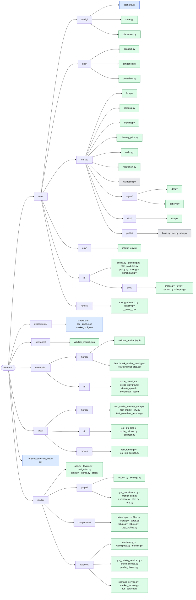

# Code structure

> The repository folder by folder, down to each script: what it is for and how far
> it is built. Keep this page current when files are added, moved or built.

The market has three layers: `core/grid/` models the network,
`core/market/` models the market on it (`LocalEnergyMarket` runs both, step by
step), and `core/config/` describes a scenario. `notebooks/` call `core/`
directly to validate it. The NiceGUI Studio is in `studio/`: pages and components
call `studio/adapters/`, a thin layer over `core/`. `core/` never imports `studio/`
or `notebooks/`, so anything that looks wrong in the Studio can be reproduced in
a notebook to tell a core problem from a UI one. `core/env/` makes the market an
RL environment; `core/rl/` is the RL layer, which imports no market module (the
environment arrives as a class), so its probes test it alone. `core/runner/` is the
one place that knows both: it starts, watches and stops training experiments
(specs in `experiments/`, results in `runs/`).

Green: works. Blue: data definitions only. Amber: stub, methods raise
`NotImplementedError` or the page shows a placeholder. Grey: original MARLEM code,
copied unchanged, kept as the reference; most of it is **not importable** (its
imports point to the old layout).

## core/config/: the scenario

Everything the user sets before stepping the market, as plain data.

| Script | What it does | State |
|---|---|---|
| `scenario.py` | `Scenario`: the network (`GridSetup`), the participants with their batteries, the market rules with the reputation weights and decay, and the DSO's tariffs, fee factors and loss factor; each setup lists its own problems (`problems()`), shown on the Summary page | data and its checks |
| `store.py` | Save and load a scenario as JSON | done |
| `placement.py` | Placing participants on the scenario's network: one on a bus, or one on every bus of the chosen kinds (`load`, `load+pv`, `load+storage`, ...); taken-over SimBench storage becomes the participant's battery, fixed in size (`set_battery`); SimBench-sized battery presets; imports `core/grid/` | done |

## core/grid/: the SimBench network

The only place that imports pandapower and simbench. It hands out plain records,
never pandapower objects.

| Script | What it does | State |
|---|---|---|
| `contract.py` | The plain records that cross the grid seam: networks, topology, elements, profiles, power-flow results, the path between two buses (`GridPath`) | done |
| `simbench.py` | Lists, loads and caches networks; topology, elements, profiles, the profile catalogue; a one-hour power flow | done |
| `powerflow.py` | `SimBenchGrid`: one power flow per market step; owned elements switched off, each participant's net injection at its bus; the path between two buses (distance, lines, zones = feeders) | done |

## core/market/: the MARLEM market

The market of the paper ([methodology](marlem/methodology.md)). `lem.py` is the
one class that runs it (`LocalEnergyMarket`, as in the original); `clearing.py`,
`bidding.py`, `clearing_price.py` and `reputation.py` are its rebuilt pieces, and
the remaining original files (ledger, profiles) are the reference.

| Script | What it does | State |
|---|---|---|
| `lem.py` | `LocalEnergyMarket`: the participants (`Participant`), the DSO (`Dso`) and the reputation rule, one step in the paper's phases (validate, orders, the three stages, settle, power flow, rate, advance), one stage at a time or all at once; the history of the day | done |
| `clearing.py` | The three clearing stages as separate functions: preferences, double auction, DSO; every trade assessed by the DSO (distance, loss, fee) | done |
| `bidding.py` | The rule that writes orders: battery first, then sell the surplus or buy the deficit between the DSO's tariffs | done |
| `clearing_price.py` | Pricing mechanisms with one fixed signature (fixes the seller price) | done |
| `order.py` | `Order`, `Trade` (stage, distance, loss, fee and who pays it) and `GridFees` (the parts of eq. 8) | done |
| `reputation.py` | The original's `ReputationHandler`, all reputation dials in one place (weights, decay): eq. 12 from reliability, price fairness and grid contribution, blended with the decay; reads a `StepRecord`; fixed where it disagreed with [P1] (see its docstring); `ReputationScore` | done |
| `validation.py` | Hash-chained trade ledger with proof of work; `seal_block` closes a market period's block | original, public `seal_block` added |
| `agent/der.py` | `Participant`: profiles from its elements, feasibility (eq. 15a-b), partner choice by reputation and distance, settlement (eq. 13, 14 less its fees, battery eq. 16), its reputation (decay blend), its bus injection; `ParticipantOutcome` | done |
| `agent/battery.py` | `Battery`: its energy, what it can still take or give (eq. 15c-d), charging and discharging (eq. 16); the market only calls it | done |
| `dso/dso.py` | `Dso`: tariffs, market price (their midpoint), the lines' loading of the last power flow, transmission losses (eq. 18), grid fees (eq. 8) and who pays them, stage 3 clearing (§3.3.2), its balance (eq. 7) and money; `DsoOutcome`, `DSO_ID` | done |
| `profile/` | Synthetic or CSV generation, demand and tariff profiles | original, imports |

## core/env/: the market as an RL environment

`MarketEnv` is the RLlib `MultiAgentEnv` over `LocalEnergyMarket`: one agent per
participant, one episode per market day. It only translates actions to orders and
the step's record to observations and rewards; the market rules stay in
`core/market/`.

| Script | What it does | State |
|---|---|---|
| `market_env.py` | `MarketEnv`: 16 normalised observations per agent (`OBS_NAMES`), 2 actions (signed quantity with a dead zone, price between the feed-in tariff and the utility price), reward = scaled net energy bill (profit less untraded imports at the utility price), episode = one day drawn from `days`, terminated at the day end; baselines `zero_policy`, `net_position_policy`. The module docstring documents the interface | done |
| `__init__.py` | Public imports: `MarketEnv`, `OBS_NAMES`, `net_position_policy`, `zero_policy` | done |

## core/rl/: the reinforcement-learning layer

The three paradigms (CTCE, CTDE, DTDE) on RLlib's own PPO, APPO and SAC. It
imports no market module: the environment is passed in as a class. Each file's
docstring names the issues it fixes ([validation/rl.md](validation/rl.md)). The
original code and its annotations live on the `clean` branch.

| Script | What it does | State |
|---|---|---|
| `grouping.py` | `GroupedEnv` (CTCE: joint observations and actions, summed reward); `CentralStateEnv` (CTDE: own observation plus the global state, own reward) | done |
| `ctde_modules.py` | CTDE: one RLlib module per agent, actor on its own observation, critic on the global state | done |
| `config.py` | Algorithms, paradigms and configuration (`build_config`, `SETTINGS`) | done |
| `policy.py` | Policy actions, baselines, rollout and evaluation | done |
| `train.py` | `train(Run(...))`: training budgets, metrics, run records and saved policies; `load_policy` | done |
| `benchmark.py` | Build, training and sampling timings | done |
| `envs/probes.py` | Five probe tasks with known answers | done |
| `envs/toy.py` | Individual and team toy tasks | done |
| `envs/spread.py` | MPE2 simple_spread and visualisation helpers | done |
| `envs/shapes.py` | Cheap environment with the market's observation and action sizes | done |
| `__init__.py`, `envs/__init__.py` | Public imports | done |

## core/runner/: experiments

Start training runs that outlive the terminal, the Studio and the Claude session,
and watch them from files only. The one place that imports both `core/env/` and
`core/rl/` (inside a job; the rest stays light). An experiment is a spec in
`experiments/`; `start` copies it to `runs/<name>/experiment.json`, writes a
`status.json` per run and spawns one detached worker, which keeps `max_parallel`
job processes training (one run each, then a held-out evaluation).

| Script | What it does | State |
|---|---|---|
| `spec.py` | `Experiment`: the JSON spec (validated early), expanded to one `RunSpec` per algorithm x paradigm x variant x seed, each building a `core.rl.Run` | done |
| `launch.py` | `start` (queue, detached worker), `work` (the worker loop), `job` (train, held-out evaluation, status), `stop` (kill worker and process trees, checked by pid and start time) | done |
| `registry.py` | Read-only view of `runs/`: `experiments()`, `runs(experiment)` with a `RunState` per run (state, progress, ETA, last and held-out score); detects `lost` runs | done |
| `__main__.py` | `python -m core.runner start / status / stop`, plus the internal `work` and `job` | done |

## experiments/: what to train

| File | What it is | State |
|---|---|---|
| `smoke.json` | Two tiny PPO-DTDE runs, to check the runner end to end (a few minutes) | done |
| `sac_alpha.json` | SAC-DTDE on the market with initial temperatures 1, 0.1 and 0.01 | done, not run |
| `market_3x3.json` | Three algorithms x three paradigms on the market, one seed | done, not run |

## studio/: the user interface

NiceGUI, port 8090. A page is one file in `pages/`; code goes to `components/`
only when more than one place uses it.

| Script | What it does | State |
|---|---|---|
| `app.py` | Registers the pages and starts the server | done |
| `layout.py`, `navigation.py`, `theme.py`, `static/` | Page frame, left navigation, colours and styles; the header names the current scenario and opens another from a scenario file (`scenarios/` or an upload) | done |
| `state.py` | The adapters (`services()`), built once | done |
| `pages/inspect.py` | Inspect: any network in depth, all SimBench profiles, two networks compared | done |
| `pages/settings.py` | Workspace folder, network cache and its coverage, dark mode | done |
| `pages/grid_participants.py` | Network, day, step length, background, limits; participants placed by clicking buses or per load or prosumer bus; batteries | done |
| `pages/market_dso.py` | Pricing mechanism, bounds, preferred partners, ledger; the bidding rule; the DSO's tariffs | done |
| `pages/summary.py` | Summary before running: readiness checks; tab Settings (every grid, market, DSO and battery setting once, the participants' day, the network) and tab Day profiles | done |
| `pages/runs.py` | Runs: the training experiments in `runs/`, refreshed every 2 s. One card per experiment (newest first): runs per state, worker alive or not, Stop experiment (with confirmation); a table of its runs with state badge, progress bar, env steps / budget, elapsed, ETA, last evaluation and held-out return, a Stop button per queued or running run, and the error of a failed run in a tooltip | done |
| `pages/step.py` | One click per part of a step (orders, the three stages, settle and power flow): order book, network with trades and voltages, trades, participants, the day so far | done |
| `components/network.py` | Network picker with filters, summary, topology plot, element table, profile inspector | done |
| `components/profiles.py`, `charts.py`, `cards.py`, `tables.py` | Profile class tiles, Plotly figures (also the day's curves), cards, tables | done |
| `components/day_profiles.py` | The Summary's Day profiles tab: every element on the scenario's day, participants (they trade) apart from the background; summed curves, single curves by row selection | done |
| `components/labels.py` | The names shown for mechanisms, background modes and step lengths, shared by the settings and summary pages | done |

## scenarios/: saved scenarios

| File | What it is | State |
|---|---|---|
| `validate_market.json` | The market notebook's scenario, saved by it in the Studio's format: open it from the Studio's header (Scenario: ... → Open) to play the same scenario there. Also the scenario of `tests/market/` and of the market environment's examples | done |

## notebooks/: the core without the Studio

Notebooks import `core/` only. Run them with the `marlem` conda env as kernel;
their setup cell finds the repository root from wherever they run. Runs go to
`runs/` in the root.

| Notebook | What it does | State |
|---|---|---|
| `market/validate_market.ipynb` | Scenario, inputs per step, one step part by part, the whole day, rule checks, experiments side by side | done |
| `market/benchmark_market_step.ipynb` | Time per market step on SimBench LV networks of 13 to 118 participants (random orders), split into market logic, grid preparation and the power flow; the floor under a training run on the market | done |
| `market/results/market_step.csv` | That notebook's summary, read by the RL speed benchmark (`notebooks/rl/benchmark_speed.ipynb`) | done |
| `rl/probe_paradigms.ipynb` | The probe environments on every combination of algorithm and paradigm: run these first after any change to `core/rl/` | done |
| `rl/probe_playground.ipynb` | Inspect learning iteration by iteration | done |
| `rl/simple_spread.ipynb` | MPE2 `simple_spread`, the second test after the probes | done |
| `rl/benchmark_speed.ipynb` | Compare RL timing with `notebooks/market/results/market_step.csv` | done |

## tests/: market and RL checks

Run with `python -m pytest` from the root in the `marlem` conda env (`pytest.ini`
sets `testpaths = tests` and `pythonpath = .`).

| Test | What it checks | State |
|---|---|---|
| `market/test_studio_matches_core.py` | `validate_market.json` read by `ScenarioService` and stepped part by part by `MarketService` gives the same `StepRecord`s as `LocalEnergyMarket.run_to_end` | done |
| `market/test_market_env.py` | `MarketEnv` on `validate_market.json`: spaces, a zero-action day, the reward as the scaled net bill, action decoding (quantity, price, dead zone), reproducible day draw, `net_position_policy` against `zero_policy`, RLlib's multi-agent environment check | done |
| `market/test_powerflow_recycle.py` | pandapower's `recycle` in the step power flow gives the same grid results | done |
| `rl/test_0_every_probe.py` to `test_5_obs_action_probe.py` | Deterministic checks of the probe environments | done |
| `rl/test_6_ctde_structure.py` | The CTDE modules' structure: what the actor and the critic read | done |
| `rl/probe_helpers.py`, `rl/conftest.py` | Shared assertions and readable test output (each test's docstring is printed) | done |
| `runner/test_runner.py` | Experiment specs (grid names, budgets, variants, date ranges, validation errors) and the registry's run states (queued, running, lost, completed, failed, legacy, progress and ETA); no training | done |
| `runner/test_run_service.py` | The Studio's `RunService` over a temporary `runs/` (`MARLEM_RUNS`): experiments newest first, runs, spec, stopping queued runs | done |

## studio/adapters/: what the pages call

Translates between the Studio and the layers below, so pages never touch the
market or pandapower directly.

| Script | What it does | State |
|---|---|---|
| `container.py` | Builds the adapters once | done |
| `workspace.py` | Where the Studio keeps its data: the network cache, the scenario file, per-browser state (`C:\MARLEM` here) | done |
| `grid_catalog_service.py` | Networks, their facts, topology, elements as the grid contract's records; the network cache and its background warming | done |
| `profile_service.py` | A network's profiles and SimBench's whole catalogue; every element's power on the scenario's day (`day_profiles`) | done |
| `profile_classes.py` | SimBench's profile classes and how a profile name is classified | done |
| `models.py` | The data types only the Studio needs: profile classes, profile types, chart series, a day's element profiles | done |
| `scenario_service.py` | The scenario being edited, saved on every change; calls `core/config/placement.py` to place participants; lists, reads and opens scenario files | done |
| `run_service.py` | The experiments in `runs/` and their runs, as the runner's registry reports them (`RunState`), newest folder first; stops an experiment or one run through `core.runner.launch.stop` | done |
| `market_service.py` | Builds and holds the `LocalEnergyMarket` the Step page plays; build, next part, step, run to the end, clear (when another scenario is opened) | done |

## Around the code

| Path | What it is |
|---|---|
| `docs/` | This documentation (Markdown); `docs/networks.py` generates the network catalogue |
| `docs_site/` | The MkDocs site built from `docs/`: config, build hooks, diagram assets |
| `run_studio.py` | Starts the Studio with auto-reload |
| `run_all.py` | Starts the dev servers (both branches' docs and Studios) in their own windows |
| `AGENTS.md` | Rules for working in this repository |
| `pytest.ini` | Discover the market and RL tests together from the root (`tests/`) |
| `runs/` | Training runs, checkpoints and benchmark results; ignored by Git. Experiments started by the runner: `runs/<name>/{experiment.json, worker.json, worker.log, <run>/{status.json, log.txt, run.json, metrics.csv, evaluation.csv, heldout.csv, checkpoint/}}` |
| `.vscode/` | Launch entries and the Python interpreter |

## Choices in the rebuilt market step

Where the rebuilt step differs from the paper or the original code, for now:

| Topic | Here |
|---|---|
| Orders | Written by the bidding rule (`core/market/bidding.py`); no learning |
| Orders preferring the DSO | Skip stages 1 and 2 and are cleared in stage 3 (the original cleared them first) |
| Distance d_ij | Line length along the shortest path between the two buses (km); for a trade with the DSO, the path to the transformer's low-voltage busbar, where its energy enters |
| Losses (eq. 18) | Recorded on every trade as d · q · κ (κ = 0.03 per km); not taken off the delivered energy, since the power flow has the physical losses |
| Grid fees (eq. 8) | Calculated by the DSO for every trade and charged (`fees_charged`). Congestion C_t is the highest line loading on the trade's path in the previous step's power flow (0 at step 0). F_trans, which has no formula in [P1], is the lost energy at the trade price, κ · d · q · p (the form quantity × distance × price factor is set; the factor and the distance measure are open). Zones are feeders. Trades with the DSO pay the fees of their path to the transformer, without a zone bonus. F_imb applies only to trades with the DSO that worsen the market's balance. No trade is blocked for grid reasons: the fees penalize (I-55). Peer fees split 50/50 between buyer and seller; a DSO trade's fee is paid by the participant. Factor values are the original code's |
| DSO balance (eq. 7) | Energy sold minus bought per step and over the day, plus the DSO's revenue and fees; money adds up to 0 with the participants' profits |
| Market balance B_grid (eq. 20) | Energy offered minus energy asked in the step's orders (before stage 3) |
| Reputation (eq. 12) | `ReputationHandler.update_reputation` for every participant after each step, as in the original: reliability = order volume matched by peers / order volume, fairness = its peer trade prices against the peer clearing price, grid = its trades against B_grid (DSO trades neutral). Weights 0.3/0.2/0.5 (the original's); decay a constant, r ← 0.8 r + 0.2 score (the original used the time of day; still open). Start 0.5 |
| Partner choice (§3.4) | Weighted score: 0.5 · standing + 0.5 · closeness, both rescaled over the candidates (closeness 1 = nearest, 0 = farthest; standing 1 = highest reputation, 0 = lowest) |
| Tariffs | Constant over the day |
| Submitted orders | Never changed by the clearing (the original changed them in place) |
| Batteries (eq. 15–16) | Efficiencies and the power limit included; partial charges allowed. A participant taking over a SimBench storage unit gets its capacity and power; other batteries take their power limit by hand (none by default), or SimBench's capacity ÷ 2 h through `simbench_battery` and its presets |
| Demand satisfied / deferred (§3.4.1) | Per step on each outcome; deferred = what the participant's orders and battery left uncovered, exchanged with the upstream grid untraded |
