# Code structure

> The repository folder by folder, down to each script: what it is for and how far
> it is built. Keep this page current when files are added, moved or built.

The market has three layers: `core/grid/` models the network,
`core/market/` models the market on it (`LocalEnergyMarket` runs both, step by
step), and `core/config/` describes a scenario. `notebooks/` call `core/`
directly to validate it. The NiceGUI Studio is in `studio/`: pages and components
call `studio/adapters/`, a thin layer over `core/`. `core/` never imports `studio/`
or `notebooks/`, so anything that looks wrong in the Studio can be reproduced in
a notebook to tell a core problem from a UI one. `core/env/` makes the market an
RL environment; `core/rl/` is the RL layer, which imports no market module (the
environment arrives as a class), so its probes test it alone. `core/runner/` is the
one place that knows both: it starts, watches and stops training experiments
(specs in `experiments/`, results in `runs/`) on a target named in
`hpc/targets.toml`: this machine, or a SLURM cluster (used from the cluster
itself, or from here over SSH).

```mermaid
flowchart TD
  root(["marlem-v1"])

  root --> core["core/"]

  core --> config["config/"]
  config --> c1["scenario.py"]:::data
  config --> c2["store.py"]:::done
  config --> c3["placement.py"]:::done

  core --> grid["grid/"]
  grid --> g1["contract.py"]:::done
  grid --> g2["simbench.py"]:::done
  grid --> g3["powerflow.py"]:::done

  core --> market["market/"]
  market --> m1["lem.py"]:::done
  market --> m7["clearing.py"]:::done
  market --> m8["bidding.py"]:::done
  market --> m4["clearing_price.py"]:::done
  market --> m2["order.py"]:::done
  market --> m5["reputation.py"]:::done
  market --> m6["validation.py"]:::orig
  market --> agent["agent/"]
  agent --> a1["der.py"]:::done
  agent --> a2["battery.py"]:::done
  market --> dso["dso/"]
  dso --> d1["dso.py"]:::done
  market --> profile["profile/"]
  profile --> p1["base.py · der.py · dso.py"]:::orig

  core --> env["env/"]
  env --> e1["market_env.py"]:::done

  core --> rlcore["rl/"]
  rlcore --> r1["config.py · grouping.py · ctde_modules.py<br/>policy.py · train.py · benchmark.py"]:::done
  rlcore --> renvs["envs/"]
  renvs --> r2["probes.py · toy.py · spread.py · shapes.py"]:::done

  core --> runnercore["runner/"]
  runnercore --> ru1["spec.py · launch.py · registry.py · slurm.py<br/>targets.py · remote.py · __main__.py"]:::done

  root --> exps["experiments/"]
  exps --> ex1["smoke.json · sac_alpha.json<br/>market_3x3.json"]:::data

  root --> hpc["hpc/"]
  hpc --> hp1["targets.toml"]:::data

  root --> scripts["scripts/"]
  scripts --> hs["hpc.ps1 / hpc.cmd"]:::done

  root --> scen["scenarios/"]
  scen --> s1["validate_market.json"]:::done

  root --> notebooks["notebooks/"]
  notebooks --> nm["market/"]
  nm --> n1["validate_market.ipynb"]:::done
  nm --> n3["benchmark_market_step.ipynb<br/>results/market_step.csv"]:::done
  notebooks --> nr["rl/"]
  nr --> nr1["probe_paradigms · probe_playground<br/>simple_spread · benchmark_speed"]:::done
  notebooks --> nu["runner/"]
  nu --> nu1["targets_demo.ipynb"]:::done

  root --> tests["tests/"]
  tests --> tm["market/"]
  tm --> x1["test_studio_matches_core.py · test_market_env.py<br/>test_powerflow_recycle.py · test_fees_timing.py"]:::done
  tests --> tr["rl/"]
  tr --> x2["test_0 to test_6 · probe_helpers.py · conftest.py"]:::done
  tests --> tru["runner/"]
  tru --> x3["test_runner.py · test_run_service.py<br/>test_slurm.py · test_targets.py · test_remote.py"]:::done

  root --> runs["runs/ (local results, not in git)"]:::data

  root --> studio["studio/"]
  studio --> t1["app.py · layout.py · navigation.py<br/>state.py · theme.py · static/"]:::done
  studio --> pages["pages/"]
  pages --> pg1["inspect.py · settings.py"]:::done
  pages --> pg2["grid_participants.py · market_dso.py<br/>summary.py · step.py · runs.py"]:::done
  studio --> comps["components/"]
  comps --> k1["network.py · profiles.py · charts.py · cards.py<br/>tables.py · labels.py · day_profiles.py"]:::done
  studio --> adapters["adapters/"]
  adapters --> v1["container.py · workspace.py · models.py"]:::done
  adapters --> v2["grid_catalog_service.py · profile_service.py<br/>profile_classes.py"]:::done
  adapters --> v3["scenario_service.py · market_service.py<br/>run_service.py"]:::done

  classDef done fill:#dcfce7,stroke:#15803d,color:#111
  classDef data fill:#dbeafe,stroke:#1d4ed8,color:#111
  classDef stub fill:#fef3c7,stroke:#b45309,color:#111
  classDef orig fill:#e5e7eb,stroke:#6b7280,color:#111
```

Green: implemented; this is not a fresh test report for every component. Blue: data definitions only. Amber: stub, methods raise
`NotImplementedError` or the page shows a placeholder. Grey: original MARLEM code,
copied unchanged, kept as the reference; most of it is **not importable** (its
imports point to the old layout).

## core/config/: the scenario

Everything the user sets before stepping the market, as plain data.

| Script | What it does | State |
|---|---|---|
| [`scenario.py`](../core/config/scenario.py) | `Scenario`: the network (`GridSetup`), the participants with their batteries, the market rules with the reputation weights and decay, and the DSO's tariffs, fee factors and loss factor; each setup lists its own problems (`problems()`), shown on the Summary page | data and its checks |
| [`store.py`](../core/config/store.py) | Save and load a scenario as JSON | done |
| [`placement.py`](../core/config/placement.py) | Placing participants on the scenario's network: one on a bus, or one on every bus of the chosen kinds (`load`, `load+pv`, `load+storage`, ...); taken-over SimBench storage becomes the participant's battery, fixed in size (`set_battery`); SimBench-sized battery presets; imports `core/grid/` | done |

## core/grid/: the SimBench network

The only place that imports pandapower and simbench. It hands out plain records,
never pandapower objects.

| Script | What it does | State |
|---|---|---|
| [`contract.py`](../core/grid/contract.py) | The plain records that cross the grid seam: networks, topology, elements, profiles, power-flow results, the path between two buses (`GridPath`) | done |
| [`simbench.py`](../core/grid/simbench.py) | Lists, loads and caches networks; topology, elements, profiles, the profile catalogue; a one-hour power flow | done |
| [`powerflow.py`](../core/grid/powerflow.py) | `SimBenchGrid`: one power flow per market step; owned elements switched off, each participant's net injection at its bus; the path between two buses (distance, lines, zones = feeders) | done |

## core/market/: the MARLEM market

The market of the paper ([methodology](marlem/methodology.md)). `lem.py` is the
one class that runs it (`LocalEnergyMarket`, as in the original); `clearing.py`,
`bidding.py`, `clearing_price.py` and `reputation.py` are its rebuilt pieces, and
the remaining original files (ledger, profiles) are the reference.

| Script | What it does | State |
|---|---|---|
| [`lem.py`](../core/market/lem.py) | `LocalEnergyMarket`: the participants (`Participant`), the DSO (`Dso`) and the reputation rule, one step in the paper's phases (validate, orders, the three stages, settle, power flow, fees, rate, advance), one stage at a time or all at once; the history of the day | done |
| [`clearing.py`](../core/market/clearing.py) | The three clearing stages as separate functions: preferences, double auction, DSO; every trade assessed by the DSO (distance, loss, fee) | done |
| [`bidding.py`](../core/market/bidding.py) | The rule that writes orders: battery first, then sell the surplus or buy the deficit between the DSO's tariffs | done |
| [`clearing_price.py`](../core/market/clearing_price.py) | Pricing mechanisms with one fixed signature (fixes the seller price) | done |
| [`order.py`](../core/market/order.py) | `Order`, `Trade` (stage, distance, loss, fee and who pays it) and `GridFees` (the parts of eq. 8) | done |
| [`reputation.py`](../core/market/reputation.py) | The original's `ReputationHandler`, all reputation dials in one place (weights, decay): eq. 12 from reliability, price fairness and grid contribution, blended with the decay; reads a `StepRecord`; fixed where it disagreed with [P1] (see its docstring); `ReputationScore` | done |
| [`validation.py`](../core/market/validation.py) | Hash-chained trade ledger with proof of work; `seal_block` closes a market period's block | original, public `seal_block` added |
| [`agent/der.py`](../core/market/agent/der.py) | `Participant`: profiles from its elements, feasibility (eq. 15a-b), partner choice by reputation and distance, settlement (eq. 13, 14 less its fees, battery eq. 16), its reputation (decay blend), its bus injection; `ParticipantOutcome` | done |
| [`agent/battery.py`](../core/market/agent/battery.py) | `Battery`: its energy, what it can still take or give (eq. 15c-d), charging and discharging (eq. 16); the market only calls it | done |
| [`dso/dso.py`](../core/market/dso/dso.py) | `Dso`: tariffs, market price (their midpoint), the lines' loading of the step's power flow, transmission losses (eq. 18), grid fees (eq. 8) charged after that power flow and who pays them, stage 3 clearing (§3.3.2), its balance (eq. 7) and money; `DsoOutcome`, `DSO_ID` | done |
| [`profile/`](../core/market/profile) | Synthetic or CSV generation, demand and tariff profiles | original, imports |

## core/env/: the market as an RL environment

`MarketEnv` is the RLlib `MultiAgentEnv` over `LocalEnergyMarket`: one agent per
participant, one episode per market day. It only translates actions to orders and
the step's record to observations and rewards; the market rules stay in
`core/market/`.

| Script | What it does | State |
|---|---|---|
| [`market_env.py`](../core/env/market_env.py) | `MarketEnv`: 16 normalised observations per agent (`OBS_NAMES`), 2 actions (signed quantity with a dead zone, price between the feed-in tariff and the utility price), reward = scaled net energy bill (profit less untraded imports at the utility price), episode = one day drawn from `days`, terminated at the day end; baselines `zero_policy`, `net_position_policy`. The module docstring documents the interface | done |
| [`__init__.py`](../core/env/__init__.py) | Public imports: `MarketEnv`, `OBS_NAMES`, `net_position_policy`, `zero_policy` | done |

## core/rl/: the reinforcement-learning layer

The three paradigms (CTCE, CTDE, DTDE) on RLlib's own PPO, APPO and SAC. It
imports no market module: the environment is passed in as a class. Each file's
docstring names the issues it fixes ([validation/rl.md](validation/rl.md)). The
original code and its annotations live on the `clean` branch.

| Script | What it does | State |
|---|---|---|
| [`grouping.py`](../core/rl/grouping.py) | `GroupedEnv` (CTCE: joint observations and actions, summed reward); `CentralStateEnv` (CTDE: own observation plus the global state, own reward) | done |
| [`ctde_modules.py`](../core/rl/ctde_modules.py) | CTDE: one RLlib module per agent, actor on its own observation, critic on the global state | done |
| [`config.py`](../core/rl/config.py) | Algorithms, paradigms and configuration (`build_config`, `SETTINGS`) | done |
| [`policy.py`](../core/rl/policy.py) | Policy actions, baselines, rollout and evaluation | done |
| [`train.py`](../core/rl/train.py) | `train(Run(...))`: training budgets, metrics, run records and saved policies; `load_policy` | done |
| [`benchmark.py`](../core/rl/benchmark.py) | Build, training and sampling timings | done |
| [`envs/probes.py`](../core/rl/envs/probes.py) | Five probe tasks with known answers | done |
| [`envs/toy.py`](../core/rl/envs/toy.py) | Individual and team toy tasks | done |
| [`envs/spread.py`](../core/rl/envs/spread.py) | MPE2 simple_spread and visualisation helpers | done |
| [`envs/shapes.py`](../core/rl/envs/shapes.py) | Cheap environment with the original market's observation and action sizes (42 and 4; `MarketEnv` has 16 and 2) | done |
| [`__init__.py`](../core/rl/__init__.py), [`envs/__init__.py`](../core/rl/envs/__init__.py) | Public imports | done |

## core/runner/: experiments

Start training runs that outlive the terminal, the Studio and the Claude session,
and watch them from files only. The one place that imports both `core/env/` and
`core/rl/` (inside a job; the rest stays light). An experiment is a spec in
`experiments/`; `start` copies it to `runs/<name>/experiment.json`, writes a
`status.json` per run and spawns one detached worker, which keeps `max_parallel`
job processes training (one run each, then a held-out evaluation).

The same runs can go to a SLURM cluster instead: `slurm.py` submits them as one
job array (one task per run, through submitit), and every task calls the same
`launch.job`. *Where* an experiment runs is a **target** (`targets.py`, settings in
`hpc/targets.toml`): `local` is this PC, `taltech` the cluster; the CLI and the
Studio talk to a target and need not know the difference. On the cluster the
target submits to SLURM directly; from this PC the same target runs the runner's
CLI on the cluster's login node over SSH (`remote.py`) and copies the results
back into `runs/@taltech/` (`sync`). A spec can also ask for
cluster `resources` (cpus, mem_gb, minutes per run) and describe its **test
profile** (`test` block): `--profile test` runs `Experiment.test_version()`, the
smallest version of the experiment (first seed, one train day and test day, about
one training batch (SAC: plus its warm-up), 15 minutes, named `<name>--test`), to prove the pipeline
with a small amount of actual training. [The resource guide](hpc/resources.md)
separates run concurrency from within-run sampling; [the workflow guide](hpc/experiments.md)
describes restart, sync and the inspected execution evidence.

| Script | What it does | State |
|---|---|---|
| [`spec.py`](../core/runner/spec.py) | `Experiment`: the JSON spec (validated early, with `resources` and the `test` block), expanded to one `RunSpec` per algorithm x paradigm x variant x seed, each building a `core.rl.Run`; `to_dict` (written to `experiment.json`), `test_version` (the smallest version; `test_budget`: one training batch per algorithm from its effective settings over every variant, SAC also its warm-up so the test run learns) | done |
| [`launch.py`](../core/runner/launch.py) | `prepare` (the experiment's folder and queued runs; refuses a spec that differs from the saved `experiment.json` before writing anything), `start` (prepare, detached worker), `work` (the worker loop), `job` (train, held-out evaluation, status), `stop` (kill worker and process trees, checked by pid and start time), `mark_stopped` | done |
| [`slurm.py`](../core/runner/slurm.py) | The cluster side, for use where `sbatch` exists: `start` (prepare, then one submitit job array, `slurm.json` and each run's `slurm_job`), `states` (one `sacct` call, parsed to a task map), `stop` (`scancel` first: if it fails the error carries its message and no run is marked; then mark the runs) | implemented; short TalTech runs recorded (see evidence below) |
| [`registry.py`](../core/runner/registry.py) | Read-only view of `runs/`: `experiments()`, `runs(experiment)` with a `RunState` per run (state, progress, ETA, last and held-out score, SLURM state, host); detects `lost` runs, for SLURM runs from the task map it is given instead of a pid | done |
| [`targets.py`](../core/runner/targets.py) | `Target` (`check` returns the one readiness report `{target, ok, problems, local_commit, cluster_commit, active}`; `start` calls it and refuses with its problems; `overview` is the one read path, `runs`, `stop`, `sync`, `close`), `LocalTarget`, `SlurmTarget` (on the cluster), `RemoteTarget` (the same cluster from the PC: every call is the runner's CLI on the login node, `sync` replaces the mirror `runs/@taltech/<experiment>` with a fresh copy, `local_runs` reads it), `get(name)` from `hpc/targets.toml` | implemented; remote workflow used for short TalTech runs |
| [`remote.py`](../core/runner/remote.py) | `Remote`: one SSH connection (asyncssh, `pip install asyncssh` in the `marlem` env; the cluster does not need it) on a private event-loop thread behind synchronous methods, so it works from the CLI, Jupyter and the Studio's threads; `execute`, `runner` (`python -m core.runner ... --json` in the cluster's checkout), `head`, `uncommitted`, `pull` (a fresh copy of the folder, without checkpoints and `slurm/`, into a temporary folder that replaces the mirror only when complete); no retries: a failed operation closes the connection and raises `RemoteError` ("<operation> failed on <host>: <reason>") | implemented; results mirrors inspected |
| [`__main__.py`](../core/runner/__main__.py) | `python -m core.runner start / status / stop / sync / check`, each with `--target` and `--json` (the JSON is then the only output), `start` with `--profile full / test`, `status --json` (every experiment with its runs and spec in one answer), `check [spec]` (the readiness report, exit 1 when not ready); plus the internal `work` and `job` | done |

Execution evidence is dated and scoped in [Training experiments](hpc/experiments.md#existing-execution-evidence).
It comes from saved pre-migration results, not a new full-suite or UI test.

## experiments/: what to train

| File | What it is | State |
|---|---|---|
| [`smoke.json`](../experiments/smoke.json) | Two tiny PPO-DTDE runs, to check the runner end to end (a few minutes) | done |
| [`sac_alpha.json`](../experiments/sac_alpha.json) | SAC-DTDE on the market with initial temperatures 1, 0.1 and 0.01 | test profile: two TalTech runs completed, one stopped; full profile not established here |
| [`market_3x3.json`](../experiments/market_3x3.json) | Three algorithms x three paradigms on the market, one seed | all nine test runs completed locally and on TalTech; full profile not established here |

## studio/: the user interface

NiceGUI, port 8090. A page is one file in `pages/`; code goes to `components/`
only when more than one place uses it.

| Script | What it does | State |
|---|---|---|
| [`app.py`](../studio/app.py) | Registers the pages and starts the server; on shutdown closes the connections to a cluster (`RunService.close`) | done |
| [`layout.py`](../studio/layout.py), [`navigation.py`](../studio/navigation.py), [`theme.py`](../studio/theme.py), [`static/`](../studio/static) | Page frame, left navigation, colours and styles; the header names the current scenario and opens another from a scenario file (`scenarios/` or an upload) | done |
| [`state.py`](../studio/state.py) | The adapters (`services()`), built once | done |
| [`pages/inspect.py`](../studio/pages/inspect.py) | Inspect: any network in depth, all SimBench profiles, two networks compared | done |
| [`pages/settings.py`](../studio/pages/settings.py) | Workspace folder, network cache and its coverage, dark mode | done |
| [`pages/grid_participants.py`](../studio/pages/grid_participants.py) | Network, day, step length, background, limits; participants placed by clicking buses or per load or prosumer bus; batteries | done |
| [`pages/market_dso.py`](../studio/pages/market_dso.py) | Pricing mechanism, bounds, preferred partners, ledger; the bidding rule; the DSO's tariffs | done |
| [`pages/summary.py`](../studio/pages/summary.py) | Summary before running: readiness checks; tab Settings (every grid, market, DSO and battery setting once, the participants' day, the network) and tab Day profiles | done |
| [`pages/runs.py`](../studio/pages/runs.py) | Runs: the training experiments on every target of `hpc/targets.toml`, one tab each (This PC, TalTech). One card per experiment (newest first): runs per state, worker alive or not (this PC), Stop experiment (with confirmation); a table of its runs with state badge, progress bar, env steps / budget, elapsed, ETA, last evaluation and held-out return, a Stop button per queued or running run, and the error of a failed run in a tooltip. This PC is read every 2 s. A cluster is read every 20 s over SSH, and only while its tab is shown (nothing connects before it is opened); its tab starts with one line from the runner's `check` ("Ready", or the problems, the two commits, the experiments queued or running) and a Check button, then "updated hh:mm:ss" and Refresh now, SLURM state and node in the table, and a Sync results button on each card (results are copied only when asked). A read that fails is not a notification: a line says why and when the data shown was last read, and goes away with the next good read. Start, Stop and Sync show their errors as notifications. The Start experiment button opens a dialog: a spec from `experiments/` (runs, budget and cluster resources shown), the profile (test or full) and the target; for a cluster the selected spec is checked whenever spec or target changes (Check again re-runs it), the problems are listed, and Start stays disabled until there are none and while its request runs | implemented; adapter tests present, full manual UI acceptance not established here |
| [`pages/step.py`](../studio/pages/step.py) | One click per part of a step (orders, the three stages, settle and power flow): order book, network with trades and voltages, trades, participants, the day so far | done |
| [`components/network.py`](../studio/components/network.py) | Network picker with filters, summary, topology plot, element table, profile inspector | done |
| [`components/profiles.py`](../studio/components/profiles.py), `charts.py`, `cards.py`, `tables.py` | Profile class tiles, Plotly figures (also the day's curves), cards, tables | done |
| [`components/day_profiles.py`](../studio/components/day_profiles.py) | The Summary's Day profiles tab: every element on the scenario's day, participants (they trade) apart from the background; summed curves, single curves by row selection | done |
| [`components/labels.py`](../studio/components/labels.py) | The names shown for mechanisms, background modes and step lengths, shared by the settings and summary pages | done |

## scenarios/: saved scenarios

| File | What it is | State |
|---|---|---|
| [`validate_market.json`](../scenarios/validate_market.json) | The market notebook's scenario, saved by it in the Studio's format: open it from the Studio's header (Scenario: ... → Open) to play the same scenario there. Also the scenario of `tests/market/` and of the market environment's examples | done |

## notebooks/: the core without the Studio

Notebooks import `core/` only. Run them with the `marlem` conda env as kernel;
their setup cell finds the repository root from wherever they run. Runs go to
`runs/` in the root.

| Notebook | What it does | State |
|---|---|---|
| [`market/validate_market.ipynb`](../notebooks/market/validate_market.ipynb) | Scenario, inputs per step, one step part by part, the whole day, rule checks, experiments side by side | done |
| [`market/benchmark_market_step.ipynb`](../notebooks/market/benchmark_market_step.ipynb) | Time per market step on SimBench LV networks of 13 to 118 participants (random orders), split into market logic, grid preparation and the power flow; the floor under a training run on the market | done |
| [`market/results/market_step.csv`](../notebooks/market/results/market_step.csv) | That notebook's summary, read by the RL speed benchmark (`notebooks/rl/benchmark_speed.ipynb`) | done |
| [`rl/probe_paradigms.ipynb`](../notebooks/rl/probe_paradigms.ipynb) | The probe environments on every combination of algorithm and paradigm: run these first after any change to `core/rl/` | done |
| [`rl/probe_playground.ipynb`](../notebooks/rl/probe_playground.ipynb) | Inspect learning iteration by iteration | done |
| [`rl/simple_spread.ipynb`](../notebooks/rl/simple_spread.ipynb) | MPE2 `simple_spread`, the second test after the probes | done |
| [`rl/benchmark_speed.ipynb`](../notebooks/rl/benchmark_speed.ipynb) | Compare RL timing with `notebooks/market/results/market_step.csv` | done |
| [`runner/targets_demo.ipynb`](../notebooks/runner/targets_demo.ipynb) | The workflow on a target: start the smoke experiment (test profile) locally and watch it, then the same on the cluster from the PC (`check`, `start`, watch, `sync`, the synced runs as a table), `stop` as an example, closing the connection | implemented; execution not established by this inventory |

## tests/: market and RL checks

Run with `python -m pytest` from the root in the `marlem` conda env (`pytest.ini`
sets `testpaths = tests` and `pythonpath = .`).

| Test | What it checks | State |
|---|---|---|
| [`market/test_studio_matches_core.py`](../tests/market/test_studio_matches_core.py) | `validate_market.json` read by `ScenarioService` and stepped part by part by `MarketService` gives the same `StepRecord`s as `LocalEnergyMarket.run_to_end` | done |
| [`market/test_market_env.py`](../tests/market/test_market_env.py) | `MarketEnv` on `validate_market.json`: spaces, a zero-action day, the reward as the scaled net bill, action decoding (quantity, price, dead zone), reproducible day draw, `net_position_policy` against `zero_policy`, RLlib's multi-agent environment check | done |
| [`market/test_fees_timing.py`](../tests/market/test_fees_timing.py) | Grid fees priced on the same step's power flow (congestion and thermal parts), the first step charged like any other | done |
| [`market/test_powerflow_recycle.py`](../tests/market/test_powerflow_recycle.py) | pandapower's `recycle` in the step power flow gives the same grid results | done |
| [`rl/test_0_every_probe.py`](../tests/rl/test_0_every_probe.py) to `test_5_obs_action_probe.py` | Deterministic checks of the probe environments | done |
| [`rl/test_6_ctde_structure.py`](../tests/rl/test_6_ctde_structure.py) | The CTDE modules' structure: what the actor and the critic read | done |
| [`rl/probe_helpers.py`](../tests/rl/probe_helpers.py), [`rl/conftest.py`](../tests/rl/conftest.py) | Shared assertions and readable test output (each test's docstring is printed) | done |
| [`runner/test_runner.py`](../tests/runner/test_runner.py) | Experiment specs (grid names, budgets, variants, date ranges, resources, `to_dict` round trip, the test version, validation errors), the registry's run states (queued, running, lost, completed, failed, legacy, progress and ETA, SLURM runs) and `launch.prepare`; no training | done |
| [`runner/test_run_service.py`](../tests/runner/test_run_service.py) | The Studio's `RunService` over a temporary `runs/` (`MARLEM_RUNS`): this PC's overview newest first with its runs, stopping queued runs, local check always ready; over fake targets: names and labels from `targets.toml`, a target made once and closed, overview newest first, check (with and without a spec), start, stop and sync handed to the target asked, and the specs of `experiments/` (all load; a broken one says why) | done |
| [`runner/test_slurm.py`](../tests/runner/test_slurm.py) | The SLURM backend without a cluster: `sacct` lines and array ranges parsed, `start` against a fake submitit (parameters, partition, `slurm.json`, resubmitting, refusing while tasks are alive), `stop` against a fake `scancel` (a failed `scancel` raises and marks nothing) | done |
| [`runner/test_targets.py`](../tests/runner/test_targets.py) | `hpc/targets.toml`, `LocalTarget` and `SlurmTarget` over a temporary `runs/`, `RemoteTarget` against a fake `Remote` (the check report for each problem, `start` refusing with the check's problems, overview and status parsing, stop, sync), and the command line (`status --json`, errors as `error: ...` or `{"error": ...}` with exit 2, `check [spec]`, `stop`, `sync`, `start --profile`) | done |
| [`runner/test_remote.py`](../tests/runner/test_remote.py) | `Remote` without a network: the commands it builds (quoting, `~`), the runner's JSON answers and errors, `pull` as a fresh copy (replaces the mirror, keeps it when the copy fails), the connection against a fake asyncssh connection (one connection, closed on failure and reopened by the next call, errors as `RemoteError`, closing) | done |

## studio/adapters/: what the pages call

Translates between the Studio and the layers below, so pages never touch the
market or pandapower directly.

| Script | What it does | State |
|---|---|---|
| [`container.py`](../studio/adapters/container.py) | Builds the adapters once | done |
| [`workspace.py`](../studio/adapters/workspace.py) | Where the Studio keeps its data: the network cache, the scenario file, per-browser state (`C:\MARLEM` here) | done |
| [`grid_catalog_service.py`](../studio/adapters/grid_catalog_service.py) | Networks, their facts, topology, elements as the grid contract's records; the network cache and its background warming | done |
| [`profile_service.py`](../studio/adapters/profile_service.py) | A network's profiles and SimBench's whole catalogue; every element's power on the scenario's day (`day_profiles`) | done |
| [`profile_classes.py`](../studio/adapters/profile_classes.py) | SimBench's profile classes and how a profile name is classified | done |
| [`models.py`](../studio/adapters/models.py) | The data types only the Studio needs: profile classes, profile types, chart series, a day's element profiles | done |
| [`scenario_service.py`](../studio/adapters/scenario_service.py) | The scenario being edited, saved on every change; calls `core/config/placement.py` to place participants; lists, reads and opens scenario files | done |
| [`run_service.py`](../studio/adapters/run_service.py) | The experiments of a target (this PC, or a cluster over SSH) as the runner reports them (the target's entries with `RunState`), newest first; one target object per name, kept for the life of the Studio (a cluster keeps its connection) and closed on shutdown; `overview`, `check(target, spec_path)`, `start`, `stop` and `sync` (returns the folder and the number of files copied) go to the target asked, `target_names` gives the labels of `targets.toml`, `spec_files` the specs of `experiments/` with their runs, budget and resources (or why one does not load) | done |
| [`market_service.py`](../studio/adapters/market_service.py) | Builds and holds the `LocalEnergyMarket` the Step page plays; build, next part, step, run to the end, clear (when another scenario is opened) | done |

## Around the code

| Path | What it is |
|---|---|
| `docs/` | This documentation (Markdown); `docs/networks.py` generates the network catalogue |
| `docs_site/` | The MkDocs site built from `docs/`: config, build hooks, diagram assets |
| `run_studio.py` | Starts the Studio with auto-reload |
| [`run_all.py`](../run_all.py) | Starts this checkout's docs and Studio in separate windows using the current Python; `docs` and `studio` select one |
| `AGENTS.md` | Rules for working in this repository |
| `pytest.ini` | Discover the market and RL tests together from the root (`tests/`) |
| [`environment.yml`](../environment.yml) | The `marlem` conda environment, with the package versions in use (this PC and the cluster) |
| [`scripts/`](../scripts/) | Tracked Windows Jupyter helpers [`hpc.ps1`](../scripts/hpc.ps1) and [`hpc.cmd`](../scripts/hpc.cmd); [setup and PATH](hpc/setup.md#the-hpc-helper) |
| `hpc/` | Where experiments run: `targets.toml` names the targets (`local`, and the `taltech` SLURM cluster with its account and partitions, and for use from the PC the SSH host, the code folder and Python on the cluster and the mirror of the results); each has a `label`, the name the Studio's Runs page shows (This PC, TalTech); how to use the cluster is in [hpc.md](hpc.md) |
| `runs/` | Training runs, checkpoints and benchmark results; ignored by Git. Experiments started by the runner: `runs/<name>/{experiment.json, worker.json, worker.log, <run>/{status.json, log.txt, run.json, metrics.csv, evaluation.csv, heldout.csv, checkpoint/}}`; on a SLURM target no worker, instead `slurm.json` and `slurm/` (submitit's batch script, pickles and task logs), and `status.json` of each run has a `slurm_job` |
| `.vscode/` | Launch entries and the Python interpreter |

## Choices in the rebuilt market step

Where the rebuilt step differs from the paper or the original code, for now:

| Topic | Here |
|---|---|
| Orders | The standalone market uses `core/market/bidding.py`; `MarketEnv` supplies feasible orders decoded from learned actions |
| Orders preferring the DSO | Skip stages 1 and 2 and are cleared in stage 3 (the original cleared them first) |
| Distance d_ij | Line length along the shortest path between the two buses (km); for a trade with the DSO, the path to the transformer's low-voltage busbar, where its energy enters |
| Losses (eq. 18) | Recorded on every trade as d · q · κ (κ = 0.03 per km); not taken off the delivered energy, since the power flow has the physical losses |
| Grid fees (eq. 8) | Calculated by the DSO for every trade and charged (`fees_charged`). They are charged after the step's power flow (clear, settle the energy, power flow, then fees), so congestion C_t is the highest line loading on the trade's path in the same step's power flow, the first step included. F_trans, which has no formula in [P1], is the lost energy at the trade price, κ · d · q · p (the form quantity × distance × price factor is set; the factor and the distance measure are open). Zones are feeders. Trades with the DSO pay the fees of their path to the transformer, without a zone bonus. F_imb applies only to trades with the DSO that worsen the market's balance. No trade is blocked for grid reasons: the fees penalize (I-55). Peer fees split 50/50 between buyer and seller; a DSO trade's fee is paid by the participant. Factor values are the original code's |
| DSO balance (eq. 7) | Energy sold minus bought per step and over the day, plus the DSO's revenue and fees; money adds up to 0 with the participants' profits |
| Market balance B_grid (eq. 20) | Energy offered minus energy asked in the step's orders (before stage 3) |
| Reputation (eq. 12) | `ReputationHandler.update_reputation` for every participant after each step, as in the original: reliability = order volume matched by peers / order volume, fairness = its peer trade prices against the peer clearing price, grid = its trades against B_grid (DSO trades neutral). Weights 0.3/0.2/0.5 (the original's); decay is configured per hour and applied as `decay ** step_hours` (I-38b decided). Start 0.5 |
| Partner choice (§3.4) | Weighted score: 0.5 · standing + 0.5 · closeness, both rescaled over the candidates (closeness 1 = nearest, 0 = farthest; standing 1 = highest reputation, 0 = lowest) |
| Tariffs | Constant over the day |
| Submitted orders | Never changed by the clearing (the original changed them in place) |
| Batteries (eq. 15–16) | Efficiencies and the power limit included; partial charges allowed. A participant taking over a SimBench storage unit gets its capacity and power; other batteries take their power limit by hand (none by default), or SimBench's capacity ÷ 2 h through `simbench_battery` and its presets |
| Demand satisfied / deferred (§3.4.1) | Per step on each outcome; deferred = what the participant's orders and battery left uncovered, exchanged with the upstream grid untraded |
