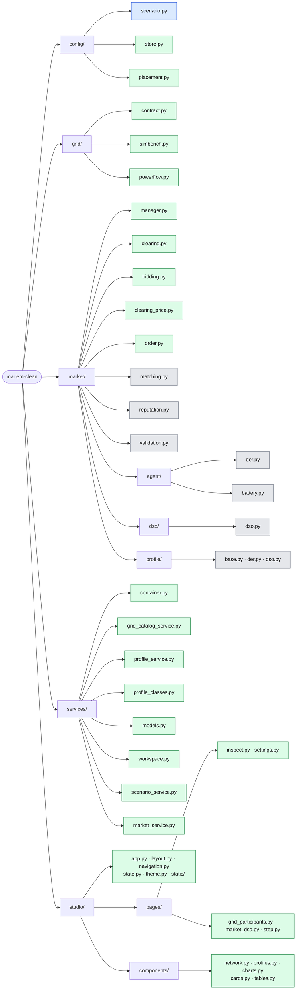

# Code structure

> The repository folder by folder, down to each script: what it is for and how far
> it is built. Keep this page current when files are added, moved or built.

Layers from bottom to top: `grid/` models the network, `market/` the market on it
(its `MarketManager` runs both, step by step), `config/` describes a scenario,
`services/` is what the Studio calls, and `studio/` is the user interface. Lower layers never
import higher ones.

Green: works. Blue: data definitions only. Amber: stub, methods raise
`NotImplementedError` or the page shows a placeholder. Grey: original MARLEM code,
copied unchanged, kept as the reference; most of it is **not importable** (its
imports point to the old layout).

## config/: the scenario

Everything the user sets before stepping the market, as plain data.

| Script | What it does | State |
|---|---|---|
| `scenario.py` | `Scenario`: the network (`GridSetup`), the participants with their batteries, the market rules and the DSO tariffs and fees | data only |
| `store.py` | Save and load a scenario as JSON | done |
| `placement.py` | Placing participants on the scenario's network: one on a bus, or one per load or prosumer bus; imports `grid/` | done |

## grid/: the SimBench network

The only place that imports pandapower and simbench. It hands out plain records,
never pandapower objects.

| Script | What it does | State |
|---|---|---|
| `contract.py` | The plain records that cross the grid seam: networks, topology, elements, profiles, power-flow results | done |
| `simbench.py` | Lists, loads and caches networks; topology, elements, profiles, the profile catalogue; a one-hour power flow | done |
| `powerflow.py` | `SimBenchGrid`: one power flow per market step; owned elements switched off, each participant's net injection at its bus; distances along the lines | done |

## market/: the MARLEM market

The market of the paper ([methodology](marlem/methodology.md)). `manager.py` is the
one class that runs it, like `lem.py` in the original; `clearing.py`, `bidding.py`
and `clearing_price.py` are its rebuilt pieces, and the remaining original files
are the reference for what is still to rebuild (reputation, fees).

| Script | What it does | State |
|---|---|---|
| `manager.py` | `MarketManager`: profiles, batteries, one step in the paper's phases (validate, orders, the three stages, settle, power flow, advance), one stage at a time or all at once; the history of the day | done |
| `clearing.py` | The three clearing stages as separate functions: preferences, double auction, DSO | done |
| `bidding.py` | The rule that writes orders: battery first, then sell the surplus or buy the deficit between the DSO's tariffs | done |
| `clearing_price.py` | Pricing mechanisms with one fixed signature (fixes the seller price) | done |
| `order.py` | `Order` and `Trade` (with the stage that made it) | done |
| `matching.py` | The original three-stage clearing | original |
| `reputation.py` | Reputation update after each period | original |
| `validation.py` | Hash-chained trade ledger with proof of work | original |
| `agent/der.py` | A prosumer: order feasibility, partner choice, energy tracking | original |
| `agent/battery.py` | Battery state of charge, charging and discharging | original, imports |
| `dso/dso.py` | The DSO: tariffs, clearing the residual, grid fees | original |
| `profile/` | Synthetic or CSV generation, demand and tariff profiles | original, imports |

## services/: what the Studio calls

Translates between the Studio and the layers below, so pages never touch the
market or pandapower directly.

| Script | What it does | State |
|---|---|---|
| `container.py` | Builds the services once | done |
| `grid_catalog_service.py` | Networks, their facts, topology, elements, the network cache | done |
| `profile_service.py` | A network's profiles and SimBench's whole catalogue | done |
| `profile_classes.py` | SimBench's profile classes and how a profile name is classified | done |
| `models.py` | The data types the Studio receives | done |
| `workspace.py` | Where the Studio keeps its data (`C:\MARLEM` here) | done |
| `scenario_service.py` | The scenario being edited, saved on every change; calls `config/placement.py` to place participants | done |
| `market_service.py` | Builds the `MarketManager` the Step page plays | done |

## studio/: the user interface

NiceGUI, port 8090. A page is one file in `pages/`; code goes to `components/`
only when more than one place uses it.

| Script | What it does | State |
|---|---|---|
| `app.py` | Registers the pages and starts the server | done |
| `layout.py`, `navigation.py`, `theme.py`, `static/` | Page frame, left navigation, colours and styles | done |
| `state.py` | The services, built once | done |
| `pages/inspect.py` | Inspect: any network in depth, all SimBench profiles, two networks compared | done |
| `pages/settings.py` | Workspace folder, network cache and its coverage, dark mode | done |
| `pages/grid_participants.py` | Network, day, step length, background, limits; participants placed by clicking buses or per load or prosumer bus; batteries | done |
| `pages/market_dso.py` | Pricing mechanism, bounds, preferred partners, ledger; the bidding rule; the DSO's tariffs | done |
| `pages/step.py` | One click per part of a step (orders, the three stages, settle and power flow): order book, network with trades and voltages, trades, participants, the day so far | done |
| `components/network.py` | Network picker with filters, summary, topology plot, element table, profile inspector | done |
| `components/profiles.py`, `charts.py`, `cards.py`, `tables.py` | Profile class tiles, Plotly figures, cards, tables | done |

## Around the code

| Path | What it is |
|---|---|
| `docs/` | This documentation (Markdown); `docs/networks.py` generates the network catalogue |
| `docs_site/` | The MkDocs site built from `docs/`: config, build hooks, diagram assets |
| `run_studio.py` | Starts the Studio with auto-reload |
| `run_all.py` | Starts the dev servers (both branches' docs and Studios) in their own windows |
| `AGENTS.md` | Rules for working in this repository |
| `.vscode/` | Launch entries and the Python interpreter |

## Choices in the rebuilt market step

Where the rebuilt step differs from the paper or the original code, for now:

| Topic | Here |
|---|---|
| Orders | Written by the bidding rule (`market/bidding.py`); no learning |
| Orders preferring the DSO | Skip stages 1 and 2 and are cleared in stage 3 (the original cleared them first) |
| Losses | The market is lossless; losses show in the power flow |
| Grid fees (eq. 8) | Not charged yet |
| Reputation (eq. 12) | Stays at 0.5 for everyone; only the auction's tie-break |
| Tariffs | Constant over the day |
| Submitted orders | Never changed by the clearing (the original changed them in place) |
| Batteries (eq. 15–16) | Efficiencies and the power limit included; partial charges allowed |
