# Code structure

> The repository folder by folder, down to each script: what it is for and how far
> it is built. Keep this page current when files are added, moved or built.

The market has three layers: `core/grid/` models the network,
`core/market/` models the market on it (`LocalEnergyMarket` runs both, step by
step), and `core/config/` describes a scenario. `notebooks/` call `core/`
directly to validate it. The NiceGUI Studio is in `studio/`: pages and components
call `studio/adapters/`, a thin layer over `core/`. `core/` never imports `studio/`
or `notebooks/`, so anything that looks wrong in the Studio can be reproduced in
a notebook to tell a core problem from a UI one. `core/env/` makes the market an
RL environment; `core/rl/` is the RL layer, which imports no market module (the
environment arrives as a class), so its probes test it alone. `core/runner/` is the
one place that knows both: it starts, watches and stops training experiments
(specs in `config/experiments/`, results in `runs/`) on a target named in
`hpc/targets.toml`: this machine, or a SLURM cluster (used from the cluster
itself, or from here over SSH).

```mermaid
flowchart TD
  root(["marlem-v2"])

  root --> core["core/"]

  core --> cs["settings.py · rl_defaults.py · files.py"]:::done

  core --> config["config/"]
  config --> c1["scenario.py"]:::data
  config --> c2["store.py"]:::done
  config --> c3["placement.py"]:::done

  core --> grid["grid/"]
  grid --> g1["contract.py"]:::done
  grid --> g2["simbench.py"]:::done
  grid --> g3["powerflow.py"]:::done
  grid --> g4["graph.py"]:::done

  core --> market["market/"]
  market --> m1["lem.py"]:::done
  market --> m7["clearing.py"]:::done
  market --> m4["clearing_price.py"]:::done
  market --> m2["order.py"]:::done
  market --> m5["reputation.py"]:::done
  market --> m9["signals.py"]:::done
  market --> agent["agent/"]
  agent --> a1["der.py"]:::done
  agent --> a2["battery.py"]:::done
  agent --> a3["rule_based_bid.py"]:::done
  market --> d1["dso.py"]:::done

  core --> env["env/"]
  env --> e1["market_env.py"]:::done

  core --> rlcore["rl/"]
  rlcore --> r1["config.py · state.py · ctce.py · ctde.py<br/>modules.py · learner.py · policy.py · train.py"]:::done
  rlcore --> renvs["envs/"]
  renvs --> r2["probes.py"]:::done
  rlcore --> rscripts["scripts/"]
  rscripts --> r3["probe_check.py · probe_ppo.py"]:::done

  core --> runnercore["runner/"]
  runnercore --> ru1["spec.py · launch.py · registry.py · results.py<br/>slurm.py · targets.py · remote.py · __main__.py"]:::done

  root --> cfg["config/"]
  cfg --> exps["experiments/"]
  exps --> ex1["smoke.json · market_ppo.json<br/>market_ppo_detailed.json · grid_methods.json"]:::data

  root --> hpc["hpc/"]
  hpc --> hp1["targets.toml"]:::data
  hpc --> hs["hpc.ps1 / hpc.cmd<br/>jupyter.slurm"]:::done

  cfg --> scen["scenarios/"]
  scen --> s1["validate_market.json"]:::done

  root --> notebooks["notebooks/"]
  notebooks --> nm["market/"]
  nm --> n1["validate_market.ipynb"]:::done
  nm --> n3["benchmark_market_step.ipynb<br/>results/market_step.csv"]:::done
  nm --> n4["grid_methods.ipynb"]:::done
  notebooks --> nr["rl/"]
  nr --> nr1["probe_paradigms"]:::done
  notebooks --> nu["runner/"]
  nu --> nu1["targets_demo.ipynb · results.ipynb"]:::done

  root --> tests["tests/"]
  tests --> tm["market/"]
  tm --> x1["test_studio_matches_core.py · test_market_env.py<br/>test_partner_choice.py · test_powerflow_recycle.py<br/>test_fees_timing.py · test_grid_methods.py"]:::done
  tests --> tr["rl/"]
  tr --> x2["test_0 to test_8 · test_training_metrics.py<br/>test_evaluation_tables.py · probe_helpers.py · conftest.py"]:::done
  tests --> tru["runner/"]
  tru --> x3["test_runner.py · test_run_service.py · test_results.py<br/>test_results_service.py · test_slurm.py · test_targets.py · test_remote.py"]:::done

  root --> runs["runs/ (local results, not in git)"]:::data

  root --> studio["studio/"]
  studio --> t1["app.py · layout.py · navigation.py<br/>state.py · theme.py · static/"]:::done
  studio --> pages["pages/"]
  pages --> pg1["inspect.py · settings.py · components.py"]:::done
  pages --> pg2["grid_participants.py<br/>summary.py · market/ (page.py · step.py · probes.py)<br/>rl_probes.py · runs.py · results.py"]:::done
  studio --> comps["components/"]
  comps --> k1["network.py · profiles.py · charts.py · cards.py<br/>tables.py · run_table.py · labels.py · day_profiles.py"]:::done
  studio --> adapters["adapters/"]
  adapters --> v1["container.py · workspace.py · models.py"]:::done
  adapters --> v2["grid_catalog_service.py · profile_service.py<br/>profile_classes.py"]:::done
  adapters --> v3["scenario_service.py · market_service.py<br/>run_service.py · results_service.py<br/>validation_service.py"]:::done

  classDef done fill:#dcfce7,stroke:#15803d,color:#111
  classDef data fill:#dbeafe,stroke:#1d4ed8,color:#111
  classDef stub fill:#fef3c7,stroke:#b45309,color:#111
  classDef orig fill:#e5e7eb,stroke:#6b7280,color:#111
```

Green: implemented; this is not a fresh test report for every component. Blue: data definitions only. Amber: stub, methods raise
`NotImplementedError` or the page shows a placeholder. Grey: original MARLEM code,
copied unchanged, kept as the reference; most of it is **not importable** (its
imports point to the old layout).

## core/: shared helpers

| Script | What it does | State |
|---|---|---|
| [`files.py`](../core/files.py) | Atomic file replacement and JSON writing shared by training and the runner; preserves the Windows retry behavior without importing either layer | done |
| [`settings.py`](../core/settings.py) | The values that belong to a person or a site (cluster account, SSH host, ports, folders): `get(key, default)` from the environment variable, else `.env` in the root, else the default; `expand` fills `${KEY}` / `${KEY:-default}` (used by `hpc/targets.toml`). Standard library only, so any layer may import it | done |

## core/config/: the scenario

Everything the user sets before stepping the market, as plain data.

| Script | What it does | State |
|---|---|---|
| [`scenario.py`](../core/config/scenario.py) | `Scenario`: the network (`GridSetup`), the participants with their batteries, the market rules with the reputation weights and decay, and the DSO's tariffs, fee factors and loss factor; each setup lists its own problems (`problems()`), shown on the Summary page | data and its checks |
| [`store.py`](../core/config/store.py) | Save and load a scenario as JSON | done |
| [`placement.py`](../core/config/placement.py) | Placing participants on the scenario's network: one on a bus, or one on every bus of the chosen kinds (`load`, `load+pv`, `load+storage`, ...); taken-over SimBench storage becomes the participant's battery, fixed in size (`set_battery`); SimBench-sized battery presets; imports `core/grid/` | done |

## core/grid/: the SimBench network

The only place that imports pandapower and simbench. It hands out plain records,
never pandapower objects.

| Script | What it does | State |
|---|---|---|
| [`contract.py`](../core/grid/contract.py) | The plain records that cross the grid seam: networks, topology, elements, profiles, power-flow results, the path between two buses (`GridPath`) | done |
| [`simbench.py`](../core/grid/simbench.py) | Lists, loads and caches networks; topology, elements, profiles, the profile catalogue; a one-hour power flow | done |
| [`powerflow.py`](../core/grid/powerflow.py) | `SimBenchGrid`: one power flow per market step; owned elements switched off, each participant's net injection at its bus; the path between two buses (distance, lines, zones = feeders) | done |
| [`graph.py`](../core/grid/graph.py) | `GraphGrid`: the paper's grid model ([P1] §3.5) on the SimBench lines, for `grid.method = "graph"`: each step's trades along their paths (`SimBenchGrid.path`, `path_upstream`), over a capacity per line (`"paper"`: a total spread by inverse length; `"ratings"`: each line's own), as the line loading the DSO's fees read. The power flow still runs and is recorded ([grid-method comparison](experiments/grid-methods.md)) | built on the `marlem-slurm` branch for review; tested (`tests/market/test_grid_methods.py`) |

## core/market/: the MARLEM market

The market of the paper ([methodology](marlem/methodology.md)). `lem.py` is the
one class that runs it (`LocalEnergyMarket`, as in the original); `clearing.py`,
`agent/rule_based_bid.py`, `clearing_price.py` and `reputation.py` are its rebuilt pieces, and
the remaining original files (profiles) are the reference.

| Script | What it does | State |
|---|---|---|
| [`lem.py`](../core/market/lem.py) | `LocalEnergyMarket`: the participants (`Participant`), the DSO (`Dso`) and the reputation rule, one step in the paper's phases (validate, orders, the three stages, settle, power flow, fees, rate, advance), one stage at a time or all at once; the history of the day | done |
| [`clearing.py`](../core/market/clearing.py) | The three clearing stages as separate functions: preferences, double auction, DSO; every trade assessed by the DSO (distance, loss, fee) | done |
| [`clearing_price.py`](../core/market/clearing_price.py) | `ClearingMechanism` enum: six pricing calculations with one fixed signature (fixes the seller price) | done |
| [`order.py`](../core/market/order.py) | `Order`, `Trade` (stage, distance, loss, fee and who pays it) and `GridFees` (the parts of eq. 8) | done |
| [`reputation.py`](../core/market/reputation.py) | The original's `ReputationHandler`, all reputation dials in one place (weights, decay): eq. 12 from reliability, price fairness and grid contribution, blended with the decay; reads a `StepRecord`; fixed where it disagreed with [P1] (see its docstring); `ReputationScore` | done |
| [`signals.py`](../core/market/signals.py) | The paper's 42 observation signals ([P1] Table 2): the 10 implicit-cooperation KPIs (functions of the steps given), the 16 market and 16 agent signals (functions of the market now), each a plain function listed in `KPIS`, `MARKET_SIGNALS`, `AGENT_SIGNALS`; NaN when there is nothing to measure; open definitions marked `# OPEN` | done, open definitions provisional |
| [`probes.py`](../core/market/probes.py) | The market probes ([plan](plan/validation.md)): tiny scripted cases on four participants of `1-LV-rural1` (SimBench profiles, five midday steps), each isolating one part of the step (M1 stage 1, M2 mutual names, M3 the double auction, M4 the DSO), played on both grid methods, with checks worked out from the profiles; `same_market` compares the two methods | M1-M4 done; M5-M9 planned |
| [`agent/der.py`](../core/market/agent/der.py) | `Participant`: profiles from its elements, feasibility (eq. 15a-b), partner choice by reputation and distance, settlement (eq. 13, 14 less its fees, battery eq. 16), its reputation (decay blend), its bus injection; `ParticipantOutcome` | done |
| [`agent/battery.py`](../core/market/agent/battery.py) | `Battery`: its energy, what it can still take or give (eq. 15c-d), charging and discharging (eq. 16); the market only calls it | done |
| [`agent/rule_based_bid.py`](../core/market/agent/rule_based_bid.py) | The rule that writes orders: battery first, then sell the surplus or buy the deficit between the DSO's tariffs | done |
| [`dso.py`](../core/market/dso.py) | `Dso`: tariffs, market price (their midpoint), the lines' loading of the step's power flow, transmission losses (eq. 18), grid fees (eq. 8) charged after that power flow and who pays them, stage 3 clearing (§3.3.2), its balance (eq. 7) and money; `DsoOutcome`, `DSO_ID` | done |

## core/env/: the market as an RL environment

`MarketEnv` is the RLlib `MultiAgentEnv` over `LocalEnergyMarket`: one agent per
participant, one episode per market day. It only translates actions to orders and
the step's record to observations and rewards; the market rules stay in
`core/market/`.

| Script | What it does | State |
|---|---|---|
| [`market_env.py`](../core/env/market_env.py) | `MarketEnv` (V2): the paper's 42 signals from `signals.py`, scaled, then the peers' reputations (`obs_names`, [Observation](rl/observation.md)); the mixed action of [P1] eq. 2 as a `Dict`: side (categorical), quantity share with a no-order threshold and price (continuous), partner (categorical over `partners(agent)`: the peers in scenario order, DSO, none), passed to `OrderIntent.partner_id` unchanged; reward = scaled net energy bill; episode = one day drawn from `days`, terminated at the day end; `resolved_config` (the training scales a run keeps), `contract` (observation names, action parts, partner mapping, scales), `encode`; baselines `zero_policy`, `net_position_policy` (`baseline_policies`); step infos with the side, partner, mutual choice and stage-1 energy. The module docstring documents the interface | done |
| [`__init__.py`](../core/env/__init__.py) | Public imports: `MarketEnv`, `OBS_NAMES` (and its three blocks), `net_position_policy`, `zero_policy` | done |

## core/rl/: the reinforcement-learning layer

The three paradigms (CTCE, CTDE, DTDE) on RLlib's own PPO (APPO and SAC are in V1). It
imports no market module: the environment is passed in as a class. Each file's
docstring names the issues it fixes ([validation/rl.md](validation/rl.md)). The
original code and its annotations live on the `clean` branch.

| Script | What it does | State |
|---|---|---|
| [`state.py`](../core/rl/state.py) | The global state: every agent's observation joined in agent order (`join`, `join_spaces`); CTCE's observation, the CTDE critic's input | done |
| [`ctce.py`](../core/rl/ctce.py) | CTCE: `CTCEEnv` (joint observation `Box`, the agents' own actions as one `Tuple` in agent order, nested and mixed as they are; summed reward); `ungroup` | done |
| [`ctde.py`](../core/rl/ctde.py) | CTDE: `CTDEEnv` (own observation plus the global state, own reward; `central_obs`) and `CTDEPPOModule`, one RLlib PPO module per agent, actor on its own observation, critic on the global state | done |
| [`modules.py`](../core/rl/modules.py) | `PPOModule`, RLlib's PPO module with its policy head wrapped (`BoundedHead`): bounded means, optional log σ bounds, a state-independent log σ (RP-3h); `action_parts`, `continuous_slots` | done |
| [`learner.py`](../core/rl/learner.py) | `PPOLearner`, RLlib's PPO learner unchanged, also logging each module's clip fraction (the share of ratios outside the clip range) | done |
| [`../rl_defaults.py`](../core/rl_defaults.py) | The default hyperparameters per algorithm (`SETTINGS`) and network settings (`NETWORK`), without Ray, so the runner and the Studio can write an experiment out in full. It sits in `core/`, outside the package: importing anything under `core/rl/` loads Ray | done |
| [`config.py`](../core/rl/config.py) | PPO (the only algorithm in V2), paradigms and configuration (`build_config` from `SETTINGS` and `MODEL`; modules declared in agent order); `build_algo` | done |
| [`policy.py`](../core/rl/policy.py) | Policy actions for any action space RLlib's catalog handles (`to_env`: continuous parts unsquashed as RLlib's samplers do, categorical parts as indices; CTCE's group action back to each agent), baselines (random and constant per action part, or the environment's `baseline_policies`), rollout (with reset options, e.g. the day) and evaluation: `evaluation` keeps every episode per agent and per episode, and chosen episodes step by step, read from the infos' layout (amounts, `state` with numbers and labels, `shared`, `shared_state`); `evaluate` its summary; per-part diagnostics (`action_parts`, `observation_sample`, `part_stats`: each action part's distribution in fixed states, written to `metrics.csv` by `train.py`) | done |
| [`train.py`](../core/rl/train.py) | `train(Run(...))`: the environment's resolved config (training scales) used for the whole run, training budgets, metrics (idle polls omitted; sampling/learner timers and training throughput), run records (resolved and given env config, the environment's contract, each agent's spaces, every PPO and network setting with its value, stage timings) and saved policies; periodic evaluation on the training configuration; `load_policy` | done |
| [`scripts/probe_check.py`](../core/rl/scripts/probe_check.py) | The probe check: probes 1-10 with their budgets and presets (`fast`, `thorough`), training in one pool (on a SLURM job with one shared Ray instance and one worker per physical core), scoring each network against the exact answers, `escalate` (failures again at larger budgets). Used by `probe_ppo.py` and `probe_paradigms.ipynb` | done |
| [`scripts/probe_ppo.py`](../core/rl/scripts/probe_ppo.py) | The probe check as one command (`--probes`, `--preset`, `--budget-scale`, `--escalate`); run it first after a change to `core/rl/` | done |
| [`envs/probes.py`](../core/rl/envs/probes.py) | Five probe tasks with known answers; probe 6, `MixedActionProbe`: a categorical and a continuous action part with known optima per agent; probes 7-10, one market feature each: `GatedActionProbe` (a gate decides whether the choice counts), `MutualChoiceProbe` (pairs paid only for mutual naming, with a safe DSO option), `ConditionalPartProbe` (the best level depends on the side), `LongEpisodeProbe` (24 steps, reward at the end) | done |
| [`__init__.py`](../core/rl/__init__.py), [`envs/__init__.py`](../core/rl/envs/__init__.py) | Public imports | done |

## core/runner/: experiments

Start training runs that outlive the terminal, the Studio and the Claude session,
and watch them from files only. The one place that imports both `core/env/` and
`core/rl/` (inside a job; the rest stays light). An experiment is a spec in
`config/experiments/`; `start` saves it with its scenario in `runs/<name>/experiment.json`
(and the scenario alone in `scenario.json`, which the runs read), writes a
`status.json` per run and spawns one detached worker, which keeps `max_parallel`
job processes training (one run each, then a held-out evaluation).

The same runs can go to a SLURM cluster instead: `slurm.py` submits them as one
job array (one task per run, through submitit), and every task calls the same
`launch.job`. *Where* an experiment runs is a **target** (`targets.py`, settings in
`hpc/targets.toml`): `local` is this PC, `taltech` the cluster; the CLI and the
Studio talk to a target and need not know the difference. On the cluster the
target submits to SLURM directly; from this PC the same target runs the runner's
CLI on the cluster's login node over SSH (`remote.py`) and copies the results
back into `runs/@taltech/` (`sync`). A spec can also ask for
cluster `resources` (cpus, mem_gb, minutes per run) and describe its **test
profile** (`test` block): `--profile test` runs `Experiment.test_version()`, the
smallest version of the experiment (first seed, one train day and test day, about
one training batch, 15 minutes, named `<name>--test`), to prove the pipeline
with a small amount of actual training. [The resource guide](hpc/resources.md)
separates run concurrency from within-run sampling; [the workflow guide](hpc/experiments.md)
describes restart, sync and the inspected execution evidence.

| Script | What it does | State |
|---|---|---|
| [`spec.py`](../core/runner/spec.py) | `Experiment`: the JSON spec (validated early, with `resources`, `num_env_runners` per run and the `test` block), expanded to one `RunSpec` per algorithm x paradigm x variant x seed, each building a `core.rl.Run`; `to_dict` (written to `experiment.json`), `dated` (`<name>-<date>-<time>`), `inline_scenario` and `resolve` (the experiment as it is started: a file or an `Experiment`, with the scenario file read into `scenario`, in a profile), `written_out` (every setting with its value, defaults included, and `to_text`: the JSON as the start dialog shows it), `test_version` (the smallest version; `test_budget`: one training batch per algorithm from its effective settings over every variant, SAC also its warm-up so the test run learns) | done |
| [`launch.py`](../core/runner/launch.py) | `prepare` (the experiment's folder, with `scenario.json`, and queued runs; refuses a spec or scenario that differs from the saved `experiment.json` before writing anything), `start` (prepare, detached worker), `work` (the worker loop), `job` (train, held-out evaluation, status), `job_environment` (what every job process runs with, `PYTHONHASHSEED` fixed so a seed repeats a run), `stop` (kill worker and process trees, checked by pid and start time), `mark_stopped` | done |
| [`slurm.py`](../core/runner/slurm.py) | The cluster side, for use where `sbatch` exists: `start` (prepare, then one submitit job array, `slurm.json` and each run's `slurm_job`), `states` (one `sacct` call, parsed to a task map), `stop` (`scancel` first: if it fails the error carries its message and no run is marked; then mark the runs) | implemented; short TalTech runs recorded (see evidence below) |
| [`registry.py`](../core/runner/registry.py) | Read-only view of `runs/`: `experiments()`, `runs(experiment)` with a `RunState` per run (state, progress, ETA, last and held-out score, SLURM state, host); detects `lost` runs, for SLURM runs from the task map it is given instead of a pid | done |
| [`results.py`](../core/runner/results.py) | The results of runs from their saved files, for the Results page and the notebooks: `find_runs` (this PC and each cluster's mirror, by target, experiment and run), `load_runs` (settings, state, tables read when asked for), `overview`, `learning_curves`, `training_curves`, `heldout_days` (paired per test day), `participant_days`, `seed_groups` (over training seeds, with the settings that differ), `differing_settings` (on the full saved settings: the scenario's contents, every day, training settings, model; `RunResult.labels` shortens them for display only); no Ray, no market, no cluster; `learner_metrics` (any run's `metrics.csv` as one long table: per module its losses, explained variance, entropy, KL and gradient norm, per action part its distribution; the groups in `LEARNER_GROUPS`) | done |
| [`probe_runs.py`](../core/runner/probe_runs.py) | The RL probe runs, for the RL probes page: `ABOUT` (each probe in words: what it tests, setup, exact answer, what a correct learner shows, the market feature), `read_probe_run` (a folder `ppo_<paradigm>_p<probe>_s<seed>[_x<scale>]`: its probe and its `score.csv` and `checks.csv`); no Ray (everything under `core/rl/` loads it) | done |
| [`targets.py`](../core/runner/targets.py) | `Target` (`check` returns the one readiness report `{target, ok, problems, local_commit, cluster_commit, active}`; `start` calls it and refuses with its problems; a spec is a file or an `Experiment`; `start_new` (a new experiment, dated if its name is taken), `restart` (again from the folder's saved settings); `overview` is the one read path, `runs`, `stop`, `sync`, `close`), `LocalTarget`, `SlurmTarget` (on the cluster), `RemoteTarget` (the same cluster from the PC: every call is the runner's CLI on the login node, `start` sends the experiment with its scenario as JSON on standard input, `sync` replaces the mirror `runs/@taltech/<experiment>` with a fresh copy, `local_runs` reads it), `get(name)` from `hpc/targets.toml` | implemented; remote workflow used for short TalTech runs |
| [`remote.py`](../core/runner/remote.py) | `Remote`: one SSH connection (asyncssh, `pip install asyncssh` in the `marlem` env; the cluster does not need it) on a private event-loop thread behind synchronous methods, so it works from the CLI, Jupyter and the Studio's threads; `execute`, `runner` (`python -m core.runner ... --json` in the cluster's checkout, optionally with standard input: the experiment of `start -`), `head`, `uncommitted`, `pull` (a fresh copy of the folder, without checkpoints and `slurm/`, into a temporary folder that replaces the mirror only when complete); no retries: a failed operation closes the connection and raises `RemoteError` ("<operation> failed on <host>: <reason>") | implemented; results mirrors inspected |
| [`__main__.py`](../core/runner/__main__.py) | `python -m core.runner start / status / stop / sync / check`, each with `--target` and `--json` (the JSON is then the only output), `start` with `--profile full / test`, `status --json` (every experiment with its runs and spec in one answer), `check [spec]` (the readiness report, exit 1 when not ready); plus the internal `work` and `job` | done |

Execution evidence is dated and scoped in [Training experiments](hpc/experiments.md#existing-execution-evidence).
It comes from saved pre-migration results, not a new full-suite or UI test.

## config/experiments/: what to train

| File | What it is | State |
|---|---|---|
| [`smoke.json`](../config/experiments/smoke.json) | Two tiny PPO-DTDE runs, to check the runner end to end (a few minutes) | done |
| [`market_ppo.json`](../config/experiments/market_ppo.json) | PPO in the three paradigms on the market with the mixed action, one seed, 240,000 steps, three environment runners per run | test profile run (see [v2.md](v2.md)); full profile not started |
| [`market_ppo_detailed.json`](../config/experiments/market_ppo_detailed.json) | The same with a short budget (8,000 steps) and `"results_detail": "detailed"`: the traced test days show each participant's partner and stage-1 trades | not run yet |
| [`grid_methods.json`](../config/experiments/grid_methods.json) | PPO-CTDE with three seeds in three arms (variants): fees from the power flow, from the paper's graph model, and from the graph model with real line ratings ([grid-method comparison](experiments/grid-methods.md)) | test profile run locally; full profile not started |

## studio/: the user interface

NiceGUI, port 8091. A page is one file in `pages/`, or a folder of its own when
its tabs are large enough for a file each (`pages/market/`: `page.py` with the
frame and the tab bar, a file per tab); code goes to `components/` only when more
than one place uses it.

| Script | What it does | State |
|---|---|---|
| [`app.py`](../studio/app.py) | Registers the pages and starts the server; on shutdown closes the connections to a cluster (`RunService.close`) | done |
| [`layout.py`](../studio/layout.py), [`navigation.py`](../studio/navigation.py), [`theme.py`](../studio/theme.py), [`static/`](../studio/static) | Page frame, left navigation, colours and styles; the header names the current scenario and opens another from a scenario file (`config/scenarios/` or an upload) | done |
| [`state.py`](../studio/state.py) | The adapters (`services()`), built once | done |
| [`pages/inspect.py`](../studio/pages/inspect.py) | Inspect: any network in depth, all SimBench profiles, two networks compared | done |
| [`pages/settings.py`](../studio/pages/settings.py) | Workspace folder, network cache and its coverage, dark mode | done |
| [`pages/components.py`](../studio/pages/components.py) | Components: every base building block (cards, rows, tabs, buttons, text classes, key_values, stat tiles, placeholder, busy and failed, tables, trades, the shared figures, `styled`) drawn with made-up values, each with the call that draws it; a reference for writing pages | done |
| [`pages/grid_participants.py`](../studio/pages/grid_participants.py) | Network, day, step length, background, limits; participants placed by clicking buses or per load or prosumer bus; batteries; the participants' summed day; the market panel (pricing mechanism, bounds, preferred partners, the bidding rule, the DSO's tariffs) | done |
| [`pages/summary.py`](../studio/pages/summary.py) | Summary before running: readiness checks; tab Settings (every grid, market, DSO and battery setting once, the participants' day, the network) and tab Day profiles | done |
| [`pages/runs.py`](../studio/pages/runs.py) | Runs: the training experiments on every target of `hpc/targets.toml`, one tab each (This PC, TalTech). One card per experiment (newest first): runs per state, worker alive or not (this PC), Stop experiment (with confirmation); a table of its runs with state badge, progress bar, env steps / budget, elapsed, ETA, last evaluation and held-out return, a Stop button per queued or running run, and the error of a failed run in a tooltip. This PC is read every 2 s. A cluster is read every 10 s over SSH, and only while its tab is shown (nothing connects before it is opened); its tab starts with one line from the runner's `check` ("Ready", or the problems, the two commits, the experiments queued or running) and a Check button, then "updated hh:mm:ss" and Refresh now, SLURM state and node in the table, and a Sync results button on each card (results are copied only when asked). A read that fails is not a notification: a line says why and when the data shown was last read, and goes away with the next good read. Start, Stop and Sync show their errors as notifications. The Start experiment button opens a dialog: a spec from `config/experiments/` as the template, its JSON in an editor, checked on every edit with the runs it makes or what is wrong; Test and Full presets that rewrite the run size settings in the editor (the template's test version or its own values; other edits stay) and pick the target; the target; fields for the paradigms (CTCE, CTDE, DTDE), seeds, budget, PPO settings, environment runners, runs in parallel, torch threads and SLURM resources, kept in step with the JSON (each rewrites its setting there); Start starts the edited experiment as a new one (dated if its name is taken on the target), and for a cluster the target is checked when the dialog opens and the target changes (Check again re-runs it), with Start disabled until there are no problems and while its request runs. Restart failed runs, on a card with failed, stopped or lost runs and none queued or running, starts the experiment again from the settings saved in its folder | implemented; adapter tests present, full manual UI acceptance not established here |
| [`pages/results.py`](../studio/pages/results.py) | Results: every run of this PC and the synced clusters in one table (`components/run_table.py`: filters choose what is shown, the boxes, *Tick shown* and *Untick all* what is ticked). Compare: every setting that differs (full saved values), the periodic evaluation return (training days, unseen seeds) over environment steps with each run's own baselines (team or per participant, optionally the training return), every held-out day as trained minus each baseline, and each configuration over its seeds; runs of more than one target keep the target in their names. Inspect a run: its settings, test days, participants × days (a chosen outcome, trained minus a baseline, the largest differences or a filter for many participants), market and grid per day, and with detailed results the traced days step by step, read when opened, with each participant's orders, named partner, mutual choice and stage-1 energy in a table. Read once; Refresh reads again and redraws both tabs. The learner of the ticked runs moved to the RL probes page | implemented; checked in NiceGUI's user simulation, not in a browser |
| [`pages/market/page.py`](../studio/pages/market/page.py) | Validate → Market: two tabs, Step (`step.py`) and Probes (`probes.py`), each in its own file in `pages/market/`; the probes play when their tab is first opened; `/market?tab=probes` opens the second | done |
| [`pages/market/step.py`](../studio/pages/market/step.py) | Market → Step tab: one click per part of a step (orders, the three stages, settle and power flow): order book, network with trades and voltages, trades, participants, the day so far | done |
| [`pages/market/probes.py`](../studio/pages/market/probes.py) | Market → Probes tab: every probe's PASS/FAIL on both grid methods; per probe its orders and expected outcome, and per step its checks, trades (with fees), participants and the DSO | done |
| [`pages/rl_probes.py`](../studio/pages/rl_probes.py) | Validate → RL probes: the run table with each probe run's probe and result; Probes tab: the ticked probe runs as probe × paradigm, and one probe run's description (`core/runner/probe_runs.py`) and checks; Learning tab (moved from Results): training return, the learner's metrics, one action part at a time | done |
| [`components/network.py`](../studio/components/network.py) | Network picker with filters, summary, topology plot, element table, profile inspector | done |
| [`components/profiles.py`](../studio/components/profiles.py), `charts.py`, `cards.py`, `tables.py` | Profile class tiles, Plotly figures (also the day's curves), cards, tables (also a step's trades, for the Market page's Step and Probes tabs) | done |
| [`components/run_table.py`](../studio/components/run_table.py) | The table of runs to tick, shared by Results and RL probes: what is shown (one or more experiments, a text filter, test runs, ticked only) apart from what is ticked (the boxes, *Tick shown*, *Untick all*); a ticked run stays ticked when a filter hides it | done |
| [`components/day_profiles.py`](../studio/components/day_profiles.py) | The Summary's Day profiles tab: every element on the scenario's day, participants (they trade) apart from the background; summed curves, single curves by row selection | done |
| [`components/labels.py`](../studio/components/labels.py) | The names shown for mechanisms, background modes and step lengths, shared by the settings and summary pages | done |

## config/scenarios/: saved scenarios

| File | What it is | State |
|---|---|---|
| [`validate_market.json`](../config/scenarios/validate_market.json) | The market notebook's scenario, saved by it in the Studio's format: open it from the Studio's header (Scenario: ... → Open) to play the same scenario there. Also the scenario of `tests/market/` and of the market environment's examples | done |

## notebooks/: the core without the Studio

Notebooks import `core/` only. Run them with the `marlem` conda env as kernel;
their setup cell finds the repository root from wherever they run. Runs go to
`runs/` in the root.

| Notebook | What it does | State |
|---|---|---|
| [`market/validate_market.ipynb`](../notebooks/market/validate_market.ipynb) | Scenario, inputs per step, one step part by part, the whole day, rule checks, experiments side by side | done |
| [`market/benchmark_market_step.ipynb`](../notebooks/market/benchmark_market_step.ipynb) | Time per market step on SimBench LV networks of 13 to 118 participants (random orders), split into market logic, grid preparation and the power flow; the floor under a training run on the market | done |
| [`market/results/market_step.csv`](../notebooks/market/results/market_step.csv) | That notebook's summary, read by the RL speed benchmark (`notebooks/rl/benchmark_speed.ipynb`, removed 24 Oct 2026; last at [90839c2](https://github.com/KevinRapo/P2P-thesis/blob/90839c2/notebooks/rl/benchmark_speed.ipynb)) | done |
| [`market/grid_methods.ipynb`](../notebooks/market/grid_methods.ipynb) | The grid-method arms on `validate_market.json`, 14 test days, with the net-position baseline (no learning): same physics in every arm; fees per part; the loading the fees saw against the measured loading; losses of eq. 18 against the power flow | done |
| [`rl/probe_paradigms.ipynb`](../notebooks/rl/probe_paradigms.ipynb) | The probe check (`probe_check.py`) for PPO in the three paradigms, probes 1-10: train in one pool, read each probe's outputs against the answers, learner health, longer budgets for failures. Runs here or in the cluster's Jupyter job | done |
| [`runner/targets_demo.ipynb`](../notebooks/runner/targets_demo.ipynb) | The workflow on a target: start the smoke experiment (test profile) locally and watch it, then the same on the cluster from the PC (`check`, `start`, watch, `sync`, the synced runs as a table), `stop` as an example, closing the connection | implemented; execution not established by this inventory |
| [`runner/results.ipynb`](../notebooks/runner/results.ipynb) | Compare finished runs with `core/runner/results.py`: the runs, learning curves, held-out days against the baselines, participants × days, and the configurations over their seeds | done |

## tests/: market and RL checks

Run with `python -m pytest` from the root in the `marlem` conda env (`pytest.ini`
sets `testpaths = tests` and `pythonpath = .`).

| Test | What it checks | State |
|---|---|---|
| [`market/test_studio_matches_core.py`](../tests/market/test_studio_matches_core.py) | `validate_market.json` read by `ScenarioService` and stepped part by part by `MarketService` gives the same `StepRecord`s as `LocalEnergyMarket.run_to_end` | done |
| [`market/test_market_env.py`](../tests/market/test_market_env.py) | `MarketEnv` on `validate_market.json`: spaces (the mixed `Dict` action, the partner block), a zero-action day, the reward as the scaled net bill, action decoding (side, quantity share, price, no-order threshold, `encode`), reproducible day draw, `net_position_policy` against `zero_policy`, RLlib's multi-agent environment check, the CTDE and CTCE wrappers over the market | done |
| [`market/test_partner_choice.py`](../tests/market/test_partner_choice.py) | The learned partner: candidate order, index to `OrderIntent.partner_id` (peer, DSO, none), never replaced by the rule-based choice, stage 1 with compatible, incompatible (bid below ask) and one-sided choices, naming the DSO, the partner observation and its timing; the training scales kept on other days and in the runner's held-out config | done |
| [`market/test_fees_timing.py`](../tests/market/test_fees_timing.py) | Grid fees priced on the same step's power flow (congestion and thermal parts), the first step charged like any other | done |
| [`market/test_powerflow_recycle.py`](../tests/market/test_powerflow_recycle.py) | pandapower's `recycle` in the step power flow gives the same grid results | done |
| [`market/test_grid_methods.py`](../tests/market/test_grid_methods.py) | The graph model's capacity rules and flows; a graph-mode day charges its thermal fees from the graph loading while `record.grid` stays the power flow; the same physics in both arms for a policy that ignores fees; the measured voltage drop | done |
| [`market/test_signals.py`](../tests/market/test_signals.py) | The KPIs, market and agent signals against numbers worked out by hand, the empty cases (NaN, not 0), the three lists, and one real day | done |
| [`market/test_market_probes.py`](../tests/market/test_market_probes.py) | Every market probe passes every check on both grid methods, with the same trades on both | done |
| [`rl/test_0_every_probe.py`](../tests/rl/test_0_every_probe.py) to `test_5_obs_action_probe.py` | Deterministic checks of the probe environments | done |
| [`rl/test_6_ctde_structure.py`](../tests/rl/test_6_ctde_structure.py) | The CTDE modules' structure: what the actor and the critic read | done |
| [`rl/test_training_metrics.py`](../tests/rl/test_training_metrics.py) | Idle reports omitted, learner-only progress preserved, non-finite metrics still fail, timing fields and total training-call time retained; learner metrics over the modules (mean, min, max); every evaluation kept per episode and agent, appended per evaluation point | done |
| [`rl/test_evaluation_tables.py`](../tests/rl/test_evaluation_tables.py) | `evaluation` on a two-agent environment: the summary as before, one row per policy, episode and agent (amounts summed, reset fields copied), one per episode (shared amounts once), and only the traced episodes step by step | done |
| [`rl/test_7_same_seed_same_run.py`](../tests/rl/test_7_same_seed_same_run.py) | The same seed gives the same run: initial weights independent of Python's set order, and two runs in the runner's job processes (PPO DTDE, CTDE and CTCE) bit for bit the same after training | done |
| [`rl/test_8_mixed_actions.py`](../tests/rl/test_8_mixed_actions.py) | Mixed actions in every paradigm (probe 6): optima and reward routing, CTCE's `Tuple` action round trip and one joint distribution, the CTDE actor independent of the central inputs, rewards and values per agent or group, PPO's clip on a constructed batch (one ratio per agent's whole action in DTDE and CTDE, one joint ratio in CTCE), the sampler and `Policy` sending the same action, `to_env`, checkpoint save and load in all three paradigms | done |
| [`rl/test_package_names.py`](../tests/rl/test_package_names.py) | `from core.rl import train` gives the function even after the module `core.rl.train` was imported (as the runner's jobs do) | done |
| [`rl/probe_helpers.py`](../tests/rl/probe_helpers.py), [`rl/conftest.py`](../tests/rl/conftest.py) | Shared assertions and readable test output (each test's docstring is printed) | done |
| [`runner/test_runner.py`](../tests/runner/test_runner.py) | Experiment specs (grid names, budgets, variants, date ranges, resources, `to_dict` round trip, the test version, validation errors), the registry's run states (queued, running, lost, completed, failed, legacy, progress and ETA, SLURM runs) and `launch.prepare`; no training | done |
| [`runner/test_run_service.py`](../tests/runner/test_run_service.py) | The Studio's `RunService` over a temporary `runs/` (`MARLEM_RUNS`): this PC's overview newest first with its runs, stopping queued runs, local check always ready; over fake targets: names and labels from `targets.toml`, a target made once and closed, overview newest first, check (with and without a spec), start, `start_new`, `restart`, stop and sync handed to the target asked, the specs of `config/experiments/` (all load; a broken one says why), `describe` of an edited experiment text (a changed copy, a file without a name, invalid JSON and specs), the editable text (every setting written out, twice the same), the presets (the template's test version and back, other edits kept, twice the same; `PRESET_KEYS` cover what the test version changes; errors), and the quick settings (paradigms, seeds, budget, PPO, workers, resources read and rewritten) | done |
| [`runner/test_results.py`](../tests/runner/test_results.py), [`runner/test_results_service.py`](../tests/runner/test_results_service.py) | The results reader over hand-written run folders: every run once (a mirror under its cluster's name), settings from the saved files, overview and curves, paired held-out days and older runs' means, participants × days, spread over seeds and the settings that differ (full values, not labels); the Studio's `ResultsService` passes the tables on and reads again after `refresh`; the page's labels across targets, the bounded participant selection and per-run baselines | done |
| [`runner/test_probe_runs.py`](../tests/runner/test_probe_runs.py) | Every probe of `probe_check.PROBES` described under its name; a probe run read from its name and files (scored and not), other runs ignored; `ValidationService` adds probe and result to the overview; the Studio reads it without loading Ray | done |
| [`runner/test_run_table.py`](../tests/runner/test_run_table.py) | The run table in NiceGUI's user simulation: an experiment shows its runs without ticking them, two experiments at once, a tick survives a filter, *Tick shown* and *Untick all* leave the filters alone, the text filter narrows *Tick shown* | done |
| [`runner/test_slurm.py`](../tests/runner/test_slurm.py) | The SLURM backend without a cluster: `sacct` lines and array ranges parsed, `start` against a fake submitit (parameters, partition, `slurm.json`, resubmitting, refusing while tasks are alive), `stop` against a fake `scancel` (a failed `scancel` raises and marks nothing) | done |
| [`runner/test_targets.py`](../tests/runner/test_targets.py) | `hpc/targets.toml`, `LocalTarget` and `SlurmTarget` over a temporary `runs/`, `RemoteTarget` against a fake `Remote` (the check report for each problem, `start` refusing with the check's problems, overview and status parsing, stop, sync), and the command line (`status --json`, errors as `error: ...` or `{"error": ...}` with exit 2, `check [spec]`, `stop`, `sync`, `start --profile`, `start -` from standard input) | done |
| [`runner/test_remote.py`](../tests/runner/test_remote.py) | `Remote` without a network: the commands it builds (quoting, `~`), the runner's JSON answers and errors, `pull` as a fresh copy (replaces the mirror, keeps it when the copy fails), the connection against a fake asyncssh connection (one connection, closed on failure and reopened by the next call, errors as `RemoteError`, closing) | done |

## studio/adapters/: what the pages call

Translates between the Studio and the layers below, so pages never touch the
market or pandapower directly.

| Script | What it does | State |
|---|---|---|
| [`container.py`](../studio/adapters/container.py) | Builds the adapters once | done |
| [`workspace.py`](../studio/adapters/workspace.py) | Where the Studio keeps its data: the network cache, the scenario file, per-browser state (`C:\MARLEM` here) | done |
| [`grid_catalog_service.py`](../studio/adapters/grid_catalog_service.py) | Networks, their facts, topology, elements as the grid contract's records; the network cache and its background warming | done |
| [`profile_service.py`](../studio/adapters/profile_service.py) | A network's profiles and SimBench's whole catalogue; every element's power on the scenario's day (`day_profiles`) | done |
| [`profile_classes.py`](../studio/adapters/profile_classes.py) | SimBench's profile classes and how a profile name is classified | done |
| [`models.py`](../studio/adapters/models.py) | The data types only the Studio needs: profile classes, profile types, chart series, a day's element profiles | done |
| [`scenario_service.py`](../studio/adapters/scenario_service.py) | The scenario being edited, saved on every change; calls `core/config/placement.py` to place participants; lists, reads and opens scenario files | done |
| [`run_service.py`](../studio/adapters/run_service.py) | The experiments of a target (this PC, or a cluster over SSH) as the runner reports them (the target's entries with `RunState`), newest first; one target object per name, kept for the life of the Studio (a cluster keeps its connection) and closed on shutdown; `overview`, `check(target, spec)`, `start`, `start_new`, `restart`, `stop` and `sync` (returns the folder and the number of files copied) go to the target asked (a spec is a file or an `Experiment`), `target_names` gives the labels of `targets.toml`, `spec_files` the specs of `config/experiments/` with their text, runs, budget and resources (or why one does not load), `describe` an experiment text edited in the start dialog (the `Experiment` to start, or why it does not load), `apply_preset` the Test or Full preset to it, `quick_settings` / `apply_settings` the dialog's fields (paradigms, seeds, budget, PPO settings, workers, cluster resources) read from and written into the text, `editable` the text with every setting written out | done |
| [`results_service.py`](../studio/adapters/results_service.py) | The Results page's runs (`core/runner/results.py`), read once until `refresh`, and the reader's tables for the runs named by key, as they are | done |
| [`validation_service.py`](../studio/adapters/validation_service.py) | The Market page's probe runs (`core/market/probes.py`), played once until played again | done |
| [`market_service.py`](../studio/adapters/market_service.py) | Builds and holds the `LocalEnergyMarket` the Step page plays; build, next part, step, run to the end, clear (when another scenario is opened) | done |

## Around the code

| Path | What it is |
|---|---|
| `docs/` | This documentation (Markdown); `docs/networks.py` generates the network catalogue |
| `docs_site/` | The MkDocs site built from `docs/`: config, build hooks, diagram assets; [`export_drawio.py`](../docs_site/export_drawio.py) exports the `.drawio` diagrams under `docs/` to the SVGs the pages show |
| [`docs/experiments/`](experiments/grid-methods.md) | The thesis's experiments: the grid-method comparison (proposal) with its diagram (`diagrams/grid_methods.drawio`, exported to `grid-methods.svg`) |
| [`docs/full-cycle.md`](full-cycle.md) | The full cycle on one page: a master diagram of the training iteration, the environment step and the market step; one card per phase (reads, computes, writes, code, paper, decisions) and where every quantity is calculated |
| `run_studio.py` | Starts the Studio with auto-reload |
| [`run_all.py`](../run_all.py) | Starts this checkout's docs and Studio in separate windows using the current Python; `docs` and `studio` select one |
| `AGENTS.md` | Rules for working in this repository |
| `pytest.ini` | Discover the market and RL tests together from the root (`tests/`) |
| [`environment.yml`](../environment.yml) | The `marlem` conda environment, with the package versions in use (this PC and the cluster) |
| [`hpc/`](../hpc/) helpers | The Jupyter job on the cluster: the Windows helper [`hpc.ps1`](../hpc/hpc.ps1) (and [`hpc.cmd`](../hpc/hpc.cmd)), which reads `.env`, and the job script [`jupyter.slurm`](../hpc/jupyter.slurm); [setup and PATH](hpc/setup.md#the-hpc-helper). |
| [`.env.example`](../.env.example), `.env` | This machine's settings (`core/settings.py`): the example lists every key and is tracked; `.env` holds your values and is git-ignored ([setup](hpc/setup.md#this-machines-settings-env)) |
| `hpc/` | Where experiments run: `targets.toml` names the targets (`local`, and the `taltech` SLURM cluster with its partitions, and as `${KEY}` settings from `.env` its account and, for use from the PC, the SSH host, the code folder and Python on the cluster; the mirror of the results); each has a `label`, the name the Studio's Runs page shows (This PC, TalTech); how to use the cluster is in [hpc.md](hpc.md) |
| `runs/` | Training runs, checkpoints and benchmark results; ignored by Git. Experiments started by the runner: `runs/<name>/{experiment.json, scenario.json, worker.json, worker.log, <run>/{status.json, log.txt, run.json, metrics.csv, evaluation.csv, heldout.csv, checkpoint/}}`; on a SLURM target no worker, instead `slurm.json` and `slurm/` (submitit's batch script, pickles and task logs), and `status.json` of each run has a `slurm_job` |
| `.vscode/` | Launch entries and the Python interpreter |

## Choices in the rebuilt market step

Where the rebuilt step differs from the paper or the original code, for now:

| Topic | Here |
|---|---|
| Orders | The standalone market uses `core/market/agent/rule_based_bid.py`; `MarketEnv` supplies feasible orders decoded from learned actions |
| Orders preferring the DSO | Skip stages 1 and 2 and are cleared in stage 3 (the original cleared them first) |
| Distance d_ij | Line length along the shortest path between the two buses (km); for a trade with the DSO, the path to the transformer's low-voltage busbar, where its energy enters |
| Losses (eq. 18) | Recorded on every trade as d · q · κ (κ = 0.03 per km); not taken off the delivered energy, since the power flow has the physical losses |
| Grid fees (eq. 8) | Calculated by the DSO for every trade and charged (`fees_charged`). They are charged after the step's power flow (clear, settle the energy, power flow, then fees), so congestion C_t is the highest line loading on the trade's path in the same step's power flow, the first step included. F_trans, which has no formula in [P1], is the lost energy at the trade price, κ · d · q · p (the form quantity × distance × price factor is set; the factor and the distance measure are open). Zones are feeders. Trades with the DSO pay the fees of their path to the transformer, without a zone bonus. F_imb applies only to trades with the DSO that worsen the market's balance. No trade is blocked for grid reasons: the fees penalize (M-12). Peer fees split 50/50 between buyer and seller; a DSO trade's fee is paid by the participant. Factor values are the original code's |
| DSO balance (eq. 7) | Energy sold minus bought per step and over the day, plus the DSO's revenue and fees; money adds up to 0 with the participants' profits |
| Market balance B_grid (eq. 20) | Energy offered minus energy asked in the step's orders (before stage 3) |
| Reputation (eq. 12) | `ReputationHandler.update_reputation` for every participant after each step, as in the original: reliability = order volume matched by peers / order volume, fairness = its peer trade prices against the peer clearing price, grid = its trades against B_grid (DSO trades neutral). Weights 0.3/0.2/0.5 (the original's); decay is configured per hour and applied as `decay ** step_hours` (M-43 decided). Start 0.5 |
| Partner choice (§3.4) | Weighted score: 0.5 · standing + 0.5 · closeness, both rescaled over the candidates (closeness 1 = nearest, 0 = farthest; standing 1 = highest reputation, 0 = lowest) |
| Tariffs | Constant over the day |
| Submitted orders | Never changed by the clearing (the original changed them in place) |
| Batteries (eq. 15–16) | Efficiencies and the power limit included; partial charges allowed. A participant taking over a SimBench storage unit gets its capacity and power; other batteries take their power limit by hand (none by default), or SimBench's capacity ÷ 2 h through `simbench_battery` and its presets |
| Demand satisfied / deferred (§3.4.1) | Per step on each outcome; deferred = what the participant's orders and battery left uncovered, exchanged with the upstream grid untraded |
