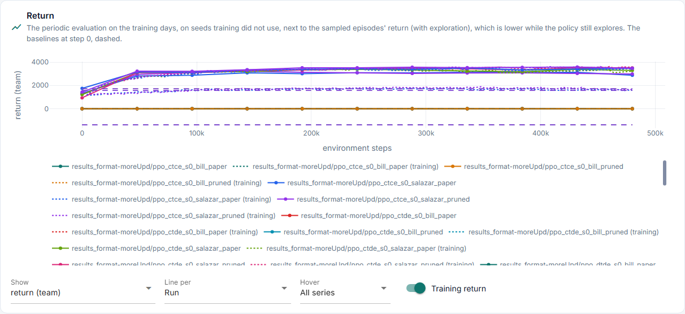
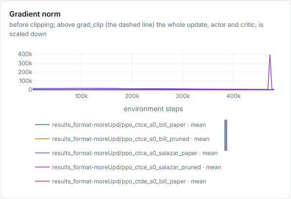
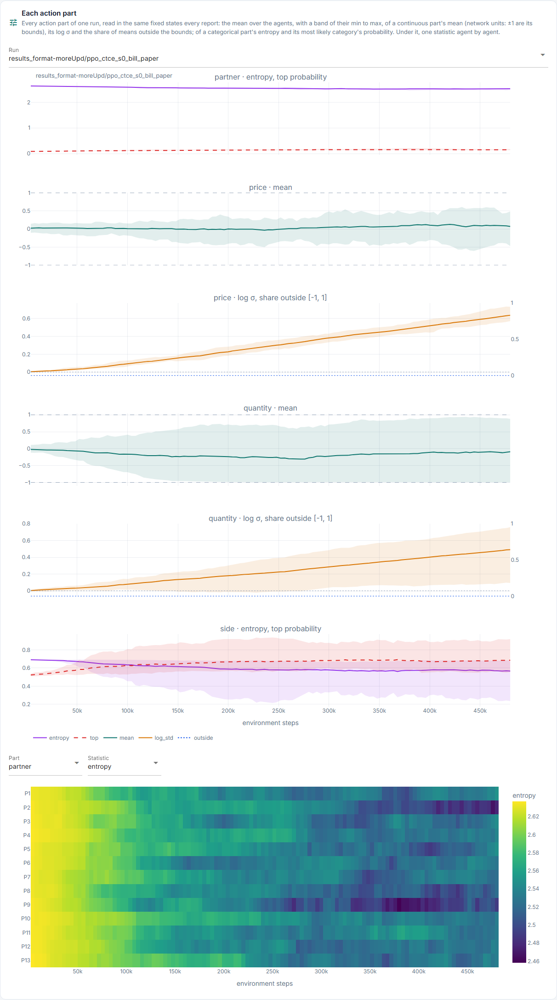
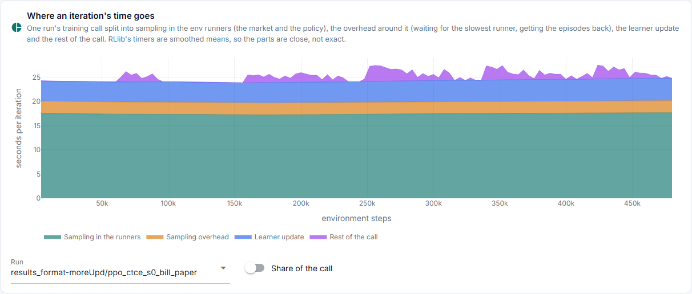
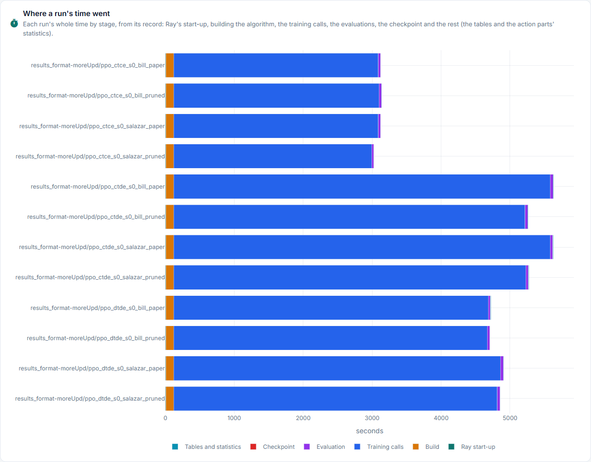

# Learning

**Did it learn?** Everything here is on the training days. It says whether training is
healthy, not whether the policy is good: that is [Validation](validation.md).

Source: `metrics.csv`, read by `learner_metrics` in
[`results.py`](../../../core/runner/results.py), drawn by
[`learning.py`](../../../studio/pages/results/learning.py). Nothing here is specific to
the market. The tab has two panels: **Evaluation**, described below, and **Timing**
(last section), drawn by [`timing.py`](../../../studio/pages/results/timing.py), whose
source is the timers of `metrics.csv` and the stages of `run.json`
(`iteration_timing` and `run_timings`).

## Structure

```text
Learning
├── panel: Evaluation · Timing (Timing: the last section)
│
│   Evaluation
├── switch: Mean over modules (on by default above 3 modules)
├── 1  Return              show: return · per participant · money
├── 2  Policy loss          3  Value loss
├── 4  Value fit            5  Entropy
├── 6  Update size (KL)     7  Clip fraction
├── 8  Gradient norm
└── 9  Each action part (one run, picked)
       ├── partner   entropy, top probability
       ├── price     mean ± σ
       ├── price     log σ, share outside the bounds
       ├── quantity  mean ± σ
       ├── quantity  log σ, share outside the bounds
       └── side      entropy, top probability
```

A colour is a run. In panels 2 to 8 a line is a module: an agent, or the group in CTCE.

## How often

`metrics.csv` gets one row per training iteration. In `obs_reward`, a batch of 500
environment steps gives 480 rows of 302 columns, about 2 MB per run. Every number is one
value per iteration, except the evaluation in panel 1, at each of `eval_points`.

## Panels

The pictures are the Studio on `results_format-moreUpd` (12 runs), made by [`screenshots.py`](../../../docs_site/screenshots.py); run it again after a Studio change.



Panels 2 to 8 look alike: a line per module and run, as in the gradient norm below.



| Panel | Column | Per | What it is | Read it as |
|---|---|---|---|---|
| 1 Return, dotted | `team_return_mean` of `metrics.csv` | run | Sum of the agents' returns, mean over the episodes finished lately, with exploration on, in the reward's units | Should rise |
| 1 Return, solid | `team_return_mean` of `evaluation.csv` | run | The trained policy on `eval_episodes` training days, on seeds training did not use, at each evaluation point; the same days at every point | Above the dotted line while exploration costs; the gap shows how much it still explores |
| 1 Return, dashed | The same at step 0 | run | `random`, `zero` and `net_position`, played once | What the curve has to beat |
| 1 Money | `bill` of `evaluation_agents.csv`, summed per day | run | The same curve in money: the one training chart that compares across rewards | A reward can rise while money falls |
| 2 Policy loss | `policy_loss` | module | PPO's clipped surrogate, negated | Its trend matters less than its noise |
| 3 Value loss | `vf_loss` | module | The critic's squared error against its targets, capped at `vf_clip_param` | Should fall, then settle |
| 3 Value loss | `vf_loss_unclipped` | module | The same without the cap | Equal to `vf_loss` unless the cap acts |
| 4 Value fit | `vf_explained_var` | module | Share of the targets' variance the critic explains | 1: perfect; 0: no better than their mean |
| 5 Entropy | `entropy` | module | Entropy of the action distribution, summed over the parts | Falls as the policy sharpens; a Gaussian's can go below 0 |
| 6 Update size | `mean_kl_loss` | module | KL between the collecting and the updated policy | 0.01 to 0.02 is usual; near 0 nothing moves. Left out when `use_kl_loss` is off |
| 7 Clip fraction | `clip_fraction` | module | Share of samples whose ratio is outside `[1 − clip, 1 + clip]` | 0.1 to 0.2 is usual |
| 8 Gradient norm | `gradients_default_optimizer_global_norm` | module | Global gradient norm before clipping, with `grad_clip` dashed | Above the line, the whole update is scaled down |



Panel 9 reads each module's action distribution in the same 128 states at every
iteration, averaged over them. The states are collected once, before training, by a
random policy on the training days. Continuous parts are in network units: ±1 are the
part's bounds. In CTCE an agent's parts are named inside the group.

| Part | Column | What it is | Read it as |
|---|---|---|---|
| `quantity`, `price` | `<module>/<part>/mean` | The Gaussian's mean | Should stay inside ±1 |
| `quantity`, `price` | `<module>/<part>/log_std` | Its log σ; σ in the hover | Falls as the part sharpens |
| `quantity`, `price` | `<module>/<part>/outside` | Share of states whose mean is outside ±1 | There the clipped action makes the reward flat |
| `side`, `partner` | `<module>/<part>/entropy` | The categorical part's entropy | Falls as the choice sharpens |
| `side`, `partner` | `<module>/<part>/top` | Probability of its most likely category | 1: always the same choice |

## Saved, not on this tab

| Column | What it is | Where |
|---|---|---|
| `total_loss` | Policy loss, value loss and entropy term together | Nowhere |
| `num_module_steps_trained` | Samples the module trained on | Nowhere |
| `iteration`, `learner_env_steps` | Counters | Nowhere |
| `modules/<metric>_mean`, `_min`, `_max` | The ten module metrics over the modules | Nowhere; recomputed from the rows |
| `async_learner_update_s_mean` | The asynchronous learner's timer; empty with the synchronous learner we use | Nowhere |
| `train_calls_s_total`, `elapsed_s` | Time so far | Nowhere |

## The Timing panel





Where a run's time goes. RLlib's timers are smoothed means in seconds, so the parts of
one call are close, not exact: a negative remainder counts as 0.

| Card | Source | What it is | Read it as |
|---|---|---|---|
| Where an iteration's time goes | `sampler_sample_s_mean`, `sampling_s_mean`, `learner_call_s_mean`, `train_call_s` | One run's training call, stacked: sampling in the env runners (the market and the policy), the overhead around it (`sampling_s_mean` minus the runners' own time: waiting for the slowest runner, getting the episodes), the learner update, and the rest of the call. A run without the runners' own timer counts all its sampling as the runners'. Switch: as a share of the call | Sampling is most of it when the market is expensive; a growing overhead means runners waiting for each other |
| Time per iteration | the same timers, nested: the call holds the driver's sampling, the learner update and the rest; the driver's sampling holds the runners' | One timer, a line per run | Whether a call gets dearer as training goes on, and which run is slower |
| Throughput | `sampled_steps_per_train_s` | Environment steps per second of training calls so far | What a budget costs |
| Where a run's time went | `timings` in `run.json` | Each run's whole time by stage: Ray start-up, build, training calls, evaluation, checkpoint, and the rest (tables and the action parts' statistics) | Known when the run has finished |

## Missing

| Number | Why it matters | Source |
|---|---|---|
| Speed, environment steps per second | Budget and cost of the next run | Saved: only needs a panel |
| Action parts in the states the policy visits | Panel 9 reads states of a random policy, so it can miss what the trained policy does | New |
