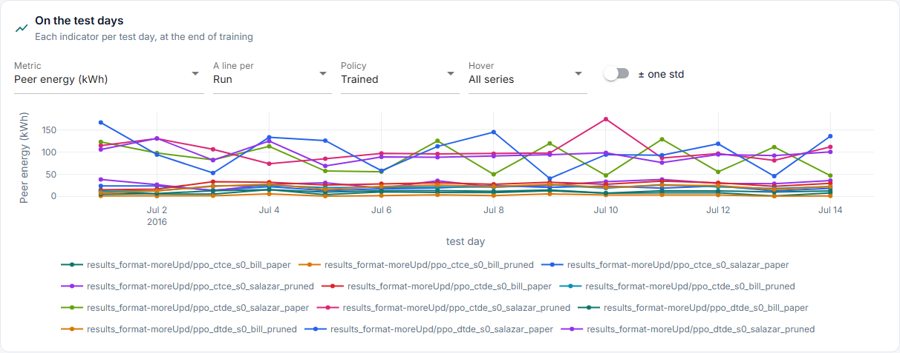
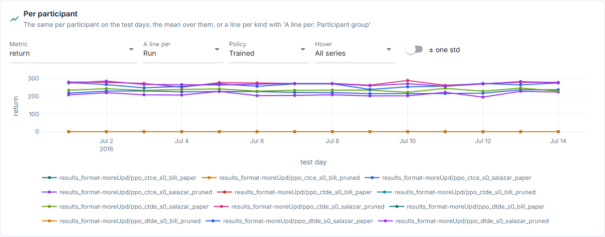
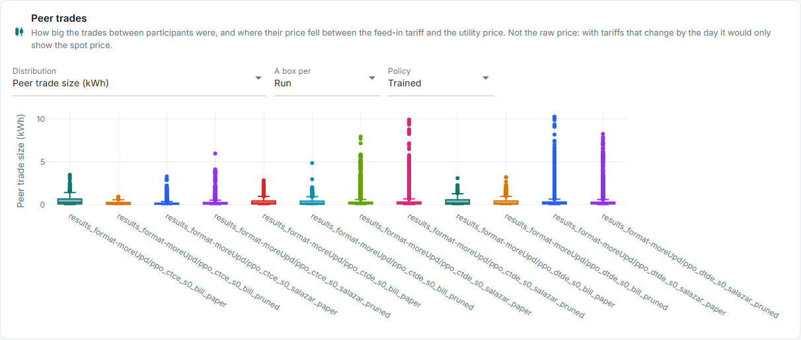
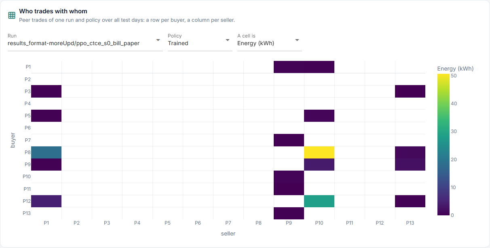
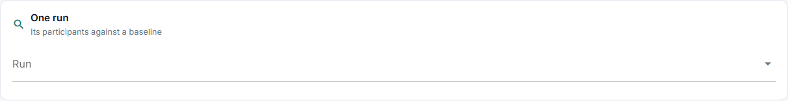
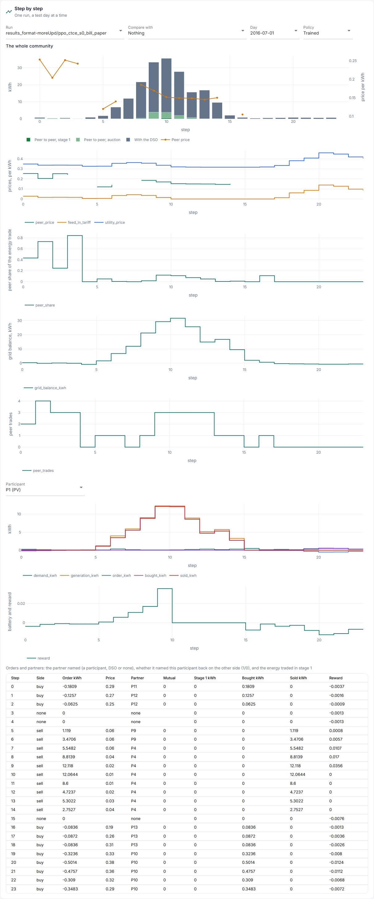

# Market

**What did the market do?** Its indicators per test day, each participant, and one run
step by step.

Source: `day_indicators` in [`results.py`](../../../core/runner/results.py),
`heldout_agents.csv` and the step tables, drawn by
[`market.py`](../../../studio/pages/results/market.py) and
[`steps.py`](../../../studio/pages/results/steps.py). The amounts are defined in
[`market_env.py`](../../../core/env/market_env.py).

## Structure

```text
Market
├── 1  On the test days     metric · a line per · policy · hover · ± one std
├── 2  Per participant      the same, a line per participant too
├── 3  Peer trades          distribution · a box per · policy
├── 4  Who trades with whom run · policy: a buyer × seller matrix
├── 5  One run              outcome · baseline · name filter: a heatmap
└── 6  Step by step         run · compare with · day · policy · participant
       ├── energy traded (stacked bars) and the peer price
       ├── prices
       ├── the participant's kWh
       ├── battery and reward
       └── orders and partners, a table
```

## Panels

The pictures are the Studio on `results_format-moreUpd` (12 runs), made by [`screenshots.py`](../../../docs_site/screenshots.py); run it again after a Studio change.



**1 On the test days.** A line stands for a run, or for what runs differ in.

| Indicator | What it is |
|---|---|
| `p2p_kwh` | Energy traded between participants, stages 1 and 2 |
| `preference_kwh` | Of it, stage 1: pairs who named each other |
| `trading_ratio` | Energy bought and sold over what participants needed to get or get rid of (demand beyond own generation, and the opposite); above 1 is energy traded back and forth |
| `unmet_kwh`, `spilled_kwh` | Demand left uncovered, and surplus left unsold: both settled untraded at retail |
| `bought_from_dso_kwh`, `sold_to_dso_kwh` | Energy traded with the DSO, stage 3 |
| `local_coverage` | Share of the participants' needed energy not taken from the DSO or left unmet, capped at what each needed at each step |
| `mean_peer_price` | Volume-weighted price of the peer trades |
| `peer_price_position` | The same between `p_FiT` (0) and `p_utility` (1) |
| `fees`, `peer_charge` | Paid over the day |
| `battery_throughput_kwh` | Energy into and out of the batteries |
| `end_reputation` | Mean reputation after the day's last step |
| `no_order_share`, `buy_share`, `sell_share` | What the participants did, as a share of their steps |
| The ten KPIs | See below |



**2 Per participant**, on the test days:

| Metric | Per | What it is |
|---|---|---|
| `return` | participant, day | Its reward summed over the day, in the reward's units |
| `bill` | participant, day | Its money: `profit` minus the utility price of `deferred_demand_kwh`. Positive is earned |
| `profit` | participant, day | Revenue minus cost of its trades and its fees ([P1] eq. 14) |
| `bought_kwh`, `sold_kwh` | participant, day | Energy it traded, peers and DSO together |
| `preference_kwh` | participant, day | Its energy traded in stage 1 |
| `deferred_demand_kwh` | participant, day | Demand left uncovered, drawn untraded from the upstream grid at the utility price |
| `deferred_supply_kwh` | participant, day | Surplus left unsold, exported untraded at the feed-in tariff (runs before 4 Nov 2026: for nothing) |



**3 Peer trades.** A box per run (or per what runs differ in) over its peer trades: their
size in kWh, or where their price fell between the feed-in tariff (0) and the utility
price (1). The place in the band, not the raw price: with tariffs that change by the day
the raw price would only show the spot price.



**4 Who trades with whom.** One run and policy over all test days: a row per buyer, a
column per seller, the cell their peer energy (or trades). It shows whether the market is
a few pairs or many.



**5 One run.** A heatmap of participants by test day: the outcome picked, for the trained
policy, minus the same for a baseline. Blue is higher for the trained policy. It shows at
most 30, the largest differences first.



**6 Step by step.** One run's day, for a picked policy and participant. *Compare with*
draws a second run over the market charts, dotted, on the same day and policy (on the
energy chart, its peer-to-peer energy).

| Chart | Columns | What it is |
|---|---|---|
| Energy traded | `p2p_kwh` (split into `preference_kwh`, stage 1, and the auction's rest), `bought_from_dso_kwh` + `sold_to_dso_kwh`, `peer_price` on the right | Each step's trading as stacked bars, so the peer part is seen at a glance; the same chart as the Market page's "The day so far" |
| Prices | `peer_price`, `feed_in_tariff`, `utility_price` | The peers' price, in the tariffs' band |
| The participant's kWh | `demand_kwh`, `generation_kwh`, `order_kwh`, `bought_kwh`, `sold_kwh` | What it had, what it asked, what it got |
| Battery and reward | `soc`, `reward` | State of charge after the step, 0 to 1; the step's reward |
| Orders and partners | `side`, `order_kwh`, `order_price`, `partner`, `partner_mutual`, `preference_kwh`, `bought_kwh`, `sold_kwh`, `reward` | Buy, sell or none; its price; the partner named: a participant, DSO or none; 1 if that partner named it back on the other side |

## Saved, not on this tab

| Column | What it is |
|---|---|
| `stored_change_kwh`, `adjusted_bill`, `fees`, `generation_kwh`, `demand_kwh`, `peer_bought_kwh`, `peer_sold_kwh`, `charge_kwh`, `discharge_kwh` of `heldout_agents.csv` | The participant's day; in `participant_metrics` for the notebook |
| `reputation`, `partner_index`, `reward_*` of `heldout_agent_steps.csv` | Per step and participant; the reward parts are what explains a Salazar result |
| `team_reward`, `clearing_price` of `heldout_steps.csv` | Per step |

**The paper's KPIs.** The ten of [P1] eq. 19-27 ([definitions](../../full-cycle/environment/observation.md)),
over the day, from `signals.kpis`, the same function the observation and the reward use.
Three need a note next to their name, because the label says more than the quantity.

| KPI | What is computed |
|---|---|
| `social_welfare` | Turnover `Σ p·q`, not surplus ([E-09](../../validation/register.md#E-09)) |
| `liquidity` | Energy traded, the DSO's trades included (MP-6a) |
| `bid_ask_spread` | Mean ask minus mean bid |
| `price_volatility` | Standard deviation of the clearing price ([E-10](../../validation/register.md#E-10)) |
| `supply_demand_imbalance` | Share of unmatched energy |
| `grid_congestion` | Mean line loading, from the loading the fees used |
| `coordination_score` | 1 minus the imbalance |
| `coordination_convergence` | Stability of the last three steps' traded energy |
| `der_self_consumption` | The peer share of the energy traded, not self-consumption ([E-12](../../validation/register.md#E-12)) |
| `flexibility_utilization` | Peer energy over the energy offered; `q_available` is undefined (MP-6a) |
