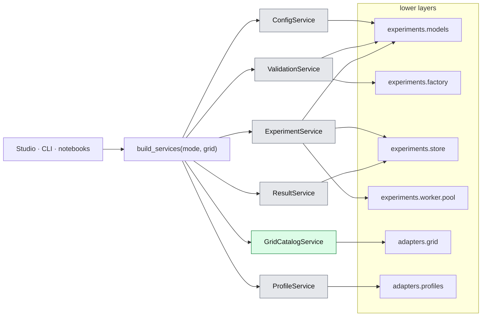

# 03. Application layer

> `src_thesis/application/`: the services that the Studio, the CLI and notebooks call. They hide MARLEM, the experiment layer and the adapters behind typed, plain-data methods.
> Master: [README.md](README.md) (layers and who may call whom: §2.1) · Experiment layer: [05-experiment-layer.md](05-experiment-layer.md) · Presentation: [04-presentation.md](04-presentation.md) · Decisions: D-09, D-13.

## 0. At a glance

Every caller gets the six services from one container; each service reaches exactly the lower layers it needs (§4). Green = real implementation today, grey = demo.

Services return plain data only (§3); nothing from the lower layers reaches the caller.

## 1. Status and wiring

| File | Holds | State (2026-09-27) |
|---|---|---|
| [contracts.py](../../../src_thesis/application/contracts.py) | One `Protocol` per service, mirroring the method tables in §2 | Done |
| [models.py](../../../src_thesis/application/models.py) | The plain data the services return (§3) | Done; experiment sections still dicts |
| [demo.py](../../../src_thesis/application/demo.py) | Demo implementations with deterministic sample data; no MARLEM, pandapower or Ray | Done |
| [grid_catalog.py](../../../src_thesis/application/grid_catalog.py) | The real `GridCatalogService` over the pandapower adapter | Done (R3, catalog part) |
| [container.py](../../../src_thesis/application/container.py) | `build_services(mode, grid)` → `Services` | Done |

| Service | Implementation today | Real implementation calls | Phase |
|---|---|---|---|
| `ConfigService` | demo | `experiments.models` (files, expand, resolve) | R6–R7 |
| `GridCatalogService` | **real** (`PandapowerGridCatalogService`) or demo | `adapters/grid/simbench_new.py` | R3 (done) |
| `ProfileService` | demo | `adapters/profiles/` (SimBench catalogue, mapping rules) | R3 |
| `ValidationService` | demo | `experiments.models` + `experiments.factory` (dry run) | R6–R7 |
| `ExperimentService` | demo | `experiments.models`, `experiments.store`, `experiments.worker.pool` | R7 |
| `ResultService` | demo | `experiments.store` (+ paper reference data) | R7 |

**Wiring.** Callers get every service through [`build_services`](../../../src_thesis/application/container.py) and depend only on the protocols:

- `build_services("demo")`: demo services everywhere; never loads pandapower (a test checks this).
- `build_services("demo", grid="pandapower")`: the real grid catalog, the rest demo. The Studio uses this unless `MARLEM_STUDIO_GRID=demo`; its header then reads "DEMO DATA · real grid".
- `build_services("real")`: reserved; raises until R6–R7.

Real services replace demo ones one at a time, in roadmap order, and are imported lazily inside `build_services`. Only this module changes when a real service arrives.

## 2. Services

One protocol per service in [contracts.py](../../../src_thesis/application/contracts.py). The earlier `*_service_new.py` stubs were removed: `scenario_service_new.py` became `ConfigService`, and `dataset_service_new.py` merged into `ProfileService`.

### 2.1 `ConfigService`: experiment files

| Method | Input → output | Notes |
|---|---|---|
| `list(filter)` | → `[FileSummary]` | Library and presets |
| `load(path_or_id)` | → `ExperimentFile` | Parses, migrates old `schema_version`s |
| `new_from_preset(name)` | → `ExperimentFile` | Presets from `experiments/presets/` (02 §7) |
| `save(file, path)` | → path | Writes canonical, pretty JSON |
| `clone(id, new_id)` | → `ExperimentFile` | Sets `meta.derived_from` |
| `resolve(file)` | → `ResolvedFile` | Fills defaults, resolves placement rules and day lists |
| `expand(file)` | → `[RunCell]` | Sweep × paradigms × algorithms × seeds (+ baselines) |
| `hash(file)` | → str | Canonical sha256 (02 §6) |
| `diff(a, b)` | → `[FieldChange]` | For "diff against preset" in the Studio |
| `export_bundle(file)` / `import_bundle(zip)` | → path / `ExperimentFile` | Only external CSV/JSON files are added |
| `json_schema()` | → dict | For editor autocomplete |

### 2.2 `GridCatalogService`: networks without an environment

| Method | Input → output | Notes |
|---|---|---|
| `list_networks(filter)` | → `[NetworkInfo]` | SimBench codes, pandapower built-ins, files. Metadata: level, buses, loads, sgens, storage, profiles?, ratings? |
| `summary(source)` | → `NetworkSummary` | Totals and element counts per type |
| `topology(source)` | → `TopologyView` | Buses with coordinates, lines, transformers (plain data for Plotly) |
| `elements(source, bus?)` | → `[ElementInfo]` | Loads, sgens and storage with profile type and rated power |
| `preview_powerflow(source, day, step, injections?)` | → `GridAssessment` + per-bus voltages | One power flow in-process (small and fast); used by the Grid page and the CLI |

### 2.3 `ProfileService`: profiles and participant mapping

| Method | Input → output | Notes |
|---|---|---|
| `profile_types(source)` | → `[ProfileType]` | SimBench catalogue (household, commercial, PV, wind, …) |
| `preview(participant_spec, time_spec)` | → series (G, D, net, background total) | After scaling and resolution |
| `suggest_mapping(source, rule)` | → `[ParticipantSpec]` | E.g. `{"type": "household_with_pv", "n": 8, "seed": 1}` |
| `import_mapping(file)` | → `[ParticipantSpec]` | CSV/JSON |
| `days(time_spec)` | → train/eval day lists | Resolves the sampler with its seed |

### 2.4 `ValidationService`: preflight

| Method | Input → output | Notes |
|---|---|---|
| `validate(file, level)` | → `ValidationReport` | Levels: `schema` (instant, as you type) · `references` · `full` (includes the dry run) |
| `dry_run(file)` | → `DryRunResult` | Builds one environment through the factory, takes one step with the no-order policy, and checks observation shapes, one power flow and the settlement identities |

`ValidationReport` = `[Finding(code, severity, path, message, fix_hint)]`. The `path` (e.g. `participants[3].owns.loads[0]`) lets the Studio jump to the field. The checks are listed in 02 §9.

### 2.5 `ExperimentService`: runs

| Method | Input → output | Notes |
|---|---|---|
| `create_runs(file)` | → `[run_id]` | Validates (`full`), expands, writes each run directory with its resolved file and manifest; state `READY` |
| `start(run_ids)` | → queued | Queues runs; the pool starts up to `resources.max_parallel_runs` workers |
| `cancel(run_id)` | → `CANCELLING` | Writes `cancel.request`; forced stop after a timeout |
| `snapshot(run_id)` | → `RunStatus` | State, progress (iteration / budget), last metrics, log tail |
| `list_runs(filter)` | → `[RunSummary]` | By experiment ID, state, network, date |
| `reconcile()` | — | On start-up: marks runs whose worker died as `FAILED` |
| `estimate(file)` | → runs count, time estimate | From stored benchmarks per network, algorithm and paradigm |

### 2.6 `ResultService`: reading results

| Method | Input → output | Notes |
|---|---|---|
| `summary(run_id)` | → `RunResult` | Research outcomes + RL return + manifest info |
| `training_curve(run_id)` | → series | Training and evaluation returns per iteration |
| `step_records(run_id, episode)` | → table | Orders, trades, settlement, assessment per step |
| `grid_series(run_id, episode)` | → series | Voltages, loadings, losses, violations over time |
| `matrix(experiment_id, metric)` | → table | Paradigm × algorithm (mean ± std over seeds): the 3 × 3 table |
| `compare(run_ids, metric)` | → series | Flags different `reward.version`s as non-comparable |
| `reference(case, metric)` | → series | Values reported in the papers for that case (reference data entered by hand), read-only |
| `export(run_ids, fmt)` | → path | CSV/JSON of raw series, figures |

## 3. Returned data

[models.py](../../../src_thesis/application/models.py) holds the only types that cross the boundary to the Studio, the CLI and notebooks.

- **Plain data only:** Pydantic models, dicts, lists and chart-ready `Series`. Never NiceGUI elements, Ray objects, pandapower nets or MARLEM objects.
- **One import path:** `ExperimentFile`, `ExperimentMeta`, `RunCell` and `RunState` belong to the experiment layer ([05 §2](05-experiment-layer.md#2-records-modelsrecordspy)) and are re-exported here, so callers import everything from `application.models`.
- **Translation happens in the service:** a real service converts lower-layer records into these models (e.g. `grid_catalog.py` turns the grid contract's `NetworkInfo` / `TopologyView` into the API models of the same names).

| Service | Returns |
|---|---|
| `ConfigService` | `ExperimentFile`, `FileSummary`, `RunCell`, `FieldChange`, JSON text and schema |
| `GridCatalogService` | `NetworkInfo`, `NetworkSummary`, `TopologyView`, `ElementInfo`, `PowerFlowPreview` |
| `ProfileService` | `ProfileType`, `Series`, participant dicts |
| `ValidationService` | `ValidationReport` (`Finding`s with `Severity`), `DryRunResult` |
| `ExperimentService` | run IDs, `RunStatus`, `RunSummary`, `RunEstimate`, `RepositoryHealth` |
| `ResultService` | `RunResult`, `Series`, step records (dicts), `MatrixTable`, export paths |

## 4. What each real service calls

Services run in the process of their caller (no REST layer, D-09). Anything long-running goes through the experiment layer's worker process.

| Service method | Lower-layer calls |
|---|---|
| `ConfigService.load` / `save` / `hash` / `json_schema` | `experiments.models.files.load` / `save` / `canonical_hash` / `json_schema` |
| `ConfigService.resolve` / `expand` | `experiments.models.resolve.resolve` / `expand.expand` |
| `GridCatalogService.*` | `adapters.grid.simbench_new` (catalog, summary, topology, elements, preview) |
| `ProfileService.*` | `adapters.profiles` (SimBench catalogue, mapping rules; R3) |
| `ValidationService.validate` | schema via the models; references, time, units, grid mapping and RL checks (02 §9) |
| `ValidationService.dry_run` | `experiments.factory.environment.build_env` + one step with the no-order policy |
| `ExperimentService.create_runs(file)` | validate → `expand` → per cell: `resolve_run`, `run_id`, `build_manifest`, `store.create_run` |
| `ExperimentService.start` / `cancel` | `worker.pool.WorkerPool.enqueue` + `poll` / `cancel` |
| `ExperimentService.snapshot` / `list_runs` / `reconcile` | `store.read_status`, `log_tail` / `store.list_runs` / `worker.pool.reconcile` |
| `ResultService.summary` / `step_records` / `grid_series` | `store.read_manifest`, `metrics/*` / `store.read_jsonl("raw/steps.jsonl")` |
| `ResultService.reference(case, metric)` | Values reported in the papers, entered by hand as reference data in a read-only `reference/` folder beside the store, each with its source (paper, figure or table) |
