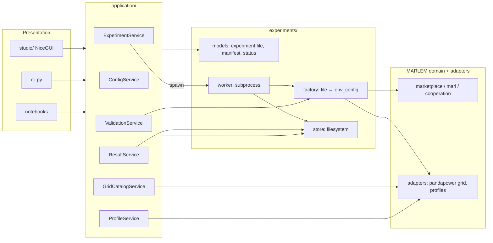

# 04. Services, worker, store and CLI

> How the UI, the CLI and notebooks talk to MARLEM without knowing its internals.
> Master: [README.md](README.md) · Experiment file: [03-experiment-config.md](03-experiment-config.md) · Experiment layer: [06-experiment-layer.md](06-experiment-layer.md) · Decisions: D-09, D-10.

## 1. Layers and who may call whom



- Presentation calls **only** `application/`.
- Services return typed, plain data: Pydantic models, dicts, lists and chart-ready series. They never return NiceGUI elements, Ray objects or pandapower nets.
- Only the **factory** turns an experiment file into live MARLEM objects. Everyone uses it: the worker, validation dry-runs, notebooks and tests.
- Services run **in-process** with the UI or CLI (no REST layer). Anything long-running (training, multi-episode simulation) runs in the **worker subprocess** (D-09).

## 2. Services

The protocols live in [application/contracts.py](../../../src_thesis/application/contracts.py) and the demo implementations in [application/demo.py](../../../src_thesis/application/demo.py). The earlier `*_service_new.py` stubs were removed: `scenario_service_new.py` became `ConfigService`, and `dataset_service_new.py` merged into `ProfileService`.

### 2.1 `ConfigService`: experiment files

| Method | Input → output | Notes |
|---|---|---|
| `list(filter)` | → `[FileSummary]` | Library and presets |
| `load(path_or_id)` | → `ExperimentFile` | Parses, migrates old `schema_version`s |
| `new_from_preset(name)` | → `ExperimentFile` | Presets from `experiments/presets/` (03 §7) |
| `save(file, path)` | → path | Writes canonical, pretty JSON |
| `clone(id, new_id)` | → `ExperimentFile` | Sets `meta.derived_from` |
| `resolve(file)` | → `ResolvedFile` | Fills defaults, resolves placement rules and day lists |
| `expand(file)` | → `[RunCell]` | Sweep × paradigms × algorithms × seeds (+ baselines) |
| `hash(file)` | → str | Canonical sha256 (03 §6) |
| `diff(a, b)` | → `[FieldChange]` | For "diff against preset" in the Studio |
| `export_bundle(file)` / `import_bundle(zip)` | → path / `ExperimentFile` | Only external CSV/JSON files are added |
| `json_schema()` | → dict | For editor autocomplete |

### 2.2 `GridCatalogService`: networks without an environment

| Method | Input → output | Notes |
|---|---|---|
| `list_networks(filter)` | → `[NetworkInfo]` | SimBench codes, pandapower built-ins, files. Metadata: level, buses, loads, sgens, storage, profiles?, ratings? |
| `summary(source)` | → `NetworkSummary` | Totals and element counts per type |
| `topology(source)` | → `TopologyView` | Buses with coordinates, lines, transformers (plain data for Plotly) |
| `elements(source, bus?)` | → `[ElementInfo]` | Loads, sgens and storage with profile type and rated power |
| `preview_powerflow(source, day, step, injections?)` | → `GridAssessment` + per-bus voltages | One power flow in-process (small and fast); used by the Grid page and the CLI |

### 2.3 `ProfileService`: profiles and participant mapping

| Method | Input → output | Notes |
|---|---|---|
| `profile_types(source)` | → `[ProfileType]` | SimBench catalogue (household, commercial, PV, wind, …) |
| `preview(participant_spec, time_spec)` | → series (G, D, net, background total) | After scaling and resolution |
| `suggest_mapping(source, rule)` | → `[ParticipantSpec]` | E.g. `{"type": "household_with_pv", "n": 8, "seed": 1}` |
| `import_mapping(file)` | → `[ParticipantSpec]` | CSV/JSON |
| `days(time_spec)` | → train/eval day lists | Resolves the sampler with its seed |

### 2.4 `ValidationService`: preflight

| Method | Input → output | Notes |
|---|---|---|
| `validate(file, level)` | → `ValidationReport` | Levels: `schema` (instant, as you type) · `references` · `full` (includes the dry run) |
| `dry_run(file)` | → `DryRunResult` | Builds one environment through the factory, takes one step with the no-order policy, and checks observation shapes, one power flow and the settlement identities |

`ValidationReport` = `[Finding(code, severity, path, message, fix_hint)]`. The `path` (e.g. `participants[3].owns.loads[0]`) lets the Studio jump to the field. The checks are listed in 03 §9.

### 2.5 `ExperimentService`: runs

| Method | Input → output | Notes |
|---|---|---|
| `create_runs(file)` | → `[run_id]` | Validates (`full`), expands, writes each run directory with its resolved file and manifest; state `READY` |
| `start(run_ids)` | → queued | Queues runs; the pool starts up to `resources.max_parallel_runs` workers |
| `cancel(run_id)` | → `CANCELLING` | Writes `cancel.request`; forced stop after a timeout |
| `snapshot(run_id)` | → `RunStatus` | State, progress (iteration / budget), last metrics, log tail |
| `list_runs(filter)` | → `[RunSummary]` | By experiment ID, state, network, date |
| `reconcile()` | — | On start-up: marks runs whose worker died as `FAILED` |
| `estimate(file)` | → runs count, time estimate | From stored benchmarks per network, algorithm and paradigm |

### 2.6 `ResultService`: reading results

| Method | Input → output | Notes |
|---|---|---|
| `summary(run_id)` | → `RunResult` | Research outcomes + RL return + manifest info |
| `training_curve(run_id)` | → series | Training and evaluation returns per iteration |
| `step_records(run_id, episode)` | → table | Orders, trades, settlement, assessment per step |
| `grid_series(run_id, episode)` | → series | Voltages, loadings, losses, violations over time |
| `matrix(experiment_id, metric)` | → table | Paradigm × algorithm (mean ± std over seeds): the 3 × 3 table |
| `compare(run_ids, metric)` | → series | Flags different `reward.version`s as non-comparable |
| `reference(case, metric)` | → series | Values reported in the papers for that case (reference data entered by hand), read-only |
| `export(run_ids, fmt)` | → path | CSV/JSON of raw series, figures |

## 3. Environment factory

`experiments/factory/environment.py` is the only place that turns an experiment file into live MARLEM objects: `build_env_config(resolved, cell, episode_seed)` gives the plain `env_config`, and `build_env(env_config)` builds the environment inside each RLlib env runner. The RLlib side is `experiments/factory/training.py`. Functions, inputs and outputs: [06 §3.7–3.8](06-experiment-layer.md#37-environment-factory-factoryenvironmentpy).

## 4. Worker

`python -m src_thesis.experiments.worker --run-dir <path>` runs exactly one run: it verifies the manifest hash, sets RUNNING, runs the selected runner, handles cancel and failures, shuts Ray down and writes the terminal state. Workers are started and watched by a polled `WorkerPool` in the Studio or CLI process; `max_parallel_runs` defaults to 1. Details and the state machine: [06 §3.9–3.11 and §4](06-experiment-layer.md#4-run-lifecycle).

## 5. Experiment store

One folder per run under `<store>/runs/<run_id>/` (experiment, resolved file, manifest, status, logs, metrics, step records, checkpoints, figures); `index.json` is a rebuildable cache. Small state files are replaced atomically; streams are append-only. RL learning metrics and research outcomes are stored apart, so results never present reward as a proxy for served demand, curtailment, P2P share, costs, violations or losses. Layout and every method: [06 §3.5](06-experiment-layer.md#35-store-storefilesystempy).

Values reported in the papers (reference data for R9 comparisons) sit in a read-only `reference/` folder beside the store, each with its source (paper, figure or table).

## 6. CLI

`python -m src_thesis.cli …`, exposed as `marlem …` once packaged. Each command is a thin wrapper around one service method:

```text
marlem new <preset> -o my.marlem.json          ConfigService.new_from_preset + save
marlem validate <file> [--dry-run]             ValidationService.validate / dry_run
marlem show <file> [--resolved]                ConfigService.load / resolve
marlem runs-plan <file>                        ConfigService.expand + ExperimentService.estimate
marlem run <file> [--only ppo:ctde] [--seeds 1,2]   ExperimentService.create_runs + start
marlem status [<run_id>|--experiment <id>]     ExperimentService.snapshot / list_runs
marlem cancel <run_id>                         ExperimentService.cancel
marlem grid list [--source simbench --level LV]      GridCatalogService.list_networks
marlem grid inspect <source>                   GridCatalogService.summary / elements
marlem grid preview <file> --day D --step t    GridCatalogService.preview_powerflow
marlem profiles <file> --participant <id>      ProfileService.preview
marlem results <run_id>                        ResultService.summary
marlem matrix <experiment_id> --metric <m>     ResultService.matrix
marlem export <run_id>... --fmt csv            ResultService.export
marlem bundle <file>                           ConfigService.export_bundle
```

Notebooks call the same services. The case notebooks become short: load a preset → `ExperimentService` → plot from `ResultService`.

## 7. Dependencies (D-10)

- Canonical environment: conda `marlem` (`environment.yml`).
- Already present: `pandapower` 3.5.4 and `simbench` 1.6.2 (checked 2026-09-23).
- Also installed and in use: `pydantic` 2.13 (service models) and `nicegui` 3.16 (the Studio). `environment.yml` pins `pandapower`, `simbench` and `nicegui` since 2026-09-27.
- Only `adapters/` imports `simbench` and `pandapower`. Only `studio/` imports `nicegui`.

## 8. Tests per layer

| Layer | Tests |
|---|---|
| Domain | Validation-plan acceptance tests (hand-sized) |
| Adapters | Mapping validation, alignment, injection identity, power flow on SimBench and built-in fixtures |
| Experiment file / factory | Round trip, hash stability, defaults resolution, sweep expansion, preset builds, 1-step dry run |
| Training config | Each algorithm × paradigm builds an `AlgorithmConfig` from the file; mutation domains contain initial values |
| Services | Temp store: create, expand, validate, start (fake worker), snapshot, cancel |
| Worker | Tiny baseline run end to end |
| CLI / UI | Smoke tests against fake services |
