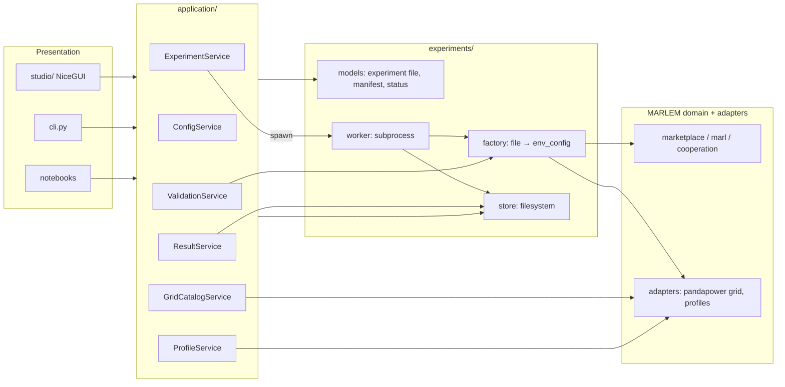

# 04. Services, worker, store and CLI

> How the UI, the CLI and notebooks talk to MARLEM without knowing its internals.
> Master: [README.md](README.md) · Experiment file: [03-experiment-config.md](03-experiment-config.md) · Decisions: D-09, D-10.

## 1. Layers and who may call whom



- Presentation calls **only** `application/`.
- Services return typed, plain data: Pydantic models, dicts, lists and chart-ready series. They never return NiceGUI elements, Ray objects or pandapower nets.
- Only the **factory** turns an experiment file into live MARLEM objects. Everyone uses it: the worker, validation dry-runs, notebooks and tests.
- Services run **in-process** with the UI or CLI (no REST layer). Anything long-running (training, multi-episode simulation) runs in the **worker subprocess** (D-09).

## 2. Services

The existing stubs in [application/](../../../src_thesis/application/) (`*_service_new.py`) become these modules. `scenario_service_new.py` becomes `ConfigService`, and `dataset_service_new.py` merges into `ProfileService`.

### 2.1 `ConfigService`: experiment files

| Method | Input → output | Notes |
|---|---|---|
| `list(filter)` | → `[FileSummary]` | Library and presets |
| `load(path_or_id)` | → `ExperimentFile` | Parses, migrates old `schema_version`s |
| `new_from_preset(name)` | → `ExperimentFile` | Presets from `experiments/presets/` (03 §7) |
| `save(file, path)` | → path | Writes canonical, pretty JSON |
| `clone(id, new_id)` | → `ExperimentFile` | Sets `meta.derived_from` |
| `resolve(file)` | → `ResolvedFile` | Fills defaults, resolves placement rules and day lists |
| `expand(file)` | → `[RunCell]` | Sweep × paradigms × algorithms × seeds (+ baselines) |
| `hash(file)` | → str | Canonical sha256 (03 §6) |
| `diff(a, b)` | → `[FieldChange]` | For "diff against preset" in the Studio |
| `export_bundle(file)` / `import_bundle(zip)` | → path / `ExperimentFile` | Only external CSV/JSON files are added |
| `json_schema()` | → dict | For editor autocomplete |

### 2.2 `GridCatalogService`: networks without an environment

| Method | Input → output | Notes |
|---|---|---|
| `list_networks(filter)` | → `[NetworkInfo]` | SimBench codes, pandapower built-ins, files. Metadata: level, buses, loads, sgens, storage, profiles?, ratings? |
| `summary(source)` | → `NetworkSummary` | Totals and element counts per type |
| `topology(source)` | → `TopologyView` | Buses with coordinates, lines, transformers (plain data for Plotly) |
| `elements(source, bus?)` | → `[ElementInfo]` | Loads, sgens and storage with profile type and rated power |
| `preview_powerflow(source, day, step, injections?)` | → `GridAssessment` + per-bus voltages | One power flow in-process (small and fast); used by the Grid page and the CLI |

### 2.3 `ProfileService`: profiles and participant mapping

| Method | Input → output | Notes |
|---|---|---|
| `profile_types(source)` | → `[ProfileType]` | SimBench catalogue (household, commercial, PV, wind, …) |
| `preview(participant_spec, time_spec)` | → series (G, D, net, background total) | After scaling and resolution |
| `suggest_mapping(source, rule)` | → `[ParticipantSpec]` | E.g. `{"type": "household_with_pv", "n": 8, "seed": 1}` |
| `import_mapping(file)` | → `[ParticipantSpec]` | CSV/JSON |
| `days(time_spec)` | → train/eval day lists | Resolves the sampler with its seed |

### 2.4 `ValidationService`: preflight

| Method | Input → output | Notes |
|---|---|---|
| `validate(file, level)` | → `ValidationReport` | Levels: `schema` (instant, as you type) · `references` · `full` (includes the dry run) |
| `dry_run(file)` | → `DryRunResult` | Builds one environment through the factory, takes one step with the no-order policy, and checks observation shapes, one power flow and the settlement identities |

`ValidationReport` = `[Finding(code, severity, path, message, fix_hint)]`. The `path` (e.g. `participants[3].owns.loads[0]`) lets the Studio jump to the field. The checks are listed in 03 §9.

### 2.5 `ExperimentService`: runs

| Method | Input → output | Notes |
|---|---|---|
| `create_runs(file)` | → `[run_id]` | Validates (`full`), expands, writes each run directory with its resolved file and manifest; state `READY` |
| `start(run_ids)` | → queued | Queues runs; the pool starts up to `resources.max_parallel_runs` workers |
| `cancel(run_id)` | → `CANCELLING` | Writes `cancel.request`; forced stop after a timeout |
| `snapshot(run_id)` | → `RunStatus` | State, progress (iteration / budget), last metrics, log tail |
| `list_runs(filter)` | → `[RunSummary]` | By experiment ID, state, network, date |
| `reconcile()` | — | On start-up: marks runs whose worker died as `FAILED` |
| `estimate(file)` | → runs count, time estimate | From stored benchmarks per network, algorithm and paradigm |

### 2.6 `ResultService`: reading results

| Method | Input → output | Notes |
|---|---|---|
| `summary(run_id)` | → `RunResult` | Research outcomes + RL return + manifest info |
| `training_curve(run_id)` | → series | Training and evaluation returns per iteration |
| `step_records(run_id, episode)` | → table | Orders, trades, settlement, assessment per step |
| `grid_series(run_id, episode)` | → series | Voltages, loadings, losses, violations over time |
| `matrix(experiment_id, metric)` | → table | Paradigm × algorithm (mean ± std over seeds): the 3 × 3 table |
| `compare(run_ids, metric)` | → series | Flags different `reward.version`s as non-comparable |
| `reference(case, metric)` | → series | Stored results of the validated release (P2), read-only |
| `export(run_ids, fmt)` | → path | CSV/JSON of raw series, figures |

## 3. Environment factory

`experiments/factory.py`: `build_env_config(resolved_file, cell, episode_seed) → env_config` (the dict MARLEM already takes), plus `build_env(...)`.

1. Take this episode's day from the resolved train (or eval) day list.
2. Build profiles through the selected profile sources (02 §3).
3. Build agents (with batteries), DSO tariffs and fee settings, and `MarketConfig`.
4. Build the pandapower grid model from `grid.source` and the participant mapping.
5. Set the observation, reward and reputation settings and the assessment mode from `environment`.

The trainer side, `experiments/training.py`, turns `learning` + cell into the RLlib `AlgorithmConfig`: algorithm parameters, paradigm module, tuning, rollouts, checkpoints and evaluation. It replaces the hard-coded blocks in [train.py](../../../src_thesis/marl/train.py#L166-L262).

RLlib env runners call the factory **inside** each runner. Only the resolved file section travels in `env_config`, never a net or agents.

## 4. Worker

Command: `python -m src_thesis.experiments.worker --run-dir <path>`

The worker:
1. verifies the manifest hash;
2. sets status `RUNNING` atomically;
3. builds the env through the factory;
4. runs the baseline, training or evaluation;
5. owns `ray.init` and `ray.shutdown` (in `finally`);
6. appends logs, metrics and raw step records;
7. checks for `cancel.request` at iteration boundaries;
8. writes the artifact index and terminal status.

On Windows it runs in its own process group; forced kill is a timed fallback. `max_parallel_runs` defaults to 1, because Ray runners already use the cores.

Run states:

```text
READY → QUEUED → RUNNING → COMPLETED
                         → FAILED
                         → CANCELLING → CANCELLED
(INVALID files never produce runs)
```

## 5. Experiment store

```text
<store>/                                  # configurable; default outside OneDrive
├── index.json                            # cache; rebuildable by scanning
└── runs/<run_id>/                        # run_id = <meta.id>__<sweep-label>__<algo>-<paradigm>__s<seed>__<hash8>
    ├── experiment.json                   # the user's file, verbatim
    ├── resolved.json                     # resolved for this run (03 §5)
    ├── manifest.json  validation.json  status.json  artifacts.json  cancel.request?
    ├── logs/          worker.log, ray/
    ├── metrics/       training.csv, evaluation.jsonl
    ├── raw/           steps.jsonl (orders, trades, settlement, grid assessment per step)
    │                  grid_elements.csv (per-bus/line results, if enabled)
    ├── checkpoints/
    └── figures/       (derived; regenerable)
```

- Small state files are written atomically (write a temp file, then rename). Logs and streams are append-only.
- RL reward and research outcomes are stored separately:
  - research outcomes are served and unmet demand, curtailment, P2P share, costs, violations and losses;
  - results never present reward as a proxy for them.
- The validated release's reference results (P2) sit in a read-only `reference/` folder beside the store, with their own manifests.

## 6. CLI

`python -m src_thesis.cli …`, exposed as `marlem …` once packaged. Each command is a thin wrapper around one service method:

```text
marlem new <preset> -o my.marlem.json          ConfigService.new_from_preset + save
marlem validate <file> [--dry-run]             ValidationService.validate / dry_run
marlem show <file> [--resolved]                ConfigService.load / resolve
marlem runs-plan <file>                        ConfigService.expand + ExperimentService.estimate
marlem run <file> [--only ppo:ctde] [--seeds 1,2]   ExperimentService.create_runs + start
marlem status [<run_id>|--experiment <id>]     ExperimentService.snapshot / list_runs
marlem cancel <run_id>                         ExperimentService.cancel
marlem grid list [--source simbench --level LV]      GridCatalogService.list_networks
marlem grid inspect <source>                   GridCatalogService.summary / elements
marlem grid preview <file> --day D --step t    GridCatalogService.preview_powerflow
marlem profiles <file> --participant <id>      ProfileService.preview
marlem results <run_id>                        ResultService.summary
marlem matrix <experiment_id> --metric <m>     ResultService.matrix
marlem export <run_id>... --fmt csv            ResultService.export
marlem bundle <file>                           ConfigService.export_bundle
```

Notebooks call the same services. The case notebooks become short: load a preset → `ExperimentService` → plot from `ResultService`.

## 7. Dependencies (D-10)

- Canonical environment: conda `marlem` (`environment.yml`).
- Already present: `pandapower` 3.5.4 and `simbench` 1.6.2 (checked 2026-09-23).
- To add, pinned after an isolated compatibility check against the current Ray and NumPy stack: `pydantic` (v2) and `nicegui`.
- Only `adapters/` imports `simbench` and `pandapower`. Only `studio/` imports `nicegui`.

## 8. Tests per layer

| Layer | Tests |
|---|---|
| Domain | Validation-plan acceptance tests (hand-sized) |
| Adapters | Mapping validation, alignment, injection identity, power flow on SimBench and built-in fixtures |
| Experiment file / factory | Round trip, hash stability, defaults resolution, sweep expansion, preset builds, 1-step dry run |
| Training config | Each algorithm × paradigm builds an `AlgorithmConfig` from the file; mutation domains contain initial values |
| Services | Temp store: create, expand, validate, start (fake worker), snapshot, cancel |
| Worker | Tiny baseline run end to end |
| CLI / UI | Smoke tests against fake services |
