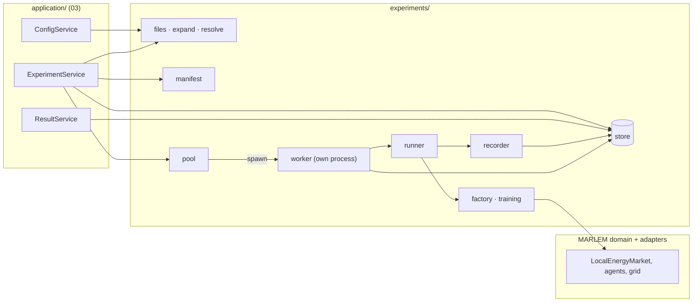
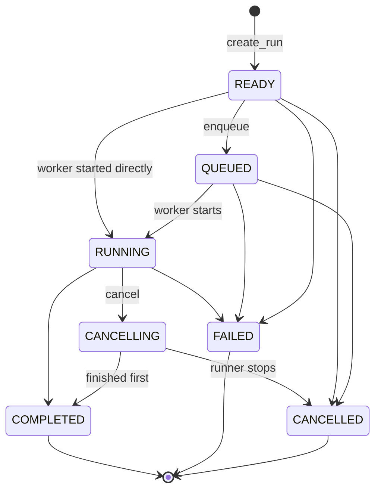
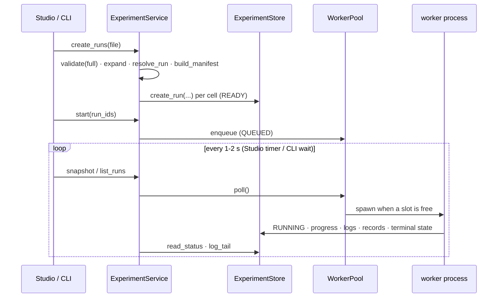

# 05. Experiment layer

> `src_thesis/experiments/`: from an experiment file to runs, run folders and worker processes. The application services (03) call it; it calls MARLEM only through the environment factory.
> Master: [README.md](README.md) · Experiment file: [02-experiment-config.md](02-experiment-config.md) · Services: [03-application-layer.md](03-application-layer.md) · Decisions: D-08, D-09, D-14.
> Written 2026-09-27. Code: [experiments/](../../../src_thesis/experiments/) · Tests: [tests/test_experiments.py](../../../tests/test_experiments.py).

<!-- BEGIN toc (python docs/toc.py) -->
## Contents

- [1. Place in the system and status](#1-place-in-the-system-and-status)
- [2. Records (models/records.py)](#2-records-modelsrecordspy)
- [3. Functions](#3-functions)
  - [3.1 Files (models/files.py)](#31-files-modelsfilespy)
  - [3.2 Runs of a file (models/expand.py)](#32-runs-of-a-file-modelsexpandpy)
  - [3.3 Resolution (models/resolve.py)](#33-resolution-modelsresolvepy)
  - [3.4 Manifest (models/manifest.py)](#34-manifest-modelsmanifestpy)
  - [3.5 Store (store/filesystem.py)](#35-store-storefilesystempy)
  - [3.6 Step records (store/recorder.py)](#36-step-records-storerecorderpy)
  - [3.7 Environment factory (factory/environment.py)](#37-environment-factory-factoryenvironmentpy)
  - [3.8 RL configuration (factory/training.py)](#38-rl-configuration-factorytrainingpy)
  - [3.9 Runners (worker/runner.py)](#39-runners-workerrunnerpy)
  - [3.10 Worker (worker/process.py)](#310-worker-workerprocesspy)
  - [3.11 Pool (worker/pool.py)](#311-pool-workerpoolpy)
- [4. Run lifecycle](#4-run-lifecycle)
- [5. How the services use it](#5-how-the-services-use-it)
- [6. Tests (tests/test_experiments.py)](#6-tests-teststest_experimentspy)

<!-- END toc -->

## 1. Place in the system and status



Rules:
- `experiments/` never imports `application/` or `studio/`. The application layer imports `experiments/` and re-exports its models (`ExperimentFile`, `RunCell`, `RunState`) so callers keep one import path.
- Importing any module of `experiments/` loads no heavy package (Ray, torch, pandapower, simbench, NiceGUI). Heavy imports happen inside the functions that need them. A test checks this.
- Only the factory turns a file into live MARLEM objects; only the worker runs them.

| Module | Role | Status (2026-09-27) |
|---|---|---|
| [models/records.py](../../../src_thesis/experiments/models/records.py) | Records: experiment file, run cell, run state, manifest, status, artifact index | Implemented |
| [models/files.py](../../../src_thesis/experiments/models/files.py) | Load, save, canonical hash, schema migration, JSON Schema | Implemented |
| [models/expand.py](../../../src_thesis/experiments/models/expand.py) | Sweep points, overrides, cells, run IDs | Implemented |
| [models/resolve.py](../../../src_thesis/experiments/models/resolve.py) | Defaults, one run's world, day lists | Implemented; placement rules need the network (R3) |
| [models/manifest.py](../../../src_thesis/experiments/models/manifest.py) | Code, environment, data and platform fingerprints | Implemented |
| [store/filesystem.py](../../../src_thesis/experiments/store/filesystem.py) | Run folders, status, cancel flag, logs, metrics, step records, artifacts | Implemented |
| [store/recorder.py](../../../src_thesis/experiments/store/recorder.py) | Step records buffered per episode | Implemented; `StepRecord` fields fixed once the environment exists (R1, R4) |
| [factory/environment.py](../../../src_thesis/experiments/factory/environment.py) | Experiment file → `env_config` → environment | `build_env_config` implemented; `build_env`, `build_grid` wait for R1 / R4 |
| [factory/training.py](../../../src_thesis/experiments/factory/training.py) | `learning` → RLlib configuration | Interface only (validation stage D) |
| [worker/runner.py](../../../src_thesis/experiments/worker/runner.py) | What a worker runs: noop, baseline, training | Noop implemented; baseline and training wait for the factory |
| [worker/process.py](../../../src_thesis/experiments/worker/process.py) | Process entry point for one run | Implemented |
| [worker/pool.py](../../../src_thesis/experiments/worker/pool.py) | Start, watch, cancel and reconcile workers | Implemented |

The package has four parts, as in the layer diagram (README §2.1):

```text
experiments/
├── models/    records.py · files.py · expand.py · resolve.py · manifest.py
├── factory/   environment.py · training.py
├── store/     filesystem.py · recorder.py
└── worker/    runner.py · process.py · pool.py · __main__.py
```

The four earlier stubs (`factory_new.py`, `runner_new.py`, `store_new.py`, `worker_new.py`) were replaced by these modules.

[↑ Contents](#contents)

## 2. Records (models/records.py)

Code: [models/records.py](../../../src_thesis/experiments/models/records.py)

| Record | Fields | Written by | Notes |
|---|---|---|---|
| `ExperimentFile` | `schema_version`, `kind`, `meta` (`ExperimentMeta`), `time`, `grid`, `participants`, `market`, `dso`, `environment`, `learning`, `evaluation`, `baselines`, `sweep`, `resources`, `outputs` | the user / the Studio | Sections are dicts until each gets its typed model (02) |
| `RunCell` | `kind` (`train` · `baseline` · `noop`), `sweep_label`, `sweep_point`, `algorithm`, `paradigm`, `seed` | `expand` | For baselines `algorithm` is the baseline name and `paradigm` is `"-"` |
| `RunState` | `READY`, `QUEUED`, `RUNNING`, `COMPLETED`, `FAILED`, `CANCELLING`, `CANCELLED` | — | Transitions in §4 (`TRANSITIONS`, `can_transition`) |
| `Manifest` | `run_id`, `experiment_id`, `cell`, `created`, `file_hash`, `resolved_hash`, `code`, `environment`, `data`, `days`, `time_alignment`, `validation_hash`, `platform` | `build_manifest`, once | Never changed after creation (02 §5) |
| `StatusRecord` | `run_id`, `experiment_id`, `state`, `pid`, `created`, `started`, `updated`, `finished`, `progress`, `iteration`, `last_metrics`, `message` | store (worker, pool) | `status.json`, replaced atomically |
| `ArtifactIndex` | `files`: name → path in the run folder | worker | `artifacts.json` |

[↑ Contents](#contents)

## 3. Functions

### 3.1 Files (models/files.py)

Code: [models/files.py](../../../src_thesis/experiments/models/files.py)

| Function | Input → output | Notes |
|---|---|---|
| `parse(text)` | JSON text → `ExperimentFile` | Migrates, then validates |
| `load(path)` | path → `ExperimentFile` | |
| `dumps(file)` | → str | Pretty JSON in field order, for people |
| `save(file, path)` | → `Path` | Atomic |
| `canonical_json(file_or_dict)` / `canonical_hash(...)` | → str | Sorted keys, compact; sha256. Same study = same hash (02 §6) |
| `migrate(data)` | raw dict → raw dict at `SCHEMA_VERSION` | Steps through `MIGRATIONS`; unknown versions raise |
| `json_schema()` | → dict | For editor autocompletion |
| `atomic_write_text(path, text)` | → `Path` | Temp file in the same folder, then `os.replace` |

### 3.2 Runs of a file (models/expand.py)

Code: [models/expand.py](../../../src_thesis/experiments/models/expand.py)

| Function | Input → output | Notes |
|---|---|---|
| `sweep_points(file)` | → `[SweepPoint(label, overrides)]` | `grid` = Cartesian product, `zip` = paired lists; no sweep = one empty point |
| `apply_overrides(file, overrides)` | dotted path → value → new `ExperimentFile` | E.g. `{"market.mechanism": "buyer"}` |
| `expand(file)` | → `[RunCell]` | Sweep points × paradigms × algorithms × seeds, plus sweep points × baselines × seeds |
| `run_id(experiment_id, cell, file_hash)` | → str | `<meta.id>__<sweep-label>__<algo>-<paradigm>__s<seed>__<hash8>`; baselines use their name instead of `algo-paradigm` |

### 3.3 Resolution (models/resolve.py)

Code: [models/resolve.py](../../../src_thesis/experiments/models/resolve.py)

| Function | Input → output | Notes |
|---|---|---|
| `resolve(file)` | → `ExperimentFile` | Fills every unset field from `DEFAULTS` (02 §3); set values win. Placement rules raise until R3 |
| `resolve_run(file, cell)` | → `ExperimentFile` | Applies the sweep point, resolves, fixes `learning` to the cell. Stored as `resolved.json` |
| `resolve_days(time_section)` | → `DaySplit(train, eval)` | `fixed`: the same date for both. `range` / `sampler`: filters (season, months, day type), then a seeded hold-out share or list for evaluation, disjoint from training |

### 3.4 Manifest (models/manifest.py)

Code: [models/manifest.py](../../../src_thesis/experiments/models/manifest.py)

| Function | Input → output | Notes |
|---|---|---|
| `build_manifest(file, resolved, cell, run_id, validation_hash=None)` | → `Manifest` | Both hashes, day lists, fingerprints |
| `code_fingerprint()` | → `{commit, dirty, diff_sha256}` | From git |
| `environment_fingerprint()` | → `{python, packages}` | Package versions from metadata, without importing them |
| `data_fingerprint(resolved)` | → `{network, files}` | sha256 of every `path` the world names (CSVs, pandapower files) |

### 3.5 Store (store/filesystem.py)

Code: [store/filesystem.py](../../../src_thesis/experiments/store/filesystem.py)

```text
<store>/                                  # configurable; default outside OneDrive
├── index.json                            # cache; rebuild_index() rewrites it
└── runs/<run_id>/
    ├── experiment.json  resolved.json  manifest.json
    ├── status.json  artifacts.json  cancel.request?
    ├── logs/        worker.log, worker.stdout
    ├── metrics/     training.csv, evaluation.jsonl
    ├── raw/         steps.jsonl (per step, if outputs.record_steps asks)
    ├── checkpoints/
    └── figures/     (derived; regenerable)
```

| Method of `ExperimentStore(root)` | Input → output | Notes |
|---|---|---|
| `run_dir(run_id)` / `exists(run_id)` | → `Path` / bool | |
| `create_run(file, resolved, manifest)` | → `Path` | Writes the folder in state READY; raises `RunExistsError` if it exists |
| `read_file` / `read_resolved` / `read_manifest(run_id)` | → records | |
| `read_status(run_id)` | → `StatusRecord` | |
| `set_state(run_id, state, **fields)` | → `StatusRecord` | Checks the state machine (`IllegalTransitionError`); stamps `started` / `finished` |
| `update_progress(run_id, progress, iteration, metrics)` | → `StatusRecord` | Progress clipped to 0..1 |
| `list_runs(experiment_id, state)` | → `[StatusRecord]` | Scans folders, oldest first |
| `rebuild_index()` | → dict | |
| `request_cancel(run_id)` / `cancel_requested(run_id)` | → None / bool | The `cancel.request` file |
| `append_log(run_id, line)` / `log_tail(run_id, lines)` | → None / `[str]` | Timestamped |
| `append_metrics_row(run_id, name, row)` | → None | CSV; the first row fixes the header |
| `append_jsonl` / `read_jsonl(run_id, relative_path, …)` | → None / iterator | Step records, evaluation outcomes |
| `write_artifacts(run_id, files)` / `read_artifacts(run_id)` | → `ArtifactIndex` | Merges names |

Small state files are replaced atomically; streams are append-only. RL learning metrics (`metrics/training.csv`, RLlib's own files) and research outcomes (`metrics/evaluation.jsonl`: served and unmet demand, curtailment, P2P share, costs, violations, losses) are stored apart, so results never present reward as a proxy for outcomes.

### 3.6 Step records (store/recorder.py)

Code: [store/recorder.py](../../../src_thesis/experiments/store/recorder.py)

`StepRecord(episode, step, day, orders, trades, settlement, assessment, kpis, reward_components, rewards)` is built once per step by the environment, after settlement and the power flow; it is the single source for reward, observation, `info` and logging.

| Method of `EpisodeRecorder(store, run_id, mode)` | Input → output | Notes |
|---|---|---|
| `start_episode(episode, day, evaluation)` | → None | |
| `record(step_record)` | → None | Buffered only if `mode` keeps this episode (`all`, or `evaluation` and an evaluation episode) |
| `end_episode(outcomes)` | → None | Appends the buffered steps to `raw/steps.jsonl`; for evaluation episodes one line with the outcomes to `metrics/evaluation.jsonl` |

During RLlib training the environment runs inside env-runner processes, so the recorder is driven from an RLlib callback (`on_episode_step` / `on_episode_end`) in `factory/training.py`; episode-level outcomes also go to RLlib's custom metrics so they appear next to the return in `progress.csv`.

### 3.7 Environment factory (factory/environment.py)

Code: [factory/environment.py](../../../src_thesis/experiments/factory/environment.py)

| Function | Input → output | Notes |
|---|---|---|
| `build_env_config(resolved, cell, episode_seed)` | → dict | Plain data only: the resolved file, the cell, the seed (key `ENV_CONFIG_KEY`) |
| `build_env(env_config)` | → `LocalEnergyMarket` | Day from the day list → profiles (01 §3) → agents, batteries, DSO, `MarketConfig` → grid model → observation, reward, reputation, assessment mode. **R1 / R4** |
| `build_grid(resolved)` | → `GridModel` | `SimBenchGrid` for `grid.source` (01 §5). **R4** |

RLlib env runners call the factory inside each runner; a network or agents never travel in `env_config`.

### 3.8 RL configuration (factory/training.py)

Code: [factory/training.py](../../../src_thesis/experiments/factory/training.py)

| Function | Input → output | Notes |
|---|---|---|
| `build_algorithm_config(resolved, cell)` | → RLlib `AlgorithmConfig` | Algorithm parameters, paradigm module, rollouts, evaluation, checkpoints (02 §3.8–3.9); replaces the hard-coded blocks of `marl/train.py`. Checks I-49 and I-50. **Stage D** |
| `build_tuner_settings(resolved)` | → dict | Scheduler (`none` / PBT), stop criterion from `budget`, checkpoint settings. **Stage D** |

### 3.9 Runners (worker/runner.py)

Code: [worker/runner.py](../../../src_thesis/experiments/worker/runner.py)

`RunContext(store, run_id, resolved, manifest)` is what a runner sees: `cell`, `should_stop()` (cancel requested), `report(progress, iteration, metrics)`, `log(message)` and `recorder()`. A runner returns `RunOutcome(state, message, artifacts)` and never writes `status.json` itself.

| Runner (`RUNNERS[cell.kind]`) | Does | Status |
|---|---|---|
| `NoopRunner` (`noop`) | A few iterations that report progress and honour cancel; for tests and smoke checks | Implemented |
| `BaselineRunner` (`baseline`) | Scripted policies (`no_order`, `random`, `rule_based`, 02 §3.10) over the evaluation days, through `build_env` and `marl/baselines.py` | Waits for R1 / R4 |
| `TrainingRunner` (`train`) | RLlib training with evaluation; owns `ray.init` / `ray.shutdown` | Stage D |

### 3.10 Worker (worker/process.py)

Code: [worker/process.py](../../../src_thesis/experiments/worker/process.py)

`python -m src_thesis.experiments.worker --run-dir <store>/runs/<run_id>` → `main(argv)` → `run_one(run_dir)`:

1. read the manifest and `resolved.json`; a hash mismatch ends in FAILED (the file was edited after the manifest);
2. a cancel requested before start ends in CANCELLED;
3. set RUNNING with the process ID;
4. run `select_runner(cell)` with a `RunContext`;
5. any exception ends in FAILED, with the traceback in `logs/worker.log`;
6. shut Ray down if a runner started it (`finally`);
7. write the artifact index and the terminal state.

Exit code 0 for COMPLETED or CANCELLED, 1 otherwise.

### 3.11 Pool (worker/pool.py)

Code: [worker/pool.py](../../../src_thesis/experiments/worker/pool.py)

Lives in the process that owns `ExperimentService` (Studio or CLI) and is polled, not threaded. Closing the Studio never stops a worker.

| Function / method | Input → output | Notes |
|---|---|---|
| `spawn(run_dir)` | → `Popen` | Own process group on Windows (own session elsewhere); output to `logs/worker.stdout` |
| `WorkerPool(store, max_parallel)` | | `max_parallel` defaults to 1, because Ray runners already use the cores |
| `.enqueue(run_ids)` | → None | State QUEUED |
| `.poll()` | → `{run_id: RunState}` | Reaps finished workers (a worker that died without a terminal state → FAILED), starts queued runs while slots are free |
| `.cancel(run_id, force_after_s)` | → None | Queued: CANCELLED at once. Running: `cancel.request` + CANCELLING; optional kill after a timeout |
| `.wait_all(timeout_s)` | → None | Poll until idle (CLI, tests) |
| `reconcile(store)` | → `[run_id]` | On start-up: RUNNING / CANCELLING runs whose process is gone → FAILED |
| `pid_alive(pid)` | → bool | Windows: `OpenProcess` + `GetExitCodeProcess`; elsewhere `os.kill(pid, 0)` |

[↑ Contents](#contents)

## 4. Run lifecycle



Any non-terminal state may go to FAILED; terminal states are final. Invalid files never produce runs: validation happens before `create_run`.



[↑ Contents](#contents)

## 5. How the services use it

The application services are the only callers of this layer. Which service method calls which function here is listed once, from the services' side, in [03 §4](03-application-layer.md#4-what-each-real-service-calls). The services are still the demo implementations; wiring them to this layer is the next step of R7.

[↑ Contents](#contents)

## 6. Tests ([tests/test_experiments.py](../../../tests/test_experiments.py))

- Files: hash stable under reformatting and key order; save/load round trip; unknown schema version rejected.
- Expansion: 3 × 3 × 3 seeds = 27 cells; baselines add sweep points × baselines × seeds; a 5-mechanism sweep multiplies by 5; run-ID format.
- Resolution: defaults filled without overriding given values; the cell fixed in `learning`; the day sampler deterministic, filtered and disjoint.
- Store: state machine enforced, cancel flag, listing and index.
- Recorder: only evaluation episodes are written in `evaluation` mode.
- Worker: noop run completes; an edited `resolved.json` fails; cancel before start; a runner error ends in FAILED with its message.
- Pool: two runs as real subprocesses, one slot; `reconcile` marks a dead worker FAILED.
- Boundaries: importing the worker and pool loads no heavy package.

[↑ Contents](#contents)
