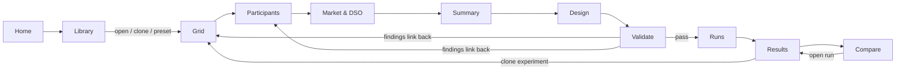

# 05. MARLEM Studio (NiceGUI)

> The structure of the web application: shell, pages, what each page contains, which services it calls and how pages lead into each other. This is structure, not visual design.
> Master: [README.md](README.md) · Services: [04-services.md](04-services.md).

## 1. Principles

- Pages call **services only** (04 §2). They never build environments, nets or Ray jobs.
- The Studio edits **one experiment file** (03). Its output is always a JSON that the CLI could run identically.
- Long work runs in the **worker**. Closing the browser never affects a run.
- Unvalidated options are shown **disabled with a reason**, never silently available.
- Research outcomes are always shown next to, and separately from, RL reward.

## 2. Shell (every page)

```text
┌──────────────────────────────────────────────────────────────────────────┐
│ Header: MARLEM Studio │ active draft: <experiment file>      │ validation │
│         badge (✓ / ⚠ / ✗) │ worker status (idle / running n) │ settings    │
├──────────────┬───────────────────────────────────────────────────────────┤
│ Navigation   │ Page content                                              │
│  Home        │                                                           │
│  BUILD       │                                                           │
│   Grid       │                                                           │
│   Participants│                                                          │
│   Market & DSO│                                                          │
│   Summary    │                                                           │
│  EXPERIMENT  │                                                           │
│   Design     │                                                           │
│   Validate   │                                                           │
│  RUN         │                                                           │
│   Runs       │                                                           │
│  ANALYSE     │                                                           │
│   Results    │                                                           │
│   Compare    │                                                           │
│  Library     │                                                           │
├──────────────┴───────────────────────────────────────────────────────────┤
│ Footer: notifications / last error with run ID and log link               │
└──────────────────────────────────────────────────────────────────────────┘
```

**Session state:**
- the current **draft experiment file** (typed). The BUILD pages edit its world sections; the EXPERIMENT pages edit its `learning`, `evaluation`, `baselines` and `sweep` sections;
- the selected run IDs.

Drafts autosave to the library (as experiment files), not to the browser, so a refresh loses nothing.

## 3. Page map and flow



The **BUILD** pages edit the world sections of one draft experiment file (`time`, `grid`, `participants`, `market`, `dso`, `environment`). They can be visited in any order, but they are laid out left to right as a guided sequence. **Validate** is the only gate to **Runs**.

## 4. Pages

### 4.1 Home (`/`)

| Region | Content | Services |
|---|---|---|
| Status | Repository and environment health (git dirty, deps, validation-plan progress) | `ResultService`, `ConfigService` |
| Recent | The last drafts and the last runs with their state | `ConfigService.list`, `ExperimentService.list_runs` |
| Start | "New from preset" (Cases 1–7 on SimBench), "Open file", "Import bundle" | `ConfigService.from_preset` |

### 4.2 Grid (`/build/grid`)

The purpose of this page is to choose the network and to understand it before placing agents.

| Region | Content | Services |
|---|---|---|
| Network source | `simbench` (code picker) · `pandapower_builtin` (e.g. IEEE 33-bus, CIGRE) · `pandapower_file` (upload JSON) | `GridCatalogService.list_networks` |
| Network picker | Filterable list of SimBench codes (voltage level, rural/semi-urban/urban, scenario 0/1/2, bus/load/PV counts) | `GridCatalogService.list_networks` |
| Topology view | Plotly network from geodata. Buses are coloured by element type; the transformer and external grid are marked. Clicking a bus shows its elements. | `GridCatalogService.topology`, `elements` |
| Element tables | Loads, sgens, storage: ID, bus, profile type, rated power | `GridCatalogService.summary` |
| Power-flow preview | Pick a day and step → run one power flow on the unmodified feeder; show voltage colouring, max loadings and violations | `GridCatalogService.preview_powerflow` |
| Limits and ratings | Voltage band, loading limits; ratings source when the network has none (rule or file) | writes the draft |

### 4.3 Participants (`/build/participants`)

The purpose of this page is to define the agents and tie them to buses and profiles (02 §3). This is the richest page.

| Region | Content | Services |
|---|---|---|
| Participant table | One row per agent: ID, role label, bus, owned elements, profile source (native, catalog, csv, synthetic), scaling, battery, capacity (derived) | writes the draft |
| Assignment tools | Add manually · apply rule ("N household+PV buses", "feeder ends", seeded) · import a mapping file · load the [P2] Table 6 roles | `ProfileService.suggest_mapping`, `apply_rule`, `import_mapping` |
| Map | The Grid page's topology with participant buses highlighted; click a bus to assign or unassign | `GridCatalogService.topology` |
| Time window | Resolution (15 min / hourly), day mode (fixed date / range / sampler with held-out share), seed | writes the draft |
| Profile preview | For the selected agent: generation, demand and net over the window; overlay of the background total | `ProfileService.preview` |
| Battery editor | Capacity, SoC limits, efficiencies, power limit, or "from owned storage" | writes the draft |
| Inline checks | Duplicate owner, bus mismatch, profile above `q_max`, shown as they happen | `ValidationService.validate` (partial) |

### 4.4 Market & DSO (`/build/market`)

| Region | Content |
|---|---|
| Market | Clearing mechanism, price and quantity bounds, partner preference (RL or rule-based), ledger difficulty |
| DSO | Tariff source (CSV / synthetic, normalised), fee factors and thresholds (congestion fees active only in feedback mode) |
| Environment | Observation and reward version with their weights, reputation weights, assessment mode (`shadow` / `feedback`), forecast error, async orders |
| Preview | Tariff curves over the time window, drawn beside the participants' net profile |

### 4.5 Summary (`/build/summary`)

A read-only summary of the draft:
- the counts: agents, batteries, energy balance per day;
- the JSON view and diff against its preset;
- **Save** / **Save as**, export as a bundle.

Services: `ConfigService.save`, `export_bundle`.

### 4.6 Design (`/experiment/design`)

| Region | Content |
|---|---|
| Sweep | Parameters to vary across runs (e.g. `market.mechanism`), grid or zip mode (03 §3.11) |
| Matrix | Algorithm × paradigm grid of checkboxes (default 3 × 3). Cells that aren't validated yet are disabled with a reason. |
| Algorithm parameters | One tab per selected algorithm (PPO, APPO, SAC) with its hyperparameters, pre-filled with the original defaults (03 §3.8) |
| Paradigm options | Reward aggregation (sum/mean), network model (`embeddings_dim`) |
| Tuning | None or PBT: population size, perturbation interval, mutation domains (checked to contain the initial values) |
| Seeds and budget | Seed list; budget in environment steps (the same for all cells) |
| Evaluation | Frequency, episodes, held-out days |
| Baselines | No-order, random, rule-based |
| Resources | CPUs per run, parallel runs |
| Run estimate | Number of runs and estimated time, from the stored benchmarks |

Services: `ConfigService.save`, `ExperimentService.expand`.

### 4.7 Validate (`/experiment/validate`)

| Region | Content |
|---|---|
| Report | Findings grouped by severity and area (schema, data, grid mapping, time, protocol, resources); each finding links to the page and field to fix |
| Dry run | Result of one simulated step through the factory: shapes, the first power flow, and settlement identities |
| Launch | Enabled only when there are no errors. Creates the runs and starts the worker, then goes to Runs. |

Services: `ValidationService.validate`, `ExperimentService.create_runs`, `start`.

### 4.8 Runs (`/runs`)

| Region | Content |
|---|---|
| Queue table | Runs grouped by experiment: cell, seed, state, progress, elapsed and ETA |
| Run drawer | Live log tail, current iteration, latest evaluation, resource use; **Cancel** |
| Filters | By experiment, state, network |

Services: `ExperimentService.list_runs`, `snapshot`, `cancel` (polled every 1–2 s).

### 4.9 Results (`/results/{run_id}`)

| Tab | Content | Services |
|---|---|---|
| Overview | Research outcomes (served/unmet demand, curtailment, P2P share, costs, violations, losses) beside RL return. Manifest and data status. | `ResultService.summary` |
| Learning | Training and evaluation curves; the baselines drawn as reference lines | `training_curve` |
| Episode replay | A step slider: orders → trades → settlement → grid assessment for one evaluation episode. Market view and grid view (voltage-coloured topology) side by side. | `step_records`, `grid_series` |
| Grid | Voltage band over time, loadings, violations per element, external-grid exchange | `grid_series` |
| Agents | Per-agent SoC, net injection, profit, reputation | `step_records` |
| Export | CSV/JSON of the raw series; publication figures | `export` |

### 4.10 Compare (`/compare`)

- **Matrix view** for an experiment: algorithm × paradigm heat table for any metric (mean ± std over seeds). This is the 3 × 3 result table.
- **Run overlay**: pick runs and overlay a metric (for example two feeders, or reward v1 vs v2). Runs with different reward versions are flagged as non-comparable.
- **Reference overlay**: the validated release's stored results (P2) for the same case, drawn as a reference. They are read from data files and are not re-run.

Services: `ResultService.matrix`, `compare`.

### 4.11 Library (`/library`)

- Experiment files and presets: open, clone, delete (drafts only), import and export bundles.
- Shows the provenance chain: preset → experiment file → runs.

## 5. Build order (P8)

1. **Shell + Runs + Results (Overview and Learning).** Read-only; proves the store and the service boundary.
2. **Grid page.** Proves the catalog and the power-flow preview without RL.
3. **Library + Summary + Market & DSO.** Load, edit and save presets.
4. **Participants.** Mapping and profile tools.
5. **Design + Validate + launch.**
6. **Results replay and Grid tabs, then Compare.**

Each step ends with a CLI-equivalence check: the experiment file saved by the Studio, run via the CLI, gives the same manifest hash.
