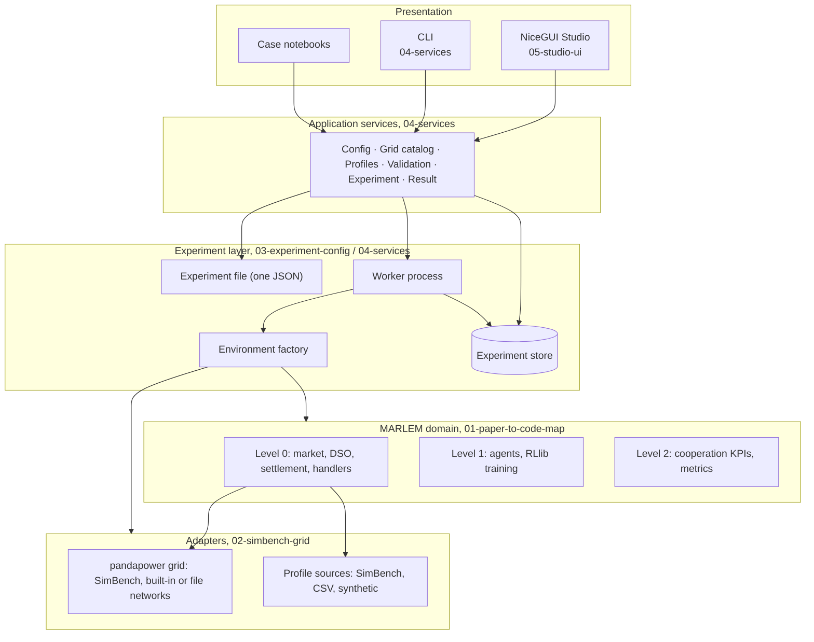

# MARLEM platform architecture (master)

> Status: target architecture, agreed direction, details open where marked **Decision**.
> Written: 2026-09-23 · Branch: `dev`
> Scope: everything *after* validation: the SimBench grid, experiment configuration, services, CLI and the NiceGUI Studio.
> The validation of the original MARLEM is planned in [../validation/plan-by-level.md](../validation/plan-by-level.md) and is a prerequisite for most of this.

## 1. Goal

1. **Validate** the original MARLEM (a paper-faithful corrected reimplementation) and publish it as a separate, tagged **validated MARLEM release**, with its reference results. That release keeps the paper's abstract NetworkX grid and is **not part of the tool**.
2. **Build the tool on SimBench + pandapower only.** The grid is a realistic AC power flow on real distribution feeders, with far more (and more realistic) load and generation profiles. The NetworkX grid is removed from the tool.
3. **Run all original experiments on the SimBench grid.** That means the 3 × 3 paradigm × algorithm matrix (Case 6) and the other case studies (Cases 1–7). They are compared against the validated release's stored results, not against a second runnable grid.
4. **Make experiments shareable and reproducible** through one versioned JSON experiment file, executable identically from the CLI, notebooks and the NiceGUI Studio.

## 2. System at a glance

**Rules of the whole system:**

1. **One way in.** UI, CLI and notebooks all go through the application services and one environment factory. Nothing builds a `LocalEnergyMarket` on its own.
2. **Files, not objects.** Only the versioned experiment JSON is persisted or shared. Live pandapower nets, agents and environments are built inside the process that uses them.
3. **The grid assesses; the market does not ask the grid.** The market clears economically. After settlement, one power flow per timestep assesses the resulting injections. Violations are fed back to the agents as observations and reward.
4. **One owner of the grid (D-13).** `LocalEnergyMarket` stays the central orchestrator and is the only holder of the grid model. Market components receive plain grid data as arguments (`GridTopologyInfo`, and `GridSignals` from step t−1) and never read or write the grid themselves (02 §5.1).
5. **One grid technology.** Every network (SimBench, pandapower built-in such as IEEE 33-bus or CIGRE, or a pandapower JSON file) goes through the same pandapower adapter.
6. **Heavy work runs in a worker process.** Ray/RLlib never runs inside the UI process.

## 3. Documents

Read in this order:

| # | Document | Answers |
|---|---|---|
| 01 | [01-paper-to-code-map.md](01-paper-to-code-map.md) | Where each [P1] Fig. 2 component lives in `src_thesis/`, and what changes for SimBench and the platform |
| 02 | [02-simbench-grid.md](02-simbench-grid.md) | Network sources, loading, assigning profiles to agents, the grid contract, and the file-by-file changes to MARLEM's step |
| 03 | [03-experiment-config.md](03-experiment-config.md) | The single experiment JSON: every section and field, including RL algorithms, training modes and hyperparameters; presets; sharing |
| 04 | [04-services.md](04-services.md) | Application services, environment factory, worker, experiment store and CLI commands |
| 05 | [05-studio-ui.md](05-studio-ui.md) | NiceGUI shell, every page, what it shows, which services it calls and how pages connect |

## 4. Roadmap

Each phase has an exit criterion.

| Phase | Content | Exit criterion | Doc |
|---|---|---|---|
| **P1 Validate original** | Steps A0–D3 in the validation plan | All 80 issues `fixed` / `decided` / `wontfix`. The evidence trace passes on the corrected code. | [validation](../validation/plan-by-level.md) |
| **P2 Validated release** | Tag and archive the validated MARLEM (NetworkX grid); run and store reference results for Cases 1–7 and the 3 × 3 matrix; write its release notes | Tagged release + stored reference results + list of corrections and decisions | 03 §8 |
| **P3 Grid seam + pandapower adapter** | Grid contracts, the settlement → injection builder, lossless market, SimBench / built-in / file network loading, profile catalogue, participant mapping, power flow → `GridAssessment`. The NetworkX grid is removed from the tool. | Adapter tests pass: mapping validation, 15-min/hourly alignment, injection signs, convergence, violations | 02 §2–§5 |
| **P4 SimBench, shadow mode** | Assessment runs inside the step and is recorded; rewards and observations unchanged | A full episode runs on SimBench; `env.step` cost measured | 02 §6 |
| **P5 SimBench in the loop** | Versioned observation and reward consume the assessment (violation feedback); KPIs re-sourced from power-flow results | Short training runs reduce violations versus no-order and random baselines | 02 §6–§7 |
| **P6 Experiment file** (can start with P3) | JSON schema, environment factory, presets for Cases 1–7 and the 3 × 3 matrix | Each preset validates and runs 1 episode from its JSON | 03 |
| **P7 Services, CLI, worker** | Application services, filesystem store, worker process, CLI | `marlem run <file>` executes a 3 × 3 smoke matrix end to end | 04 |
| **P8 Studio** | Read-only (Runs, Results, Grid) → editors → launch | An experiment built in the Studio produces a run identical to its CLI equivalent | 05 |
| **P9 Evidence runs** | Original experiments on SimBench; comparison with the P2 reference results; thesis figures | Results reproducible from the stored manifests | 03 §7 |

## 5. Decision log

| ID | Decision | Status | Where |
|---|---|---|---|
| D-01 | Grid assessment happens **after settlement**: one power flow per timestep, market not constrained. Agents learn from violation feedback (reward and observation) rather than being blocked. | **Agreed** (2026-09-23) | 02 §5–§6 |
| D-02 | The tool is **SimBench/pandapower only**. The validated original with its NetworkX grid is published separately (P2) and serves as the reference, not as a runnable backend. | **Agreed** (2026-09-23) | 02 §1 |
| D-03 | Integration goes in two stages: **shadow** (record only, P4) → **feedback** (observation and reward consume the assessment, P5). Each is a versioned mode. | Proposed | 02 §6 |
| D-04 | Keep MARLEM's file names and responsibilities. SimBench enters through a few new modules (contracts, injection builder, adapters) and small edits to existing files. | **Agreed** | 02 §7 |
| D-05 | The market is **lossless per trade**. Feeder losses are reported system-wide by the power flow and supplied via the external grid. | Proposed | 02 §5 |
| D-06 | Profile assignment defaults to `mapped_replacement`: agents replace the SimBench elements they own, and all other elements run as background with their own profiles. | Proposed | 02 §3 |
| D-07 | Paper-parity presets use **hourly aggregation** (24 steps), energy-consistent. Native 15-min (96 steps) is an extension. | Proposed | 02 §4, 03 §7 |
| D-08 | **One JSON file per experiment**. It contains the world (time, grid, participants, market, DSO, environment), the learning plan (algorithms, paradigms, hyperparameters, tuning, budget, seeds), evaluation, baselines and the sweep. Runs get a system-written manifest. | **Agreed** (2026-09-23) | 03 |
| D-09 | Services run in-process for UI and CLI. Ray runs only in a worker subprocess. The filesystem experiment store is the source of truth. | Proposed | 04 |
| D-10 | The canonical environment is the conda `marlem` env (`environment.yml`). pandapower 3.5.4 and simbench 1.6.2 are already installed. `pydantic` and `nicegui` are added after a compatibility check. | Proposed | 04 §7 |
| D-11 | Violation feedback reward: shared vs bus-attributed vs marginal credit assignment | **Open** | 02 §6 |
| D-12 | Non-convergent power flow during training: truncate with a fixed penalty vs fail the run | **Open** | 02 §6 |
| D-13 | **Grid ownership and data flow.** `LocalEnergyMarket` is the only holder of the `GridModel`. `OrderMatcher`, `DSOAgent` and `DERAgent` get `GridTopologyInfo` (static distances and zones) and `GridSignals` (step t−1) as arguments and never call the grid; KPIs, reward and observation use `GridAssessment[t]`. A read-only view is the accepted fallback. | **Agreed** (2026-09-27) | 02 §5.1 |

## 6. Glossary

| Term | Meaning |
|---|---|
| **Settlement** | Per agent and step: served demand, generation, curtailment, battery charge and discharge, imports, exports and cash. The output of the market step. |
| **Injection** | An agent's net active power at its bus, derived from settlement: production − consumption, in kW. It is **not** trades counted as loads. |
| **Assessment** | One power-flow result for one timestep: voltages, loadings, losses, external-grid exchange and violations |
| **Grid signals** | The few numbers the market may use from the previous step's assessment (max line loading, external-grid exchange); passed as an argument (02 §5.1) |
| **Topology info** | Static per network: electrical distance between buses and bus zones, computed once at reset and passed to the market (02 §5.1) |
| **Background** | Network loads and generators not owned by an agent. They follow their own profiles. |
| **Validated release** | The tagged, corrected original MARLEM with its NetworkX grid (P2). It is published separately and its stored results are the reference. |
| **Experiment file** | The single JSON describing one study (03) |
| **Preset** | A checked-in experiment file reproducing an original MARLEM case on SimBench |
