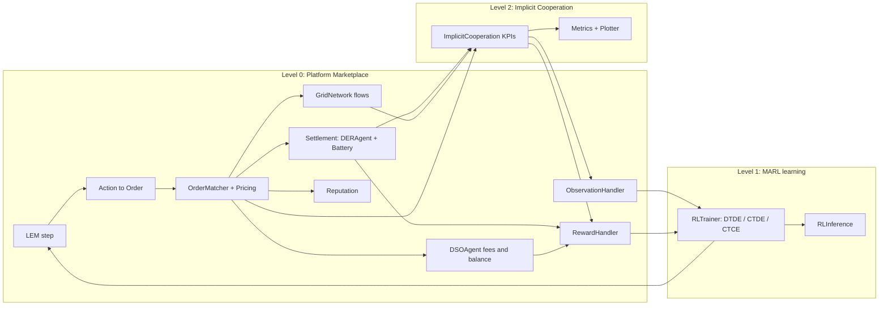

# MARLEM validation plan by level

> Status: **live work plan and issue tracker** for validating MARLEM in `src_thesis/`.
> Written: 2026-09-23 · Branch: `dev`
> The detail behind each issue (paper text, code behaviour, evidence) is in [marlem-paper-vs-code.md](paper-vs-code.md) under the same ID. Status is tracked **here only**.

## 1. How this plan is organised

The plan follows the three levels of [P1] Fig. 2 (the high-level class diagram), in the order **Level 0 → Level 2 → Level 1**:

| Fig. 2 level | Classes in Fig. 2 | `src_thesis/` location |
|---|---|---|
| **Level 0: Platform Marketplace** | `LEM`, `ObservationHandler`, `ActionHandler`, `RewardHandler`, `ReputationHandler`, `OrderMatcher`, `MarketConfig`, `ClearingMechanism`, `MatchingResult`, `Order`, `Trade`, `DSOAgent`, `GridNetwork`, `GridTopology`, `Location`, `Validator`, `TransactionBlock` | `marketplace/` (`lem.py`, `observation.py`, `action.py`, `reward.py`, `market/`, `dso/`, `grid/`), `adapters/grid/network.py` |
| **Level 1: MARL Agents** | `DERAgent`, `Battery`, `RLTrainer`, `RLInference`, `RLAlgorithm`, `TrainingMode` | `marl/` (`agents/`, `train.py`, `inference.py`, `base.py`, `ctce.py`, `ctde.py`) |
| **Level 2: Implicit Cooperation** | `ImplicitCooperation`, `CoordinationMetricsHandler`, `DSOMetricsHandler`, grid and market metrics handlers, `Plotter` | `cooperation/` (`implicit_cooperation.py`, `metrics/`, `visualization/`) |
| *Not in Fig. 2* | Profile handlers, CTCE/CTDE modules, `GroupedLEM`, config I/O | `adapters/profiles/`, `marl/`, `marketplace/io.py` |

**Two classes cross levels, so the plan moves them.** This keeps your Level 0 → 2 → 1 order while respecting what calls what:

- **`DERAgent` and `Battery` are Level 1 in Fig. 2 but are validated in Stage A.** `LEM.step` calls them to turn actions into orders and to settle energy. A market cannot be validated while its participants' energy and cash accounting is wrong. Only the *learning* part of Level 1 is left for last.
- **`ObservationHandler` and `RewardHandler` are Level 0 in Fig. 2 but are validated in Stage C, after Level 2.** Both consume the Level 2 KPIs.

**Stage order:** A (Level 0 core) → B (Level 2) → C (Level 0 observation and reward) → D (Level 1 learning).

**Rules for every step:**

1. Take the step's **decisions** first. These are Paper-origin issues the paper cannot settle; record each as a one-line rule plus reason, with status `decided`.
2. Write the step's **acceptance test** on a hand-sized case (2–3 agents, 1–3 periods). It must fail on the original code.
3. Port the minimal change (from `marlem-baseline` where it exists). Rerun the test and the evidence trace, and record a before/after.
4. Set the status to `fixed`. Move to the next step only when all of the step's issues are `fixed`, `decided` or `wontfix`.

**Code links** open the exact lines in `src_thesis/` as of 2026-09-23 (the original code). Line numbers shift once a step edits that file, so update the links when you close a step.

**Markers in the code.** Each issue location in `src_thesis/` carries a one-line comment directly above it. It uses the same ID and step as this plan:

- `# FAULT I-12 [A5] …` for ❌ issues (red)
- `# DEVIATION I-14 [A5] …` for ⚠️ issues (amber)
- `# DECIDE I-16 [A5] …` for ❓ issues, where the paper is silent (blue)

The Todo Tree extension highlights these lines, marks them on the scrollbar, and lists them all in its sidebar tree grouped by tag. An issue with several locations numbers its markers and points to the next one, e.g. `# FAULT I-12 [A5] (2/3; next marketplace/market/matching.py:368) …`; the last points back to the first. When an issue is fixed or decided, delete its marker in the same commit. The doc links point to the code line *below* each marker. The markers were inserted on 2026-09-24, and every link was shifted to match.

**Status values:** `open` → `agreed` (plan and test agreed) → `fixed` / `decided` / `wontfix`.

**Origin:** Paper = the paper's method is unsound or silent. Fidelity = the code deviates from the paper. Code = an internal code defect where the paper is silent.
**Type:** ❌ defect · ⚠️ deviation · ❓ decision needed.

## 2. Root causes that cross levels

Fixing these early clears symptoms in later levels. Check the downstream rows again after the root is fixed; several will close without separate work.

| Root cause (step) | Downstream symptoms |
|---|---|
| I-12: orders mutated in matching (A5) | I-43 reward terms constant (C2). KPIs and info see residuals (B1). |
| I-24: DSO balance ≡ 0 (A6) | I-44 grid reward and DSO penalty inactive (C2). I-38 reputation grid term neutral (A9). Grid-balance observation (C1). |
| I-01: 23-step horizon (A1) | I-02 terminal penalty never applied (C2) |
| I-27: profit never updated (A8) | "Mean profit" observation ≡ 0 (C1) |
| I-18 to I-20: battery sign and efficiency (A8) | Flexibility-utilisation KPI (B1). Battery observations (C1). [P1] Case 5 results. |
| I-32, I-33: grid flows (A7) | Congestion KPI (B1), congestion fee (A6), `f_coop` (C2) |
| I-35, I-68: imbalance definition (B1) | Coordination score (B1). `f_coop` (C2). [P2]'s headline metric. |
| I-36, I-75: unnormalised welfare and `f_coop` (B1, C2) | I-41 `f_coop` ≈ 1811 (C2) |
| I-48: CTDE actor never trained (D1) | Every CTDE result |

## 3. Stage A: Level 0, Platform Marketplace

Market, DSO, grid, ledger and the episode loop, plus the two Level 1 classes that Level 0 physically calls (`DERAgent` action/settlement, `Battery`). The goal is that one hand-sized period produces correct orders, trades, prices, energy, cash and grid state.

### A0. Test harness

- **Components:** — (repository)
- **Why here:** A working `pytest` gate with real assertions, so every later step can add a test that fails before its fix.
- **Decisions needed first:** none
- **Acceptance test:** `pytest -q` collects and runs. A deliberately broken assertion fails.

| ID | Origin | Type | Issue | Code | Ev. | § | Status |
|---|---|---|---|---|---|---|---|
| I-52 | Code | ❌ | No functioning test gate: tests without assertions, fixtures that fail, signatures that have drifted | [test_battery.py:L13-L62](../../../tests/test_battery.py#L13-L62) [test_checkpoint.py](../../../tests/test_checkpoint.py) | — | — | open |
| I-53 | Code | ⚠️ | Defensive checks hide bad state (dead capacity check, bare `except`, float-only validators, mutable defaults) | [network.py:L39](../../../src_thesis/adapters/grid/network.py#L39) [network.py:L98-L99](../../../src_thesis/adapters/grid/network.py#L98-L99) [base.py:L57](../../../src_thesis/marketplace/grid/base.py#L57) | — | — | open |

### A1. Episode loop

- **Components:** `LEM` (`reset`, `step`)
- **Why here:** The episode contract everything else sits on: horizon, terminal flag, seeding.
- **Decisions needed first:** none
- **Acceptance test:** `max_steps = 24` gives 24 `step` calls. Only the last returns `terminated`, and it passes `is_terminal=True` to the reward. The same seed replays the episode exactly; `seed=None` advances.

| ID | Origin | Type | Issue | Code | Ev. | § | Status |
|---|---|---|---|---|---|---|---|
| I-01 | Fidelity | ❌ | Only 23 of 24 periods run: termination is checked after the step increment against `max_steps − 1` | [lem.py:L459-L469](../../../src_thesis/marketplace/lem.py#L459-L469) | T1 | 2.11 | open |
| I-02 | Fidelity | ❌ | `is_terminal` is never true, so the terminal unmet-demand penalty never applies | [lem.py:L444](../../../src_thesis/marketplace/lem.py#L444) [reward.py:L216-L223](../../../src_thesis/marketplace/reward.py#L216-L223) | T2 | 2.10 | open |
| I-03 | Code | ⚠️ | `reset(seed=None)` falls back to the config seed, so every episode is identical | [lem.py:L276-L278](../../../src_thesis/marketplace/lem.py#L276-L278) | C | 2.11 | open |
| I-04 | Code | ⚠️ | `LocalEnergyMarket.seed()` is shadowed by the `self.seed` attribute | [lem.py:L69](../../../src_thesis/marketplace/lem.py#L69) [lem.py:L525-L532](../../../src_thesis/marketplace/lem.py#L525-L532) | C | 2.11 | open |
| I-78 | Fidelity | ⚠️ | Invalid actions raise `ValueError` instead of being dropped (Alg. 1 `ValidateOrder`) | [lem.py:L349-L350](../../../src_thesis/marketplace/lem.py#L349-L350) | C | 2.2 | open |

### A2. Inputs: profiles and units

- **Components:** Profile handlers (not in Fig. 2)
- **Why here:** The data every level consumes. Units and Δt are decided here once.
- **Decisions needed first:** I-56
- **Acceptance test:** Profiles supplied to an agent survive `reset()` (or the override is explicit). One CSV column maps to one agent deterministically. Units are stated per quantity.

| ID | Origin | Type | Issue | Code | Ev. | § | Status |
|---|---|---|---|---|---|---|---|
| I-05 | Code | ⚠️ | Profiles passed to `DERAgent(...)` are overwritten at `reset()` | [lem.py:L285-L299](../../../src_thesis/marketplace/lem.py#L285-L299) | T11 | 2.11 | open |
| I-06 | Fidelity | ⚠️ | CSV profiles use a random column and random scale per reset. Procedural G is additive, not eq. 17's multiplicative form | [base.py:L32-L44](../../../src_thesis/adapters/profiles/base.py#L32-L44) [der.py:L120-L132](../../../src_thesis/adapters/profiles/der.py#L120-L132) [der.py:L174-L200](../../../src_thesis/adapters/profiles/der.py#L174-L200) | C | 2.11 | open |
| I-56 | Paper | ❓ | Units and timestep are inconsistent (W/kW/kWh/Wh, $/Wh vs $/kWh). There is no explicit Δt | [der.py:L36](../../../src_thesis/marl/agents/der.py#L36) [matching.py:L35-L38](../../../src_thesis/marketplace/market/matching.py#L35-L38) | — | — | open |

### A3. Action → order

- **Components:** `ActionHandler`, `DERAgent.adjust_action_for_battery` (Level 1 in Fig. 2), `Order`
- **Why here:** Pulled forward from Level 1 because `LEM.step` calls it before the market.
- **Decisions needed first:** I-11
- **Acceptance test:** For G = 5, D = 30, SoC headroom h and α ∈ {0, 1}: the order quantity equals eq. 15's `q_buy,max` / `q_sell,max` (or the decided rule). α = 0.3 is a sell everywhere.

| ID | Origin | Type | Issue | Code | Ev. | § | Status |
|---|---|---|---|---|---|---|---|
| I-08 | Fidelity | ❌ | Feasibility clipping does not implement eq. 15: it treats the requested `q` as the need | [der.py:L202-L234](../../../src_thesis/marl/agents/der.py#L202-L234) | C | 2.1 | open |
| I-09 | Fidelity | ❌ | `is_buy` is truthy in `adjust_action_for_battery` but `> 0.5` in `step`, so the order is sized for the wrong direction | [der.py:L202](../../../src_thesis/marl/agents/der.py#L202) [lem.py:L366](../../../src_thesis/marketplace/lem.py#L366) | T8 | 2.1 | open |
| I-10 | Fidelity | ⚠️ | β = "no preference" is reachable only at the exact upper bound | [action.py:L36-L45](../../../src_thesis/marketplace/action.py#L36-L45) [action.py:L70-L91](../../../src_thesis/marketplace/action.py#L70-L91) [lem.py:L368](../../../src_thesis/marketplace/lem.py#L368) | C | 2.1 | open |
| I-11 | Paper | ❓ | No "submit nothing" action when `q_min > 0` | [der.py:L238-L239](../../../src_thesis/marl/agents/der.py#L238-L239) | — | 2.1 | open |
| I-77 | Fidelity | ⚠️ | Rule-based partner selection is a lexicographic sort plus a random top-half pick, not a weighted score | [der.py:L140-L163](../../../src_thesis/marl/agents/der.py#L140-L163) [lem.py:L372-L375](../../../src_thesis/marketplace/lem.py#L372-L375) | C | 2.2 | open |

### A4. Pricing

- **Components:** `MarketConfig`, `ClearingMechanism`
- **Why here:** The smallest pure functions in the model. A good first fix.
- **Decisions needed first:** none
- **Acceptance test:** For every mechanism with buy = 200, sell = 50, ref = 100: the expected value from eq. 9–11 (check eq. 11 against the rendered PDF).

| ID | Origin | Type | Issue | Code | Ev. | § | Status |
|---|---|---|---|---|---|---|---|
| I-13 | Fidelity | ❌ | `SELLER` pricing returns the buyer's price (positional-argument bug) | [mechanism.py:L70-L85](../../../src_thesis/marketplace/market/mechanism.py#L70-L85) [matching.py:L330-L332](../../../src_thesis/marketplace/market/matching.py#L330-L332) | T6 | 2.3 | open |
| I-17 | Fidelity | ❌ | `BID_ASK_SPREAD` pricing receives `market_price` as `factor`, so it returns the buyer's price. The mechanism is also absent from §3.3.3 | [mechanism.py:L89-L113](../../../src_thesis/marketplace/market/mechanism.py#L89-L113) [matching.py:L330-L332](../../../src_thesis/marketplace/market/matching.py#L330-L332) | T12 | 2.3 | open |

### A5. Matching

- **Components:** `OrderMatcher`, `MatchingResult`, `Trade`
- **Why here:** Stages 1–3 of Algorithm 1.
- **Decisions needed first:** I-15, I-16
- **Acceptance test:** A hand case with 2 sellers and 1 buyer at known prices gives the expected trades, quantities and clearing price. Submitted orders are unchanged after matching.

| ID | Origin | Type | Issue | Code | Ev. | § | Status |
|---|---|---|---|---|---|---|---|
| I-12 | Code | ❌ | Orders are mutated in place, so the reward, KPIs and info see residual quantities (0), not submitted ones | [matching.py:L370-L371](../../../src_thesis/marketplace/market/matching.py#L370-L371) [dso.py:L215-L256](../../../src_thesis/marketplace/dso/dso.py#L215-L256) [lem.py:L437-L445](../../../src_thesis/marketplace/lem.py#L437-L445) | T3 | 2.2 | open |
| I-14 | Fidelity | ⚠️ | P2P loss is topped up from the DSO. The buyer's `energy_bought` counts `q + loss` | [matching.py:L370](../../../src_thesis/marketplace/market/matching.py#L370) [lem.py:L404-L423](../../../src_thesis/marketplace/lem.py#L404-L423) | C | 2.2 | open |
| I-15 | Paper | ❓ | Stage 1 clears DSO-preferred orders with the DSO before any P2P matching | [matching.py:L635-L663](../../../src_thesis/marketplace/market/matching.py#L635-L663) | — | 2.2 | open |
| I-16 | Paper | ❓ | The clearing price is a VWAP that includes DSO trades | [matching.py:L410](../../../src_thesis/marketplace/market/matching.py#L410) | — | 2.2 | open |
| I-54 | Code | ⚠️ | DSO fallback skips grid feasibility (zero distance, loss and fee), and `validate_grid_constraints` ignores direction | [dso.py:L192-L275](../../../src_thesis/marketplace/dso/dso.py#L192-L275) [dso.py:L356-L401](../../../src_thesis/marketplace/dso/dso.py#L356-L401) | — | 2.2 | open |
| I-55 | Code | ❌ | The Stage-2 capacity check uses `max_quantity·N` and the current balance, not grid capacity or the projected trade | [matching.py:L174](../../../src_thesis/marketplace/market/matching.py#L174) [matching.py:L317-L318](../../../src_thesis/marketplace/market/matching.py#L317-L318) | C | 2.2 | open |

### A6. DSO: balance and fees

- **Components:** `DSOAgent`
- **Why here:** The DSO's balance (eq. 7) and fees (eq. 8).
- **Decisions needed first:** I-29, I-74
- **Acceptance test:** `B_DSO` after one step equals `Σ(E_sold − E_bought)` over DSO trades, with one sign convention. Each fee term matches eq. 8 on a hand case, and the total is charged to the decided payer.

| ID | Origin | Type | Issue | Code | Ev. | § | Status |
|---|---|---|---|---|---|---|---|
| I-24 | Fidelity | ❌ | `dso.balance` changes only on Stage-1 DSO-preferred trades and carries across steps, so it is ≡ 0 by default | [matching.py:L275-L283](../../../src_thesis/marketplace/market/matching.py#L275-L283) [matching.py:L398](../../../src_thesis/marketplace/market/matching.py#L398) | T4 | 2.4 | open |
| I-25 | Code | ❓ | The B_DSO sign convention is inconsistent between `match_orders` and `_match_preferred_partners` | [matching.py:L275-L283](../../../src_thesis/marketplace/market/matching.py#L275-L283) [matching.py:L656-L663](../../../src_thesis/marketplace/market/matching.py#L656-L663) | C | 2.4 | open |
| I-28 | Fidelity | ❌ | Grid fees are computed but never charged to anyone | [dso.py:L350-L351](../../../src_thesis/marketplace/dso/dso.py#L350-L351) [matching.py:L340-L353](../../../src_thesis/marketplace/market/matching.py#L340-L353) | C | 2.4 | open |
| I-29 | Paper | ❓ | `F_trans` has no formula in the paper; the code uses 0 | [dso.py:L297](../../../src_thesis/marketplace/dso/dso.py#L297) | — | 2.4 | open |
| I-30 | Fidelity | ⚠️ | `F_volt` and `F_thermal` caps (0.2, 0.3) differ from or are undefined in the paper | [dso.py:L332-L339](../../../src_thesis/marketplace/dso/dso.py#L332-L339) | C | 2.4 | open |
| I-31 | Fidelity | ⚠️ | `F_imb` is effectively always 0 | [dso.py:L343-L346](../../../src_thesis/marketplace/dso/dso.py#L343-L346) [dso.py:L403-L451](../../../src_thesis/marketplace/dso/dso.py#L403-L451) | C | 2.4 | open |
| I-74 | Paper | ⚠️ | Thermal-fee threshold (20 %) sits below the congestion threshold (80 %) | [dso.py:L66-L68](../../../src_thesis/marketplace/dso/dso.py#L66-L68) | — | 2.4 | open |

### A7. Grid

- **Components:** `GridNetwork`, `GridTopology`, `Location`
- **Why here:** Graph, losses and congestion (eq. 18–19).
- **Decisions needed first:** I-70
- **Acceptance test:** IEEE-34 is connected. Flows at the start of a period are the decided baseline. After one trade of `q` along a known path, each edge flow and the congestion match a hand calculation.

| ID | Origin | Type | Issue | Code | Ev. | § | Status |
|---|---|---|---|---|---|---|---|
| I-32 | Fidelity | ❌ | Only Stage-1 trades update edge flows | [matching.py:L603](../../../src_thesis/marketplace/market/matching.py#L603) [matching.py:L286-L379](../../../src_thesis/marketplace/market/matching.py#L286-L379) | C | 2.6 | open |
| I-33 | Fidelity | ❌ | Edge flows start random and accumulate over the episode instead of being per period | [network.py:L87](../../../src_thesis/adapters/grid/network.py#L87) [network.py:L330](../../../src_thesis/adapters/grid/network.py#L330) | T10 | 2.6 | open |
| I-34 | Code | ⚠️ | Loss factor κ = 0.03 is hard-coded | [network.py:L338-L355](../../../src_thesis/adapters/grid/network.py#L338-L355) | C | 2.6 | open |
| I-57 | Fidelity | ❌ | IEEE-34 graph is disconnected (edge 832–888 missing), and the impedance table is unused | [config.py:L30-L40](../../../src_thesis/marketplace/grid/config.py#L30-L40) [config.py:L45-L77](../../../src_thesis/marketplace/grid/config.py#L45-L77) [network.py:L137](../../../src_thesis/adapters/grid/network.py#L137) | T13 | 2.6 | open |
| I-70 | Paper | ❓ | Grid physics scope: linear unbounded losses, `V_drop = f·d`, transport flows. "High-fidelity" is an overclaim | [network.py:L338-L355](../../../src_thesis/adapters/grid/network.py#L338-L355) [dso.py:L332-L334](../../../src_thesis/marketplace/dso/dso.py#L332-L334) | — | 3 | open |

### A8. Settlement: energy and cash

- **Components:** `DERAgent` accounting, `Battery` (Level 1 in Fig. 2)
- **Why here:** Pulled forward from Level 1 because settlement is a Level 0 physical outcome. This is where conservation lives.
- **Decisions needed first:** I-22, I-71
- **Acceptance test:** Per agent and step, `G + imports + discharge = served D + exports + charge + curtailment`. Profit (eq. 14) changes by `Σ p·q` minus fees. Selling with G = D discharges. The battery respects SoC limits, η and any decided power limit. `B_grid` (eq. 20) is computed.

| ID | Origin | Type | Issue | Code | Ev. | § | Status |
|---|---|---|---|---|---|---|---|
| I-18 | Fidelity | ❌ | Battery dispatch has the trade term's sign reversed: selling charges the battery | [der.py:L302-L314](../../../src_thesis/marl/agents/der.py#L302-L314) | T7 | 2.5 | open |
| I-19 | Fidelity | ❌ | A charge is refused entirely if it would reach SoC_max; there is no partial fill | [battery.py:L96-L112](../../../src_thesis/marl/agents/battery.py#L96-L112) [battery.py:L134-L159](../../../src_thesis/marl/agents/battery.py#L134-L159) | C | 2.5 | open |
| I-20 | Fidelity | ❌ | Discharge efficiency is applied in the wrong direction (`·η` instead of `/η`) | [battery.py:L162-L180](../../../src_thesis/marl/agents/battery.py#L162-L180) | C | 2.5 | open |
| I-21 | Code | ⚠️ | Demand satisfaction ignores battery discharge | [der.py:L258-L270](../../../src_thesis/marl/agents/der.py#L258-L270) | C | 2.5 | open |
| I-22 | Paper | ❓ | No household energy-conservation identity is enforced | [lem.py:L402-L423](../../../src_thesis/marketplace/lem.py#L402-L423) | — | 2.5 | open |
| I-23 | Fidelity | ❌ | `B_grid` (eq. 20) is never computed. The "grid balance" observation is `dso.balance` | [lem.py:L489](../../../src_thesis/marketplace/lem.py#L489) [observation.py:L287](../../../src_thesis/marketplace/observation.py#L287) | C | 2.6 | open |
| I-26 | Fidelity | ⚠️ | `agent.balance = sold − bought`, not eq. 13 | [lem.py:L455](../../../src_thesis/marketplace/lem.py#L455) [matching.py:L453-L472](../../../src_thesis/marketplace/market/matching.py#L453-L472) | C | 2.5 | open |
| I-27 | Fidelity | ❌ | Agent profit (eq. 14) is never updated | [der.py:L63](../../../src_thesis/marl/agents/der.py#L63) [der.py:L112](../../../src_thesis/marl/agents/der.py#L112) [observation.py:L347](../../../src_thesis/marketplace/observation.py#L347) | T5 | 2.5 | open |
| I-71 | Paper | ❓ | Battery model has no charge/discharge power limit (claimed in the text), and eq. 15 ignores efficiency | [battery.py:L134-L180](../../../src_thesis/marl/agents/battery.py#L134-L180) [battery.py:L210-L219](../../../src_thesis/marl/agents/battery.py#L210-L219) | — | 2.5 | open |

### A9. Reputation

- **Components:** `ReputationHandler`
- **Why here:** Eq. 12. Used as the tie-break in Stage 2.
- **Decisions needed first:** none
- **Acceptance test:** On a hand case, each of the three components and the decayed score match a hand calculation. Agents' initial reputations are independent draws.

| ID | Origin | Type | Issue | Code | Ev. | § | Status |
|---|---|---|---|---|---|---|---|
| I-07 | Code | ⚠️ | All agents get the same initial reputation (the RNG is reseeded before each draw) | [lem.py:L289](../../../src_thesis/marketplace/lem.py#L289) [reputation.py:L57-L69](../../../src_thesis/marketplace/market/reputation.py#L57-L69) | C | 2.7 | open |
| I-38 | Code | ⚠️ | Reputation: reliability ≡ 1, the grid term is neutral, and decay is weighted by time of day | [reputation.py:L132](../../../src_thesis/marketplace/market/reputation.py#L132) [reputation.py:L89](../../../src_thesis/marketplace/market/reputation.py#L89) | C | 2.7 | open |

### A10. Ledger

- **Components:** `Validator`, `TransactionBlock`
- **Why here:** Audit chain only; no effect on outcomes.
- **Decisions needed first:** none
- **Acceptance test:** The block hash covers every settlement field. Tampering with a fee breaks `verify_chain()`.

| ID | Origin | Type | Issue | Code | Ev. | § | Status |
|---|---|---|---|---|---|---|---|
| I-66 | Code | ⚠️ | The block hash omits loss and fees, and blocks are forced every step (in-memory PoW, not consensus) | [validation.py:L26-L35](../../../src_thesis/marketplace/market/validation.py#L26-L35) [matching.py:L422](../../../src_thesis/marketplace/market/matching.py#L422) | — | 2.2 | open |

## 4. Stage B: Level 2, Implicit Cooperation

The KPIs computed from Stage A's outcomes. They can only be validated once A is correct, because they are functions of its output.

### B1. Cooperation KPIs

- **Components:** `ImplicitCooperation`
- **Why here:** The 10 shared KPIs (eq. 21–27) that feed both the observation and the reward.
- **Decisions needed first:** I-36, I-68, I-69
- **Acceptance test:** On a fixed hand episode (from A5–A8), each KPI matches its decided definition and range. None is identically 0 or unbounded by construction.

| ID | Origin | Type | Issue | Code | Ev. | § | Status |
|---|---|---|---|---|---|---|---|
| I-35 | Fidelity | ❌ | "Supply-demand imbalance" is volume/C, not `\|Σbuy − Σsell\|/C`. The coordination score inherits this | [implicit_cooperation.py:L127-L128](../../../src_thesis/cooperation/implicit_cooperation.py#L127-L128) [implicit_cooperation.py:L147-L148](../../../src_thesis/cooperation/implicit_cooperation.py#L147-L148) | C | 2.8 | open |
| I-36 | Paper | ❓ | Social welfare is turnover `Σ p·q`, not surplus | [implicit_cooperation.py:L95](../../../src_thesis/cooperation/implicit_cooperation.py#L95) | — | 2.8 | open |
| I-37 | Fidelity | ⚠️ | Price volatility is computed over the whole episode, not a window | [implicit_cooperation.py:L107-L108](../../../src_thesis/cooperation/implicit_cooperation.py#L107-L108) | C | 2.8 | open |
| I-68 | Paper | ❓ | Imbalance (eq. 24) over trades is ≡ 0 by construction. Needs a definition over orders or physical net positions, and a timing (before or after DSO clearing) for `B_grid` | [implicit_cooperation.py:L127-L128](../../../src_thesis/cooperation/implicit_cooperation.py#L127-L128) | — | 3 | open |
| I-69 | Paper | ⚠️ | "DER self-consumption" is defined as P2P share; the label does not match the quantity | [implicit_cooperation.py:L195](../../../src_thesis/cooperation/implicit_cooperation.py#L195) | — | 2.8 | open |

### B2. Metrics and plots

- **Components:** `CoordinationMetricsHandler`, `DSOMetricsHandler`, grid and `MarketMetricsHandler`, `Plotter`
- **Why here:** Reporting only. They do not affect learning.
- **Decisions needed first:** none
- **Acceptance test:** Each reported metric is either the B1 KPI or has its own stated definition. Unsupported metrics are removed or relabelled.

| ID | Origin | Type | Issue | Code | Ev. | § | Status |
|---|---|---|---|---|---|---|---|
| I-65 | Code | ❌ | `src/analytics` reports welfare, grid and coordination concepts without the required inputs | [market_analytics.py:L124-L137](../../../src_thesis/cooperation/metrics/market_analytics.py#L124-L137) | — | — | open |

## 5. Stage C: Level 0 agent interface (observation and reward)

These are drawn in Level 0 in Fig. 2 but consume Level 2 KPIs, so they come after B. The reward is the paper's main contribution.

### C1. Observation

- **Components:** `ObservationHandler`
- **Why here:** Level 0 in Fig. 2, but it consumes Level 2 KPIs, so it is validated after B.
- **Decisions needed first:** I-40
- **Acceptance test:** Each of the 42 entries equals its source value (or forecast). The reset observation is consistent with the reset state. The dimension equals Table 2.

| ID | Origin | Type | Issue | Code | Ev. | § | Status |
|---|---|---|---|---|---|---|---|
| I-39 | Fidelity | ❌ | Forecast error (`max_error`) is never applied, so the "remaining demand/supply" observations reveal the true future | [lem.py:L66-L67](../../../src_thesis/marketplace/lem.py#L66-L67) [observation.py:L342-L345](../../../src_thesis/marketplace/observation.py#L342-L345) | C | 2.9 | open |
| I-40 | Paper | ❓ | Observations are raw and unnormalised | [observation.py:L336-L358](../../../src_thesis/marketplace/observation.py#L336-L358) | — | 2.9 | open |
| I-58 | Code | ⚠️ | The reset observation hard-codes G, D, remaining energy and KPIs to 0 | [observation.py:L196-L258](../../../src_thesis/marketplace/observation.py#L196-L258) | — | 2.9 | open |

### C2. Reward

- **Components:** `RewardHandler`
- **Why here:** Level 0 in Fig. 2, but it consumes Level 2 KPIs. This is the thesis's central mechanism (eq. 3–6).
- **Decisions needed first:** I-42, I-47, I-75, I-76
- **Acceptance test:** On the fixed hand steps, each component (`r_grid` … `γ_UD`), `f_coop` ∈ [0, 1], `f_contrib` and the final `R_i` match a hand calculation. The ordering P2P > DSO > unmet demand holds.

| ID | Origin | Type | Issue | Code | Ev. | § | Status |
|---|---|---|---|---|---|---|---|
| I-41 | Fidelity | ❌ | `f_coop` is not in [0, 1] (≈ 1811) | [reward.py:L176-L198](../../../src_thesis/marketplace/reward.py#L176-L198) | T9 | 2.10 | open |
| I-42 | Paper | ❓ | The cooperation-boost form differs across [P1] eq. 4, the code and [P2] eq. 3 | [reward.py:L228-L231](../../../src_thesis/marketplace/reward.py#L228-L231) | — | 2.10 | open |
| I-43 | Code | ❌ | `r_res ≡ −1.5` and `r_trade ≡ 0` (caused by I-12) | [reward.py:L419-L425](../../../src_thesis/marketplace/reward.py#L419-L425) [reward.py:L259-L260](../../../src_thesis/marketplace/reward.py#L259-L260) | T3 | 2.10 | open |
| I-44 | Fidelity | ❌ | `r_grid`, `γ_DSO` and the grid part of `f_contrib` are inactive (caused by I-24) | [reward.py:L209](../../../src_thesis/marketplace/reward.py#L209) [reward.py:L265-L321](../../../src_thesis/marketplace/reward.py#L265-L321) [reward.py:L487-L499](../../../src_thesis/marketplace/reward.py#L487-L499) | T4 | 2.10 | open |
| I-45 | Code | ⚠️ | `_w_local` is overwritten 0.7 → 0.3, so `r_trade = 0.3ρ_local + 0.3ρ_dso` (the paper prints 0.3/0.3) | [reward.py:L80](../../../src_thesis/marketplace/reward.py#L80) [reward.py:L95](../../../src_thesis/marketplace/reward.py#L95) | C | 2.10 | open |
| I-46 | Fidelity | ⚠️ | The unmet-demand penalty uses `p_dso`, not the paper's `p_no_trades = 5` | [reward.py:L216-L223](../../../src_thesis/marketplace/reward.py#L216-L223) [reward.py:L236](../../../src_thesis/marketplace/reward.py#L236) | C | 2.10 | open |
| I-47 | Paper | ❓ | The no-trade guard returns a fixed −4.46 before any other term | [reward.py:L138-L139](../../../src_thesis/marketplace/reward.py#L138-L139) | — | 2.10 | open |
| I-75 | Paper | ❓ | `f_coop` has no normalisation ranges for its unbounded KPIs, so the [0, 1] claim is unsupported | [reward.py:L176-L198](../../../src_thesis/marketplace/reward.py#L176-L198) [implicit_cooperation.py:L95](../../../src_thesis/cooperation/implicit_cooperation.py#L95) | — | 3 | open |
| I-76 | Paper | ❓ | `R_base` components have no formulas in the paper; the code is the only specification | [reward.py:L152-L170](../../../src_thesis/marketplace/reward.py#L152-L170) | — | 2.10 | open |
| I-79 | Fidelity | ⚠️ | `f_contrib` grid term is a heuristic, not [P2]'s marginal `−∂\|B_grid\|/∂a_i` | [reward.py:L487-L499](../../../src_thesis/marketplace/reward.py#L487-L499) | C | 2.10 | open |

## 6. Stage D: Level 1, MARL Agents (learning)

The learning layer, last. It needs a correct environment, observations and rewards before any training result means anything.

### D1. Training paradigms

- **Components:** `RLTrainer`, `TrainingMode`, `RLAlgorithm` (plus the CTCE/CTDE modules and `GroupedLEM`, not in Fig. 2)
- **Why here:** The MARL layer.
- **Decisions needed first:** I-50, I-60, I-73
- **Acceptance test:** For each of the 9 mode × algorithm combinations: the acting weights change after one update. CTDE acts with the actor it trains. Agent order is preserved through grouping. Short runs beat the fixed no-order and random policies on physical outcomes.

| ID | Origin | Type | Issue | Code | Ev. | § | Status |
|---|---|---|---|---|---|---|---|
| I-48 | Fidelity | ❌ | CTDE trains a centralized `pi` but acts with per-agent `pi_heads`, which are never trained | [ctde.py:L48-L57](../../../src_thesis/marl/ctde.py#L48-L57) [ctde.py:L76-L89](../../../src_thesis/marl/ctde.py#L76-L89) [ctde.py:L127-L128](../../../src_thesis/marl/ctde.py#L127-L128) | C | 2.12 | open |
| I-49 | Code | ⚠️ | The PBT lr domain [1e-4, 1e-2] excludes the initial 1e-5, and the entropy domain reaches 10 | [train.py:L182-L197](../../../src_thesis/marl/train.py#L182-L197) [train.py:L219](../../../src_thesis/marl/train.py#L219) | C | 2.12 | open |
| I-50 | Paper | ❓ | The budget is counted in training iterations, but the paper says "10 000 episodes" | [train.py:L449](../../../src_thesis/marl/train.py#L449) | — | 2.12 | open |
| I-59 | Code | ❌ | Grouped obs/action tuples may be assigned to the wrong agents: insertion order vs sorted keys | [train.py:L657](../../../src_thesis/marl/train.py#L657) [train.py:L693](../../../src_thesis/marl/train.py#L693) [train.py:L717](../../../src_thesis/marl/train.py#L717) | — | 2.12 | open |
| I-60 | Paper | ❓ | CTCE is a centralized-information baseline, not a true upper bound. The group reward sum scales with N | [train.py:L698](../../../src_thesis/marl/train.py#L698) | — | 2.12 | open |
| I-62 | Code | ⚠️ | Training config defects: positive `evaluation_duration` rejected, CPUs double-allocated, PBT always on, no `finally` around `ray.shutdown` | [train.py:L117](../../../src_thesis/marl/train.py#L117) [train.py:L290-L299](../../../src_thesis/marl/train.py#L290-L299) [train.py:L439](../../../src_thesis/marl/train.py#L439) [train.py:L459-L468](../../../src_thesis/marl/train.py#L459-L468) | — | 2.12 | open |
| I-73 | Paper | ❓ | Cross-paradigm return comparability: group sum vs per-agent returns | [train.py:L698](../../../src_thesis/marl/train.py#L698) | — | 3 | open |

### D2. Inference

- **Components:** `RLInference`
- **Why here:** Uses RLlib's own action path.
- **Decisions needed first:** none
- **Acceptance test:** A restored checkpoint gives the same actions as the trainer's evaluation for the same observation.

| ID | Origin | Type | Issue | Code | Ev. | § | Status |
|---|---|---|---|---|---|---|---|
| I-61 | Code | ❌ | Standalone inference samples and clips actions itself instead of using RLlib's action path, and reads `info` wrongly | [inference.py:L147-L217](../../../src_thesis/marl/inference.py#L147-L217) [inference.py:L237](../../../src_thesis/marl/inference.py#L237) | — | — | open |

### D3. Experiments and reporting

- **Components:** Case notebooks, config I/O, manifests
- **Why here:** What the thesis numbers come from.
- **Decisions needed first:** I-51, I-72, I-80
- **Acceptance test:** A saved run reconstructs its scenario exactly. Several seeds are reported. The Case 6 data status is labelled.

| ID | Origin | Type | Issue | Code | Ev. | § | Status |
|---|---|---|---|---|---|---|---|
| I-51 | Paper | ❓ | The Case 6 profile-to-agent mapping is unpublished | [case6_implicit_cooperation.ipynb](../../../notebooks/case6_implicit_cooperation.ipynb) | — | 2.12 | open |
| I-63 | Code | ⚠️ | The saved env config cannot reconstruct the scenario (seeds, profile sources, rounding) | [io.py:L113](../../../src_thesis/marketplace/io.py#L113) [io.py:L148-L149](../../../src_thesis/marketplace/io.py#L148-L149) [io.py:L56](../../../src_thesis/marketplace/io.py#L56) | — | — | open |
| I-64 | Code | ⚠️ | No run manifests, non-learning baselines or multi-seed statistics | [train.py:L447](../../../src_thesis/marl/train.py#L447) [train.py:L397](../../../src_thesis/marl/train.py#L397) | — | — | open |
| I-67 | Code | ⚠️ | README, notebooks and docs describe a different repository state | [README.md](../../../README.md) tests.md (removed from this repo; see upstream `marlem-main`) | — | — | open |
| I-72 | Paper | ❓ | [P2] protocol: one fixed seed, evaluation on the training scenario, ranking by shaped reward | [train.py:L279-L299](../../../src_thesis/marl/train.py#L279-L299) [lem.py:L276-L278](../../../src_thesis/marketplace/lem.py#L276-L278) | — | 3 | open |
| I-80 | Paper | ❓ | [P2] evaluation metric `B_index` is undefined in the paper and absent from the code | — | C | 2.12 | open |

## 7. Progress summary

Update this table when statuses change.

| Stage | Steps | Issues | Open |
|---|---|---|---|
| A: Level 0, Platform Marketplace | A0, A1, A2, A3, A4, A5, A6, A7, A8, A9, A10 | 47 | 47 |
| B: Level 2, Implicit Cooperation | B1, B2 | 6 | 6 |
| C: Level 0 agent interface (observation and reward) | C1, C2 | 13 | 13 |
| D: Level 1, MARL Agents (learning) | D1, D2, D3 | 14 | 14 |
| **Total** | | **80** | **80** |
