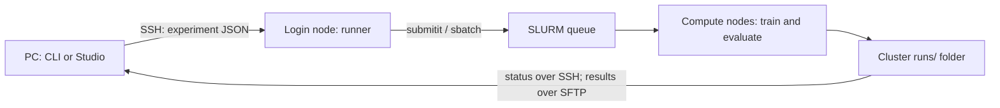

# Starting and following runs

An experiment is defined once, as a file in [config/experiments/](../../../config/experiments/),
and runs on a target. The CLI, Python and the Studio all call the same runner,
[core/runner/](../../../core/runner/) ([API](../../api/runner/index.md)), and see the same
state, because the runner keeps everything in files under `runs/`.

| Term | Meaning |
|---|---|
| Experiment | Algorithms × paradigms × seeds × variants, with budgets, scenario, train and test days, training settings and cluster resources; every setting is in [Configuration](config.md#experiment) |
| Profile | `full`: the experiment as written. `test`: its smallest version, named `<name>--test`, to check the pipeline before spending cluster time ([what it keeps](hpc/resources.md#full-and-test-profiles)) |
| Target | `local` (this PC: a detached worker) or `taltech` (one SLURM job array, a task per run, via submitit), from [hpc/targets.toml](../../../hpc/targets.toml) with your account and host from `.env` ([setup](../../getting-started/hpc-setup.md#this-machines-settings-env)) |

Every run trains, then plays every test day once with the trained policy and the
baselines ([How a run is judged](../../methodology/evaluation/index.md)), and saves
the results per day, per participant and per step
([What a run saves](../../methodology/evaluation/files.md)).

An experiment file gives only what differs from the defaults. The market itself
(network, participants, market and DSO rules) is the scenario's; the agents'
observation and action are [MarketEnv](../../../core/env/market_env.py)'s
([Action](../../methodology/environment/action.md),
[Observation](../../methodology/environment/observation.md)).

## Commands

From the `marlem-v2` root, in the `marlem` environment:

```powershell
python -m core.runner check config/experiments/smoke.json --target taltech
python -m core.runner start config/experiments/smoke.json --profile test --target taltech
python -m core.runner status --target taltech
python -m core.runner status smoke--test --target taltech
python -m core.runner sync smoke--test --target taltech
python -m core.runner stop smoke--test [run] --target taltech
```

Without `--target` (or with `--target local`) the same commands run on this PC.
`start` returns at once; `status` lists every experiment, or one experiment's runs
with state, progress, ETA and scores (on the cluster also the SLURM state and
node). `--json` gives the same answers as JSON; that is also how this PC talks to
the cluster.

**`check`** says whether a start would work: `ready`, or the problems (the cluster
does not answer, this PC and the cluster are at different commits, the cluster's
checkout has changes, the spec or its scenario does not load), with both commits
and the experiments queued or running there. `start` runs the same check and
refuses with its problems. Exit code 1 when not ready.

**`sync`** copies the experiment's results to `runs/@taltech/<experiment>`,
without checkpoints and `slurm/`. The copy goes to a temporary folder that replaces
the old one only when complete, so a failed download keeps the previous copy;
files removed on the cluster disappear here too. Nothing is copied unless asked.

**Restarting:** `start` on an existing experiment keeps its completed runs and
starts failed, stopped and lost ones again, **from scratch** (there is no
checkpoint resume). A changed spec, or a changed scenario, is refused: use a new
name.

The cluster's checkout is `~/marlem-v2` (branch `marlem-studio`) with its own `runs/`;
synced results land in `runs/@taltech/` on this PC
([setup](../../getting-started/hpc-setup.md#what-is-where)).

## PC-to-cluster pipeline

The PC prepares and controls experiments; the cluster's login node submits them,
and its compute nodes train them. The CLI and Studio use the same path:



1. **Prepare on the PC.** The runner reads the experiment, embeds the contents of
   its base and variant scenario files, and applies the profile. Studio sends its
   edited experiment, including unsaved changes and the active scenario if selected;
   Start adds a date and time if the name is already taken.
2. **Check and send.** `RemoteTarget` checks readiness, matching Git commits, a clean
   cluster checkout and resource fit. Over SSH it runs the cluster's configured
   Python in `~/marlem-v2`: `python -m core.runner start - --target taltech --json`.
   The `-` means read the experiment JSON from standard input. Neither source JSON
   file needs to exist in the cluster's `config/` folders.
3. **Save and submit on the login node.** There, `sbatch` is available, so the runner
   uses `SlurmTarget`. It saves `experiment.json` and `scenario.json` under
   `runs/<experiment>/`, with each run's variant settings and scenario in its own
   folder. The Python library submitit generates and submits a SLURM job array:
   one task per algorithm × paradigm × seed × variant, with the requested CPUs,
   memory, time and parallelism. Submission records and logs go in `slurm.json`
   and `slurm/` next to the runs.
4. **Run on compute nodes.** When resources are available, each task calls
   `launch.job(run_dir)`, loads the saved experiment and trains its run, then
   evaluates the trained policy and baselines on the test days. Status and results
   are written to the cluster's `runs/` folder. A successful Start means submitted;
   the tasks may still be queued. Once submitted, they continue with Studio closed
   or the PC disconnected.
5. **Follow from the PC.** Status requests query the remote runner, which checks
   SLURM and the run files. Studio's live following downloads updated result files;
   `sync` copies the results into `runs/@taltech/<experiment>` as described above.

| Input | How it reaches the experiment |
|---|---|
| Experiment and scenarios | Sent with Start; no save, commit or `git shipc` needed for local edits |
| Inline prices (numbers or lists) | Included in the scenario JSON |
| Named price files, e.g. `"prices": "de_2024"` | Read from the cluster's `config/data/`; referenced files must be committed and synchronized |
| Python code and dependencies | Already installed on the cluster; Start does not update them |

Editing a source experiment or scenario later does not change the saved inputs.
Local starts save the same copies. The **code** is still read from the cluster's
checkout when tasks start: leave it unchanged while jobs are queued or running
([limits](#limits)).

## From Python

```python
from core.runner import targets
from core.runner.spec import Experiment

target = targets.get("taltech")
try:
    print(target.check("config/experiments/smoke.json"))
    # name = target.start("config/experiments/smoke.json", profile="test")
    # A changed copy, as the Studio's Experiments page makes it; a taken name is dated:
    # experiment = Experiment.load("config/experiments/smoke.json")
    # experiment.seeds = [0, 1, 2]
    # name = target.start_new(experiment, profile="test")
    # target.restart(name)  # again from its saved settings
    # print(target.runs(name))
    # folder = target.sync(name)
finally:
    target.close()
```

[targets_demo.ipynb](../../../notebooks/runner/targets_demo.ipynb) walks through it.

One run without the runner, in the terminal's own process:

In Python, from the `marlem-v2` root (the RL code is imported as `core.rl`, the
market as `core.*`):

```python
from core.env import MarketEnv, net_position_policy, zero_policy
from core.rl import Run, evaluation, load_policy, train

config = {"scenario": "config/scenarios/validate_market.json",
          "days": [f"2016-06-{d:02d}" for d in range(1, 31)]}
record = train(Run("ppo", "ctde", MarketEnv, config, budget=24_000, eval_every=4_800))

held_out = {"scenario": config["scenario"], "days": [f"2016-07-{d:02d}" for d in range(1, 15)]}
env = MarketEnv(held_out)
policies = {"trained": load_policy(record["out_dir"])[0],
            "net_position": net_position_policy(env)}
days = held_out["days"]  # every test day once
found = evaluation(MarketEnv, held_out, policies, seeds=list(range(2000, 2014)),
                   options=[{"day": d} for d in days])
found.summary, found.episodes, found.agents  # means; per day; per day and participant
```

Each run writes `run.json`, `metrics.csv`, `evaluation.csv` (with its per-episode
and per-agent tables) and a checkpoint to `runs/` (not in git).

## In the Studio

[Experiments](../studio/build/experiments.md) edits an experiment from a template
and starts it; [Runs](../studio/experiments/runs.md) follows, stops, restarts and
syncs; [Results](../studio/experiments/results/index.md) compares finished and
running runs, as does [results.ipynb](../../../notebooks/runner/results.ipynb).

## Keeping experiments apart

To keep experiments apart, move their folders by hand into folders of your own
(`runs/@taltech/test/<experiment>`, or `runs/test/<experiment>` on this PC; at any
depth). The Results and RL probes pages read them as `test/<experiment>`, and their
run table narrows by target, then folder, then experiment. Every folder level is an
option, and a folder includes those under it. The runner does not see
inside these folders, and the cluster keeps its copy at the top level: **Sync
results** on such an experiment brings a second copy back to the mirror's top level.

## Limits

1. **Leave the cluster's checkout alone while its experiments are queued or
   running** (`git shipc`, `git pull`, edits): each task reads the checkout when it
   starts, so a queued task would run the newer code. `check` lists them.
2. **Changes to the code are not detected**, only changes to the spec and its
   scenario: use a new experiment name for them too. `run.json` records the commit
   each run trained with.
3. **One start at a time** across the CLI and the Studio; nothing stops two
   starts from two places at once.
4. **Each run starts its own Ray instance**, of about 230–340 threads with the
   runner's thread caps (`ray_thread_caps`, on by default; 540–760 without), and
   TalTech allows 4096 threads per user per node. SLURM packs runs onto one node
   by CPU and does not know this limit: with `num_env_runners: 3`, more than 12
   runs on a node (5 without the caps) crash at start; with 8, more than 10. A run
   over the limit can also hang at 0 steps and stay `running`. Size `max_parallel`
   and `resources.cpus` from [how many runs fit](hpc/resources.md#how-many-runs-fit-at-once).
5. **No checkpoint resume.** A run ends with its only checkpoint; one stopped by
   its time limit or restarted starts from scratch. Size `budget` so the slowest
   paradigm fits `resources.minutes` ([times](hpc/performance.md#time-per-paradigm)).
6. **No retries over SSH.** A failed call raises its error and the next call
   reconnects; after a lost answer to `start`, look at `status` before starting
   again.
7. **Ray can fail to start when memory is short**, as each run in parallel starts its
   own: run fewer in parallel if it happens.
