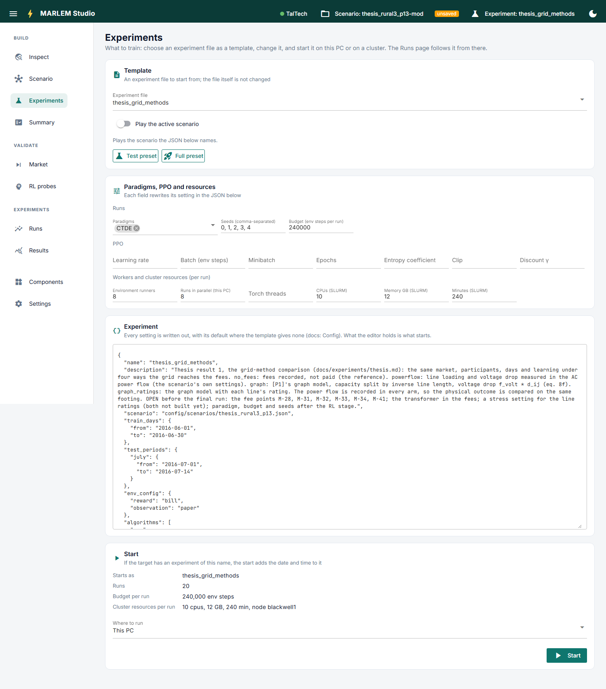

# Experiments

**Prepare a training experiment and start it.** What the settings mean and how a run
works: [Starting and following runs](../../running/runs.md).

- **Template:** an experiment file from `config/experiments/` to start from. The file
  itself is never changed; edits stay with the experiment being prepared.
- **Play the active scenario:** on, the experiment plays the Scenario page's
  scenario; off, the scenario its file names.
- **Test preset / Full preset:** shrink every run to a quick pipeline check, or set
  the template's size back. Other edits stay.
- **Fields:** paradigms, seeds, budget, the main PPO settings, environment runners,
  parallel runs, and the cluster's CPUs, memory and time. Each rewrites its line in
  the JSON.
- **The JSON editor:** everything that will start, every setting written out. Each
  edit is checked as a start would check it; problems show at once.
- **Start:** shows the name it starts as, the number of runs, the budget and the
  cluster resources. *Where to run* picks this PC or a cluster; for a cluster, Start
  waits until the cluster's check has no problems (*Check again*). If the target
  already has an experiment of that name, the date and time are added.

After a start, the [Runs](../experiments/runs.md) page follows it.
