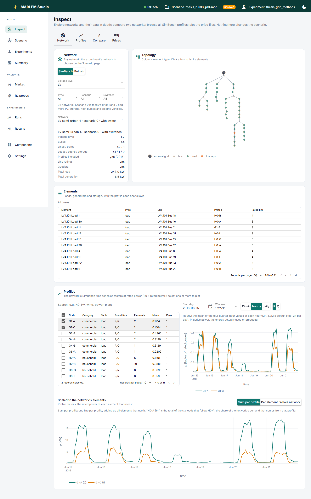

# Inspect

**Get to know the data before using it.** Read only: nothing here changes the
scenario.

## Network

One network in depth.

- **Choose a network:** SimBench or built-in; filter SimBench's by voltage level,
  type, scenario (0 today, 1 and 2 with more PV, storage, heat pumps and EVs) and
  switches. The card shows its key numbers: buses, lines, elements, total load and
  generation, and whether it has profiles, line ratings and coordinates.
- **Topology:** the network coloured by what each bus carries. Click a bus to list
  its elements.
- **Elements:** every load, generator and storage unit with its profile and rated
  power.
- **Profiles:** tick profiles to plot them over a start day and a window, at 15 min,
  hourly or daily, active (P) or reactive (Q) power. Below, the same profiles scaled
  to the network's elements: summed per profile, per element, or the whole network.

## Profiles

SimBench's whole profile catalogue (2016), searchable, to plot and compare any of
them.

## Compare

Two networks side by side: their facts, the mix of elements per profile category,
both topologies, and the profiles each uses.

## Prices

The price files in `config/data/`, plotted. A scenario names one as its DSO prices
([Prices](../../data/prices.md)).
