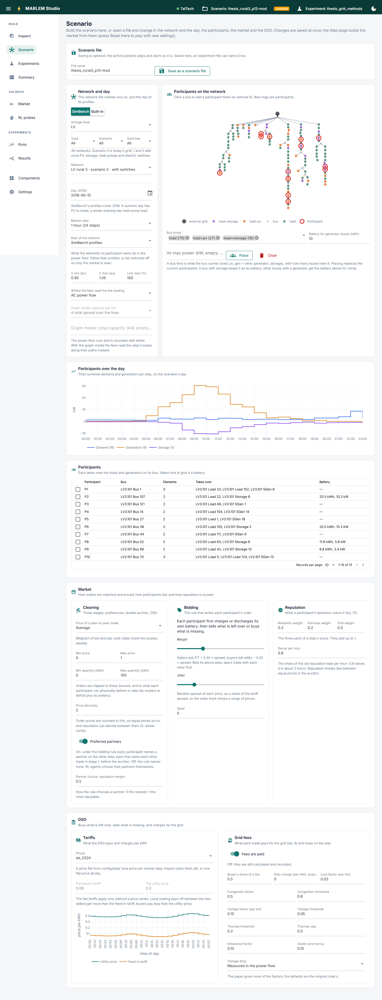

# Scenario

**Build the market a run plays**, or open a scenario file (header → Scenario) and
change it. Every setting of a scenario file is on this page, and every change is
kept at once. What each setting means: [Config](../../running/config.md).

## Network and day

- **The network:** picked as on Inspect; *Use this network* makes it the scenario's.
- **The day** (2016) and **the market step:** 1 hour (24 steps) or 15 minutes (96).
- **The rest of the network:** what the elements no participant owns do: follow their
  SimBench profiles, or switch off.
- **Limits:** voltage band and line loading, for the violations counted.
- **Where the fees read the line loading:** the AC power flow, or [P1]'s graph model
  with its capacity per line ([Grid methods](../../../methodology/market/grid-methods.md)).

## Participants

- **On the network:** click a bus to add a participant there, or again to remove it.
  It takes over the loads and generators on its bus. Red rings mark participants.
- **Place:** a participant on every bus of the chosen kinds (load, PV, storage, …),
  with an optional battery for generator buses. *Clear* removes them all.
- **The table:** select a participant to give it a battery or change it: a SimBench
  size (small, typical, large) or custom capacity, power, starting charge, limits
  and efficiencies.
- **Over the day:** their summed demand and generation on the scenario's day.

## Market

- **Clearing:** how a peer trade is priced, price and quantity bounds, price
  decimals, and preferred partners with the weight between distance and reputation.
- **Bidding:** the margin and jitter of the rule that writes non-RL participants'
  orders, and its seed.
- **Reputation:** the weights of its three parts and the decay per hour.

## DSO

- **Tariffs:** flat, or a price file. A note warns when they leave no gain from
  peers ([Tariffs](../../../methodology/market/tariffs.md)).
- **Grid fees:** paid or only recorded, the buyer's share, the peer charge, and every
  fee factor and threshold.

## Save

*Save as a scenario file* writes it to `config/scenarios/`, where an experiment can
name it. Saving is optional: the active scenario plays and starts as it is.
