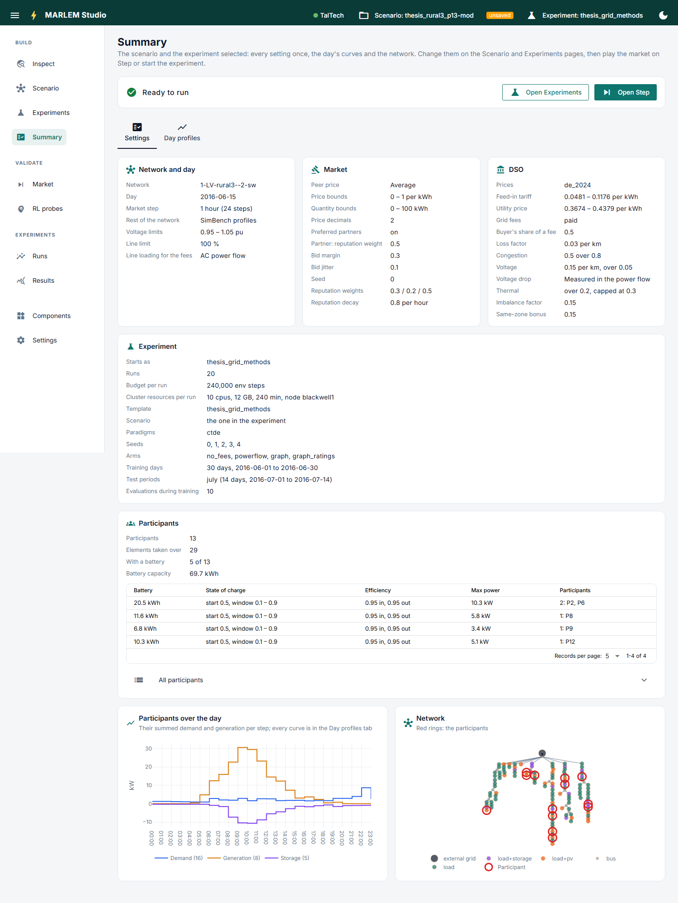

# Summary

**Check everything once before running it.** Read only: change things on the
Scenario and Experiments pages.

- **The banner:** *Ready to run*, or each problem found in the scenario and the
  experiment (for example, tariffs with no gain from peers). It warns and blocks
  nothing. *Open Experiments* and *Open Step* go on from here.
- **Settings tab:** every scenario setting once (network and day, market, DSO), the
  experiment as it will start (runs, arms, seeds, days, resources), the participants
  and their batteries, their curves over the day, and the network with the
  participants marked.
- **Day profiles tab:** what every element does on the day, participants apart from
  the background.
