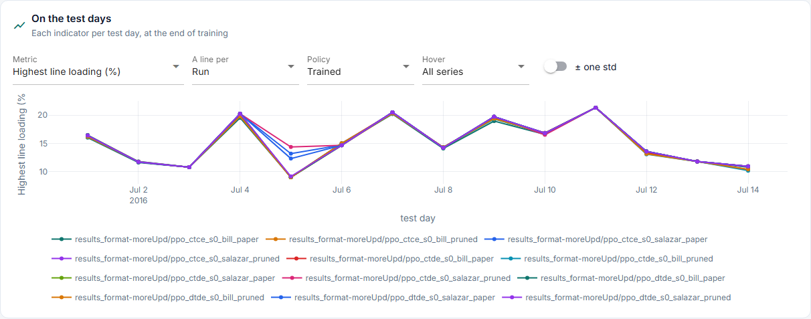
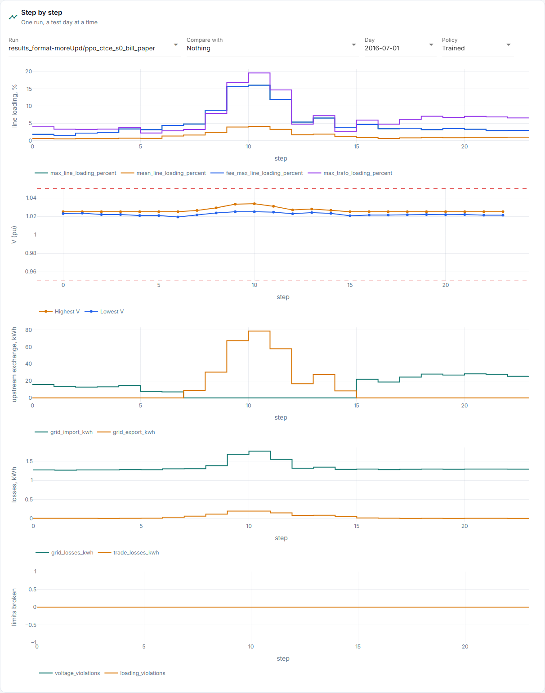
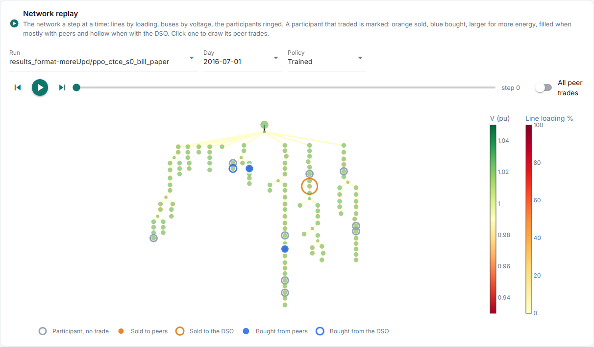

# Grid

**What did the grid do?** Its indicators per test day, then one run step by step. This is
the tab the grid-method comparison is read on.

Source: `day_indicators` in [`results.py`](../../../../../core/runner/results.py) and
`heldout_steps.csv`, drawn by [`grid.py`](../../../../../studio/pages/results/grid.py) and
[`steps.py`](../../../../../studio/pages/results/steps.py). The amounts are the AC power
flow's for the whole network, background included, whichever `grid.method` charged the
fees; a flow that did not converge counts 0 for them.

## Structure

```text
Grid
├── 1  On the test days   metric · a line per · policy · hover · ± one std
├── 2  Step by step       run · compare with · day · policy
       ├── line loading
       ├── voltage
       ├── upstream exchange
       ├── losses
       └── limits broken
└── 3  Network replay     run · day · policy · step: the network on a map
```

## Panels

The pictures are the Studio on `results_format-moreUpd` (12 runs), made by [`screenshots.py`](../../../../../docs_site/screenshots.py); run it again after a Studio change.



**1 On the test days.** Any run in a line per run, paradigm, variant, seed or policy.

| Indicator | What it is |
|---|---|
| `highest_line_loading` | Worst step of the day, % |
| `hours_over_limit` | Hours with a voltage or loading limit broken |
| `highest_trafo_loading` | Worst transformer step, % |
| `lowest_voltage`, `highest_voltage` | Worst bus and step, pu |
| `grid_import_kwh`, `grid_export_kwh` | Energy from and to the upstream grid |
| `peak_import_kw`, `peak_export_kw` | The highest of them, kW |
| `grid_losses_kwh` | Line and transformer losses of the power flow |
| `trade_losses_kwh` | Losses charged to the trades ([P1] eq. 18): the market's estimate |
| `fee_error_mean`, `fee_error_worst` | Fee loading against measured loading, percentage points: the grid-method comparison in one number |
| `not_converged` | Steps whose power flow did not converge |
| `energy_balance_index` | Zhou et al. (2018) eq. 22-23, for the participants as one community (their netted demand and charging less generation and discharging, without the network's other loads): 1 − their exchange with the upstream grid, import and export, over all they consumed and produced. 1: nothing exchanged |
| `peak_to_average` | Their eq. 24 (EPARI): the community's highest exchange in either direction over its mean, lower is flatter. Their power flatness index divides it by the worst of the runs compared, so it is left to the comparison |
| `self_sufficiency_index` | Their eq. 26-28: 1 − the community's net import over all it consumed |
| `energy_balance_index_period`, `peak_to_average_period`, `self_sufficiency_index_period` | The same three over the whole test period, shown on each of its days ([Metrics](../../../../methodology/evaluation/metrics.md#a-headline)) |



**2 Step by step.** One run's day, for a picked policy. *Compare with* draws a second run
over it, dotted, on the same day and policy.

| Chart | Columns |
|---|---|
| Line loading | `max_line_loading_percent`, `fee_max_line_loading_percent`, `max_trafo_loading_percent` |
| Voltage | `min_voltage_pu`, `max_voltage_pu`, with the run's limits (`v_min_pu`, `v_max_pu` of its scenario) dashed; the same chart as the Market page's "Network over the day" |
| Upstream exchange | `grid_import_kwh`, `grid_export_kwh` |
| Losses | `grid_losses_kwh`, `trade_losses_kwh` |
| Limits broken | `voltage_violations`, `loading_violations` |

`fee_max_line_loading_percent` is the highest line loading the fees were charged on: the
graph model's with `grid.method = "graph"`, else the power flow's.



**3 Network replay.** The network a step at a time: lines coloured by loading, buses
by voltage, the participants ringed. A participant that traded is marked, orange when it
sold and blue when it bought, larger for more energy, filled when mostly with peers and
hollow when with the DSO. Clicking one draws its peer trades as lines to its partners.

## Missing

| Number | Why it matters | Source |
|---|---|---|
| The participants' share of the import and export | 13 of the network's 43 prosumer buses trade, so the background hides what the market changed; the power flow does not separate them | Not available |
| Which line or bus is worst | A number per day says how bad, not where | New, per element: large |
