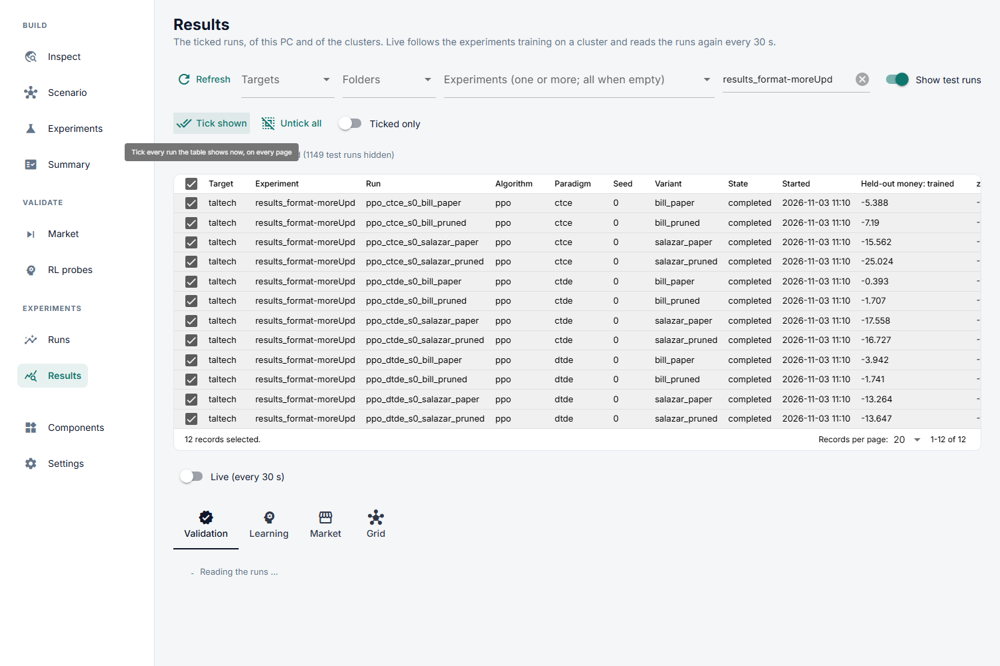

# Results

**Read runs, finished or still training.** Tick runs in the table; four tabs show
them. What the numbers mean and what a run is compared against:
[Evaluation](../../../../methodology/evaluation/index.md).



```text
Results
├── run table        tick the runs to compare; Live follows running ones
└── tabs             share what is selected (run, day, policy, participant)
    ├── Validation   how good is each version on the test days?     (opens first)
    ├── Learning     did it learn?
    ├── Market       what did the market do?
    └── Grid         what did the grid do?
```

## The run table

The same table picks runs on Results and on [RL probes](../../validate/rl-probes.md).

- **Rows:** every run of this PC and of each cluster's synced copy: target,
  experiment, run, algorithm, paradigm, seed, variant, state, start, and the
  held-out money of the trained policy and the baselines. Click a header to sort.
- **Filters:** targets, folders, experiments, free text, and *Show test runs*.
- **Ticking:** *Tick shown* ticks every run the filters show, *Untick all* clears,
  *Ticked only* hides the rest. *Refresh* reads every run again.
- **Live:** on, the page asks each cluster every 30 s which experiments are running,
  brings their results here, and redraws the open tab in place.

Ticks, filters, the open tab and each tab's controls are remembered between visits.

## The tabs

| Tab | Shows | Page |
|---|---|---|
| Validation | Each version on the test days: the indices, money against the baselines, per day and per participant | [Validation](validation.md) |
| Learning | Training on the training days: return, losses, entropy, KL, each action part; where the time went | [Learning](learning.md) |
| Market | Trades, prices and money per test day, per participant, and one day step by step | [Market](market.md) |
| Grid | Line loading, voltages and exchange per test day, and one day replayed on the network | [Grid](grid.md) |

Picking a row in Validation and pressing *Market* or *Grid* opens that tab on it.
Charts along an axis have a *Hover* control: all series at the pointer in one
label, or only the nearest one.

The notebook [`results.ipynb`](../../../../../notebooks/runner/results.ipynb) reads the
same tables through [`core/runner/results.py`](../../../../../core/runner/results.py).
