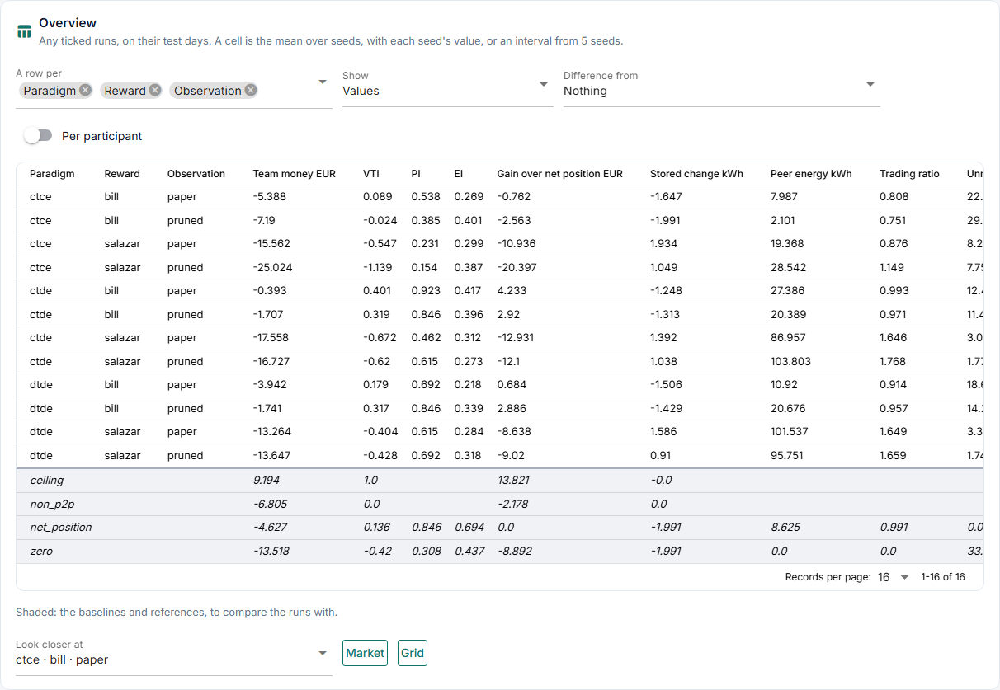
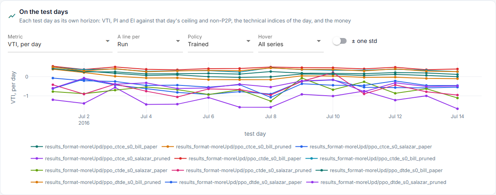
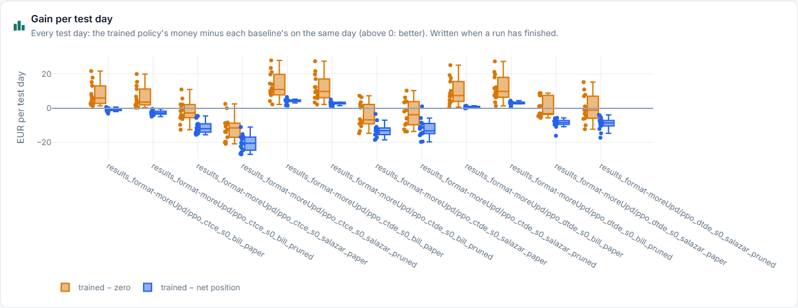
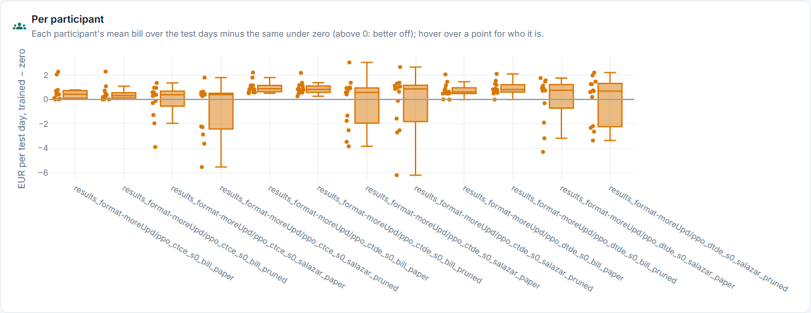
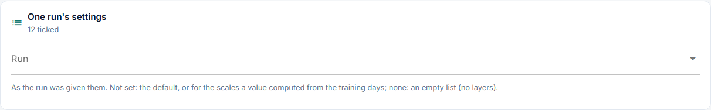

# Validation

**How good is each version on the test days?** The tab that opens first. Any ticked runs
can be compared, whatever they differ in; the tab says what differs.

Source: `day_indicators` in [`results.py`](../../../../../core/runner/results.py) and
[`indicators.py`](../../../../../core/runner/indicators.py), from the held-out tables; drawn
by [`validation.py`](../../../../../studio/pages/results/validation.py).

## Structure

```text
Validation
├── These runs differ in: ...
├── 1  Overview           a row per · show · difference from · per participant
│      the table of headline indicators, with the baselines under it
│      look closer at: a row, then Market or Grid
├── 2  On the test days   VTI, PI, EI, the technical indices and the money, per day:
│                         metric · a line per · policy · hover · ± one std
├── 3  Gain per test day  the gain over net position, as boxes
├── 4  Per participant    each participant's gain over its own non-P2P money, per run
└── 5  One run's settings
```

## Panels

The pictures are the Studio on `results_format-moreUpd` (12 runs), made by [`screenshots.py`](../../../../../docs_site/screenshots.py); run it again after a Studio change.



**1 Overview.** A row per what *A row per* picks: the run, or any setting that differs,
with seeds pooled. Each run is the mean over its test days. A seed is the mean of its
runs, and a cell the mean over seeds, with each seed's value in brackets, or from 5 seeds
a 95% bootstrap interval in square brackets.

| Column | What it is |
|---|---|
| Team money | The participants' `bill` summed, EUR per day; positive is earned |
| VTI | Value to ideal over the test period: (team money − `non_p2p`) / (`ceiling` − `non_p2p`), the period's sums. 0 is every participant on its own, 1 the most the period allows; below 0 worse than on their own |
| PI | Participation over the test period: the share of participants whose money beats their own `non_p2p` money. It says whether the gain reaches most of them |
| EI | Equality over the test period: 1 − Gini of the participants' gains over their own `non_p2p` money, with the absolute gains in the denominator so it stays in 0 to 1 when some gains are negative ([`equality`](../../../../../core/runner/indicators.py)). 1: the gain shared evenly; towards 0: it sits with few. Equal losses also score 1, so read it with the VTI |
| Gain over net position | Team money minus the run's own `net_position`, same day |
| Stored change | Energy left in the batteries against the start of the day, kWh. Money alone favours draining them, so it stands next to it |
| Peer energy | `p2p_kwh` |
| Trading ratio | Energy bought and sold over what participants needed to get or get rid of; above 1 is energy traded back and forth |
| Unmet demand | `deferred_demand_kwh` |
| Highest line loading | Worst step of the day, % |
| Hours over a limit | Hours with a voltage or loading limit broken |
| Energy balance index, peak-to-average (EPARI), self-sufficiency index | Zhou et al.'s technical indices for the participants as one community ([Metrics](../../../../methodology/evaluation/metrics.md#a-headline)) |

Every column is defined in [Metrics](../../../../methodology/evaluation/metrics.md), with the group it belongs to; the
headline indices are group A.

The six headline indices are over **the test period**: the batteries carried from day
to day, one number per run shown on each of its days, so a cell is the period's value.
Their values per test day are in *On the test days*.

*Show* picks the values, or each value minus the run's own `net_position` on the same
day: that makes different scenarios or price sets comparable, because each run
plays its own baselines.

*Difference from* picks a row: every cell becomes that row's difference from it. *Paired*
says how: with the same seeds, days, prices and network, a seed's mean difference over the
days both have, with the spread over seeds; otherwise the difference of the two means,
which keeps the variation between days. `difference(by=..., reference=...)` in the
notebook does the same per factor, inside each combination of the other settings.

Under it, a second table with the same columns holds the baselines and references, one
row per baseline and what it was played on (prices, peer charge, network,
test days), by VTI from the top down: `ceiling`, `net_position`, `non_p2p` (should the
rule fall below 0, under `non_p2p`). Being a table of their own, sorting the runs leaves
them in place. Every table in the Studio sorts numbers
as numbers, so a click on *VTI* ranks the runs. The `non_p2p` and `ceiling` rows are the
two ends of the VTI ([Evaluation](../../../../methodology/evaluation/index.md#three-yardsticks)); they fill only team money, the
period's VTI, stored change and the gains. With several test periods, a period value's
mean over the days is the periods' mean weighted by their days. A warning names steps that did not
converge, because on them loading and limits count nothing and read low.

*Look closer at* picks a row, and *Market* or *Grid* opens that tab on its median seed by
team money.



**2 On the test days.** One metric per test day, a line per run (or per what runs differ
in), as on Market and Grid. The metrics are the headline indices **with every day its own
horizon** (`vti_day`, `pi_day`, `ei_day` against that day's ceiling and non-P2P, each
battery starting the day at the scenario's initial charge and ending it at least as full;
the technical indices of the day), and the money they are made of (team money, the gains
over the baselines, stored change). A day's VTI also credits energy a policy carried in
from the day before, which the references of that day cannot. This is where to see
whether a version is good on every day or only on some; the overview's period value
weights the days by what was at stake.



**3 Gain per test day.** Per run, a box over the test days of `gain_net_position`: the
money above the market's rule on the same day.



**4 Per participant.** Per run, each participant's mean `bill` over the test days minus
its own `non_p2p` money (on its own with the retailer), a point per participant (hover: who, and whether it has a battery
or PV). A better team total can hide participants that lose; this shows them.



**5 One run's settings.** For a picked run: what it is, its days, the code, and its
environment, training and model settings.

## Saved, not on this tab

| Column | What it is | Where |
|---|---|---|
| `team_return_mean`, `team_return_std`, `return/<participant>` of `heldout.csv` | Return per policy | Nowhere: it does not compare across rewards |
| `final`, `spaces`, `agents`, `env_contract`, `settings_effective`, `model_effective`, `versions`, `eval_seeds` in `run.json` | The final evaluation, the spaces, every effective setting, library versions | Nowhere |

The other indicators are per test day on Market and Grid.

## Missing

| Number | Why it matters | Source |
|---|---|---|
| The best rule of the margin sweep | MP-6b's reference for "good" | New |
