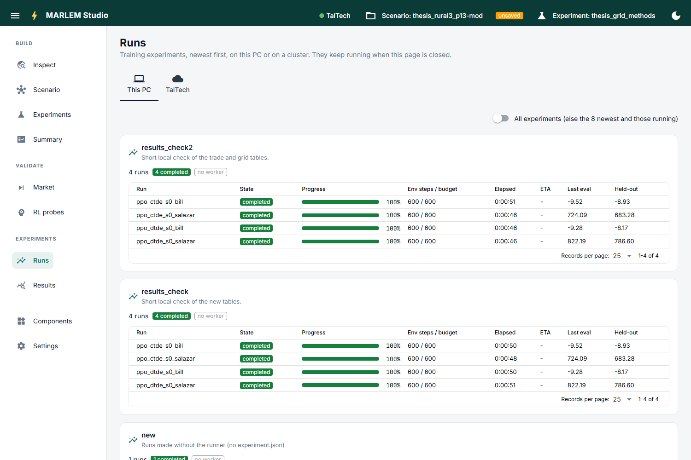

# Runs

**Follow training while it runs, here and on a cluster.** Experiments are started on
[Experiments](../build/experiments.md); this page follows them.

- **One tab per target:** *This PC* and each cluster (`hpc/targets.toml`).
- **One card per experiment,** newest first: how many runs are in each state, and a
  table of its runs (state, progress, environment steps, elapsed time, ETA, latest
  evaluation and held-out return). *All experiments* shows older ones too.
- **Stop** a single run, or the whole experiment (asks first).
- **Restart failed runs:** trains the failed, stopped and lost runs again, from
  scratch, with the settings saved in their folder.

On a cluster tab:

- it is read over SSH every 10 s, only while shown; *Refresh now* reads at once;
- a line at the top says whether the cluster is ready to start runs (*Check*);
- the table adds each run's SLURM state and node;
- **Sync results** copies an experiment's results to this PC, where
  [Results](results/index.md) reads them. Running experiments can also be followed
  live from Results.

How runs, targets and syncing work: [Starting and following runs](../../running/runs.md)
and [Running on HPC](../../running/hpc/index.md).
