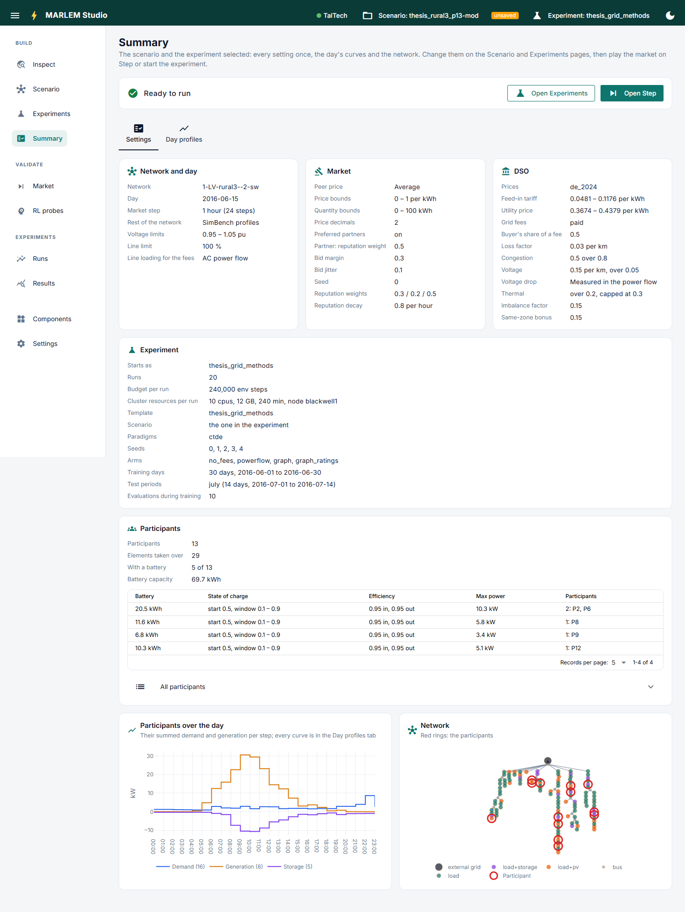

# The Studio

> A browser interface to the whole workflow: look at the data, build a scenario,
> check the market and the learner, start training, follow it and read the results.
> It reads and writes the same files as the CLI and the notebooks, so nothing exists
> only in the Studio.

## Start it

From a checkout, in the `marlem` environment:

```
python run_studio.py
```

It opens http://127.0.0.1:8091. Closing the browser does not stop runs; they keep
going on their own.

## Find your way



**The navigation** on the left groups the pages in the order of the work. The ☰
button folds it away.

| Group | Page | For |
|---|---|---|
| Build | [Inspect](build/inspect.md) | Looking at networks, profiles and prices |
| Build | [Scenario](build/scenario.md) | Building the market a run plays |
| Build | [Experiments](build/experiments.md) | Preparing and starting training |
| Build | [Summary](build/summary.md) | Checking both before running |
| Validate | [Market](validate/market.md) | Playing the market step by step; scripted checks |
| Validate | [RL probes](validate/rl-probes.md) | Checking the learner on known answers |
| Experiments | [Runs](experiments/runs.md) | Following, stopping and syncing training |
| Experiments | [Results](experiments/results/index.md) | Reading finished and running runs |
| | [Settings](settings.md) | The workspace folder, the network cache, dark mode |

**The header** is on every page:

- **The cluster dot:** green when the cluster answered recently. Click to check now.
- **Scenario:** the active scenario. *unsaved* means it has no file, or differs from
  the file it came from (`-mod` in its name); it plays and starts all the same.
  Click to open another scenario file.
- **Experiment:** the experiment being prepared. *unsaved* means the editor differs
  from the file it came from (`-mod` in its name; a preset, a setting or another
  scenario does it); it starts as it is, and the file itself is never changed.
  Click to open another file, which drops the edits.
- **The moon:** dark mode.

## What the Studio remembers

The active scenario, the experiment being prepared and the network cache live in the
**workspace folder** ([Settings](settings.md)). Each page's choices (open tab, ticked
runs, filters) are remembered per browser. Both survive a restart.

The screenshots show the thesis setup: the scenario `thesis_rural3_p13` and the
experiment `thesis_grid_methods` ([Grid methods](../../experiments/thesis/grid-methods.md)).
