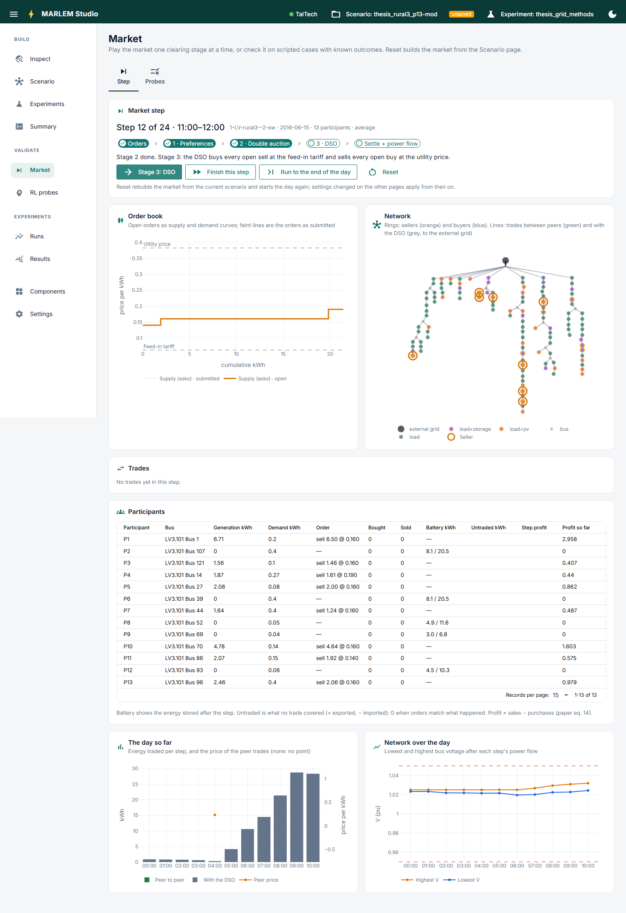
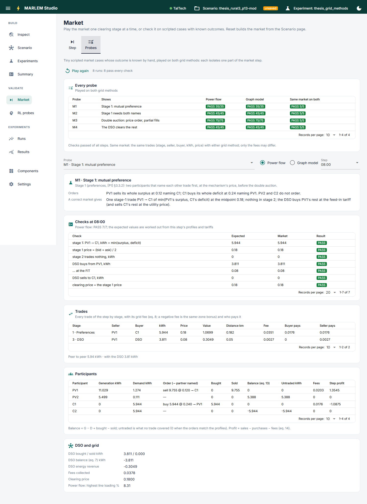

# Market

**See the market work, play the scenario before learning, and check it against cases with a known outcome.** No
learning here: participants bid with the market's own rule.

## Step

Plays the active scenario's market one part of a step at a time, as in
[Market step](../../../methodology/market/step.md).

- **Build the market** from the active scenario. *Reset* builds it again after
  settings change.
- **One part per click:** collect the orders, stage 1 (preferences), stage 2 (double
  auction), stage 3 (DSO), then settle and run the power flow. The chips show where
  the step is.
- **Skip ahead:** *Finish this step*, or *Run to the end of the day*.
- **After each part:**
  - the order book still open, as supply and demand curves;
  - the network: sellers, buyers, and trades between peers and with the DSO;
  - the trades so far, with their fees;
  - every participant: generation, demand, order, battery, profit;
  - the day so far (energy traded, peer price) and the network's voltages over the
    day.

## Baseline

Plays the active scenario over a window of days with the market's rule and no noise,
the evaluation's `net_position` baseline ([`baseline.py`](../../../../core/market/baseline.py)):
how the network copes before any learning. The Scenario page's *Check the baseline*
opens it.

- **The window:** *From* and *To*, up to 31 days (longer: `baseline.play` from a
  notebook). The batteries and reputations carry over from day to day.
- **A sweep (optional):** values for any of the scaling factors (generation, load,
  storage ×, MP-4i), comma-separated; a factor left empty keeps the scenario's value.
  Every combination is played over the window: generation 1, 2, 3 with load 1, 2 is six
  runs. Nothing is saved; *Use in the scenario* saves the combination picked.
- **Overview:** per combination, the highest and 95th-percentile line loading, the
  transformer's highest, the lowest and highest voltage, the steps with a violation,
  losses, fees and team money.
- **Over the window and the network:** for the run picked under the overview (*Charts
  below show*), the highest line and transformer loading and the voltage band per step,
  and the network at that run's step with the highest line loading, lines coloured by
  loading, buses by voltage.

## Probes

Small scripted cases whose result is worked out by hand, each played on both grid
methods ([Validation](../../../methodology/validation/index.md)). They play when the tab
first opens (about 10 s); *Play again* repeats them.

- **Every probe:** one row per probe, PASS or FAIL per grid method, and whether both
  methods gave the same trades.
- **One probe:** pick it, the grid method and a step: its orders, what a correct
  market gives, each check against the market's value, the trades, the participants,
  and the DSO and grid.
