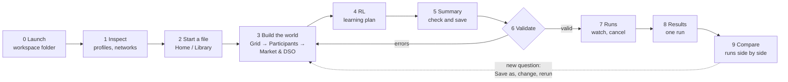

# Using MARLEM Studio: from first launch to comparing runs

> A walk through the whole process of a study in the Studio, in the order a first-time user meets it: launch the app, get to know the data, build the experiment, validate it, run it, and analyse and compare the results. It explains what to decide at each step and what to check before moving on, not how the code works.
> How the Studio is built: [05-presentation.md](../thesis/architecture/05-presentation.md) · What the experiment file holds: [02-experiment-config.md](../thesis/architecture/02-experiment-config.md) · Which pages still show sample data: [implementation-status.md §4](../thesis/architecture/implementation-status.md#4-studio-page-by-page-src_thesisstudio-05).

<!-- BEGIN toc (python docs_thesis/toc.py) -->
## Contents

- [1. The idea in one paragraph](#1-the-idea-in-one-paragraph)
- [2. The workflow at a glance](#2-the-workflow-at-a-glance)
- [3. Step 0: launch and find your way around](#3-step-0-launch-and-find-your-way-around)
  - [Start the Studio](#start-the-studio)
  - [Choose where your work is saved](#choose-where-your-work-is-saved)
  - [Read the header](#read-the-header)
- [4. Step 1: get to know the data (Inspect)](#4-step-1-get-to-know-the-data-inspect)
  - [Profiles: what kinds of behaviour exist](#profiles-what-kinds-of-behaviour-exist)
  - [Network: one grid in depth](#network-one-grid-in-depth)
  - [Compare: two grids side by side](#compare-two-grids-side-by-side)
- [5. Step 2: start an experiment file (Home, Library)](#5-step-2-start-an-experiment-file-home-library)
- [6. Step 3: build the world (Grid → Participants → Market & DSO)](#6-step-3-build-the-world-grid--participants--market--dso)
  - [Grid: choose and check the network](#grid-choose-and-check-the-network)
  - [Participants: who trades, where, with which profiles](#participants-who-trades-where-with-which-profiles)
  - [Market & DSO: the rules of the game](#market--dso-the-rules-of-the-game)
- [7. Step 4: plan the learning (RL)](#7-step-4-plan-the-learning-rl)
- [8. Step 5: check and save (Summary)](#8-step-5-check-and-save-summary)
- [9. Step 6: validate (Validate)](#9-step-6-validate-validate)
- [10. Step 7: run and watch (Runs)](#10-step-7-run-and-watch-runs)
- [11. Step 8: look at one run (Results)](#11-step-8-look-at-one-run-results)
- [12. Step 9: compare runs (Compare)](#12-step-9-compare-runs-compare)
- [13. Checklist and common mistakes](#13-checklist-and-common-mistakes)

<!-- END toc -->

## 1. The idea in one paragraph

Everything you set up in the Studio ends up in one **experiment file**: the grid, the participants and their profiles, the market and DSO rules, and the learning plan. The pages are only different views onto that file. You start from a preset (one of the paper's seven cases) or an earlier file, change what your study needs, save it, and let the Studio check it. Only a valid file can be run. Each run keeps a copy of the file it ran with, so every result can be traced back to exactly the settings that produced it, and two runs can be compared knowing what differed between them.

[↑ Contents](#contents)

## 2. The workflow at a glance



The left navigation follows the same order: **Build** (Inspect, Grid, Participants, Market & DSO, RL, Summary), **Experiment** (Validate), **Run** (Runs) and **Analyse** (Results, Compare). Library and Settings sit at the bottom because you need them now and then, not in every study.

| Step | Page | The question you answer | Saved to the experiment file |
|---|---|---|---|
| 0 | Settings | Where is my work stored? | — (a Studio setting) |
| 1 | Inspect | What data is available, and what does it look like? | Nothing: read-only |
| 2 | Home, Library | Which case do I start from? | A new draft file |
| 3 | Grid | On which network does the market run? | `grid` |
| 3 | Participants | Who trades, on which bus, with which demand, generation and battery? | `participants`, `time` |
| 3 | Market & DSO | How is the market cleared, what do the tariffs and fees look like, what do agents observe and how are they rewarded? | `market`, `dso`, `environment` |
| 4 | RL | Which algorithms and paradigms, how many seeds, how much training? | `learning`, `evaluation`, `baselines`, `sweep`, `resources`, `outputs` |
| 5 | Summary | Is the file what I meant? | `meta`; Save as |
| 6 | Validate | Can this file run, and does it make sense? | Nothing: a check |
| 7 | Runs | Is it running, is it healthy? | — (runs are stored next to the file) |
| 8 | Results | What happened in one run? | — |
| 9 | Compare | Which setting did better, and is the difference real? | — |

[↑ Contents](#contents)

## 3. Step 0: launch and find your way around

### Start the Studio

In a terminal in the repository, with the `marlem` conda environment active:

```text
python -m src_thesis.studio
```

A browser tab opens at <http://localhost:8080>. Settings such as the port live in the repository's `.env` file (see `.env.example`). The terminal must stay open while you work; closing it stops the Studio.

### Choose where your work is saved

Open **Settings** first. The *Workspace folder* holds three folders: `library/` (your experiment files), `store/` (runs and their results) and `exports/` (bundles to share). Choose a folder outside OneDrive or other synchronised folders: runs write many files, and synchronisation slows them down or locks files. The choice is remembered for the next launch.

### Read the header

The bar at the top shows the state of your work on every page:

| Chip | Meaning | Click it to |
|---|---|---|
| Draft name | The experiment file you are editing | Open Summary |
| *valid* / *n errors* | Result of the quick check of the draft | Open Validate |
| *n running* / *worker idle* | Runs in progress | Open Runs |
| SAMPLE DATA | Some pages still show generated example data instead of real data (hover for which) | — |

Controls that are not built yet say "not implemented yet" when clicked; they change nothing.

[↑ Contents](#contents)

## 4. Step 1: get to know the data (Inspect)

Before deciding anything, look at what the data offers. Inspect is read-only: nothing you do here changes the experiment file, so you can explore freely. It has three tabs.

### Profiles: what kinds of behaviour exist

Start here. A **profile** is a year of quarter-hourly values that describes how one kind of consumer or generator behaves, as a factor of its rated power (1.0 = full power). SimBench ships 458 of them. The overview at the top groups them as SimBench does: **Load** (standard profiles for many customers such as households *H*, businesses *G* and farms *L*; individual devices such as heat pumps *HP* and electric vehicles *EV*), **Generation** (PV, wind, biomass, hydro, conventional plants), **Storage** and **Aggregated grids** (whole grids represented as one element).

- Click a class to list only its profiles; the caption under the overview explains the class and its naming.
- Tick profiles in the table to plot them. Use the *Start day*, *Window* and *15 min / hourly / daily* controls: a week at hourly resolution shows the daily rhythm; a year at daily resolution shows the seasons.
- Things worth noticing: the mean (how much energy over the year) versus the peak (the highest value); PV is zero at night and peaks at noon; household profiles have morning and evening peaks; individual devices (HP, EV) are spiky, standard profiles are smooth because they average many customers.

### Network: one grid in depth

Pick a network (SimBench networks are named by voltage level and type, e.g. `1-LV-semiurb4--0-sw` is a semi-urban low-voltage grid). You see its facts, its topology (click a bus to list what is connected there), its elements with their profiles, and the profiles this network uses.

The second plot scales the profiles by the rated power of the elements that use them, in kW: what the loads and generators would really draw or feed in. *Sum per profile* adds up all elements with the same profile; *Per element* shows each one.

Questions to answer before building: How many loads and generators does the network have, and on how many buses? Is there enough local generation (PV) for trading to matter? Which profiles dominate the demand?

### Compare: two grids side by side

Pick two networks to compare their facts, their mix of profile classes, their topologies and the profiles they share. Useful when choosing between, say, a rural and an urban grid for a study.

[↑ Contents](#contents)

## 5. Step 2: start an experiment file (Home, Library)

On **Home**, *Start* lists the presets: the seven cases of the MARLEM papers (market mechanisms, heterogeneity, DSO strategies, grid constraints, batteries, the 3 × 3 implicit-cooperation study, scalability). *New draft* copies a preset into your library and opens the Grid page. Pick the case closest to your question; you change only what your study is about.

**Library** lists your files. Click a file to make it the draft you are editing; click a preset to start a new draft from it.

Work on one question per file. When you want a variant (another network, another reward), use *Save as* on Summary rather than overwriting: the new file remembers where it came from, and Summary can show the difference later.

[↑ Contents](#contents)

## 6. Step 3: build the world (Grid → Participants → Market & DSO)

These Build pages describe the world the agents live in. Go through them in order, since each depends on the one before: participants sit on the grid's buses, and the market rules apply to those participants.

### Grid: choose and check the network

Choose the source (SimBench, a pandapower built-in or a file) and the network. Check its topology and elements, then run the **power-flow preview**: one solve of the unmodified network at the chosen day and hour, colouring buses by voltage. If the preview already shows violations without any trading, keep in mind that the grid is stressed before the agents do anything. A picked network is only used once you *Apply to draft*; the page says whether the draft uses it. Changing the network of a draft that has participants asks whether to keep them (to fix on the Participants page) or remove them.

*Grid rules for the experiment* set what the network does around the agents: how the elements no agent owns behave (*background*), the voltage band and loading limits, where line ratings come from, reactive power, the power-flow solver, and what happens when the power flow fails.

### Participants: who trades, where, with which profiles

Each participant is one agent: a bus, the loads and generators it owns, a demand profile, a generation profile, how they are scaled, and optionally a battery.

- **Placing many at once:** *Apply placement rule* proposes agents from the network's own loads (one per load, households with PV, feeder ends, or spread over the feeders), each owning its load and the generators at its bus, with their own SimBench profiles. *Import mapping* reads a JSON or CSV list. *Apply [P2] Table 6 roles* turns the first eight into the paper's agents.
- **One at a time:** *Add participant*, or select a row and edit, duplicate, move or remove it. The dialog offers only the elements at the chosen bus and refuses an element that another agent already owns.
- **Checking:** the *Check* column flags buses or elements that are not in the network (e.g. after changing it); the map rings the participants' buses; *Profile preview* shows the selected agent's demand, generation and net power in kW, scaled, for a week from the start of the time window.
- **Time window:** resolution, steps per episode and which days (one day, a range, or a sampler with filters). It counts the training and evaluation days while you change it.

Check before moving on: every agent has a bus and a demand profile; generation is scaled sensibly against demand (an agent that produces ten times its demand dominates the market); battery capacities are in proportion to the agent's size.

### Market & DSO: the rules of the game

- **Market:** the clearing mechanism, price and quantity bounds, whether agents prefer some partners, whether orders arrive asynchronously, and the ledger.
- **DSO:** where tariffs come from and the fee factors for using the grid.
- **Environment:** what agents observe (observation version, forecast error) and how they are rewarded (reward version, how grid violations are attributed).
- **Weights:** every weight of the reward (eq. 4–6, penalties) and of the reputation (eq. 12), pre-filled with the original values.
- **Tariffs:** the tariff CSVs the DSO starts from, drawn as you choose them.

*Apply to draft* writes your changes into the file. Change only what your study varies; for everything else the preset's values are the paper's.

[↑ Contents](#contents)

## 7. Step 4: plan the learning (RL)

RL, the Build page after Market & DSO, says how the agents learn and how much computing it costs. The run count at the top follows your changes before you apply them.

- **Matrix:** which algorithms (PPO, APPO, SAC) under which paradigms (CTCE centralised, DTDE decentralised, CTDE centralised training with decentralised execution). The default is the papers' 3 × 3.
- **Algorithm parameters:** pre-filled with the original MARLEM defaults; leave them unless the study is about them.
- **Seeds and budget:** how many repetitions per cell and how long each trains. One seed shows nothing about reliability; use at least three when you intend to compare.
- **Evaluation and baselines:** how runs are scored after training, and which simple strategies they are compared with (the presets use *no_order*, agents that never trade, and *random*).
- **Sweep:** variants of one setting in one file, e.g. all six market mechanisms; every variant runs the whole matrix.
- **Resources and outputs:** CPUs per run, runs at once, and what is recorded.
- **Run count:** if it is too high, reduce the matrix, the sweep or the seeds first, not the training budget: under-trained agents make every comparison meaningless.

[↑ Contents](#contents)

## 8. Step 5: check and save (Summary)

Summary shows the whole file: how many values each section sets (click one to edit it), counts, the complete file as JSON ("exactly what the CLI would run"), and *Diff* against the file it came from. Give the file a name and a description that say what the study asks; you will need them when comparing results weeks later. *Save as* creates a variant; *Export bundle* packs the file for someone else. Data status says whether the data is synthetic, measured or reconstructed; keep it honest, because it travels with every result.

[↑ Contents](#contents)

## 9. Step 6: validate (Validate)

Validate is the only way to start runs, and it refuses while the file has errors. Findings are sorted by severity and area; click one to jump to the page and field it concerns. Warnings do not block, but read them: they flag settings that are allowed but probably not intended.

*Run dry run* takes one step through the environment with your file. It catches what a schema check cannot, such as a participant whose profile has no values in the time window. When there are no errors and the dry run passes, *Launch runs* queues one run per cell and seed.

[↑ Contents](#contents)

## 10. Step 7: run and watch (Runs)

Runs lists every run with its state (queued, running, finished, failed), refreshed every two seconds. Open a run to see its log; cancel a run that is clearly wrong instead of waiting for it to finish. Runs continue when you close the browser tab, but not when you stop the Studio.

A failed run keeps its log: read the last lines first. If many runs fail the same way, the cause is usually in the file, so go back to Validate.

[↑ Contents](#contents)

## 11. Step 8: look at one run (Results)

Results shows one run in depth.

- **Research outcomes** (served and unmet demand, curtailment, share traded peer to peer, grid violations, losses) come first, and the **learning signal** (RL return) is kept separate. A rising return only means the agents got better at the reward; whether that is good for the participants or the grid is what the outcomes say.
- **Training and evaluation return** with the baselines drawn as reference lines: a run that does not beat the simple baselines has not learned anything useful.
- **Step-by-step replay:** the market and the grid at each step of an episode, side by side, to see *why* something happened (who traded with whom, which bus went out of the voltage band).
- **Run manifest:** the exact file, code version and seed of the run.

[↑ Contents](#contents)

## 12. Step 9: compare runs (Compare)

Compare answers the study's question. The **matrix** shows each algorithm × paradigm cell as mean ± standard deviation over the seeds; the **overlay** draws the evaluation curves of selected runs together.

- Compare means over seeds, never single runs; a difference smaller than the spread between seeds is not a result.
- Runs with different reward versions are flagged: their returns are not comparable, only their research outcomes are.
- The paper's reference values can be shown alongside, to see whether a preset reproduces the published result.

A new question usually means a new variant: go back to Summary, *Save as*, change one thing, validate and run again.

[↑ Contents](#contents)

## 13. Checklist and common mistakes

| Before … | Check |
|---|---|
| building | You looked at the profiles and the network you plan to use (Inspect). |
| designing | Summary shows the world you meant; the file has a name and description saying what the study asks. |
| launching | Validate shows no errors, the warnings are understood, the dry run passes, and the run estimate fits your time. |
| comparing | Each cell has several seeds; the compared runs differ in the one setting the study is about. |

Common mistakes:

- **Overwriting a file that already has runs.** The runs keep their own copy, but you lose the easy link between file and results. Use *Save as* for variants.
- **Changing several things between two files.** Then a difference in the results cannot be attributed to either change.
- **Reading the RL return as the result.** It measures the reward, not the research outcome.
- **Working in a synchronised folder.** Choose a workspace outside OneDrive (Settings).

[↑ Contents](#contents)
