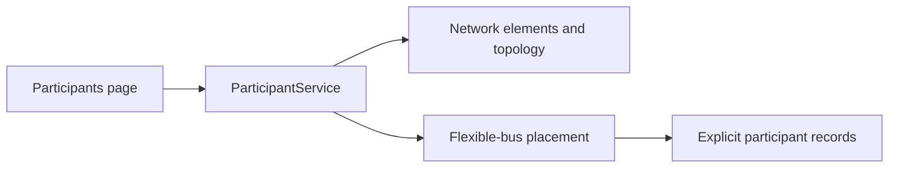

# 2. Participants and profiles

[Previous: experiment input](01-experiment.md) · [Master overview](README.md)

## Why this stage exists

An agent needs a physical connection and assets before its actions can have a
meaning in an energy market. A profile supplies time-varying demand or generation;
ownership says which participant those assets belong to.

## What goes in and comes out

Input: the selected network plus placement filters, a participant count and seed.
Output: explicit participant records containing an ID, bus, owned element IDs,
profile choice, scaling settings and battery settings.

For Alice, the record would identify her actual LV bus and the load/PV elements
she owns. Bob can own demand without owning PV. The IDs must come from the chosen
network; the names Alice and Bob alone do not create or move electrical assets.

Native profiles derive demand/generation from owned elements. Catalogue profiles
choose alternative shapes. Preview produces time-series data for inspection;
it does not create the full runtime. See the
[grid and profile design](../thesis/architecture/01-simbench-grid.md) for the
precise proposed replacement/background rules and units.

## Where it happens

| Function / module | Responsibility |
|---|---|
| [ParticipantService.suggest_mapping](../../src_thesis/platform/services/participant_service.py) | Requests elements/topology and delegates to the flexible-bus placement |
| [candidates / place](../../src_thesis/marlem/grid/placement.py) | Filters candidate buses and chooses a reproducible mapping |
| [ParticipantService.preview](../../src_thesis/platform/services/participant_service.py) | Builds participant series for the selected window |
| [ProfileService](../../src_thesis/platform/services/profile_service.py) | Exposes profile catalogue and series operations |
| [simbench_new.py](../../src_thesis/marlem/grid/simbench.py) | Loads networks, reads elements and constructs absolute profile series |
| [core/grid_contract.py](../../src_thesis/marlem/grid/contract.py) | Plain records/protocols exchanged across the adapter boundary |

The contract describes the data exchanged; it is not itself a power-flow engine.
The adapter contains the library-specific work.

## Who calls it

The [`participants` Studio page](../../src_thesis/platform/studio/pages/network.py)
calls `s.participants.suggest_mapping` through `run.io_bound`, so loading data does
not block the UI event loop. The service calls `adapter.elements`,
`adapter.topology_view` and `mapping.place`. Its preview operation similarly
supplies data for charts on the page.

## Current status

These placement and profile operations read real source data. The mapping is
configuration for the planned runtime integration. It must not be mistaken for
proof that the same profiles survive construction and reset in the existing
`LocalEnergyMarket`; the next two chapters explain that gap.

**Next:** [3. Constructing the runtime](03-runtime.md).
