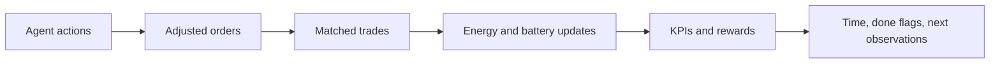

# 4. One market timestep

[Previous: runtime construction](03-runtime.md) · [Master overview](README.md)

## Why this stage exists

The environment translates agent decisions into a shared market outcome and the
next state. This is the main loop to understand before interpreting RL results:
the policy can only learn the incentives and transitions implemented here.

## What goes in and comes out

`LocalEnergyMarket.step(action_dict)` takes one action per agent. The current
action has four components: **bid price, bid quantity, buy/sell indicator,
preferred partner**. It is a market offer, not a direct battery-power command.

It returns five dictionaries: observations, rewards, terminated flags, truncated
flags and information. Agent IDs connect each agent to its own values; the done
dictionaries also contain `__all__`.

In our example Alice's offer is to sell and Bob's is to buy. A submitted quantity
is not necessarily the traded quantity. Matching may only partially fill an
order; later accounting operates on actual trades.

## Where it happens

Read [`LocalEnergyMarket.step`](../../src_thesis/marlem/environment/lem.py) in this order:

| Step in the current body | Work performed | Next source to inspect |
|---|---|---|
| Adjust actions | Each agent adjusts its action for battery state; action validity is checked | [DERAgent](../../src_thesis/marlem/agents/der.py), [ActionHandler](../../src_thesis/marlem/environment/action.py) |
| Construct orders | Bound price/quantity, interpret direction/partner and assign arrival time | [Order](../../src_thesis/marlem/core/orders.py) |
| Match | Pass orders, reputation scores and DSO balance to the matcher | [OrderMatcher.match_orders](../../src_thesis/marlem/market/matching.py) |
| Update agents | Sum bought/sold trade quantities; update energy tracking and batteries | [DERAgent.update_energy_tracking / update_battery_from_trades](../../src_thesis/marlem/agents/der.py) |
| Compute rewards | Obtain cooperation KPIs and calculate each agent's reward | [ImplicitCooperation](../../src_thesis/marlem/cooperation/implicit_cooperation.py), [RewardHandler](../../src_thesis/marlem/environment/reward.py) |
| Advance state | Increment time, update balances/reputations and determine done flags | [ReputationHandler](../../src_thesis/marlem/market/reputation.py) |
| Return feedback | Assemble information and updated observations | [ObservationHandler](../../src_thesis/marlem/environment/observation.py) |

This diagram follows the inspected function body. It does not add the proposed
post-settlement AC power flow: that belongs to the future SimBench integration.

## Who calls it

During training, RLlib's environment interaction calls the environment's `step`;
`GroupedLEM.step` delegates through the grouped environment when that wrapper is
selected. During standalone inference,
[`RLInference.inference`](../../src_thesis/marlem/marl/inference.py) constructs actions
and explicitly calls `self.env.step(actions)`.

## Current status

The loop exists, but its presence is not a correctness claim. Examples that
change how to interpret a run include the episode termination boundary (I-01),
in-place order mutation (I-12), and missing enforced household energy accounting
(I-22). Exact evidence and dispositions remain in the
[issue register](../thesis/validation/issues.md).

The planned physical loop should assess actual injections after settlement.
Current graph-related statistics should not be read as SimBench AC voltages or
line loadings. Read [the grid design](../thesis/architecture/01-simbench-grid.md)
for that intended extension.

**Next:** [5. Training and evaluation](05-learning.md). The trainer repeatedly
uses this environment interface; it does not replace the market's rules.
